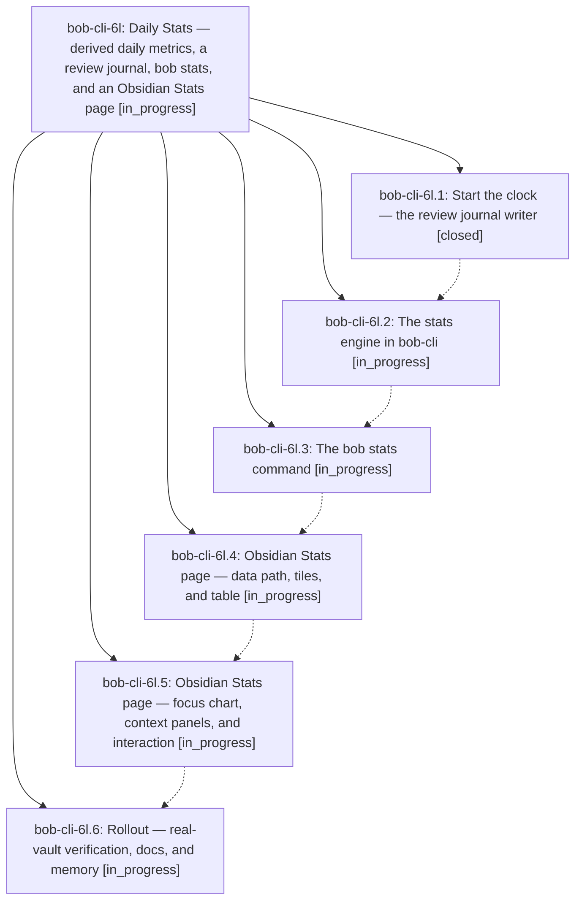

# Bead: bob-cli-6l — Daily Stats — derived daily metrics, a review journal, bob stats, and an Obsidian Stats page

[Bead Pages](../README.md) / bob-cli-6l

**Status:** ◐ in_progress · **Type:** ▸ plan · **Tier:** epic
**Owner:** `bryanbugyi34@gmail.com` · **Created by:** [bbugyi200.apollo.research.0u.linker.w0](https://github.com/bobs-org/bob-cli--agents/blob/main/agents/bbugyi200.apollo.research.0u.linker.w0/README.md) · **Assignee:** `bob-cli-6l.land`
**Created:** 2026-10-11 07:01:05 EDT
**Plan:** [202610/daily\_stats.md](https://github.com/bobs-org/bob-cli--plans/blob/main/202610/daily_stats.md)

## Description

Bryan can open Stats (Obsidian) or run `bob stats` (terminal) during the weekly prune, understand how the last weeks went in about a minute, trust where every number came from, and add a new daily metric with a few lines of config — with no daily logging habit and no data written that the vault already keeps.

## Phases

| Bead | Title | Status | Size | Created | Agents | Commits |
|---|---|---|---|---|---:|---:|
| [bob-cli-6l.1](bob-cli-6l.1.md) | Start the clock — the review journal writer | ✓ closed | medium | 2026-10-11 | 1 | 1 |
| [bob-cli-6l.2](bob-cli-6l.2.md) | The stats engine in bob-cli | ◐ in_progress | large | 2026-10-11 | 1 | 0 |
| [bob-cli-6l.3](bob-cli-6l.3.md) | The bob stats command | ◐ in_progress | medium | 2026-10-11 | 1 | 0 |
| [bob-cli-6l.4](bob-cli-6l.4.md) | Obsidian Stats page — data path, tiles, and table | ◐ in_progress | medium | 2026-10-11 | 1 | 0 |
| [bob-cli-6l.5](bob-cli-6l.5.md) | Obsidian Stats page — focus chart, context panels, and interaction | ◐ in_progress | large | 2026-10-11 | 1 | 0 |
| [bob-cli-6l.6](bob-cli-6l.6.md) | Rollout — real-vault verification, docs, and memory | ◐ in_progress | small | 2026-10-11 | 1 | 0 |

## Lineage

## Agents

| Agent | Bead | Commits |
|---|---|---:|
| [bbugyi200.apollo.bob-cli-6l.1](https://github.com/bobs-org/bob-cli--agents/blob/main/agents/bbugyi200.apollo.bob-cli-6l.1/README.md) | [bob-cli-6l.1](bob-cli-6l.1.md) | 1 |
| [bbugyi200.apollo.bob-cli-6l.2](https://github.com/bobs-org/bob-cli--agents/blob/main/agents/bbugyi200.apollo.bob-cli-6l.2/README.md) | [bob-cli-6l.2](bob-cli-6l.2.md) | 0 |
| [bbugyi200.apollo.bob-cli-6l.3](https://github.com/bobs-org/bob-cli--agents/blob/main/agents/bbugyi200.apollo.bob-cli-6l.3/README.md) | [bob-cli-6l.3](bob-cli-6l.3.md) | 0 |
| [bbugyi200.apollo.bob-cli-6l.4](https://github.com/bobs-org/bob-cli--agents/blob/main/agents/bbugyi200.apollo.bob-cli-6l.4/README.md) | [bob-cli-6l.4](bob-cli-6l.4.md) | 0 |
| [bbugyi200.apollo.bob-cli-6l.5](https://github.com/bobs-org/bob-cli--agents/blob/main/agents/bbugyi200.apollo.bob-cli-6l.5/README.md) | [bob-cli-6l.5](bob-cli-6l.5.md) | 0 |
| [bbugyi200.apollo.bob-cli-6l.6](https://github.com/bobs-org/bob-cli--agents/blob/main/agents/bbugyi200.apollo.bob-cli-6l.6/README.md) | [bob-cli-6l.6](bob-cli-6l.6.md) | 0 |
| [bbugyi200.apollo.bob-cli-6l.land](https://github.com/bobs-org/bob-cli--agents/blob/main/agents/bbugyi200.apollo.bob-cli-6l.land/README.md) | [bob-cli-6l](README.md) | 0 |

## Commits

| Repo | Commit | Subject | Bead | Committed |
|---|---|---|---|---|
| bob-cli | [`1023e6c`](https://github.com/bobs-org/bob-cli/commit/1023e6cb14cfbf68d8a1ef43cf288e855d6ab6f7) | feat(stats): add review answer journal contract | [bob-cli-6l.1](bob-cli-6l.1.md) | 2026-10-11 07:21:27 EDT |
