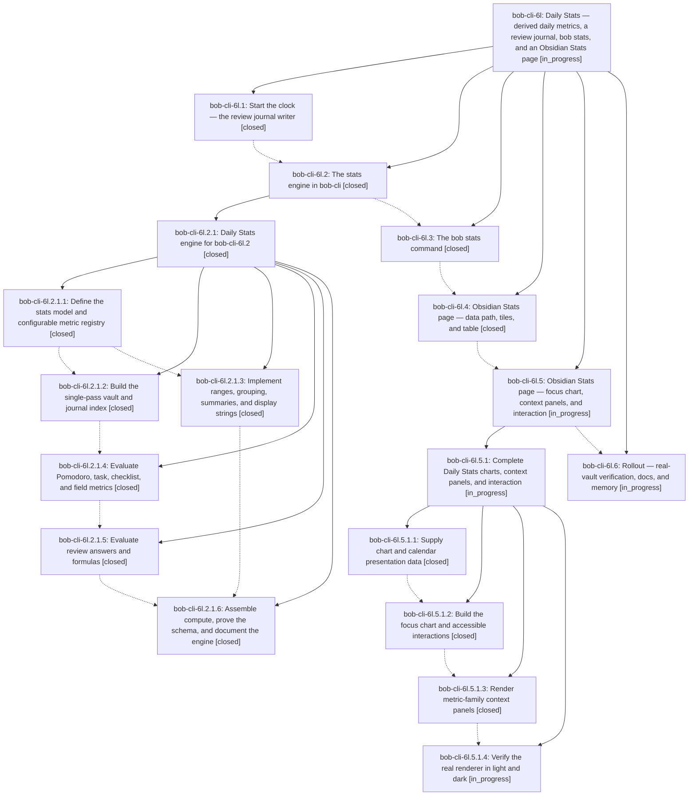

# Bead: bob-cli-6l — Daily Stats — derived daily metrics, a review journal, bob stats, and an Obsidian Stats page

[Bead Pages](../README.md) / bob-cli-6l

**Status:** ◐ in_progress · **Type:** ▸ plan · **Tier:** epic
**Owner:** `bryanbugyi34@gmail.com` · **Created by:** [bbugyi200.apollo.research.0u.linker.w0](https://github.com/bobs-org/bob-cli--agents/blob/main/agents/bbugyi200.apollo.research.0u.linker.w0/README.md) · **Assignee:** `bob-cli-6l.land`
**Created:** 2026-10-11 07:01:05 EDT
**Plan:** [202610/daily\_stats.md](https://github.com/bobs-org/bob-cli--plans/blob/main/202610/daily_stats.md)

<!-- sase:links:start -->

## Links

| Relation | Artifact | Why |
| --- | --- | --- |
| implemented-by | [plan:202610/daily_stats.md][1] | derived from the plan's `bead_id:` frontmatter field |

_Plus 2 automatic references — see [Referenced By](#referenced-by)._

[1]: https://github.com/bobs-org/bob-cli--plans/blob/main/202610/daily_stats.md

<!-- sase:links:end -->

## Description

Bryan can open Stats (Obsidian) or run `bob stats` (terminal) during the weekly prune, understand how the last weeks went in about a minute, trust where every number came from, and add a new daily metric with a few lines of config — with no daily logging habit and no data written that the vault already keeps.

## Notes

[2026-10-11T15:27:10Z · bob-cli-6l.2.1.land] DISCOVERED ISSUE (from bob-cli-6l.2.1 landing review): docs/stats.md records ~2.4 s for stats compute on the live vault, but that came from a debug test build. Release-mode re-measurement by the bob-cli-6l.2.1 land agent (BOB_STATS_REAL_VAULT_PARITY=1 BOB_NOW='2026-10-11 12:00:00' cargo test --release --lib real_vault_parity_is_opt_in, master f9324da, apollo, ~/bob) gives 365-378 ms for the full read plus a 7-day five-metric report — still ~25% over the <=300 ms rollout target. The bob-cli-6l.2.1 remediation tale corrects the doc number; meeting or re-budgeting the target remains rollout (bob-cli-6l.6) / CLI (bob-cli-6l.3) acceptance as the engine plan assigned.

## Phases

| Bead | Title | Status | Size | Created | Agents | Commits |
|---|---|---|---|---|---:|---:|
| [bob-cli-6l.1](bob-cli-6l.1.md) | Start the clock — the review journal writer | ✓ closed | medium | 2026-10-11 | 1 | 2 |
| [bob-cli-6l.2](bob-cli-6l.2.md) | The stats engine in bob-cli | ✓ closed | large | 2026-10-11 | 1 | 0 |
| [bob-cli-6l.3](bob-cli-6l.3.md) | The bob stats command | ✓ closed | medium | 2026-10-11 | 1 | 1 |
| [bob-cli-6l.4](bob-cli-6l.4.md) | Obsidian Stats page — data path, tiles, and table | ✓ closed | medium | 2026-10-11 | 1 | 2 |
| [bob-cli-6l.5](bob-cli-6l.5.md) | Obsidian Stats page — focus chart, context panels, and interaction | ◐ in_progress | large | 2026-10-11 | 1 | 0 |
| [bob-cli-6l.6](bob-cli-6l.6.md) | Rollout — real-vault verification, docs, and memory | ◐ in_progress | small | 2026-10-11 | 1 | 0 |

## Lineage

## Agents

| Agent | Bead | Commits |
|---|---|---:|
| [bbugyi200.apollo.bob-cli-6l.1](https://github.com/bobs-org/bob-cli--agents/blob/main/agents/bbugyi200.apollo.bob-cli-6l.1/README.md) | [bob-cli-6l.1](bob-cli-6l.1.md) | 2 |
| [bbugyi200.apollo.bob-cli-6l.2](https://github.com/bobs-org/bob-cli--agents/blob/main/sessions/bbugyi200.apollo.bob-cli-6l.2.md) | [bob-cli-6l.2](bob-cli-6l.2.md) | 0 |
| [bbugyi200.apollo.bob-cli-6l.2.1.1](https://github.com/bobs-org/bob-cli--agents/blob/main/agents/bbugyi200.apollo.bob-cli-6l.2.1.1/README.md) | [bob-cli-6l.2.1.1](bob-cli-6l.2.1.1.md) | 1 |
| [bbugyi200.apollo.bob-cli-6l.2.1.2](https://github.com/bobs-org/bob-cli--agents/blob/main/sessions/bbugyi200.apollo.bob-cli-6l.2.1.2.md) | [bob-cli-6l.2.1.2](bob-cli-6l.2.1.2.md) | 1 |
| [bbugyi200.apollo.bob-cli-6l.2.1.3](https://github.com/bobs-org/bob-cli--agents/blob/main/agents/bbugyi200.apollo.bob-cli-6l.2.1.3/README.md) | [bob-cli-6l.2.1.3](bob-cli-6l.2.1.3.md) | 1 |
| [bbugyi200.apollo.bob-cli-6l.2.1.4](https://github.com/bobs-org/bob-cli--agents/blob/main/sessions/bbugyi200.apollo.bob-cli-6l.2.1.4.md) | [bob-cli-6l.2.1.4](bob-cli-6l.2.1.4.md) | 1 |
| [bbugyi200.apollo.bob-cli-6l.2.1.5](https://github.com/bobs-org/bob-cli--agents/blob/main/agents/bbugyi200.apollo.bob-cli-6l.2.1.5/README.md) | [bob-cli-6l.2.1.5](bob-cli-6l.2.1.5.md) | 1 |
| [bbugyi200.apollo.bob-cli-6l.2.1.6](https://github.com/bobs-org/bob-cli--agents/blob/main/agents/bbugyi200.apollo.bob-cli-6l.2.1.6/README.md) | [bob-cli-6l.2.1.6](bob-cli-6l.2.1.6.md) | 1 |
| [bbugyi200.apollo.bob-cli-6l.2.1.land](https://github.com/bobs-org/bob-cli--agents/blob/main/sessions/bbugyi200.apollo.bob-cli-6l.2.1.land.md) | [bob-cli-6l.2.1](bob-cli-6l.2.1.md) | 2 |
| [bbugyi200.apollo.bob-cli-6l.3](https://github.com/bobs-org/bob-cli--agents/blob/main/agents/bbugyi200.apollo.bob-cli-6l.3/README.md) | [bob-cli-6l.3](bob-cli-6l.3.md) | 1 |
| [bbugyi200.apollo.bob-cli-6l.4](https://github.com/bobs-org/bob-cli--agents/blob/main/agents/bbugyi200.apollo.bob-cli-6l.4/README.md) | [bob-cli-6l.4](bob-cli-6l.4.md) | 2 |
| [bbugyi200.apollo.bob-cli-6l.5](https://github.com/bobs-org/bob-cli--agents/blob/main/sessions/bbugyi200.apollo.bob-cli-6l.5.md) | [bob-cli-6l.5](bob-cli-6l.5.md) | 0 |
| [bbugyi200.apollo.bob-cli-6l.5.1.1](https://github.com/bobs-org/bob-cli--agents/blob/main/agents/bbugyi200.apollo.bob-cli-6l.5.1.1/README.md) | [bob-cli-6l.5.1.1](bob-cli-6l.5.1.1.md) | 1 |
| [bbugyi200.apollo.bob-cli-6l.5.1.2](https://github.com/bobs-org/bob-cli--agents/blob/main/agents/bbugyi200.apollo.bob-cli-6l.5.1.2/README.md) | [bob-cli-6l.5.1.2](bob-cli-6l.5.1.2.md) | 1 |
| [bbugyi200.apollo.bob-cli-6l.5.1.3](https://github.com/bobs-org/bob-cli--agents/blob/main/agents/bbugyi200.apollo.bob-cli-6l.5.1.3/README.md) | [bob-cli-6l.5.1.3](bob-cli-6l.5.1.3.md) | 1 |
| [bbugyi200.apollo.bob-cli-6l.5.1.4](https://github.com/bobs-org/bob-cli--agents/blob/main/agents/bbugyi200.apollo.bob-cli-6l.5.1.4/README.md) | [bob-cli-6l.5.1.4](bob-cli-6l.5.1.4.md) | 0 |
| [bbugyi200.apollo.bob-cli-6l.5.1.land](https://github.com/bobs-org/bob-cli--agents/blob/main/agents/bbugyi200.apollo.bob-cli-6l.5.1.land/README.md) | [bob-cli-6l.5.1](bob-cli-6l.5.1.md) | 0 |
| [bbugyi200.apollo.bob-cli-6l.6](https://github.com/bobs-org/bob-cli--agents/blob/main/agents/bbugyi200.apollo.bob-cli-6l.6/README.md) | [bob-cli-6l.6](bob-cli-6l.6.md) | 0 |
| [bbugyi200.apollo.bob-cli-6l.land](https://github.com/bobs-org/bob-cli--agents/blob/main/agents/bbugyi200.apollo.bob-cli-6l.land/README.md) | [bob-cli-6l](README.md) | 0 |

## Commits

| Repo | Commit | Subject | Bead | Committed |
|---|---|---|---|---|
| bob-cli | [`1023e6c`](https://github.com/bobs-org/bob-cli/commit/1023e6cb14cfbf68d8a1ef43cf288e855d6ab6f7) | feat(stats): add review answer journal contract | [bob-cli-6l.1](bob-cli-6l.1.md) | 2026-10-11 07:21:27 EDT |
| bob-plugins | [`bob-plugins@f4a2fe3`](https://github.com/bobs-org/bob-plugins/commit/f4a2fe345748b71b37b3b955f999671f8ea2d288) | feat(stats): journal review answers per host | [bob-cli-6l.1](bob-cli-6l.1.md) | 2026-10-11 07:22:37 EDT |
| bob-cli | [`d513f01`](https://github.com/bobs-org/bob-cli/commit/d513f013bb713434f631f488c00bd531487b1a36) | feat(stats): define engine types, isolated config, and metric registry | [bob-cli-6l.2.1.1](bob-cli-6l.2.1.1.md) | 2026-10-11 08:29:03 EDT |
| bob-cli | [`e27fe70`](https://github.com/bobs-org/bob-cli/commit/e27fe7020e80c1856899cc757f4b0c1e0675076d) | feat(stats): build single-pass vault and journal index | [bob-cli-6l.2.1.2](bob-cli-6l.2.1.2.md) | 2026-10-11 08:58:30 EDT |
| bob-cli | [`7f14f5f`](https://github.com/bobs-org/bob-cli/commit/7f14f5fd47d80227adc7c376d1523e2933e881af) | feat(stats): implement range and series reporting | [bob-cli-6l.2.1.3](bob-cli-6l.2.1.3.md) | 2026-10-11 09:08:21 EDT |
| bob-cli | [`346d4bf`](https://github.com/bobs-org/bob-cli/commit/346d4bf3fe438bccb75c1953be9ac544e06d4d18) | feat(stats): evaluate vault-derived metrics | [bob-cli-6l.2.1.4](bob-cli-6l.2.1.4.md) | 2026-10-11 09:28:02 EDT |
| bob-cli | [`0d014c0`](https://github.com/bobs-org/bob-cli/commit/0d014c0299c25a5f13ca2947a155f0af8562e1c7) | feat(stats): evaluate review answers and checked formulas | [bob-cli-6l.2.1.5](bob-cli-6l.2.1.5.md) | 2026-10-11 09:48:07 EDT |
| bob-cli | [`f9324da`](https://github.com/bobs-org/bob-cli/commit/f9324da87f989be6388c4db3650f9bfc15c6f48e) | feat(stats): assemble compute, prove the schema, and document the engine | [bob-cli-6l.2.1.6](bob-cli-6l.2.1.6.md) | 2026-10-11 11:03:23 EDT |
| bob-cli | [`625e973`](https://github.com/bobs-org/bob-cli/commit/625e973c43de2bd51b33f562af6e3cc50c90b6db) | fix(stats): land Daily Stats engine correctness for bob-cli-6l.2.1 | [bob-cli-6l.2.1](bob-cli-6l.2.1.md) | 2026-10-11 12:52:17 EDT |
| bob-cli--plans | [`bob-cli--plans@6a0a600`](https://github.com/bobs-org/bob-cli--plans/commit/6a0a6005a454b53689f8de1d64aace8f858cf968) | docs(plans): mark Daily Stats engine epic and landing-fixes done | [bob-cli-6l.2.1](bob-cli-6l.2.1.md) | 2026-10-11 12:53:31 EDT |
| bob-cli | [`9be32d9`](https://github.com/bobs-org/bob-cli/commit/9be32d97e56a552d0ef1dc19f3b8eff94ce43638) | feat(stats): add the bob stats CLI (overview, show, metrics) | [bob-cli-6l.3](bob-cli-6l.3.md) | 2026-10-11 13:48:19 EDT |
| bob-cli | [`f74f3ad`](https://github.com/bobs-org/bob-cli/commit/f74f3ad305e5ecee85eef35312af918d60c6070b) | feat(stats): document the Stats child page and Browse chip | [bob-cli-6l.4](bob-cli-6l.4.md) | 2026-10-11 14:05:58 EDT |
| bob-plugins | [`bob-plugins@db91d68`](https://github.com/bobs-org/bob-plugins/commit/db91d68a8d003689835001695d7c816303f8bcb6) | feat(stats): add the Stats page data path, tiles, and table block | [bob-cli-6l.4](bob-cli-6l.4.md) | 2026-10-11 14:07:01 EDT |
| bob-cli | [`ab314c0`](https://github.com/bobs-org/bob-cli/commit/ab314c061da8da06ed1d821c2afa03979c30cb4c) | feat(stats): add schema-1 chart, daily\_points, checklist, and chore metadata | [bob-cli-6l.5.1.1](bob-cli-6l.5.1.1.md) | 2026-10-11 14:45:40 EDT |
| bob-plugins | [`bob-plugins@f3bc5e2`](https://github.com/bobs-org/bob-plugins/commit/f3bc5e27fc9699ebef58cb044525abbbea0fe4eb) | feat(bob-ledger-tools): add accessible stats charts | [bob-cli-6l.5.1.2](bob-cli-6l.5.1.2.md) | 2026-10-11 15:08:27 EDT |
| bob-plugins | [`bob-plugins@2e7f3b0`](https://github.com/bobs-org/bob-plugins/commit/2e7f3b0ff365ad5696dc4ee0d61cfd11b84c8a8b) | feat(bob-ledger-tools): render Stats metric-family context panels | [bob-cli-6l.5.1.3](bob-cli-6l.5.1.3.md) | 2026-10-11 15:23:57 EDT |

<!-- sase:referenced-by:start -->

## Referenced By

| Relation | Artifact | Why | Uses |
| --- | --- | --- | ---: |
| read-by | [agent:bob-cli-6l.3][1] | Need parent epic plan and remaining phases | 1 |
| read-by | [agent:bob-cli-6l.4][2] | Need epic scope for phase 6l.4 | 1 |

[1]: https://github.com/bobs-org/bob-cli--agents/blob/main/agents/bbugyi200.apollo.bob-cli-6l.3/README.md
[2]: https://github.com/bobs-org/bob-cli--agents/blob/main/agents/bbugyi200.apollo.bob-cli-6l.4/README.md

<!-- sase:referenced-by:end -->
