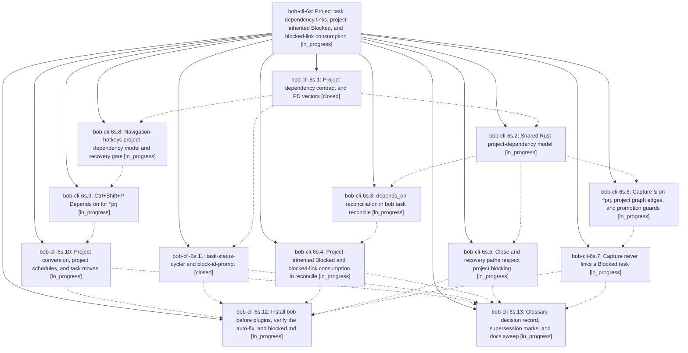

# Bead: bob-cli-6s — Project task dependency links, project-inherited Blocked, and blocked-link consumption

[Bead Pages](../README.md) / bob-cli-6s

**Status:** ◐ in_progress · **Type:** ▸ plan · **Tier:** epic
**Owner:** `bryanbugyi34@gmail.com` · **Created by:** [bbugyi200.apollo.research.0z.linker.w0](https://github.com/bobs-org/bob-cli--agents/blob/main/sessions/bbugyi200.apollo.research.0z.linker.w0.md) · **Assignee:** `bob-cli-6s.land`
**Created:** 2026-10-12 08:34:40 EDT
**Plan:** [202610/prj\_task\_dep\_links.md](https://github.com/bobs-org/bob-cli--plans/blob/main/202610/prj_task_dep_links.md)

<!-- sase:links:start -->

## Links

| Relation | Artifact | Why |
| --- | --- | --- |
| implemented-by | [plan:202610/prj_task_dep_links.md][1] | derived from the plan's `bead_id:` frontmatter field |

_Plus 1 automatic references — see [Referenced By](#referenced-by)._

[1]: https://github.com/bobs-org/bob-cli--plans/blob/main/202610/prj_task_dep_links.md

<!-- sase:links:end -->

## Description

A project's (`^prj`) dependency links live in its note's `depends_on` frontmatter list. While a project has an open prerequisite or a future `scheduled` date, `^prj` and every open task in its note are Blocked `[?]`. No Blocked task keeps a Task Link under today's open Pomodoros: links are consumed (prerequisites promoted, link removed, emptied Pomodoro deleted). `bob task reconcile` auto-fixes existing notes such as `job_apply_to_databricks.md`, and the Ctrl+Shift+P and `create-project-note-from-task` keymaps write the new model.

## Phases

| Bead | Title | Status | Size | Created | Agents | Commits |
|---|---|---|---|---|---:|---:|
| [bob-cli-6s.1](bob-cli-6s.1.md) | Project-dependency contract and PD vectors | ✓ closed | medium | 2026-10-12 | 1 | 1 |
| [bob-cli-6s.10](bob-cli-6s.10.md) | Project conversion, project schedules, and task moves | ◐ in_progress | medium | 2026-10-12 | 1 | 0 |
| [bob-cli-6s.11](bob-cli-6s.11.md) | task-status-cycler and block-id-prompt | ✓ closed | medium | 2026-10-12 | 1 | 1 |
| [bob-cli-6s.12](bob-cli-6s.12.md) | Install bob before plugins, verify the auto-fix, and blocked.md | ◐ in_progress | small | 2026-10-12 | 1 | 0 |
| [bob-cli-6s.13](bob-cli-6s.13.md) | Glossary, decision record, supersession marks, and docs sweep | ◐ in_progress | small | 2026-10-12 | 1 | 0 |
| [bob-cli-6s.2](bob-cli-6s.2.md) | Shared Rust project-dependency model | ◐ in_progress | medium | 2026-10-12 | 1 | 0 |
| [bob-cli-6s.3](bob-cli-6s.3.md) | depends\_on reconciliation in bob task reconcile | ◐ in_progress | medium | 2026-10-12 | 1 | 0 |
| [bob-cli-6s.4](bob-cli-6s.4.md) | Project-inherited Blocked and blocked-link consumption in reconcile | ◐ in_progress | medium | 2026-10-12 | 1 | 0 |
| [bob-cli-6s.5](bob-cli-6s.5.md) | Close and recovery paths respect project blocking | ◐ in_progress | small | 2026-10-12 | 1 | 0 |
| [bob-cli-6s.6](bob-cli-6s.6.md) | Capture & on ^prj, project graph edges, and promotion guards | ◐ in_progress | medium | 2026-10-12 | 1 | 0 |
| [bob-cli-6s.7](bob-cli-6s.7.md) | Capture never links a Blocked task | ◐ in_progress | medium | 2026-10-12 | 1 | 0 |
| [bob-cli-6s.8](bob-cli-6s.8.md) | Navigation-hotkeys project-dependency model and recovery gate | ◐ in_progress | medium | 2026-10-12 | 1 | 0 |
| [bob-cli-6s.9](bob-cli-6s.9.md) | Ctrl+Shift+P Depends on for ^prj | ◐ in_progress | medium | 2026-10-12 | 1 | 0 |

## Lineage

## Agents

| Agent | Bead | Commits |
|---|---|---:|
| [bbugyi200.apollo.bob-cli-6s.1](https://github.com/bobs-org/bob-cli--agents/blob/main/agents/bbugyi200.apollo.bob-cli-6s.1/README.md) | [bob-cli-6s.1](bob-cli-6s.1.md) | 1 |
| [bbugyi200.apollo.bob-cli-6s.10](https://github.com/bobs-org/bob-cli--agents/blob/main/agents/bbugyi200.apollo.bob-cli-6s.10/README.md) | [bob-cli-6s.10](bob-cli-6s.10.md) | 0 |
| [bbugyi200.apollo.bob-cli-6s.11](https://github.com/bobs-org/bob-cli--agents/blob/main/agents/bbugyi200.apollo.bob-cli-6s.11/README.md) | [bob-cli-6s.11](bob-cli-6s.11.md) | 1 |
| [bbugyi200.apollo.bob-cli-6s.12](https://github.com/bobs-org/bob-cli--agents/blob/main/agents/bbugyi200.apollo.bob-cli-6s.12/README.md) | [bob-cli-6s.12](bob-cli-6s.12.md) | 0 |
| [bbugyi200.apollo.bob-cli-6s.13](https://github.com/bobs-org/bob-cli--agents/blob/main/agents/bbugyi200.apollo.bob-cli-6s.13/README.md) | [bob-cli-6s.13](bob-cli-6s.13.md) | 0 |
| [bbugyi200.apollo.bob-cli-6s.2](https://github.com/bobs-org/bob-cli--agents/blob/main/agents/bbugyi200.apollo.bob-cli-6s.2/README.md) | [bob-cli-6s.2](bob-cli-6s.2.md) | 0 |
| [bbugyi200.apollo.bob-cli-6s.3](https://github.com/bobs-org/bob-cli--agents/blob/main/agents/bbugyi200.apollo.bob-cli-6s.3/README.md) | [bob-cli-6s.3](bob-cli-6s.3.md) | 0 |
| [bbugyi200.apollo.bob-cli-6s.4](https://github.com/bobs-org/bob-cli--agents/blob/main/agents/bbugyi200.apollo.bob-cli-6s.4/README.md) | [bob-cli-6s.4](bob-cli-6s.4.md) | 0 |
| [bbugyi200.apollo.bob-cli-6s.5](https://github.com/bobs-org/bob-cli--agents/blob/main/agents/bbugyi200.apollo.bob-cli-6s.5/README.md) | [bob-cli-6s.5](bob-cli-6s.5.md) | 0 |
| [bbugyi200.apollo.bob-cli-6s.6](https://github.com/bobs-org/bob-cli--agents/blob/main/agents/bbugyi200.apollo.bob-cli-6s.6/README.md) | [bob-cli-6s.6](bob-cli-6s.6.md) | 0 |
| [bbugyi200.apollo.bob-cli-6s.7](https://github.com/bobs-org/bob-cli--agents/blob/main/agents/bbugyi200.apollo.bob-cli-6s.7/README.md) | [bob-cli-6s.7](bob-cli-6s.7.md) | 0 |
| [bbugyi200.apollo.bob-cli-6s.8](https://github.com/bobs-org/bob-cli--agents/blob/main/agents/bbugyi200.apollo.bob-cli-6s.8/README.md) | [bob-cli-6s.8](bob-cli-6s.8.md) | 0 |
| [bbugyi200.apollo.bob-cli-6s.9](https://github.com/bobs-org/bob-cli--agents/blob/main/agents/bbugyi200.apollo.bob-cli-6s.9/README.md) | [bob-cli-6s.9](bob-cli-6s.9.md) | 0 |
| [bbugyi200.apollo.bob-cli-6s.land](https://github.com/bobs-org/bob-cli--agents/blob/main/agents/bbugyi200.apollo.bob-cli-6s.land/README.md) | [bob-cli-6s](README.md) | 0 |

## Commits

| Repo | Commit | Subject | Bead | Committed |
|---|---|---|---|---|
| bob-cli | [`75e323b`](https://github.com/bobs-org/bob-cli/commit/75e323b2d6c59899a0b739b8079e2087fbfbb90e) | docs(task-deps): add §13 project-dependency contract and PD vectors | [bob-cli-6s.1](bob-cli-6s.1.md) | 2026-10-12 08:54:38 EDT |
| bob-plugins | [`bob-plugins@3208e8c`](https://github.com/bobs-org/bob-plugins/commit/3208e8c44ac1a56f4c113b0230371f3cd6ca8a73) | feat(plugins): honor project blockers across task gestures | [bob-cli-6s.11](bob-cli-6s.11.md) | 2026-10-12 09:15:12 EDT |

<!-- sase:referenced-by:start -->

## Referenced By

| Relation | Artifact | Why | Uses |
| --- | --- | --- | ---: |
| read-by | [agent:6x][1] | Check whether project dependency blocking adds a new unblock path relevant to freshness review guarantee | 1 |

[1]: https://github.com/bobs-org/bob-cli--agents/blob/main/agents/bbugyi200.apollo.6x/README.md

<!-- sase:referenced-by:end -->
