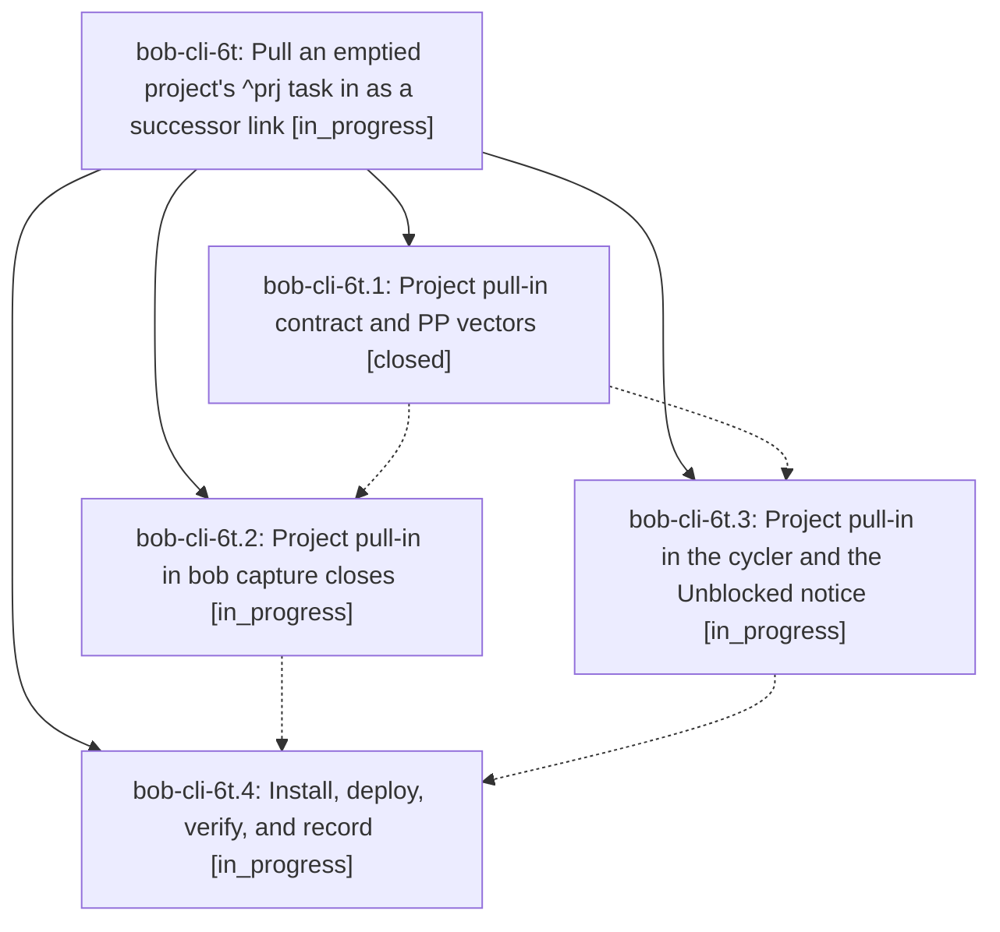

# Bead: bob-cli-6t — Pull an emptied project's ^prj task in as a successor link

[Bead Pages](../README.md) / bob-cli-6t

**Status:** ◐ in_progress · **Type:** ▸ plan · **Tier:** epic
**Owner:** `bryanbugyi34@gmail.com` · **Created by:** [bbugyi200.apollo.6z](https://github.com/bobs-org/bob-cli--agents/blob/main/sessions/bbugyi200.apollo.6z.md) · **Assignee:** `bob-cli-6t.land`
**Created:** 2026-10-12 10:07:29 EDT
**Plan:** [202610/project\_task\_pull\_in.md](https://github.com/bobs-org/bob-cli--plans/blob/main/202610/project_task_pull_in.md)

## Description

When a close gesture completes the last open task in a project note through its Task Link, the project's ^prj task is linked right after that link, becomes Next [*], and loses #hide in the same write, in both bob capture and Obsidian, so Bryan immediately sees that the project needs a decision: close it, or add its next task.

## Phases

| Bead | Title | Status | Size | Created | Agents | Commits |
|---|---|---|---|---|---:|---:|
| [bob-cli-6t.1](bob-cli-6t.1.md) | Project pull-in contract and PP vectors | ✓ closed | small | 2026-10-12 | 1 | 1 |
| [bob-cli-6t.2](bob-cli-6t.2.md) | Project pull-in in bob capture closes | ◐ in_progress | medium | 2026-10-12 | 1 | 0 |
| [bob-cli-6t.3](bob-cli-6t.3.md) | Project pull-in in the cycler and the Unblocked notice | ◐ in_progress | medium | 2026-10-12 | 1 | 0 |
| [bob-cli-6t.4](bob-cli-6t.4.md) | Install, deploy, verify, and record | ◐ in_progress | small | 2026-10-12 | 1 | 0 |

## Lineage

## Agents

| Agent | Bead | Commits |
|---|---|---:|
| [bbugyi200.apollo.bob-cli-6t.1](https://github.com/bobs-org/bob-cli--agents/blob/main/agents/bbugyi200.apollo.bob-cli-6t.1/README.md) | [bob-cli-6t.1](bob-cli-6t.1.md) | 1 |
| [bbugyi200.apollo.bob-cli-6t.2](https://github.com/bobs-org/bob-cli--agents/blob/main/agents/bbugyi200.apollo.bob-cli-6t.2/README.md) | [bob-cli-6t.2](bob-cli-6t.2.md) | 0 |
| [bbugyi200.apollo.bob-cli-6t.3](https://github.com/bobs-org/bob-cli--agents/blob/main/agents/bbugyi200.apollo.bob-cli-6t.3/README.md) | [bob-cli-6t.3](bob-cli-6t.3.md) | 0 |
| [bbugyi200.apollo.bob-cli-6t.4](https://github.com/bobs-org/bob-cli--agents/blob/main/agents/bbugyi200.apollo.bob-cli-6t.4/README.md) | [bob-cli-6t.4](bob-cli-6t.4.md) | 0 |
| [bbugyi200.apollo.bob-cli-6t.land](https://github.com/bobs-org/bob-cli--agents/blob/main/agents/bbugyi200.apollo.bob-cli-6t.land/README.md) | [bob-cli-6t](README.md) | 0 |

## Commits

| Repo | Commit | Subject | Bead | Committed |
|---|---|---|---|---|
| bob-cli | [`ec7251e`](https://github.com/bobs-org/bob-cli/commit/ec7251eb91b478f761e9de0bb394b8f3393ecba3) | docs(task-dependencies): add project pull-in contract and PP vectors | [bob-cli-6t.1](bob-cli-6t.1.md) | 2026-10-12 10:24:44 EDT |
