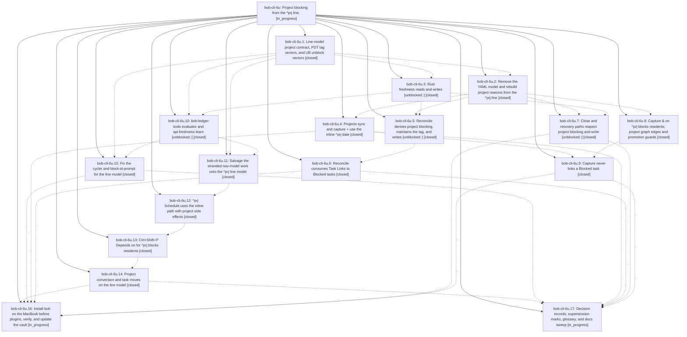

# Bead: bob-cli-6u — Project blocking from the ^prj line,

[Bead Pages](../README.md) / bob-cli-6u

**Status:** ◐ in_progress · **Type:** ▸ plan · **Tier:** epic
**Owner:** `bryanbugyi34@gmail.com` · **Created by:** [bbugyi200.apollo.70](https://github.com/bobs-org/bob-cli--agents/blob/main/sessions/bbugyi200.apollo.70.md) · **Assignee:** `bob-cli-6u.land`
**Created:** 2026-10-12 10:25:43 EDT
**Plan:** [202610/prj\_line\_project\_blocking.md](https://github.com/bobs-org/bob-cli--plans/blob/main/202610/prj_line_project_blocking.md)

<!-- sase:links:start -->

## Links

| Relation | Artifact | Why |
| --- | --- | --- |
| implemented-by | [plan:202610/prj_line_project_blocking.md][1] | derived from the plan's `bead_id:` frontmatter field |

_Plus 5 automatic references — see [Referenced By](#referenced-by)._

[1]: https://github.com/bobs-org/bob-cli--plans/blob/main/202610/prj_line_project_blocking.md

<!-- sase:links:end -->

## Description

A project's prerequisites live on its `^prj` task's ordinary Depends-On line and its date as an inline `[scheduled::]` on `^prj`; no project frontmatter `depends_on` or `scheduled` remains. While `^prj` has its own reason to be Blocked, every open task in its note is Blocked `[?]` and tagged `#prj_is_blocked`, and no Blocked task keeps a Task Link under today's open Pomodoros. Every automatic Blocked → Ready recovery writes `[unblocked:: D]`, so the task is a TICKLER in the next morning review. The YAML-storage code, docs, and deployed bundle left behind by the canceled epic bob-cli-6s are removed or salvaged.

## Notes

[2026-10-12T14:46:04Z · 72] COORDINATION — concurrent epic bob-cli-6t (project pull-in, plan:202610/project_task_pull_in.md) was planned against canceled 6s and is running now (6t.2 and 6t.3 started 10:28 EDT). Impact on this epic:
1. ec7251e (6t.1, landed) added docs/task-dependencies.md §12.10 "Project pull-in" and §12.11 PP1–PP24. It also added a §13.4 sentence: ADJ-11 governs dependency promotion, and the §12.10 close-gesture pull-in is the one path that makes ^prj Next. Pointers went into docs/projects.md, plan.md, capture.md and README. 6t.1's "keep this through the sweep" note went to canceled 6s.13, so this plan never lists it. Keep §12.10, and port its YAML-model wording (Rule step 3, PP7, PP8, the Gate, Trigger (b), PP17) to the line model.
2. 6t.2 is adding drain_state/DrainState in projects/scan.rs, mod.rs and edits.rs (and making normalize_task_hide_tag pub(crate)). It will add task_complete/project_pull_in.rs and edit successors.rs, capture/output.rs, task_complete.rs and pomodoro_close.rs. It takes step 3 from the 6s.2 YAML model. If it lands before 6u.2/6u.4/6u.7, carry its callers over to the line model; do not revert them, and do not restore scan.rs wholesale from 54a54bf^.
3. 6t.3 is adding task-status-cycler 088 (and a planned 137 mixin), and editing 085, 136, nav 285 and the nav manifest. That overlaps 6u.15 and 6u.11.
4. 6t.4 would reach the MacBook early because 6s.12 reads closed. A note on 6t.4 redirects it to 6u.16.
I asked 6t.2/6t.3 not to land against the YAML model. Bryan decides whether to stop or re-sequence 6t. See research:202610/bob_cli_6t_6u_epic_conflict.md.

## Phases

| Bead | Title | Status | Size | Created | Agents | Commits |
|---|---|---|---|---|---:|---:|
| [bob-cli-6u.1](bob-cli-6u.1.md) | Line-model project contract, PDT tag vectors, and UB unblock vectors | ✓ closed | medium | 2026-10-12 | 1 | 1 |
| [bob-cli-6u.10](bob-cli-6u.10.md) | bob-ledger-tools evaluator and api.freshness learn \[unblocked::\] | ✓ closed | medium | 2026-10-12 | 1 | 0 |
| [bob-cli-6u.11](bob-cli-6u.11.md) | Salvage the stranded nav-model work onto the ^prj line model | ✓ closed | medium | 2026-10-12 | 1 | 0 |
| [bob-cli-6u.12](bob-cli-6u.12.md) | ^prj Schedule uses the inline path with project side effects | ✓ closed | medium | 2026-10-12 | 1 | 1 |
| [bob-cli-6u.13](bob-cli-6u.13.md) | Ctrl+Shift+P Depends on for ^prj blocks residents | ✓ closed | medium | 2026-10-12 | 1 | 1 |
| [bob-cli-6u.14](bob-cli-6u.14.md) | Project conversion and task moves on the line model | ✓ closed | medium | 2026-10-12 | 1 | 1 |
| [bob-cli-6u.15](bob-cli-6u.15.md) | Fix the cycler and block-id-prompt for the line model | ✓ closed | medium | 2026-10-12 | 1 | 0 |
| [bob-cli-6u.16](bob-cli-6u.16.md) | Install bob on the MacBook before plugins, verify, and update the vault | ◐ in_progress | small | 2026-10-12 | 1 | 0 |
| [bob-cli-6u.17](bob-cli-6u.17.md) | Decision records, supersession marks, glossary, and docs sweep | ◐ in_progress | small | 2026-10-12 | 1 | 0 |
| [bob-cli-6u.2](bob-cli-6u.2.md) | Remove the YAML model and rebuild project reasons from the ^prj line | ✓ closed | medium | 2026-10-12 | 1 | 1 |
| [bob-cli-6u.3](bob-cli-6u.3.md) | Rust freshness reads and writes \[unblocked::\] | ✓ closed | medium | 2026-10-12 | 1 | 1 |
| [bob-cli-6u.4](bob-cli-6u.4.md) | Projects sync and capture + use the inline ^prj date | ✓ closed | medium | 2026-10-12 | 1 | 1 |
| [bob-cli-6u.5](bob-cli-6u.5.md) | Reconcile derives project blocking, maintains the tag, and writes \[unblocked::\] | ✓ closed | medium | 2026-10-12 | 1 | 1 |
| [bob-cli-6u.6](bob-cli-6u.6.md) | Reconcile consumes Task Links to Blocked tasks | ✓ closed | medium | 2026-10-12 | 1 | 1 |
| [bob-cli-6u.7](bob-cli-6u.7.md) | Close and recovery paths respect project blocking and write \[unblocked::\] | ✓ closed | medium | 2026-10-12 | 1 | 1 |
| [bob-cli-6u.8](bob-cli-6u.8.md) | Capture & on ^prj blocks residents; project graph edges and promotion guards | ✓ closed | medium | 2026-10-12 | 1 | 1 |
| [bob-cli-6u.9](bob-cli-6u.9.md) | Capture never links a Blocked task | ✓ closed | medium | 2026-10-12 | 1 | 1 |

## Lineage

## Agents

| Agent | Bead | Commits |
|---|---|---:|
| [bbugyi200.apollo.bob-cli-6u.1](https://github.com/bobs-org/bob-cli--agents/blob/main/agents/bbugyi200.apollo.bob-cli-6u.1/README.md) | [bob-cli-6u.1](bob-cli-6u.1.md) | 1 |
| [bbugyi200.apollo.bob-cli-6u.10](https://github.com/bobs-org/bob-cli--agents/blob/main/agents/bbugyi200.apollo.bob-cli-6u.10/README.md) | [bob-cli-6u.10](bob-cli-6u.10.md) | 0 |
| [bbugyi200.apollo.bob-cli-6u.11](https://github.com/bobs-org/bob-cli--agents/blob/main/agents/bbugyi200.apollo.bob-cli-6u.11/README.md) | [bob-cli-6u.11](bob-cli-6u.11.md) | 0 |
| [bbugyi200.apollo.bob-cli-6u.12](https://github.com/bobs-org/bob-cli--agents/blob/main/agents/bbugyi200.apollo.bob-cli-6u.12/README.md) | [bob-cli-6u.12](bob-cli-6u.12.md) | 1 |
| [bbugyi200.apollo.bob-cli-6u.13](https://github.com/bobs-org/bob-cli--agents/blob/main/agents/bbugyi200.apollo.bob-cli-6u.13/README.md) | [bob-cli-6u.13](bob-cli-6u.13.md) | 1 |
| [bbugyi200.apollo.bob-cli-6u.14](https://github.com/bobs-org/bob-cli--agents/blob/main/agents/bbugyi200.apollo.bob-cli-6u.14/README.md) | [bob-cli-6u.14](bob-cli-6u.14.md) | 1 |
| [bbugyi200.apollo.bob-cli-6u.15](https://github.com/bobs-org/bob-cli--agents/blob/main/agents/bbugyi200.apollo.bob-cli-6u.15/README.md) | [bob-cli-6u.15](bob-cli-6u.15.md) | 0 |
| [bbugyi200.apollo.bob-cli-6u.16](https://github.com/bobs-org/bob-cli--agents/blob/main/agents/bbugyi200.apollo.bob-cli-6u.16/README.md) | [bob-cli-6u.16](bob-cli-6u.16.md) | 0 |
| [bbugyi200.apollo.bob-cli-6u.17](https://github.com/bobs-org/bob-cli--agents/blob/main/agents/bbugyi200.apollo.bob-cli-6u.17/README.md) | [bob-cli-6u.17](bob-cli-6u.17.md) | 0 |
| [bbugyi200.apollo.bob-cli-6u.2](https://github.com/bobs-org/bob-cli--agents/blob/main/sessions/bbugyi200.apollo.bob-cli-6u.2.md) | [bob-cli-6u.2](bob-cli-6u.2.md) | 1 |
| [bbugyi200.apollo.bob-cli-6u.3](https://github.com/bobs-org/bob-cli--agents/blob/main/agents/bbugyi200.apollo.bob-cli-6u.3/README.md) | [bob-cli-6u.3](bob-cli-6u.3.md) | 1 |
| [bbugyi200.apollo.bob-cli-6u.4](https://github.com/bobs-org/bob-cli--agents/blob/main/agents/bbugyi200.apollo.bob-cli-6u.4/README.md) | [bob-cli-6u.4](bob-cli-6u.4.md) | 1 |
| [bbugyi200.apollo.bob-cli-6u.5](https://github.com/bobs-org/bob-cli--agents/blob/main/sessions/bbugyi200.apollo.bob-cli-6u.5.md) | [bob-cli-6u.5](bob-cli-6u.5.md) | 1 |
| [bbugyi200.apollo.bob-cli-6u.6](https://github.com/bobs-org/bob-cli--agents/blob/main/agents/bbugyi200.apollo.bob-cli-6u.6/README.md) | [bob-cli-6u.6](bob-cli-6u.6.md) | 1 |
| [bbugyi200.apollo.bob-cli-6u.7](https://github.com/bobs-org/bob-cli--agents/blob/main/agents/bbugyi200.apollo.bob-cli-6u.7/README.md) | [bob-cli-6u.7](bob-cli-6u.7.md) | 1 |
| [bbugyi200.apollo.bob-cli-6u.8](https://github.com/bobs-org/bob-cli--agents/blob/main/agents/bbugyi200.apollo.bob-cli-6u.8/README.md) | [bob-cli-6u.8](bob-cli-6u.8.md) | 1 |
| [bbugyi200.apollo.bob-cli-6u.9](https://github.com/bobs-org/bob-cli--agents/blob/main/agents/bbugyi200.apollo.bob-cli-6u.9/README.md) | [bob-cli-6u.9](bob-cli-6u.9.md) | 1 |
| [bbugyi200.apollo.bob-cli-6u.land](https://github.com/bobs-org/bob-cli--agents/blob/main/agents/bbugyi200.apollo.bob-cli-6u.land/README.md) | [bob-cli-6u](README.md) | 0 |

## Commits

| Repo | Commit | Subject | Bead | Committed |
|---|---|---|---|---|
| bob-cli | [`37c100f`](https://github.com/bobs-org/bob-cli/commit/37c100fa50d94c3038eec1e4f966dc48caab1616) | docs(task-deps): rewrite §13 for the ^prj line-model contract | [bob-cli-6u.1](bob-cli-6u.1.md) | 2026-10-12 10:52:02 EDT |
| bob-cli | [`f51ba28`](https://github.com/bobs-org/bob-cli/commit/f51ba2890392ccf32e84dc0d9751c12bb4177912) | feat(freshness): read and write \[unblocked::\] with RESURFACED evaluation | [bob-cli-6u.3](bob-cli-6u.3.md) | 2026-10-12 11:22:28 EDT |
| bob-cli | [`f6fbd7d`](https://github.com/bobs-org/bob-cli/commit/f6fbd7ddf35e050d635f5c473ff38827458ec462) | refactor(projects): derive blocking from ^prj task line | [bob-cli-6u.2](bob-cli-6u.2.md) | 2026-10-12 11:22:48 EDT |
| bob-cli | [`13d183f`](https://github.com/bobs-org/bob-cli/commit/13d183ff74594ae691034c83ce43d2d5b21d3f80) | feat(task-complete): respect project blocking in close paths | [bob-cli-6u.7](bob-cli-6u.7.md) | 2026-10-12 11:50:31 EDT |
| bob-cli | [`66c4ddb`](https://github.com/bobs-org/bob-cli/commit/66c4ddbd9f19927eb13fe8d4be78986cb315970f) | feat(capture): block residents on & writes to ^prj with graph and promotion guards | [bob-cli-6u.8](bob-cli-6u.8.md) | 2026-10-12 11:59:33 EDT |
| bob-cli | [`34d4ab6`](https://github.com/bobs-org/bob-cli/commit/34d4ab6e8e28d20406cef9bb26668c486a740ccd) | feat(task-status): reconcile derives project blocking, maintains tag, writes \[unblocked::\] | [bob-cli-6u.5](bob-cli-6u.5.md) | 2026-10-12 12:03:12 EDT |
| bob-cli | [`23f2fd9`](https://github.com/bobs-org/bob-cli/commit/23f2fd90e7bade2f6ff5973a6d3e4e6892208a0b) | feat(projects): hoist YAML scheduled onto ^prj and keep inline dates | [bob-cli-6u.4](bob-cli-6u.4.md) | 2026-10-12 12:15:37 EDT |
| bob-cli | [`2340689`](https://github.com/bobs-org/bob-cli/commit/234068907ceaa66c4157a84801a97609d24f616d) | feat(task-status-hooks): consume live Task Links to Blocked tasks | [bob-cli-6u.6](bob-cli-6u.6.md) | 2026-10-12 12:50:17 EDT |
| bob-cli | [`e7dee5d`](https://github.com/bobs-org/bob-cli/commit/e7dee5ddd23ccf16b38439e8597bbf9670c4696b) | docs(projects): document inline project scheduling | [bob-cli-6u.12](bob-cli-6u.12.md) | 2026-10-12 14:25:48 EDT |
| bob-cli | [`a36a39b`](https://github.com/bobs-org/bob-cli/commit/a36a39bd8061286e5080c5636c3cdb6a21f5b0b2) | docs(task-deps): Ctrl+Shift+P Depends on for ^prj blocks residents | [bob-cli-6u.13](bob-cli-6u.13.md) | 2026-10-12 15:00:26 EDT |
| bob-cli | [`e9acfdf`](https://github.com/bobs-org/bob-cli/commit/e9acfdf7264098425e6176ecb6b65afeeda7487a) | docs(projects): document line-based conversion behavior | [bob-cli-6u.14](bob-cli-6u.14.md) | 2026-10-12 16:04:13 EDT |
| bob-cli | [`36f997b`](https://github.com/bobs-org/bob-cli/commit/36f997b1aad6d0757b83de36aff75f584718237d) | feat(capture): never link a Blocked task | [bob-cli-6u.9](bob-cli-6u.9.md) | 2026-10-12 16:52:38 EDT |

<!-- sase:referenced-by:start -->

## Referenced By

| Relation | Artifact | Why | Uses |
| --- | --- | --- | ---: |
| read-by | [agent:72][1] | Check for conflict between epics 6u and 6t | 1 |
| read-by | [agent:bob-cli-6u.13][2] | epic scope for phase worker | 1 |
| read-by | [agent:bob-cli-6u.3][3] | Need epic scope for phase 6u.3 | 1 |
| read-by | [agent:bob-cli-6u.4][4] | Need parent epic DECISIONS, phases, and full plan context | 1 |
| read-by | [agent:bob-cli-6u.8][5] | Need epic phase status list | 2 |

[1]: https://github.com/bobs-org/bob-cli--agents/blob/main/agents/bbugyi200.apollo.72/README.md
[2]: https://github.com/bobs-org/bob-cli--agents/blob/main/agents/bbugyi200.apollo.bob-cli-6u.13/README.md
[3]: https://github.com/bobs-org/bob-cli--agents/blob/main/agents/bbugyi200.apollo.bob-cli-6u.3/README.md
[4]: https://github.com/bobs-org/bob-cli--agents/blob/main/agents/bbugyi200.apollo.bob-cli-6u.4/README.md
[5]: https://github.com/bobs-org/bob-cli--agents/blob/main/agents/bbugyi200.apollo.bob-cli-6u.8/README.md

<!-- sase:referenced-by:end -->
