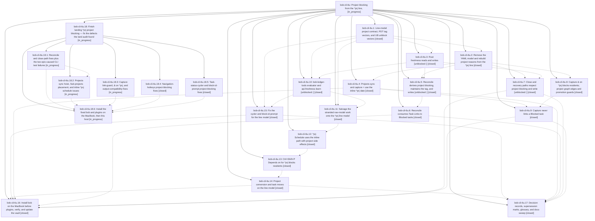

# Bead: bob-cli-6u — Project blocking from the ^prj line,

[Bead Pages](../README.md) / bob-cli-6u

**Status:** ◐ in_progress · **Type:** ▸ plan · **Tier:** epic
**Owner:** `bryanbugyi34@gmail.com` · **Created by:** [bbugyi200.apollo.70](https://github.com/bobs-org/bob-cli--agents/blob/main/sessions/bbugyi200.apollo.70.md) · **Assignee:** `bob-cli-6u.land`
**Created:** 2026-10-12 10:25:43 EDT
**Plan:** [202610/prj\_line\_project\_blocking.md](https://github.com/bobs-org/bob-cli--plans/blob/main/202610/prj_line_project_blocking.md)

<!-- sase:links:start -->

## Links

| Relation | Artifact | Why |
| --- | --- | --- |
| implemented-by | [plan:202610/prj_line_project_blocking.md][1] | derived from the plan's `bead_id:` frontmatter field |

_Plus 5 automatic references — see [Referenced By](#referenced-by)._

[1]: https://github.com/bobs-org/bob-cli--plans/blob/main/202610/prj_line_project_blocking.md

<!-- sase:links:end -->

## Description

A project's prerequisites live on its `^prj` task's ordinary Depends-On line and its date as an inline `[scheduled::]` on `^prj`; no project frontmatter `depends_on` or `scheduled` remains. While `^prj` has its own reason to be Blocked, every open task in its note is Blocked `[?]` and tagged `#prj_is_blocked`, and no Blocked task keeps a Task Link under today's open Pomodoros. Every automatic Blocked → Ready recovery writes `[unblocked:: D]`, so the task is a TICKLER in the next morning review. The YAML-storage code, docs, and deployed bundle left behind by the canceled epic bob-cli-6s are removed or salvaged.

## Notes

[2026-10-12T14:46:04Z · 72] COORDINATION — concurrent epic bob-cli-6t (project pull-in, plan:202610/project_task_pull_in.md) was planned against canceled 6s and is running now (6t.2 and 6t.3 started 10:28 EDT). Impact on this epic:
1. ec7251e (6t.1, landed) added docs/task-dependencies.md §12.10 "Project pull-in" and §12.11 PP1–PP24. It also added a §13.4 sentence: ADJ-11 governs dependency promotion, and the §12.10 close-gesture pull-in is the one path that makes ^prj Next. Pointers went into docs/projects.md, plan.md, capture.md and README. 6t.1's "keep this through the sweep" note went to canceled 6s.13, so this plan never lists it. Keep §12.10, and port its YAML-model wording (Rule step 3, PP7, PP8, the Gate, Trigger (b), PP17) to the line model.
2. 6t.2 is adding drain_state/DrainState in projects/scan.rs, mod.rs and edits.rs (and making normalize_task_hide_tag pub(crate)). It will add task_complete/project_pull_in.rs and edit successors.rs, capture/output.rs, task_complete.rs and pomodoro_close.rs. It takes step 3 from the 6s.2 YAML model. If it lands before 6u.2/6u.4/6u.7, carry its callers over to the line model; do not revert them, and do not restore scan.rs wholesale from 54a54bf^.
3. 6t.3 is adding task-status-cycler 088 (and a planned 137 mixin), and editing 085, 136, nav 285 and the nav manifest. That overlaps 6u.15 and 6u.11.
4. 6t.4 would reach the MacBook early because 6s.12 reads closed. A note on 6t.4 redirects it to 6u.16.
I asked 6t.2/6t.3 not to land against the YAML model. Bryan decides whether to stop or re-sequence 6t. See research:202610/bob_cli_6t_6u_epic_conflict.md.

[2026-10-12T22:03:16Z · bob-cli-6u.land] LAND TRIAGE (bob-cli-6u.land, 2026-10-12): PROPOSED FOLLOW-UP outcomes
- percent-listen CLI failures (6u.1-6u.9, 6u.17): duplicate. +1 on bob-cli-6m, reproduced at 7a44aa7.
- highlights_ref listen ETXTBSY flake (6u.3 #2): duplicate. +1 on bob-cli-5l (same in-place stub-writer race).
- stage-ranker timing flake (6u.10/6u.11/6u.12 #6): duplicate. +1 on bob-cli-3w.
- bob-plugins clean-base failures (6u.10/6u.11/6u.12 #4-#5/6u.13/6u.14/6u.15/6u.17 #8): 5 still fail at 1abde2f and all 5 reproduce at the pre-epic base 4193a19. New beads: bob-cli-6v (unblocked-glyph x4; wall-clock DAILY vs frozen TODAY) and bob-cli-6w (decision-card Keep notice). Declined the rest: the picker-single cases are already bob-cli-5r, and the successor-polish/wiring and scheduled-roll cases no longer fail (2511/2516 pass).
- "wall-clock-rotted" CLI fixtures (6u.9 #1, 6u.13 #1, 6u.17 #12): DECLINED as follow-ups because the epic caused them. Repro: reconcile now adds #prj_is_blocked to the resident (schedule.rs:131), and the inline ^prj date blocks the residents of tasks.md (blocked.rs:173, 11 vs 7). This is the 6u.4 x 6u.5 integration, so it is remaining epic work.
- 6u.17 #2 ledger pill: bob-cli-6y. #3 PRE-tier reconcile-staleness notice: bob-cli-6z. #4 projects list column: bob-cli-70. #5 dash_projects query: bob-cli-71. #6 retire ADJ-8 propagation: bob-cli-72 (needs Bryan's decision).
- 6u.17 #7 sub-project cascade / re-linking on unblock: DECLINED. Both are rejected alternatives in decisions:projects-block-from-prj-line, which reopens only if Bryan asks.
- 6u.17 #9 a future 6t decision record should link projects-block-from-prj-line: DECLINED. 6t is canceled and there is no record to act on; noted on bob-cli-6x context.
- New, not epic-caused: the canceled 6t pull-in is documented as shipped. Filed bob-cli-6x.
- New Mac follow-up per cli-capture-links step 6: bob-cli-73 (Bob Mac Capture renders link_guard).

[2026-10-12T22:06:33Z · bob-cli-6u.land] LAND VERIFICATION (bob-cli-6u.land, 2026-10-12)
- Scope: read all 17 phase beads and their notes, and audited every phase commit against the plan. bob-cli: 37c100f, f51ba28, f6fbd7d, 13d183f, 66c4ddb, 34d4ab6, 23f2fd9, 2340689, 36f997b, 7a44aa7. bob-plugins: f47be84, 744247c, c9938d8, a42f45d, 046028c, 1abde2f.
- Drift: none. Every commit since the epic started, in both repos, belongs to 6u. 6t was canceled; its code never landed, and its only commit is the ec7251e docs. Nothing needs integrating.
- Rollout: verified in ~/bob. The 10 hoists landed (vault commit 1fe1fb35; sase_message_boards ^prj is [?] with an inline 2026-10-16 date). Terminal projects keep their frontmatter as designed. The Databricks residents recovered with [unblocked:: 2026-10-12] after LinkedIn closed. blocked.md and the CSS are in 3ac0b3be.
- Epic-symbols: none.
- Remaining epic-caused work, which blocks the close:
  - bob-cli just check fails 2 CLI tests caused by the 6u.4 x 6u.5 integration (schedule.rs:131 now has #prj_is_blocked; blocked.rs:173 now has 11 vs 7 because the ^prj inline date blocks residents), besides bob-cli-6m.
  - Audit defects, among them:
    - HIGH capture regression: link_guard.rs:209 consumes a resident of an UNBLOCKED project with only its own future date instead of pulling it forward;
    - capture JSON claims links in existing fields;
    - PDC3 tag strip missing on the close path (Rust and cycler);
    - internal-target guard skipped on R2/legacy;
    - every status flip is now structural;
    - hoist with no ^prj breaks sync;
    - Sub-projects insertion splits the Cancel Log;
    - nav resident recovery from an unblocked ^prj;
    - resident cycle edges missing in capture & and nav;
    - tag drift in nav schedule and move;
    - counted/batch paths skip [unblocked::];
    - link guard reads the whole vault (regresses bob-cli-5v).
- Planned as a child epic (plan sase_plan_prj_line_blocking_landing_fixes.md) with phases cli-reconcile-close, cli-projects-sync, cli-capture, nav-fixes, cycler-blockid, rollout. Its land agent resumes this landing: close bob-cli-6u, then mark plan:202610/prj_line_project_blocking.md done.

## Phases

| Bead | Title | Status | Size | Created | Agents | Commits |
|---|---|---|---|---|---:|---:|
| [bob-cli-6u.1](bob-cli-6u.1.md) | Line-model project contract, PDT tag vectors, and UB unblock vectors | ✓ closed | medium | 2026-10-12 | 1 | 1 |
| [bob-cli-6u.10](bob-cli-6u.10.md) | bob-ledger-tools evaluator and api.freshness learn \[unblocked::\] | ✓ closed | medium | 2026-10-12 | 1 | 1 |
| [bob-cli-6u.11](bob-cli-6u.11.md) | Salvage the stranded nav-model work onto the ^prj line model | ✓ closed | medium | 2026-10-12 | 1 | 1 |
| [bob-cli-6u.12](bob-cli-6u.12.md) | ^prj Schedule uses the inline path with project side effects | ✓ closed | medium | 2026-10-12 | 1 | 2 |
| [bob-cli-6u.13](bob-cli-6u.13.md) | Ctrl+Shift+P Depends on for ^prj blocks residents | ✓ closed | medium | 2026-10-12 | 1 | 2 |
| [bob-cli-6u.14](bob-cli-6u.14.md) | Project conversion and task moves on the line model | ✓ closed | medium | 2026-10-12 | 1 | 2 |
| [bob-cli-6u.15](bob-cli-6u.15.md) | Fix the cycler and block-id-prompt for the line model | ✓ closed | medium | 2026-10-12 | 1 | 1 |
| [bob-cli-6u.16](bob-cli-6u.16.md) | Install bob on the MacBook before plugins, verify, and update the vault | ✓ closed | small | 2026-10-12 | 1 | 0 |
| [bob-cli-6u.17](bob-cli-6u.17.md) | Decision records, supersession marks, glossary, and docs sweep | ✓ closed | small | 2026-10-12 | 1 | 1 |
| [bob-cli-6u.2](bob-cli-6u.2.md) | Remove the YAML model and rebuild project reasons from the ^prj line | ✓ closed | medium | 2026-10-12 | 1 | 1 |
| [bob-cli-6u.3](bob-cli-6u.3.md) | Rust freshness reads and writes \[unblocked::\] | ✓ closed | medium | 2026-10-12 | 1 | 1 |
| [bob-cli-6u.4](bob-cli-6u.4.md) | Projects sync and capture + use the inline ^prj date | ✓ closed | medium | 2026-10-12 | 1 | 1 |
| [bob-cli-6u.5](bob-cli-6u.5.md) | Reconcile derives project blocking, maintains the tag, and writes \[unblocked::\] | ✓ closed | medium | 2026-10-12 | 1 | 1 |
| [bob-cli-6u.6](bob-cli-6u.6.md) | Reconcile consumes Task Links to Blocked tasks | ✓ closed | medium | 2026-10-12 | 1 | 1 |
| [bob-cli-6u.7](bob-cli-6u.7.md) | Close and recovery paths respect project blocking and write \[unblocked::\] | ✓ closed | medium | 2026-10-12 | 1 | 1 |
| [bob-cli-6u.8](bob-cli-6u.8.md) | Capture & on ^prj blocks residents; project graph edges and promotion guards | ✓ closed | medium | 2026-10-12 | 1 | 1 |
| [bob-cli-6u.9](bob-cli-6u.9.md) | Capture never links a Blocked task | ✓ closed | medium | 2026-10-12 | 1 | 1 |

## Lineage

## Agents

| Agent | Bead | Commits |
|---|---|---:|
| [bbugyi200.apollo.bob-cli-6u.1](https://github.com/bobs-org/bob-cli--agents/blob/main/agents/bbugyi200.apollo.bob-cli-6u.1/README.md) | [bob-cli-6u.1](bob-cli-6u.1.md) | 1 |
| [bbugyi200.apollo.bob-cli-6u.10](https://github.com/bobs-org/bob-cli--agents/blob/main/agents/bbugyi200.apollo.bob-cli-6u.10/README.md) | [bob-cli-6u.10](bob-cli-6u.10.md) | 1 |
| [bbugyi200.apollo.bob-cli-6u.11](https://github.com/bobs-org/bob-cli--agents/blob/main/agents/bbugyi200.apollo.bob-cli-6u.11/README.md) | [bob-cli-6u.11](bob-cli-6u.11.md) | 1 |
| [bbugyi200.apollo.bob-cli-6u.12](https://github.com/bobs-org/bob-cli--agents/blob/main/agents/bbugyi200.apollo.bob-cli-6u.12/README.md) | [bob-cli-6u.12](bob-cli-6u.12.md) | 2 |
| [bbugyi200.apollo.bob-cli-6u.13](https://github.com/bobs-org/bob-cli--agents/blob/main/agents/bbugyi200.apollo.bob-cli-6u.13/README.md) | [bob-cli-6u.13](bob-cli-6u.13.md) | 2 |
| [bbugyi200.apollo.bob-cli-6u.14](https://github.com/bobs-org/bob-cli--agents/blob/main/agents/bbugyi200.apollo.bob-cli-6u.14/README.md) | [bob-cli-6u.14](bob-cli-6u.14.md) | 2 |
| [bbugyi200.apollo.bob-cli-6u.15](https://github.com/bobs-org/bob-cli--agents/blob/main/agents/bbugyi200.apollo.bob-cli-6u.15/README.md) | [bob-cli-6u.15](bob-cli-6u.15.md) | 1 |
| [bbugyi200.apollo.bob-cli-6u.16](https://github.com/bobs-org/bob-cli--agents/blob/main/sessions/bbugyi200.apollo.bob-cli-6u.16.md) | [bob-cli-6u.16](bob-cli-6u.16.md) | 0 |
| [bbugyi200.apollo.bob-cli-6u.17](https://github.com/bobs-org/bob-cli--agents/blob/main/sessions/bbugyi200.apollo.bob-cli-6u.17.md) | [bob-cli-6u.17](bob-cli-6u.17.md) | 1 |
| [bbugyi200.apollo.bob-cli-6u.18.1](https://github.com/bobs-org/bob-cli--agents/blob/main/agents/bbugyi200.apollo.bob-cli-6u.18.1/README.md) | [bob-cli-6u.18.1](bob-cli-6u.18.1.md) | 0 |
| [bbugyi200.apollo.bob-cli-6u.18.2](https://github.com/bobs-org/bob-cli--agents/blob/main/agents/bbugyi200.apollo.bob-cli-6u.18.2/README.md) | [bob-cli-6u.18.2](bob-cli-6u.18.2.md) | 0 |
| [bbugyi200.apollo.bob-cli-6u.18.3](https://github.com/bobs-org/bob-cli--agents/blob/main/agents/bbugyi200.apollo.bob-cli-6u.18.3/README.md) | [bob-cli-6u.18.3](bob-cli-6u.18.3.md) | 0 |
| [bbugyi200.apollo.bob-cli-6u.18.4](https://github.com/bobs-org/bob-cli--agents/blob/main/agents/bbugyi200.apollo.bob-cli-6u.18.4/README.md) | [bob-cli-6u.18.4](bob-cli-6u.18.4.md) | 2 |
| [bbugyi200.apollo.bob-cli-6u.18.5](https://github.com/bobs-org/bob-cli--agents/blob/main/agents/bbugyi200.apollo.bob-cli-6u.18.5/README.md) | [bob-cli-6u.18.5](bob-cli-6u.18.5.md) | 2 |
| [bbugyi200.apollo.bob-cli-6u.18.6](https://github.com/bobs-org/bob-cli--agents/blob/main/agents/bbugyi200.apollo.bob-cli-6u.18.6/README.md) | [bob-cli-6u.18.6](bob-cli-6u.18.6.md) | 0 |
| [bbugyi200.apollo.bob-cli-6u.18.land](https://github.com/bobs-org/bob-cli--agents/blob/main/agents/bbugyi200.apollo.bob-cli-6u.18.land/README.md) | [bob-cli-6u.18](bob-cli-6u.18.md) | 0 |
| [bbugyi200.apollo.bob-cli-6u.2](https://github.com/bobs-org/bob-cli--agents/blob/main/sessions/bbugyi200.apollo.bob-cli-6u.2.md) | [bob-cli-6u.2](bob-cli-6u.2.md) | 1 |
| [bbugyi200.apollo.bob-cli-6u.3](https://github.com/bobs-org/bob-cli--agents/blob/main/agents/bbugyi200.apollo.bob-cli-6u.3/README.md) | [bob-cli-6u.3](bob-cli-6u.3.md) | 1 |
| [bbugyi200.apollo.bob-cli-6u.4](https://github.com/bobs-org/bob-cli--agents/blob/main/agents/bbugyi200.apollo.bob-cli-6u.4/README.md) | [bob-cli-6u.4](bob-cli-6u.4.md) | 1 |
| [bbugyi200.apollo.bob-cli-6u.5](https://github.com/bobs-org/bob-cli--agents/blob/main/sessions/bbugyi200.apollo.bob-cli-6u.5.md) | [bob-cli-6u.5](bob-cli-6u.5.md) | 1 |
| [bbugyi200.apollo.bob-cli-6u.6](https://github.com/bobs-org/bob-cli--agents/blob/main/agents/bbugyi200.apollo.bob-cli-6u.6/README.md) | [bob-cli-6u.6](bob-cli-6u.6.md) | 1 |
| [bbugyi200.apollo.bob-cli-6u.7](https://github.com/bobs-org/bob-cli--agents/blob/main/agents/bbugyi200.apollo.bob-cli-6u.7/README.md) | [bob-cli-6u.7](bob-cli-6u.7.md) | 1 |
| [bbugyi200.apollo.bob-cli-6u.8](https://github.com/bobs-org/bob-cli--agents/blob/main/agents/bbugyi200.apollo.bob-cli-6u.8/README.md) | [bob-cli-6u.8](bob-cli-6u.8.md) | 1 |
| [bbugyi200.apollo.bob-cli-6u.9](https://github.com/bobs-org/bob-cli--agents/blob/main/agents/bbugyi200.apollo.bob-cli-6u.9/README.md) | [bob-cli-6u.9](bob-cli-6u.9.md) | 1 |
| [bbugyi200.apollo.bob-cli-6u.land](https://github.com/bobs-org/bob-cli--agents/blob/main/sessions/bbugyi200.apollo.bob-cli-6u.land.md) | [bob-cli-6u](README.md) | 0 |

## Commits

| Repo | Commit | Subject | Bead | Committed |
|---|---|---|---|---|
| bob-cli | [`37c100f`](https://github.com/bobs-org/bob-cli/commit/37c100fa50d94c3038eec1e4f966dc48caab1616) | docs(task-deps): rewrite §13 for the ^prj line-model contract | [bob-cli-6u.1](bob-cli-6u.1.md) | 2026-10-12 10:52:02 EDT |
| bob-cli | [`f51ba28`](https://github.com/bobs-org/bob-cli/commit/f51ba2890392ccf32e84dc0d9751c12bb4177912) | feat(freshness): read and write \[unblocked::\] with RESURFACED evaluation | [bob-cli-6u.3](bob-cli-6u.3.md) | 2026-10-12 11:22:28 EDT |
| bob-cli | [`f6fbd7d`](https://github.com/bobs-org/bob-cli/commit/f6fbd7ddf35e050d635f5c473ff38827458ec462) | refactor(projects): derive blocking from ^prj task line | [bob-cli-6u.2](bob-cli-6u.2.md) | 2026-10-12 11:22:48 EDT |
| bob-plugins | [`bob-plugins@f47be84`](https://github.com/bobs-org/bob-plugins/commit/f47be84eb62cfb2a1ac6f9ce282727a6797e5954) | feat(freshness): add unblocked ledger returns | [bob-cli-6u.10](bob-cli-6u.10.md) | 2026-10-12 11:41:33 EDT |
| bob-cli | [`13d183f`](https://github.com/bobs-org/bob-cli/commit/13d183ff74594ae691034c83ce43d2d5b21d3f80) | feat(task-complete): respect project blocking in close paths | [bob-cli-6u.7](bob-cli-6u.7.md) | 2026-10-12 11:50:31 EDT |
| bob-cli | [`66c4ddb`](https://github.com/bobs-org/bob-cli/commit/66c4ddbd9f19927eb13fe8d4be78986cb315970f) | feat(capture): block residents on & writes to ^prj with graph and promotion guards | [bob-cli-6u.8](bob-cli-6u.8.md) | 2026-10-12 11:59:33 EDT |
| bob-cli | [`34d4ab6`](https://github.com/bobs-org/bob-cli/commit/34d4ab6e8e28d20406cef9bb26668c486a740ccd) | feat(task-status): reconcile derives project blocking, maintains tag, writes \[unblocked::\] | [bob-cli-6u.5](bob-cli-6u.5.md) | 2026-10-12 12:03:12 EDT |
| bob-cli | [`23f2fd9`](https://github.com/bobs-org/bob-cli/commit/23f2fd90e7bade2f6ff5973a6d3e4e6892208a0b) | feat(projects): hoist YAML scheduled onto ^prj and keep inline dates | [bob-cli-6u.4](bob-cli-6u.4.md) | 2026-10-12 12:15:37 EDT |
| bob-plugins | [`bob-plugins@744247c`](https://github.com/bobs-org/bob-plugins/commit/744247ceee0f22279f0a9754470e2ff4957b4f5e) | feat(project-blocking): align cycler and block-id handling | [bob-cli-6u.15](bob-cli-6u.15.md) | 2026-10-12 12:16:22 EDT |
| bob-plugins | [`bob-plugins@c9938d8`](https://github.com/bobs-org/bob-plugins/commit/c9938d8cb18c1f08acbd54cb43a030aa75bb2c54) | feat(navigation-hotkeys): port project blocking onto the ^prj line model | [bob-cli-6u.11](bob-cli-6u.11.md) | 2026-10-12 12:18:36 EDT |
| bob-cli | [`2340689`](https://github.com/bobs-org/bob-cli/commit/234068907ceaa66c4157a84801a97609d24f616d) | feat(task-status-hooks): consume live Task Links to Blocked tasks | [bob-cli-6u.6](bob-cli-6u.6.md) | 2026-10-12 12:50:17 EDT |
| bob-cli | [`e7dee5d`](https://github.com/bobs-org/bob-cli/commit/e7dee5ddd23ccf16b38439e8597bbf9670c4696b) | docs(projects): document inline project scheduling | [bob-cli-6u.12](bob-cli-6u.12.md) | 2026-10-12 14:25:48 EDT |
| bob-plugins | [`bob-plugins@a42f45d`](https://github.com/bobs-org/bob-plugins/commit/a42f45d6e32089daf77235913a8d20f926d0d616) | feat(navigation): schedule projects from inline ^prj fields | [bob-cli-6u.12](bob-cli-6u.12.md) | 2026-10-12 14:27:14 EDT |
| bob-cli | [`a36a39b`](https://github.com/bobs-org/bob-cli/commit/a36a39bd8061286e5080c5636c3cdb6a21f5b0b2) | docs(task-deps): Ctrl+Shift+P Depends on for ^prj blocks residents | [bob-cli-6u.13](bob-cli-6u.13.md) | 2026-10-12 15:00:26 EDT |
| bob-plugins | [`bob-plugins@046028c`](https://github.com/bobs-org/bob-plugins/commit/046028c83aee95aa507314c598bdf53fa1fdd553) | feat(navigation-hotkeys): Ctrl+Shift+P Depends on for ^prj blocks residents | [bob-cli-6u.13](bob-cli-6u.13.md) | 2026-10-12 15:01:38 EDT |
| bob-cli | [`e9acfdf`](https://github.com/bobs-org/bob-cli/commit/e9acfdf7264098425e6176ecb6b65afeeda7487a) | docs(projects): document line-based conversion behavior | [bob-cli-6u.14](bob-cli-6u.14.md) | 2026-10-12 16:04:13 EDT |
| bob-plugins | [`bob-plugins@1abde2f`](https://github.com/bobs-org/bob-plugins/commit/1abde2f639ff709dea6db6e36a90ee5c6a4962c2) | feat(navigation): preserve project state across conversion and moves | [bob-cli-6u.14](bob-cli-6u.14.md) | 2026-10-12 16:05:32 EDT |
| bob-cli | [`36f997b`](https://github.com/bobs-org/bob-cli/commit/36f997b1aad6d0757b83de36aff75f584718237d) | feat(capture): never link a Blocked task | [bob-cli-6u.9](bob-cli-6u.9.md) | 2026-10-12 16:52:38 EDT |
| bob-cli | [`7a44aa7`](https://github.com/bobs-org/bob-cli/commit/7a44aa79a470f16b694aab65d08b8cb0c4c295a3) | docs(memory): publish ^prj blocking and unblocked-tickler records | [bob-cli-6u.17](bob-cli-6u.17.md) | 2026-10-12 17:20:04 EDT |
| bob-cli | [`414b802`](https://github.com/bobs-org/bob-cli/commit/414b802b915c9ec7e89f6cfbdded0cced5a84422) | docs(task-dependencies): clarify direct project task links | [bob-cli-6u.18.5](bob-cli-6u.18.5.md) | 2026-10-12 18:18:56 EDT |
| bob-plugins | [`bob-plugins@f1d5a4e`](https://github.com/bobs-org/bob-plugins/commit/f1d5a4e05ff9cbd64cbe66b8651efeb8c3b5ef9e) | fix(project-blocking): repair cycler and block id prompt | [bob-cli-6u.18.5](bob-cli-6u.18.5.md) | 2026-10-12 18:20:17 EDT |
| bob-cli | [`524073e`](https://github.com/bobs-org/bob-cli/commit/524073e5775d9f4e851c40c0a0e572d1111dee63) | docs(task-deps): record nav-fixes ^prj blocking corrections | [bob-cli-6u.18.4](bob-cli-6u.18.4.md) | 2026-10-12 18:44:33 EDT |
| bob-plugins | [`bob-plugins@a7fafed`](https://github.com/bobs-org/bob-plugins/commit/a7fafedb34bb8bd0348ea14c74a276fd6749d368) | feat(navigation): land nav-fixes ^prj blocking corrections | [bob-cli-6u.18.4](bob-cli-6u.18.4.md) | 2026-10-12 18:49:19 EDT |

<!-- sase:referenced-by:start -->

## Referenced By

| Relation | Artifact | Why | Uses |
| --- | --- | --- | ---: |
| read-by | [agent:72][1] | Check for conflict between epics 6u and 6t | 1 |
| read-by | [agent:bob-cli-6u.13][2] | epic scope for phase worker | 1 |
| read-by | [agent:bob-cli-6u.3][3] | Need epic scope for phase 6u.3 | 1 |
| read-by | [agent:bob-cli-6u.4][4] | Need parent epic DECISIONS, phases, and full plan context | 1 |
| read-by | [agent:bob-cli-6u.8][5] | Need epic phase status list | 2 |

[1]: https://github.com/bobs-org/bob-cli--agents/blob/main/agents/bbugyi200.apollo.72/README.md
[2]: https://github.com/bobs-org/bob-cli--agents/blob/main/agents/bbugyi200.apollo.bob-cli-6u.13/README.md
[3]: https://github.com/bobs-org/bob-cli--agents/blob/main/agents/bbugyi200.apollo.bob-cli-6u.3/README.md
[4]: https://github.com/bobs-org/bob-cli--agents/blob/main/agents/bbugyi200.apollo.bob-cli-6u.4/README.md
[5]: https://github.com/bobs-org/bob-cli--agents/blob/main/agents/bbugyi200.apollo.bob-cli-6u.8/README.md

<!-- sase:referenced-by:end -->
