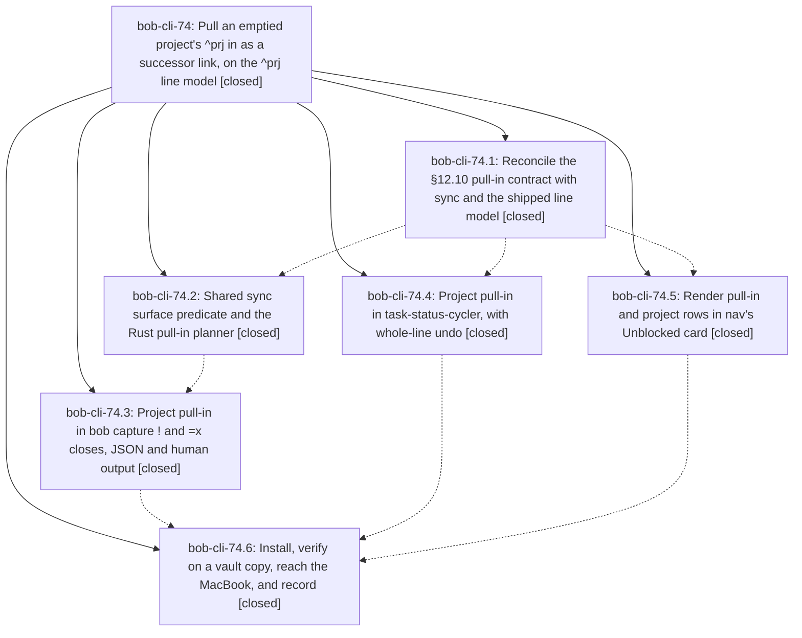

# Bead: bob-cli-74 — Pull an emptied project's ^prj in as a successor link, on the ^prj line model

[Bead Pages](../README.md) / bob-cli-74

**Status:** ✓ closed · **Resolution:** done · **Type:** ▸ plan · **Tier:** epic
**Owner:** `bryanbugyi34@gmail.com` · **Created by:** [bbugyi200.apollo.73](https://github.com/bobs-org/bob-cli--agents/blob/main/sessions/bbugyi200.apollo.73.md) · **Assignee:** `bob-cli-74.land`
**Created:** 2026-10-12 23:40:11 EDT · **Closed:** 2026-10-13 02:45:25 EDT
**Plan:** [202610/project\_pull\_in\_line\_model.md](https://github.com/bobs-org/bob-cli--plans/blob/main/202610/project_pull_in_line_model.md)

<!-- sase:links:start -->

## Links

| Relation | Artifact | Why |
| --- | --- | --- |
| implemented-by | [plan:202610/project_pull_in_line_model.md][1] | derived from the plan's `bead_id:` frontmatter field |

_Plus 2 automatic references — see [Referenced By](#referenced-by)._

[1]: https://github.com/bobs-org/bob-cli--plans/blob/main/202610/project_pull_in_line_model.md

<!-- sase:links:end -->

## Description

When a close gesture completes the last remaining task of a project note, its ^prj task is linked right after the closed task's link, becomes Next, and loses its hide tag in the same write. This works in bob capture (! and =x) and in Obsidian (Ctrl+Enter, Alt+]). "Empty" is exactly bob projects sync's surface predicate, so sync never re-hides a pulled-in ^prj. docs/task-dependencies.md §12.10/§12.11 become true (resolving bob-cli-6x). bob-cli just check fails only the bob-cli-6m tests, and bob-plugins npm test fails only the known bob-cli-6v, bob-cli-6w and bob-cli-3w cases. The new bob and plugins are installed on this host and, when reachable, on the MacBook.

## Notes

[2026-10-13T06:17:16Z · bob-cli-74.land] FOLLOW-UP TRIAGE (land agent, via /sase_new_task): (1) decisions-web record project-pull-in-on-empty, proposed by 74.1 #1, 74.2 #1, 74.4 #1, 74.5 #1, 74.6 #1 → consolidated into new ready memory task bob-cli-75 (small; memory untouched because decision_record=no was auto-decided). (2) bob-cli-6m percent-listen failures (74.3 #1) → duplicate; +1 on bob-cli-6m (reproduced in landing just check on 309e98a: only those 2 tests fail). (3) five bob-plugins npm test failures (74.5 #2) → duplicates; +1 on bob-cli-6v (4 unblocked-glyph cases) and bob-cli-6w (decision-card Keep case), reproduced at plugins 9e05379; the 6th landing failure was the known bob-cli-3w timing flake. (4) distinct Bob Mac Capture copy for trigger project_empty (74.6 #2) → new ready feature task bob-cli-76 (medium). (5) ledger-tools 🔓 glyph on pulled-in links (74.6 #3) → new ready feature task bob-cli-77 (medium). No proposal declined.

[2026-10-13T06:17:43Z · bob-cli-74.land] LAND AUDIT (land agent): Read epic, all 6 phases and notes, plan:202610/project_pull_in_line_model.md; reviewed bob-cli eb03584/5fc27f0/309e98a and bob-plugins 00f3e8f/9e05379. All phases closed; bob-cli-6x closed; epic-symbols empty; no parent bead. just check on 309e98a fails only the 2 bob-cli-6m tests; bob-plugins npm test fails only 6v (4), 6w (1), 3w (timing). INTEGRATION: no non-epic commits since the epic started in bob-cli (08d9e1f predates it), bob-plugins, or bob-mac-capture (decodes unblocked rows with decodeIfPresent; additive JSON is safe). EPIC-CAUSED DEFECTS (remaining epic work, planned as one tale): Rust — (R1) pull-in #hide detection uses whitespace-only has_hide_tag while sync/normalize_task_hide_tag accept punctuation-bounded #hide (e.g. '#hide,'): unlinked R gets no write and sync then removes #hide (PP23 broken); linked R reports hide_removed:false; (R2) Gate omits the vault-wide snapshot when R is [?] with no Depends-On, so the PROJECT RECOVERY cascade recovers a resident whose own dependency is still open; (R3) contract says reason:project still_blocked rows carry scheduled when the project date blocks, Rust always sends None; (R4) §12.6 / capture.md still list the wrong Rust still-blocked project suffix; nits: pull_in_needs_dependents test-only (non-test unused warnings), duplicate raw_task_line, stale [id::]-gate comment in capture/task_complete.rs, §12.6 double-space example. Cycler — (P1) 089 REMAINING skip keys are ^blockId/id without note path → false pull-in when another note's closed task shares a block id; (P2) cancelled/disabled checked before not_planned_today (Rule order is step 6 before 7/8), and the JS PP11 test locks the wrong order; (P3) 085's no-[id::] branch ignores pullIns.cascadePaths so a [?] R pull-in never recovers N's residents; (P4) empty/invalid frontmatter scheduled is a Rust scan issue but JS treats it as no schedule; (P5) recognition via 080 projectDependencyInfo diverges from Rust (missing status = wip, flow/block-list type, ^prj line validity); (P6) 087 says 'Surfaced' for any unlinked pull-in row (Rust/nav: only status-unchanged rows) and nav fallback adds a suffix the cycler lacks; plus SUBOPEN parsing fidelity, pull-in still_blocked rows missing project, dead code (unused after/dailyAfter/today, PROJECT_OPEN_MARKS misnamed, redundant 137 condition, nav unused projectEmpty) and repeated projectSurfaceState scans.

[2026-10-13T06:45:16Z · bob-cli-74.land] Landing repairs R1-R4/P1-P7 with tests. Rust: sync-boundary #hide (R1), stale-[?] cascade gate (R2), project scheduled on reason:project rows (R3), docs §12.5/§12.6/capture.md + cleanup (R4). Plugins: path-qualified skip keys (P1), step order (P2), id-less cascade (P3), frontmatter scheduled validity (P4), 089 recognition (P5), SUBOPEN fidelity (P6), copy/row parity (P7), R2 mirror (P8), cleanup + 1.36.0/2.29.0. Verify: just check fails only bob-cli-6m percent-listen (2); npm test fails only 6v glyph (4) + 6w Keep (1); installed bob + cycler/nav on apollo; temp-copy live punctuation pull-in + sync dry-run clean. Follow-ups 75/76/77 filed, 6m/6v/6w +1'd.

[2026-10-13T06:45:25Z · bob-cli-74.land] verified: phases 74.1-74.6 closed; landing repairs R1-R4/P1-P7 with tests; just check fails only bob-cli-6m; npm test only 6v/6w/3w; installed bob + cycler/nav on apollo; follow-ups bob-cli-75/76/77 filed and 6m/6v/6w +1'd; no integration drift

## Phases

| Bead | Title | Status | Size | Created | Agents | Commits |
|---|---|---|---|---|---:|---:|
| [bob-cli-74.1](bob-cli-74.1.md) | Reconcile the §12.10 pull-in contract with sync and the shipped line model | ✓ closed | small | 2026-10-12 | 1 | 1 |
| [bob-cli-74.2](bob-cli-74.2.md) | Shared sync surface predicate and the Rust pull-in planner | ✓ closed | medium | 2026-10-12 | 1 | 1 |
| [bob-cli-74.3](bob-cli-74.3.md) | Project pull-in in bob capture ! and =x closes, JSON and human output | ✓ closed | medium | 2026-10-12 | 1 | 1 |
| [bob-cli-74.4](bob-cli-74.4.md) | Project pull-in in task-status-cycler, with whole-line undo | ✓ closed | medium | 2026-10-12 | 1 | 1 |
| [bob-cli-74.5](bob-cli-74.5.md) | Render pull-in and project rows in nav's Unblocked card | ✓ closed | small | 2026-10-12 | 1 | 1 |
| [bob-cli-74.6](bob-cli-74.6.md) | Install, verify on a vault copy, reach the MacBook, and record | ✓ closed | small | 2026-10-12 | 1 | 0 |

## Lineage

## Agents

| Agent | Bead | Commits |
|---|---|---:|
| [bbugyi200.apollo.bob-cli-74.1](https://github.com/bobs-org/bob-cli--agents/blob/main/agents/bbugyi200.apollo.bob-cli-74.1/README.md) | [bob-cli-74.1](bob-cli-74.1.md) | 1 |
| [bbugyi200.apollo.bob-cli-74.2](https://github.com/bobs-org/bob-cli--agents/blob/main/agents/bbugyi200.apollo.bob-cli-74.2/README.md) | [bob-cli-74.2](bob-cli-74.2.md) | 1 |
| [bbugyi200.apollo.bob-cli-74.3](https://github.com/bobs-org/bob-cli--agents/blob/main/agents/bbugyi200.apollo.bob-cli-74.3/README.md) | [bob-cli-74.3](bob-cli-74.3.md) | 1 |
| [bbugyi200.apollo.bob-cli-74.4](https://github.com/bobs-org/bob-cli--agents/blob/main/agents/bbugyi200.apollo.bob-cli-74.4/README.md) | [bob-cli-74.4](bob-cli-74.4.md) | 1 |
| [bbugyi200.apollo.bob-cli-74.5](https://github.com/bobs-org/bob-cli--agents/blob/main/agents/bbugyi200.apollo.bob-cli-74.5/README.md) | [bob-cli-74.5](bob-cli-74.5.md) | 1 |
| [bbugyi200.apollo.bob-cli-74.6](https://github.com/bobs-org/bob-cli--agents/blob/main/agents/bbugyi200.apollo.bob-cli-74.6/README.md) | [bob-cli-74.6](bob-cli-74.6.md) | 0 |
| [bbugyi200.apollo.bob-cli-74.land](https://github.com/bobs-org/bob-cli--agents/blob/main/sessions/bbugyi200.apollo.bob-cli-74.land.md) | [bob-cli-74](README.md) | 2 |

## Commits

| Repo | Commit | Subject | Bead | Committed |
|---|---|---|---|---|
| bob-cli | [`eb03584`](https://github.com/bobs-org/bob-cli/commit/eb0358440bc6e1a2fe013343bde719ab19d72d18) | docs(contracts): reconcile task-dependency, project, capture, and status-hooks docs with sync surface predicate | [bob-cli-74.1](bob-cli-74.1.md) | 2026-10-12 23:49:47 EDT |
| bob-plugins | [`bob-plugins@00f3e8f`](https://github.com/bobs-org/bob-plugins/commit/00f3e8f7495a457d2c2c8681234fb034cabd2480) | feat(navigation): render project pull-in notices | [bob-cli-74.5](bob-cli-74.5.md) | 2026-10-12 23:57:08 EDT |
| bob-plugins | [`bob-plugins@9e05379`](https://github.com/bobs-org/bob-plugins/commit/9e0537911d8eaf7c8f7f262b28b552f101c6cb31) | feat(task-status-cycler): pull in an emptied project's ^prj as a successor | [bob-cli-74.4](bob-cli-74.4.md) | 2026-10-13 00:27:24 EDT |
| bob-cli | [`5fc27f0`](https://github.com/bobs-org/bob-cli/commit/5fc27f0818e7b677b3da3bff23253b0f0c5a8387) | feat(pull-in): shared sync surface predicate and Rust pull-in planner | [bob-cli-74.2](bob-cli-74.2.md) | 2026-10-13 00:34:48 EDT |
| bob-cli | [`309e98a`](https://github.com/bobs-org/bob-cli/commit/309e98a92ed290f3893b4fcf4c9e58bb857d94b4) | feat(capture): surface project pull-ins on close | [bob-cli-74.3](bob-cli-74.3.md) | 2026-10-13 01:09:19 EDT |
| bob-cli | [`db03ce6`](https://github.com/bobs-org/bob-cli/commit/db03ce6d2f008a85b9bd72d899792e99a0be5ffd) | fix(pull-in): land project pull-in repairs R1-R4 with tests | [bob-cli-74](README.md) | 2026-10-13 02:48:13 EDT |
| bob-plugins | [`bob-plugins@ace5733`](https://github.com/bobs-org/bob-plugins/commit/ace5733ee1502f4893d2c45922620592612e9438) | fix(pull-in): land cycler/nav repairs P1-P7 with tests, bump 1.36.0/2.29.0 | [bob-cli-74](README.md) | 2026-10-13 02:49:05 EDT |

<!-- sase:referenced-by:start -->

## Referenced By

| Relation | Artifact | Why | Uses |
| --- | --- | --- | ---: |
| read-by | [agent:bob-cli-74.1][1] | epic decisions final | 1 |
| read-by | [agent:bob-cli-74.4][2] | Need parent epic decisions, notes, and sibling phase status | 1 |

[1]: https://github.com/bobs-org/bob-cli--agents/blob/main/agents/bbugyi200.apollo.bob-cli-74.1/README.md
[2]: https://github.com/bobs-org/bob-cli--agents/blob/main/agents/bbugyi200.apollo.bob-cli-74.4/README.md

<!-- sase:referenced-by:end -->
