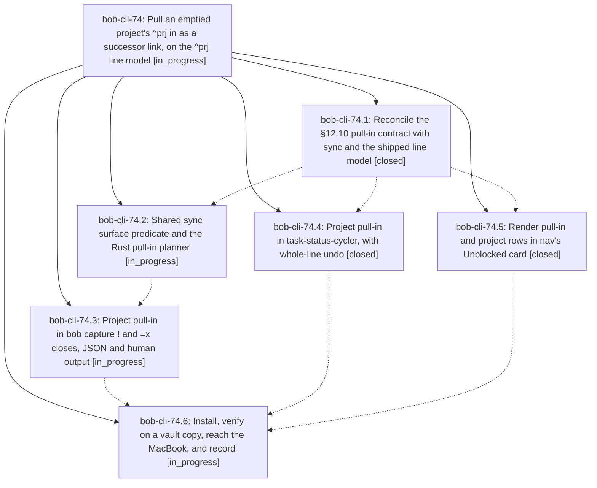

# Bead: bob-cli-74 — Pull an emptied project's ^prj in as a successor link, on the ^prj line model

[Bead Pages](../README.md) / bob-cli-74

**Status:** ◐ in_progress · **Type:** ▸ plan · **Tier:** epic
**Owner:** `bryanbugyi34@gmail.com` · **Created by:** [bbugyi200.apollo.73](https://github.com/bobs-org/bob-cli--agents/blob/main/sessions/bbugyi200.apollo.73.md) · **Assignee:** `bob-cli-74.land`
**Created:** 2026-10-12 23:40:11 EDT
**Plan:** [202610/project\_pull\_in\_line\_model.md](https://github.com/bobs-org/bob-cli--plans/blob/main/202610/project_pull_in_line_model.md)

<!-- sase:links:start -->

## Links

| Relation | Artifact | Why |
| --- | --- | --- |
| implemented-by | [plan:202610/project_pull_in_line_model.md][1] | derived from the plan's `bead_id:` frontmatter field |

_Plus 1 automatic references — see [Referenced By](#referenced-by)._

[1]: https://github.com/bobs-org/bob-cli--plans/blob/main/202610/project_pull_in_line_model.md

<!-- sase:links:end -->

## Description

When a close gesture completes the last remaining task of a project note, its ^prj task is linked right after the closed task's link, becomes Next, and loses its hide tag in the same write. This works in bob capture (! and =x) and in Obsidian (Ctrl+Enter, Alt+]). "Empty" is exactly bob projects sync's surface predicate, so sync never re-hides a pulled-in ^prj. docs/task-dependencies.md §12.10/§12.11 become true (resolving bob-cli-6x). bob-cli just check fails only the bob-cli-6m tests, and bob-plugins npm test fails only the known bob-cli-6v, bob-cli-6w and bob-cli-3w cases. The new bob and plugins are installed on this host and, when reachable, on the MacBook.

## Phases

| Bead | Title | Status | Size | Created | Agents | Commits |
|---|---|---|---|---|---:|---:|
| [bob-cli-74.1](bob-cli-74.1.md) | Reconcile the §12.10 pull-in contract with sync and the shipped line model | ✓ closed | small | 2026-10-12 | 1 | 1 |
| [bob-cli-74.2](bob-cli-74.2.md) | Shared sync surface predicate and the Rust pull-in planner | ◐ in_progress | medium | 2026-10-12 | 1 | 0 |
| [bob-cli-74.3](bob-cli-74.3.md) | Project pull-in in bob capture ! and =x closes, JSON and human output | ◐ in_progress | medium | 2026-10-12 | 1 | 0 |
| [bob-cli-74.4](bob-cli-74.4.md) | Project pull-in in task-status-cycler, with whole-line undo | ✓ closed | medium | 2026-10-12 | 1 | 1 |
| [bob-cli-74.5](bob-cli-74.5.md) | Render pull-in and project rows in nav's Unblocked card | ✓ closed | small | 2026-10-12 | 1 | 1 |
| [bob-cli-74.6](bob-cli-74.6.md) | Install, verify on a vault copy, reach the MacBook, and record | ◐ in_progress | small | 2026-10-12 | 1 | 0 |

## Lineage

## Agents

| Agent | Bead | Commits |
|---|---|---:|
| [bbugyi200.apollo.bob-cli-74.1](https://github.com/bobs-org/bob-cli--agents/blob/main/agents/bbugyi200.apollo.bob-cli-74.1/README.md) | [bob-cli-74.1](bob-cli-74.1.md) | 1 |
| [bbugyi200.apollo.bob-cli-74.2](https://github.com/bobs-org/bob-cli--agents/blob/main/agents/bbugyi200.apollo.bob-cli-74.2/README.md) | [bob-cli-74.2](bob-cli-74.2.md) | 0 |
| [bbugyi200.apollo.bob-cli-74.3](https://github.com/bobs-org/bob-cli--agents/blob/main/agents/bbugyi200.apollo.bob-cli-74.3/README.md) | [bob-cli-74.3](bob-cli-74.3.md) | 0 |
| [bbugyi200.apollo.bob-cli-74.4](https://github.com/bobs-org/bob-cli--agents/blob/main/agents/bbugyi200.apollo.bob-cli-74.4/README.md) | [bob-cli-74.4](bob-cli-74.4.md) | 1 |
| [bbugyi200.apollo.bob-cli-74.5](https://github.com/bobs-org/bob-cli--agents/blob/main/agents/bbugyi200.apollo.bob-cli-74.5/README.md) | [bob-cli-74.5](bob-cli-74.5.md) | 1 |
| [bbugyi200.apollo.bob-cli-74.6](https://github.com/bobs-org/bob-cli--agents/blob/main/agents/bbugyi200.apollo.bob-cli-74.6/README.md) | [bob-cli-74.6](bob-cli-74.6.md) | 0 |
| [bbugyi200.apollo.bob-cli-74.land](https://github.com/bobs-org/bob-cli--agents/blob/main/agents/bbugyi200.apollo.bob-cli-74.land/README.md) | [bob-cli-74](README.md) | 0 |

## Commits

| Repo | Commit | Subject | Bead | Committed |
|---|---|---|---|---|
| bob-cli | [`eb03584`](https://github.com/bobs-org/bob-cli/commit/eb0358440bc6e1a2fe013343bde719ab19d72d18) | docs(contracts): reconcile task-dependency, project, capture, and status-hooks docs with sync surface predicate | [bob-cli-74.1](bob-cli-74.1.md) | 2026-10-12 23:49:47 EDT |
| bob-plugins | [`bob-plugins@00f3e8f`](https://github.com/bobs-org/bob-plugins/commit/00f3e8f7495a457d2c2c8681234fb034cabd2480) | feat(navigation): render project pull-in notices | [bob-cli-74.5](bob-cli-74.5.md) | 2026-10-12 23:57:08 EDT |
| bob-plugins | [`bob-plugins@9e05379`](https://github.com/bobs-org/bob-plugins/commit/9e0537911d8eaf7c8f7f262b28b552f101c6cb31) | feat(task-status-cycler): pull in an emptied project's ^prj as a successor | [bob-cli-74.4](bob-cli-74.4.md) | 2026-10-13 00:27:24 EDT |

<!-- sase:referenced-by:start -->

## Referenced By

| Relation | Artifact | Why | Uses |
| --- | --- | --- | ---: |
| read-by | [agent:bob-cli-74.1][1] | epic decisions final | 1 |

[1]: https://github.com/bobs-org/bob-cli--agents/blob/main/agents/bbugyi200.apollo.bob-cli-74.1/README.md

<!-- sase:referenced-by:end -->
