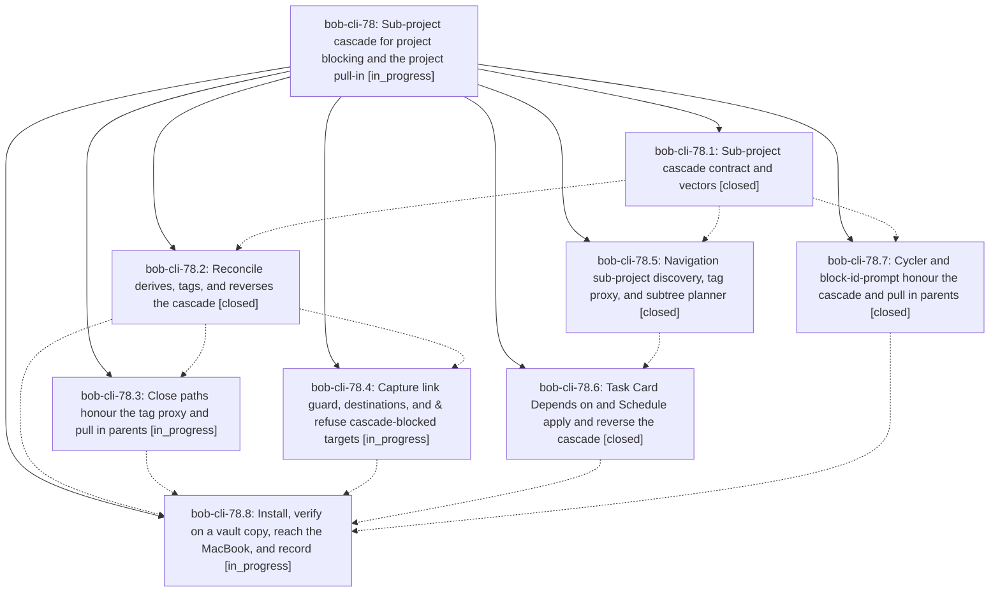

# Bead: bob-cli-78 — Sub-project cascade for project blocking and the project pull-in

[Bead Pages](../README.md) / bob-cli-78

**Status:** ◐ in_progress · **Type:** ▸ plan · **Tier:** epic
**Owner:** `bryanbugyi34@gmail.com` · **Created by:** [bbugyi200.apollo.71](https://github.com/bobs-org/bob-cli--agents/blob/main/sessions/bbugyi200.apollo.71.md) · **Assignee:** `bob-cli-78.land`
**Created:** 2026-10-13 03:14:27 EDT
**Plan:** [202610/subproject\_cascade.md](https://github.com/bobs-org/bob-cli--plans/blob/main/202610/subproject_cascade.md)

<!-- sase:links:start -->

## Links

| Relation | Artifact | Why |
| --- | --- | --- |
| implemented-by | [plan:202610/subproject_cascade.md][1] | derived from the plan's `bead_id:` frontmatter field |

_Plus 1 automatic references — see [Referenced By](#referenced-by)._

[1]: https://github.com/bobs-org/bob-cli--plans/blob/main/202610/subproject_cascade.md

<!-- sase:links:end -->

## Description

A blocked project's sub-projects (project notes whose `parent:` names it, recursively) are Blocked too: their `^prj` and every open resident are `[?]` and tagged `#prj_is_blocked`. `bob task reconcile` derives this and reverses it when the ancestor's reasons clear. The Task Card (Ctrl+Shift+P) applies and reverses it in the same gesture. Every other engine reads a tagged `^prj` as an inherited reason, so nothing links, recovers, or pulls in a cascade-blocked task. Closing a sub-project's `^prj` that leaves its parent with no open work pulls the parent's `^prj` in as Next (§12.10 trigger (c)), both in bob capture and in Obsidian.

## Phases

| Bead | Title | Status | Size | Created | Agents | Commits |
|---|---|---|---|---|---:|---:|
| [bob-cli-78.1](bob-cli-78.1.md) | Sub-project cascade contract and vectors | ✓ closed | small | 2026-10-13 | 1 | 1 |
| [bob-cli-78.2](bob-cli-78.2.md) | Reconcile derives, tags, and reverses the cascade | ✓ closed | medium | 2026-10-13 | 1 | 1 |
| [bob-cli-78.3](bob-cli-78.3.md) | Close paths honour the tag proxy and pull in parents | ◐ in_progress | medium | 2026-10-13 | 1 | 0 |
| [bob-cli-78.4](bob-cli-78.4.md) | Capture link guard, destinations, and & refuse cascade-blocked targets | ◐ in_progress | medium | 2026-10-13 | 1 | 0 |
| [bob-cli-78.5](bob-cli-78.5.md) | Navigation sub-project discovery, tag proxy, and subtree planner | ✓ closed | medium | 2026-10-13 | 1 | 0 |
| [bob-cli-78.6](bob-cli-78.6.md) | Task Card Depends on and Schedule apply and reverse the cascade | ✓ closed | medium | 2026-10-13 | 1 | 0 |
| [bob-cli-78.7](bob-cli-78.7.md) | Cycler and block-id-prompt honour the cascade and pull in parents | ✓ closed | medium | 2026-10-13 | 1 | 1 |
| [bob-cli-78.8](bob-cli-78.8.md) | Install, verify on a vault copy, reach the MacBook, and record | ◐ in_progress | small | 2026-10-13 | 1 | 0 |

## Lineage

## Agents

| Agent | Bead | Commits |
|---|---|---:|
| [bbugyi200.apollo.bob-cli-78.1](https://github.com/bobs-org/bob-cli--agents/blob/main/agents/bbugyi200.apollo.bob-cli-78.1/README.md) | [bob-cli-78.1](bob-cli-78.1.md) | 1 |
| [bbugyi200.apollo.bob-cli-78.2](https://github.com/bobs-org/bob-cli--agents/blob/main/sessions/bbugyi200.apollo.bob-cli-78.2.md) | [bob-cli-78.2](bob-cli-78.2.md) | 1 |
| [bbugyi200.apollo.bob-cli-78.3](https://github.com/bobs-org/bob-cli--agents/blob/main/agents/bbugyi200.apollo.bob-cli-78.3/README.md) | [bob-cli-78.3](bob-cli-78.3.md) | 0 |
| [bbugyi200.apollo.bob-cli-78.4](https://github.com/bobs-org/bob-cli--agents/blob/main/agents/bbugyi200.apollo.bob-cli-78.4/README.md) | [bob-cli-78.4](bob-cli-78.4.md) | 0 |
| [bbugyi200.apollo.bob-cli-78.5](https://github.com/bobs-org/bob-cli--agents/blob/main/agents/bbugyi200.apollo.bob-cli-78.5/README.md) | [bob-cli-78.5](bob-cli-78.5.md) | 0 |
| [bbugyi200.apollo.bob-cli-78.6](https://github.com/bobs-org/bob-cli--agents/blob/main/agents/bbugyi200.apollo.bob-cli-78.6/README.md) | [bob-cli-78.6](bob-cli-78.6.md) | 0 |
| [bbugyi200.apollo.bob-cli-78.7](https://github.com/bobs-org/bob-cli--agents/blob/main/agents/bbugyi200.apollo.bob-cli-78.7/README.md) | [bob-cli-78.7](bob-cli-78.7.md) | 1 |
| [bbugyi200.apollo.bob-cli-78.8](https://github.com/bobs-org/bob-cli--agents/blob/main/agents/bbugyi200.apollo.bob-cli-78.8/README.md) | [bob-cli-78.8](bob-cli-78.8.md) | 0 |
| [bbugyi200.apollo.bob-cli-78.land](https://github.com/bobs-org/bob-cli--agents/blob/main/agents/bbugyi200.apollo.bob-cli-78.land/README.md) | [bob-cli-78](README.md) | 0 |

## Commits

| Repo | Commit | Subject | Bead | Committed |
|---|---|---|---|---|
| bob-cli | [`a2e92bc`](https://github.com/bobs-org/bob-cli/commit/a2e92bcb8f11c9a0d209bfa5d5afb65d13595375) | docs(tasks): cascade contract for parent/ancestors/descendants | [bob-cli-78.1](bob-cli-78.1.md) | 2026-10-13 03:25:05 EDT |
| bob-cli | [`23dbefe`](https://github.com/bobs-org/bob-cli/commit/23dbefe507eac92896f660512733b1040371a8f9) | docs(memory): record subproject blocking cascade | [bob-cli-78.7](bob-cli-78.7.md) | 2026-10-13 03:52:50 EDT |
| bob-cli | [`96bf514`](https://github.com/bobs-org/bob-cli/commit/96bf514e6dc1d4535704bde59c4159ca9b50aa9d) | feat(projects): reconcile inherited sub-project blocking | [bob-cli-78.2](bob-cli-78.2.md) | 2026-10-13 04:53:27 EDT |

<!-- sase:referenced-by:start -->

## Referenced By

| Relation | Artifact | Why | Uses |
| --- | --- | --- | ---: |
| read-by | [agent:bob-cli-78.1][1] | epic context | 1 |

[1]: https://github.com/bobs-org/bob-cli--agents/blob/main/agents/bbugyi200.apollo.bob-cli-78.1/README.md

<!-- sase:referenced-by:end -->
