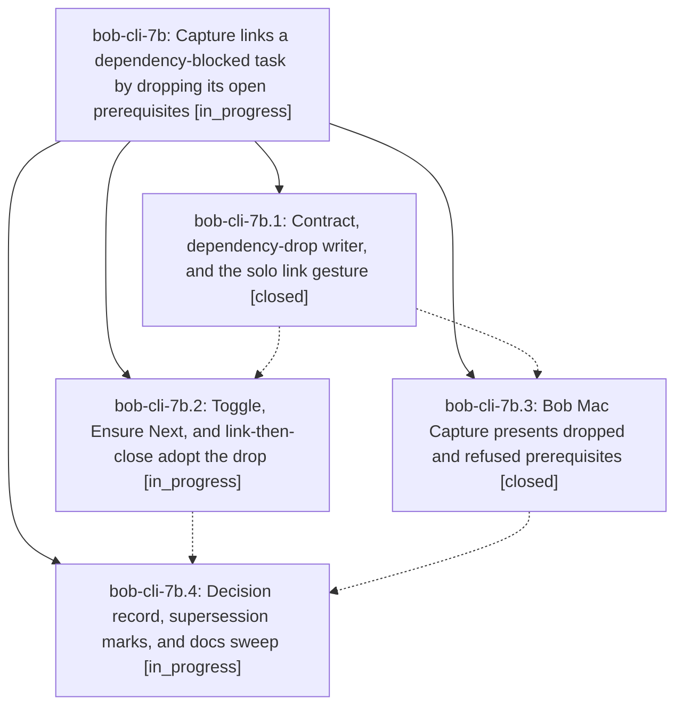

# Bead: bob-cli-7b — Capture links a dependency-blocked task by dropping its open prerequisites

[Bead Pages](../README.md) / bob-cli-7b

**Status:** ◐ in_progress · **Type:** ▸ plan · **Tier:** epic
**Owner:** `bryanbugyi34@gmail.com` · **Created by:** [bbugyi200.apollo.7c.w0](https://github.com/bobs-org/bob-cli--agents/blob/main/sessions/bbugyi200.apollo.7c.w0.md) · **Assignee:** `bob-cli-7b.land`
**Created:** 2026-10-13 08:12:08 EDT
**Plan:** [202610/capture\_link\_drops\_blocking\_deps.md](https://github.com/bobs-org/bob-cli--plans/blob/main/202610/capture_link_drops_blocking_deps.md)

<!-- sase:links:start -->

## Links

| Relation | Artifact | Why |
| --- | --- | --- |
| implemented-by | [plan:202610/capture_link_drops_blocking_deps.md][1] | derived from the plan's `bead_id:` frontmatter field |

[1]: https://github.com/bobs-org/bob-cli--plans/blob/main/202610/capture_link_drops_blocking_deps.md

<!-- sase:links:end -->

## Description

Typing an existing-task link gesture (`@route:id`, `^route:id`, `@route+id`, `@route+id!`, `@route:id=x…`) in `bob capture` or Bob Mac Capture on a task that is Blocked only by its own open prerequisites removes those prerequisites from its Depends-On line and then performs the gesture, while every case where dropping is unsafe keeps today's consumption and says why.

## Phases

| Bead | Title | Status | Size | Created | Agents | Commits |
|---|---|---|---|---|---:|---:|
| [bob-cli-7b.1](bob-cli-7b.1.md) | Contract, dependency-drop writer, and the solo link gesture | ✓ closed | medium | 2026-10-13 | 1 | 1 |
| [bob-cli-7b.2](bob-cli-7b.2.md) | Toggle, Ensure Next, and link-then-close adopt the drop | ◐ in_progress | medium | 2026-10-13 | 1 | 0 |
| [bob-cli-7b.3](bob-cli-7b.3.md) | Bob Mac Capture presents dropped and refused prerequisites | ✓ closed | medium | 2026-10-13 | 1 | 1 |
| [bob-cli-7b.4](bob-cli-7b.4.md) | Decision record, supersession marks, and docs sweep | ◐ in_progress | small | 2026-10-13 | 1 | 0 |

## Lineage

## Agents

| Agent | Bead | Commits |
|---|---|---:|
| [bbugyi200.apollo.bob-cli-7b.1](https://github.com/bobs-org/bob-cli--agents/blob/main/sessions/bbugyi200.apollo.bob-cli-7b.1.md) | [bob-cli-7b.1](bob-cli-7b.1.md) | 1 |
| [bbugyi200.apollo.bob-cli-7b.2](https://github.com/bobs-org/bob-cli--agents/blob/main/agents/bbugyi200.apollo.bob-cli-7b.2/README.md) | [bob-cli-7b.2](bob-cli-7b.2.md) | 0 |
| [bbugyi200.apollo.bob-cli-7b.3](https://github.com/bobs-org/bob-cli--agents/blob/main/agents/bbugyi200.apollo.bob-cli-7b.3/README.md) | [bob-cli-7b.3](bob-cli-7b.3.md) | 1 |
| [bbugyi200.apollo.bob-cli-7b.4](https://github.com/bobs-org/bob-cli--agents/blob/main/agents/bbugyi200.apollo.bob-cli-7b.4/README.md) | [bob-cli-7b.4](bob-cli-7b.4.md) | 0 |
| [bbugyi200.apollo.bob-cli-7b.land](https://github.com/bobs-org/bob-cli--agents/blob/main/agents/bbugyi200.apollo.bob-cli-7b.land/README.md) | [bob-cli-7b](README.md) | 0 |

## Commits

| Repo | Commit | Subject | Bead | Committed |
|---|---|---|---|---|
| bob-cli | [`92515f1`](https://github.com/bobs-org/bob-cli/commit/92515f1bb8565fa7d6116e4581911b9f45e880bb) | feat(capture): support dependency-drop link gestures | [bob-cli-7b.1](bob-cli-7b.1.md) | 2026-10-13 09:24:19 EDT |
| bob-mac-capture | [`bob-mac-capture@8f89423`](https://github.com/bobs-org/bob-mac-capture/commit/8f89423d5f7b1303ca5b591c2f378e091cea5542) | feat(capture): present dropped and refused prerequisites | [bob-cli-7b.3](bob-cli-7b.3.md) | 2026-10-13 09:50:57 EDT |
