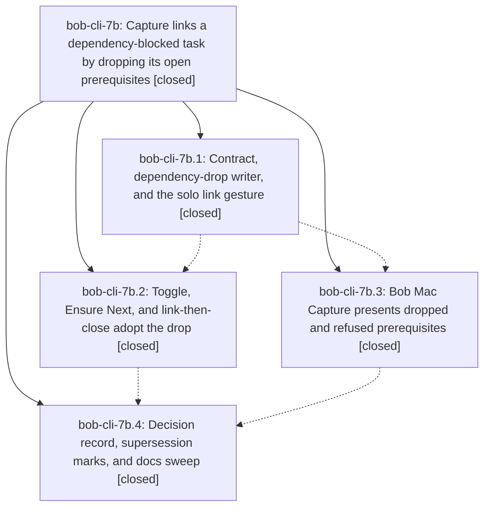

# Bead: bob-cli-7b — Capture links a dependency-blocked task by dropping its open prerequisites

[Bead Pages](../README.md) / bob-cli-7b

**Status:** ✓ closed · **Resolution:** done · **Type:** ▸ plan · **Tier:** epic
**Owner:** `bryanbugyi34@gmail.com` · **Created by:** [bbugyi200.apollo.7c.w0](https://github.com/bobs-org/bob-cli--agents/blob/main/sessions/bbugyi200.apollo.7c.w0.md) · **Assignee:** `bob-cli-7b.land`
**Created:** 2026-10-13 08:12:08 EDT · **Closed:** 2026-10-13 11:06:42 EDT
**Plan:** [202610/capture\_link\_drops\_blocking\_deps.md](https://github.com/bobs-org/bob-cli--plans/blob/main/202610/capture_link_drops_blocking_deps.md)

<!-- sase:links:start -->

## Links

| Relation | Artifact | Why |
| --- | --- | --- |
| implemented-by | [plan:202610/capture_link_drops_blocking_deps.md][1] | derived from the plan's `bead_id:` frontmatter field |

[1]: https://github.com/bobs-org/bob-cli--plans/blob/main/202610/capture_link_drops_blocking_deps.md

<!-- sase:links:end -->

## Description

Typing an existing-task link gesture (`@route:id`, `^route:id`, `@route+id`, `@route+id!`, `@route:id=x…`) in `bob capture` or Bob Mac Capture on a task that is Blocked only by its own open prerequisites removes those prerequisites from its Depends-On line and then performs the gesture, while every case where dropping is unsafe keeps today's consumption and says why.

## Notes

[2026-10-13T13:59:51Z · bryanbugyi34@gmail.com] Pretty sure the changes made by this epic caused the bob-mac-capture build to fail. See the partial error in the 🔒 bob\_mac\_capture\_error.txt file for context.

[2026-10-13T14:57:56Z · bob-cli-7b.land] FOLLOW-UP TRIAGE (land agent, before the remaining-work tale):

Declined, already tracked: bob-cli-7b.1, bob-cli-7b.2, and bob-cli-7b.4 each proposed the two percent-listen CLI failures (capture::r#ref::percent_listen_reference_runs_existing_worker_and_installs_audio and capture::r#ref::failed_percent_listen_worker_keeps_listen_retry_guidance). Same defect is bob-cli-6m. bob-cli-7b.1 also named the parallel library listen-stub ETXTBSY, already bob-cli-5l. Not caused by this epic. No new task, and no +1: this turn did not re-run those tests.

Caused by this epic, stays epic work: epic note #1. bob-mac-capture CI runs 38408350959 (8f89423, bob-cli-7b.3) and 38414162582 (a86eddb, bob-cli-7d.3, same errors) fail because `guard` is used as a Swift identifier in CaptureLinkGuardPresentation.swift and CaptureModelTests.swift, and because CaptureTogglePresentationTests.swift opens three multiline strings with a comma on the delimiter line. A tale will fix that and close this epic. Not filed as a separate task.

Not follow-up work: the install and ^job:blocked manual-check notes on bob-cli-7b.3 and bob-cli-7b.4 are instructions for Bryan.

Integration, no bob-cli change: f2f2fd0 (bob-cli-7d.1 Go To grammar) does not call the link guard. 2d1adfa (bob-cli-7c.1 Successor Offers) left PDG18–PDG27 and §13.5.1 in place. bob-mac-capture a86eddb only failed CI on the compile errors above.

[2026-10-13T15:06:42Z · bob-cli-7b.land] Verified bob-cli-7b on origin/master. Phases 7b.1–7b.4 are closed and their notes are addressed. resolve_link_guard is what pomodoro_link, task_toggle, ensure_next, and pomodoro_close call. assess_link_target drops only after project_blocked, project_task, and schedule, and the writer refuses a bad Depends-On line with dependency_line. PDG1 and PDG18–PDG27 are in docs/task-dependencies.md. decisions:capture-link-drops-blocking-deps is accepted; projects-block-from-prj-line and task-deps-are-depends-on-links are superseded-in-part with the back-link sentences. Drift since 92515f1 needs no bob-cli edit: f2f2fd0 does not call the link guard, and 2d1adfa left the drop contract in place. Follow-up triage is the FOLLOW-UP TRIAGE note: percent-listen stays bob-cli-6m, ETXTBSY stays bob-cli-5l, and the Mac compile failure was this epic's remaining work. That failure was guard used as a Swift identifier in CaptureLinkGuardPresentation.swift and CaptureModelTests.swift, plus three illegal multiline strings in CaptureTogglePresentationTests.swift. Those are renamed to linkGuard and rewritten as raw strings. epic-symbols had no entries. No parent bead.

## Attachments

- 🔒 bob\_mac\_capture\_error.txt · text/plain · 11.9141 KiB (private attachment)

## Phases

| Bead | Title | Status | Size | Created | Agents | Commits |
|---|---|---|---|---|---:|---:|
| [bob-cli-7b.1](bob-cli-7b.1.md) | Contract, dependency-drop writer, and the solo link gesture | ✓ closed | medium | 2026-10-13 | 1 | 1 |
| [bob-cli-7b.2](bob-cli-7b.2.md) | Toggle, Ensure Next, and link-then-close adopt the drop | ✓ closed | medium | 2026-10-13 | 1 | 1 |
| [bob-cli-7b.3](bob-cli-7b.3.md) | Bob Mac Capture presents dropped and refused prerequisites | ✓ closed | medium | 2026-10-13 | 1 | 1 |
| [bob-cli-7b.4](bob-cli-7b.4.md) | Decision record, supersession marks, and docs sweep | ✓ closed | small | 2026-10-13 | 1 | 1 |

## Lineage

## Agents

| Agent | Bead | Commits |
|---|---|---:|
| [bbugyi200.apollo.bob-cli-7b.1](https://github.com/bobs-org/bob-cli--agents/blob/main/sessions/bbugyi200.apollo.bob-cli-7b.1.md) | [bob-cli-7b.1](bob-cli-7b.1.md) | 1 |
| [bbugyi200.apollo.bob-cli-7b.2](https://github.com/bobs-org/bob-cli--agents/blob/main/agents/bbugyi200.apollo.bob-cli-7b.2/README.md) | [bob-cli-7b.2](bob-cli-7b.2.md) | 1 |
| [bbugyi200.apollo.bob-cli-7b.3](https://github.com/bobs-org/bob-cli--agents/blob/main/agents/bbugyi200.apollo.bob-cli-7b.3/README.md) | [bob-cli-7b.3](bob-cli-7b.3.md) | 1 |
| [bbugyi200.apollo.bob-cli-7b.4](https://github.com/bobs-org/bob-cli--agents/blob/main/agents/bbugyi200.apollo.bob-cli-7b.4/README.md) | [bob-cli-7b.4](bob-cli-7b.4.md) | 1 |
| [bbugyi200.apollo.bob-cli-7b.land](https://github.com/bobs-org/bob-cli--agents/blob/main/sessions/bbugyi200.apollo.bob-cli-7b.land.md) | [bob-cli-7b](README.md) | 2 |

## Commits

| Repo | Commit | Subject | Bead | Committed |
|---|---|---|---|---|
| bob-cli | [`92515f1`](https://github.com/bobs-org/bob-cli/commit/92515f1bb8565fa7d6116e4581911b9f45e880bb) | feat(capture): support dependency-drop link gestures | [bob-cli-7b.1](bob-cli-7b.1.md) | 2026-10-13 09:24:19 EDT |
| bob-mac-capture | [`bob-mac-capture@8f89423`](https://github.com/bobs-org/bob-mac-capture/commit/8f89423d5f7b1303ca5b591c2f378e091cea5542) | feat(capture): present dropped and refused prerequisites | [bob-cli-7b.3](bob-cli-7b.3.md) | 2026-10-13 09:50:57 EDT |
| bob-cli | [`bdfc8c3`](https://github.com/bobs-org/bob-cli/commit/bdfc8c3ee3edb5eef6f3ba0dddc12c36ef8095ec) | feat(capture): route toggle, ensure-next and link-then-close through shared link guard | [bob-cli-7b.2](bob-cli-7b.2.md) | 2026-10-13 10:14:59 EDT |
| bob-cli | [`c80cbde`](https://github.com/bobs-org/bob-cli/commit/c80cbdeaf4c2bdf53d74b903e6a108c8d7a1a72f) | docs(memory): record capture dropping own blocking deps | [bob-cli-7b.4](bob-cli-7b.4.md) | 2026-10-13 10:37:23 EDT |
| bob-mac-capture | [`bob-mac-capture@7b87f79`](https://github.com/bobs-org/bob-mac-capture/commit/7b87f7926cd739ad738d7c4f2b88197811cd9b9e) | fix(capture): compile link-guard presentation on Swift | [bob-cli-7b](README.md) | 2026-10-13 11:05:19 EDT |
| bob-cli--plans | [`bob-cli--plans@e6a1b40`](https://github.com/bobs-org/bob-cli--plans/commit/e6a1b40071b390412a4fa80bc51abb747e9d7d8b) | chore(plan): mark capture\_link\_drops\_blocking\_deps done | [bob-cli-7b](README.md) | 2026-10-13 11:09:36 EDT |
