# Bead: bob-cli-7c — Successor Offers — pick which unblocked tasks to pull in after a close

[Bead Pages](../README.md) / bob-cli-7c

**Status:** ✓ closed · **Resolution:** done · **Type:** ▸ plan · **Tier:** epic
**Owner:** `bryanbugyi34@gmail.com` · **Created by:** [bbugyi200.apollo.research.11.linker.w0](https://github.com/bobs-org/bob-cli--agents/blob/main/sessions/bbugyi200.apollo.research.11.linker.w0.md) · **Assignee:** `bob-cli-7c.land`
**Created:** 2026-10-13 09:48:11 EDT · **Closed:** 2026-10-13 17:34:51 EDT
**Plan:** [202610/successor\_offers.md](https://github.com/bobs-org/bob-cli--plans/blob/main/202610/successor_offers.md)

<!-- sase:links:start -->

## Links

| Relation | Artifact | Why |
| --- | --- | --- |
| implemented-by | [plan:202610/slash_task_goto.md][1] | derived from the plan's `bead_id:` frontmatter field |
| implemented-by | [plan:202610/successor_offers.md][2] | derived from the plan's `bead_id:` frontmatter field |
| related | [bead:bob-cli-7j][3] | Successor Offers epic that shipped the offer/pick contract and the Obsidian-only destination override this extends |

_Plus 4 automatic references — see [Referenced By](#referenced-by)._

[1]: https://github.com/bobs-org/bob-cli--plans/blob/main/202610/slash_task_goto.md
[2]: https://github.com/bobs-org/bob-cli--plans/blob/main/202610/successor_offers.md
[3]: https://github.com/bobs-org/bob-cli--beads/blob/main/pages/bob-cli-7j/README.md

<!-- sase:links:end -->

## Description

Closing a task that unblocks other tasks (in Obsidian, bob capture, or Bob Mac Capture) still recovers everything immediately, but no successor Task Link is created automatically. Instead one grouped picker per gesture offers the direct dependents, every available task of a project whose ^prj the close unblocked (the sase.md ^bar → sase_foo.md case), and the emptied-project / parent-project ^prj pull-ins, with no 5-successor limit. Only the picked tasks are linked, raised to Next, and stamped fresh.

## Notes

[2026-10-13T19:35:02Z · bob-cli-7e.land] DISCOVERED ISSUE: scripts/test-task-status-cycler-successor-wiring.cjs 'Pomodoro-line close appends the successor to the created continuation' (test line 490) fails deterministically on bob-plugins 8406ebb, both in the full file and alone via --test-name-pattern: the continuation and successor link are written, but assert.equal(row.link.entry_created, true) at line 529 gets false. The test file was last changed by 310739d (bob-cli-7c.4), whose own note recorded a suite-vs-standalone divergence on this test. bob-cli-7e.3, 7e.4, and 7e.7 each reproduced it on clean base (0d69a20 / 4fad819) before their BLOCKS changes, so it predates bob-cli-7e and belongs to the Successor Offers cycler wiring. Surfaced by the bob-cli-7e land agent.

[2026-10-13T21:34:51Z · bob-cli-7c.land] LANDED. Verification:
(1) All 8 phases are closed and every phase note was reviewed. DECISIONS were honored. Memory edits are limited to decisions:unblocked-tasks-are-offered, the superseded-in-part marks on unblocked-tasks-resurface-as-ticklers and subprojects-inherit-project-blocking, and glossary:successor-offer (19075ee).
(2) Source and commits match the reports.
- Rust (2d1adfa, f5c82d6, e7a0c7b): the breaker and not_planned_today are gone from the planner. -p/--pull-in and the hidden --require-pull-in-choice exist. tests/cli/capture/successor_offers.rs covers SO1–6/13–19/26/27/29 and dry-run parity.
- Plugins: 310739d, 0d69a20, e5ef68c.
- Mac: 395c521, b0e2ff2, 6c4209b. --pull-in is sent only when bob supports it, with the require-choice retry.
(3) Epic-caused defect fixed in this landing. The epic DISCOVERED ISSUE #1 / 7c.4 follow-up was real: the cycler's post-picker re-plan used post-close day text as its anchor baseline, so a Pomodoro-line close lost its closing anchor. Picks fell to the implicit destination: entry_created was false, and with another open timed entry the pick landed under the wrong Pomodoro. The fix rebuilds the pre-gesture baseline by restoring the closed headline (task-status-cycler 1.40.1, 137-plugin-successor-project.js). A new regression test 'Pomodoro-line close keeps the closing anchor after the picker re-plan' fails before the fix and passes after. Also removed the dead breaker/not_planned_today copy from capture/output.rs, fixed stale test comments, and documented the re-plan baseline in task-dependencies §12.13.
(4) Checks:
- just check exit 0 (all suites pass).
- bob-plugins npm test: 2749/2755. The 6 failures exist without this epic: 4 ledger glyph (bob-cli-6v), 1 Keep counts (bob-cli-6w), and 1 forward-conversion BLOCKS (bob-cli-7i). The successor wiring suite is 12/12.
- npm run validate ok.
- bob plugins sync deployed 9 files; dry-run shows 0 drift.
- Mac CI 38464978866: every pull-in suite passed. The only failures are 4 RefsInspectorScrollTests (bob-cli-7h), which skip the Bundle/launch gates.
(5) Integration since the epic started (7b drops, 7d Go To, 7e BLOCKS, 429550b): no conflicts. §14 makes closes write no BLOCKS and keeps BLOCKS out of offers, and both engines guard managed lines. Added integration notes to bob-cli-5w (still-open predecessor epic, now superseded), 63, 64, and 75 (memory tasks written for auto-linking), 76 (Mac pull-in copy), and 77 (glyph misses picked residents).
(6) Follow-ups:
- +1 bob-cli-3w (7c.5 perf flake).
- Created bob-cli-7h (7c.7 #3 / 7c.8 #1 RefsInspector CI), bob-cli-7i (7c.8 #2 conversion BLOCKS), and bob-cli-7j (7c.8 #1 Mac destination override + --pull-in destination grammar).
- Declined: 7c.1 #2 percent_listen (tracked by bob-cli-6m; it passed in this just check). Ledger glyph and Keep counts (already bob-cli-6v / 6w). The wiring failure (fixed here). 7c.7 #2 host-mac XCTest (known Command Line Tools-only limitation per bob-cli-3x; CI is the authority).
- Declined the 7c.8 #1 Obsidian rescue command: the decision rejects a held-offer tray and lists retrieval as its reopen condition.
- Declined the 7c.8 #1 TTY picker: the decision says bob capture never prompts.
- Not filed: the plan's unproposed deferrals (sub-project recovery on close; offering on cancel / auto-link a lone offer). They conflict with PDC5 and the rejected auto-single alternative.
No --epic-symbol entries.

## Phases

| Bead | Title | Status | Size | Created | Agents | Commits |
|---|---|---|---|---|---:|---:|
| [bob-cli-7c.1](bob-cli-7c.1.md) | Successor Offers contract, vectors, and docs | ✓ closed | medium | 2026-10-13 | 1 | 1 |
| [bob-cli-7c.2](bob-cli-7c.2.md) | Rust planner emits offers and applies a selection | ✓ closed | large | 2026-10-13 | 1 | 1 |
| [bob-cli-7c.3](bob-cli-7c.3.md) | bob capture --pull-in, offer JSON, and the Mac guard | ✓ closed | large | 2026-10-13 | 1 | 1 |
| [bob-cli-7c.4](bob-cli-7c.4.md) | task-status-cycler plans offers, awaits the picker, then applies | ✓ closed | large | 2026-10-13 | 1 | 1 |
| [bob-cli-7c.5](bob-cli-7c.5.md) | Navigation hotkeys successor picker modal and walk integration | ✓ closed | large | 2026-10-13 | 1 | 1 |
| [bob-cli-7c.6](bob-cli-7c.6.md) | Per-row destination override in the Obsidian picker | ✓ closed | medium | 2026-10-13 | 1 | 2 |
| [bob-cli-7c.7](bob-cli-7c.7.md) | Bob Mac Capture in-panel pull-in choice step | ✓ closed | large | 2026-10-13 | 1 | 1 |
| [bob-cli-7c.8](bob-cli-7c.8.md) | Decision record, supersession marks, and epic acceptance | ✓ closed | small | 2026-10-13 | 1 | 1 |

## Lineage

```mermaid
flowchart TD
    n0["bob-cli-7c: Successor Offers — pick which unblocked tasks to pull in after a close [closed]"]
    n1["bob-cli-7c.1: Successor Offers contract, vectors, and docs [closed]"]
    n2["bob-cli-7c.2: Rust planner emits offers and applies a selection [closed]"]
    n3["bob-cli-7c.3: bob capture --pull-in, offer JSON, and the Mac guard [closed]"]
    n4["bob-cli-7c.4: task-status-cycler plans offers, awaits the picker, then applies [closed]"]
    n5["bob-cli-7c.5: Navigation hotkeys successor picker modal and walk integration [closed]"]
    n6["bob-cli-7c.6: Per-row destination override in the Obsidian picker [closed]"]
    n7["bob-cli-7c.7: Bob Mac Capture in-panel pull-in choice step [closed]"]
    n8["bob-cli-7c.8: Decision record, supersession marks, and epic acceptance [closed]"]
    n0 --> n1
    n0 --> n2
    n0 --> n3
    n0 --> n4
    n0 --> n5
    n0 --> n6
    n0 --> n7
    n0 --> n8
    n1 -.-> n2
    n1 -.-> n4
    n1 -.-> n5
    n2 -.-> n3
    n3 -.-> n7
    n3 -.-> n8
    n4 -.-> n6
    n4 -.-> n8
    n5 -.-> n6
    n5 -.-> n8
    n6 -.-> n8
    n7 -.-> n8
```

## Agents

| Agent | Bead | Commits |
|---|---|---:|
| [bbugyi200.apollo.bob-cli-7c.1](https://github.com/bobs-org/bob-cli--agents/blob/main/sessions/bbugyi200.apollo.bob-cli-7c.1.md) | [bob-cli-7c.1](bob-cli-7c.1.md) | 1 |
| [bbugyi200.apollo.bob-cli-7c.2](https://github.com/bobs-org/bob-cli--agents/blob/main/sessions/bbugyi200.apollo.bob-cli-7c.2.md) | [bob-cli-7c.2](bob-cli-7c.2.md) | 1 |
| [bbugyi200.apollo.bob-cli-7c.3](https://github.com/bobs-org/bob-cli--agents/blob/main/sessions/bbugyi200.apollo.bob-cli-7c.3.md) | [bob-cli-7c.3](bob-cli-7c.3.md) | 1 |
| [bbugyi200.apollo.bob-cli-7c.4](https://github.com/bobs-org/bob-cli--agents/blob/main/sessions/bbugyi200.apollo.bob-cli-7c.4.md) | [bob-cli-7c.4](bob-cli-7c.4.md) | 1 |
| [bbugyi200.apollo.bob-cli-7c.5](https://github.com/bobs-org/bob-cli--agents/blob/main/sessions/bbugyi200.apollo.bob-cli-7c.5.md) | [bob-cli-7c.5](bob-cli-7c.5.md) | 1 |
| [bbugyi200.apollo.bob-cli-7c.6](https://github.com/bobs-org/bob-cli--agents/blob/main/agents/bbugyi200.apollo.bob-cli-7c.6/README.md) | [bob-cli-7c.6](bob-cli-7c.6.md) | 2 |
| [bbugyi200.apollo.bob-cli-7c.7](https://github.com/bobs-org/bob-cli--agents/blob/main/sessions/bbugyi200.apollo.bob-cli-7c.7.md) | [bob-cli-7c.7](bob-cli-7c.7.md) | 1 |
| [bbugyi200.apollo.bob-cli-7c.8](https://github.com/bobs-org/bob-cli--agents/blob/main/sessions/bbugyi200.apollo.bob-cli-7c.8.md) | [bob-cli-7c.8](bob-cli-7c.8.md) | 1 |
| [bbugyi200.apollo.bob-cli-7c.land](https://github.com/bobs-org/bob-cli--agents/blob/main/agents/bbugyi200.apollo.bob-cli-7c.land/README.md) | [bob-cli-7c](README.md) | 1 |

## Commits

| Repo | Commit | Subject | Bead | Committed |
|---|---|---|---|---|
| bob-cli | [`2d1adfa`](https://github.com/bobs-org/bob-cli/commit/2d1adfa7d7c794929e8e198a013379f059e7f8fb) | docs(tasks): rewrite successor links as Successor Offers | [bob-cli-7c.1](bob-cli-7c.1.md) | 2026-10-13 10:35:14 EDT |
| bob-plugins | [`bob-plugins@310739d`](https://github.com/bobs-org/bob-plugins/commit/310739dd72d70856d89a7fc1a3eb0c03d24ca048) | feat(cycler): offer successors and await picker before applying (bob-cli-7c.4) | [bob-cli-7c.4](bob-cli-7c.4.md) | 2026-10-13 11:28:18 EDT |
| bob-plugins | [`bob-plugins@0d69a20`](https://github.com/bobs-org/bob-plugins/commit/0d69a20b0363a4b4a4e0ada18753f8d7aa1e373e) | feat(nav): grouped successor offer picker with review-walk hold | [bob-cli-7c.5](bob-cli-7c.5.md) | 2026-10-13 11:32:45 EDT |
| bob-cli | [`3f29da1`](https://github.com/bobs-org/bob-cli/commit/3f29da1c3b0fa8b42b40f442afaebaf184e43b0a) | docs(tasks): document per-row successor destination override (bob-cli-7c.6) | [bob-cli-7c.6](bob-cli-7c.6.md) | 2026-10-13 11:51:13 EDT |
| bob-plugins | [`bob-plugins@e5ef68c`](https://github.com/bobs-org/bob-plugins/commit/e5ef68c2999daebf9fc0189e095d930cf9104f59) | feat(plugins): per-row successor destination override in the Obsidian picker (bob-cli-7c.6) | [bob-cli-7c.6](bob-cli-7c.6.md) | 2026-10-13 11:52:28 EDT |
| bob-cli | [`f5c82d6`](https://github.com/bobs-org/bob-cli/commit/f5c82d63aaa66fc32fc9baf0dfdea66c5359856c) | feat(task-complete): emit successor offers and apply a selection | [bob-cli-7c.2](bob-cli-7c.2.md) | 2026-10-13 12:07:25 EDT |
| bob-cli | [`e7a0c7b`](https://github.com/bobs-org/bob-cli/commit/e7a0c7b588494bd46a67a5a9cdd73dd87906416c) | feat(capture): select successor offers with --pull-in | [bob-cli-7c.3](bob-cli-7c.3.md) | 2026-10-13 13:57:52 EDT |
| bob-mac-capture | [`bob-mac-capture@395c521`](https://github.com/bobs-org/bob-mac-capture/commit/395c5217523aaf28e81f38c8ef5d471d0e9725e7) | feat(capture): add in-panel successor pull-in choice | [bob-cli-7c.7](bob-cli-7c.7.md) | 2026-10-13 15:43:32 EDT |
| bob-cli | [`19075ee`](https://github.com/bobs-org/bob-cli/commit/19075ee673e0dd8a187676204575dced50d2f3dd) | feat(memory): record successor offers decision | [bob-cli-7c.8](bob-cli-7c.8.md) | 2026-10-13 17:11:07 EDT |
| bob-cli | [`f24d5e7`](https://github.com/bobs-org/bob-cli/commit/f24d5e7daf3e8349dd03505da413317934f2cf41) | chore(successors): land Successor Offers epic cleanup | [bob-cli-7c](README.md) | 2026-10-13 17:35:57 EDT |

<!-- sase:referenced-by:start -->

## Referenced By

| Relation | Artifact | Why | Uses |
| --- | --- | --- | ---: |
| read-by | [agent:bob-cli-7c.1--1][1] | Need epic phase split and memory assignment | 1 |
| read-by | [agent:bob-cli-7c.6][2] | Need epic DECISIONS and plan context | 1 |
| read-by | [agent:bob-cli-7c.8--1][3] | Check whether clean-base plugin failures are already tracked | 1 |
| read-by | [agent:bob-cli-7e.land][4] | Triage bob-cli-7e follow-ups against related beads | 2 |

[1]: https://github.com/bobs-org/bob-cli--agents/blob/main/sessions/bbugyi200.apollo.bob-cli-7c.1.md
[2]: https://github.com/bobs-org/bob-cli--agents/blob/main/agents/bbugyi200.apollo.bob-cli-7c.6/README.md
[3]: https://github.com/bobs-org/bob-cli--agents/blob/main/sessions/bbugyi200.apollo.bob-cli-7c.8.md
[4]: https://github.com/bobs-org/bob-cli--agents/blob/main/agents/bbugyi200.apollo.bob-cli-7e.land/README.md

<!-- sase:referenced-by:end -->
