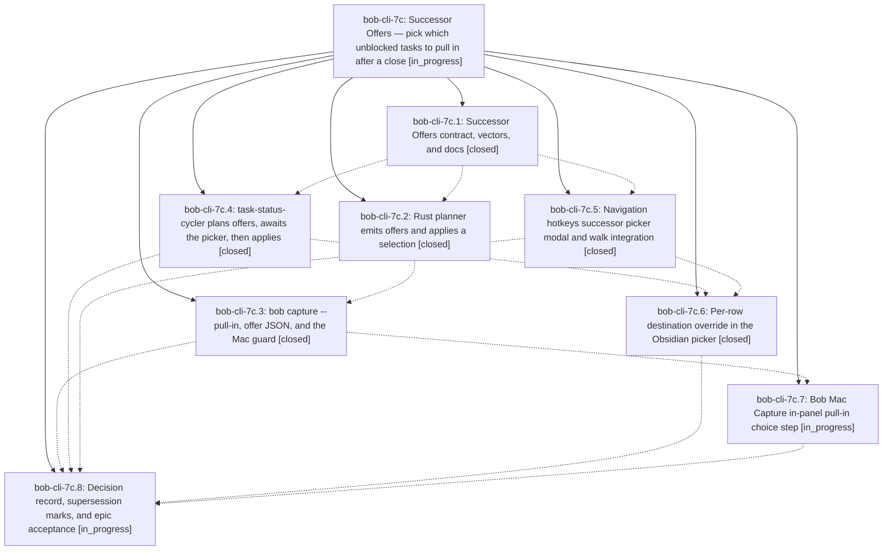

# Bead: bob-cli-7c — Successor Offers — pick which unblocked tasks to pull in after a close

[Bead Pages](../README.md) / bob-cli-7c

**Status:** ◐ in_progress · **Type:** ▸ plan · **Tier:** epic
**Owner:** `bryanbugyi34@gmail.com` · **Created by:** [bbugyi200.apollo.research.11.linker.w0](https://github.com/bobs-org/bob-cli--agents/blob/main/sessions/bbugyi200.apollo.research.11.linker.w0.md) · **Assignee:** `bob-cli-7c.land`
**Created:** 2026-10-13 09:48:11 EDT
**Plan:** [202610/successor\_offers.md](https://github.com/bobs-org/bob-cli--plans/blob/main/202610/successor_offers.md)

<!-- sase:links:start -->

## Links

| Relation | Artifact | Why |
| --- | --- | --- |
| implemented-by | [plan:202610/slash_task_goto.md][1] | derived from the plan's `bead_id:` frontmatter field |
| implemented-by | [plan:202610/successor_offers.md][2] | derived from the plan's `bead_id:` frontmatter field |

_Plus 2 automatic references — see [Referenced By](#referenced-by)._

[1]: https://github.com/bobs-org/bob-cli--plans/blob/main/202610/slash_task_goto.md
[2]: https://github.com/bobs-org/bob-cli--plans/blob/main/202610/successor_offers.md

<!-- sase:links:end -->

## Description

Closing a task that unblocks other tasks (in Obsidian, bob capture, or Bob Mac Capture) still recovers everything immediately, but no successor Task Link is created automatically. Instead one grouped picker per gesture offers the direct dependents, every available task of a project whose ^prj the close unblocked (the sase.md ^bar → sase_foo.md case), and the emptied-project / parent-project ^prj pull-ins, with no 5-successor limit. Only the picked tasks are linked, raised to Next, and stamped fresh.

## Phases

| Bead | Title | Status | Size | Created | Agents | Commits |
|---|---|---|---|---|---:|---:|
| [bob-cli-7c.1](bob-cli-7c.1.md) | Successor Offers contract, vectors, and docs | ✓ closed | medium | 2026-10-13 | 1 | 1 |
| [bob-cli-7c.2](bob-cli-7c.2.md) | Rust planner emits offers and applies a selection | ✓ closed | large | 2026-10-13 | 1 | 1 |
| [bob-cli-7c.3](bob-cli-7c.3.md) | bob capture --pull-in, offer JSON, and the Mac guard | ✓ closed | large | 2026-10-13 | 1 | 1 |
| [bob-cli-7c.4](bob-cli-7c.4.md) | task-status-cycler plans offers, awaits the picker, then applies | ✓ closed | large | 2026-10-13 | 1 | 0 |
| [bob-cli-7c.5](bob-cli-7c.5.md) | Navigation hotkeys successor picker modal and walk integration | ✓ closed | large | 2026-10-13 | 1 | 0 |
| [bob-cli-7c.6](bob-cli-7c.6.md) | Per-row destination override in the Obsidian picker | ✓ closed | medium | 2026-10-13 | 1 | 1 |
| [bob-cli-7c.7](bob-cli-7c.7.md) | Bob Mac Capture in-panel pull-in choice step | ◐ in_progress | large | 2026-10-13 | 1 | 0 |
| [bob-cli-7c.8](bob-cli-7c.8.md) | Decision record, supersession marks, and epic acceptance | ◐ in_progress | small | 2026-10-13 | 1 | 0 |

## Lineage

## Agents

| Agent | Bead | Commits |
|---|---|---:|
| [bbugyi200.apollo.bob-cli-7c.1](https://github.com/bobs-org/bob-cli--agents/blob/main/sessions/bbugyi200.apollo.bob-cli-7c.1.md) | [bob-cli-7c.1](bob-cli-7c.1.md) | 1 |
| [bbugyi200.apollo.bob-cli-7c.2](https://github.com/bobs-org/bob-cli--agents/blob/main/sessions/bbugyi200.apollo.bob-cli-7c.2.md) | [bob-cli-7c.2](bob-cli-7c.2.md) | 1 |
| [bbugyi200.apollo.bob-cli-7c.3](https://github.com/bobs-org/bob-cli--agents/blob/main/sessions/bbugyi200.apollo.bob-cli-7c.3.md) | [bob-cli-7c.3](bob-cli-7c.3.md) | 1 |
| [bbugyi200.apollo.bob-cli-7c.4](https://github.com/bobs-org/bob-cli--agents/blob/main/sessions/bbugyi200.apollo.bob-cli-7c.4.md) | [bob-cli-7c.4](bob-cli-7c.4.md) | 0 |
| [bbugyi200.apollo.bob-cli-7c.5](https://github.com/bobs-org/bob-cli--agents/blob/main/sessions/bbugyi200.apollo.bob-cli-7c.5.md) | [bob-cli-7c.5](bob-cli-7c.5.md) | 0 |
| [bbugyi200.apollo.bob-cli-7c.6](https://github.com/bobs-org/bob-cli--agents/blob/main/agents/bbugyi200.apollo.bob-cli-7c.6/README.md) | [bob-cli-7c.6](bob-cli-7c.6.md) | 1 |
| [bbugyi200.apollo.bob-cli-7c.7](https://github.com/bobs-org/bob-cli--agents/blob/main/agents/bbugyi200.apollo.bob-cli-7c.7/README.md) | [bob-cli-7c.7](bob-cli-7c.7.md) | 0 |
| [bbugyi200.apollo.bob-cli-7c.8](https://github.com/bobs-org/bob-cli--agents/blob/main/agents/bbugyi200.apollo.bob-cli-7c.8/README.md) | [bob-cli-7c.8](bob-cli-7c.8.md) | 0 |
| [bbugyi200.apollo.bob-cli-7c.land](https://github.com/bobs-org/bob-cli--agents/blob/main/agents/bbugyi200.apollo.bob-cli-7c.land/README.md) | [bob-cli-7c](README.md) | 0 |

## Commits

| Repo | Commit | Subject | Bead | Committed |
|---|---|---|---|---|
| bob-cli | [`2d1adfa`](https://github.com/bobs-org/bob-cli/commit/2d1adfa7d7c794929e8e198a013379f059e7f8fb) | docs(tasks): rewrite successor links as Successor Offers | [bob-cli-7c.1](bob-cli-7c.1.md) | 2026-10-13 10:35:14 EDT |
| bob-cli | [`3f29da1`](https://github.com/bobs-org/bob-cli/commit/3f29da1c3b0fa8b42b40f442afaebaf184e43b0a) | docs(tasks): document per-row successor destination override (bob-cli-7c.6) | [bob-cli-7c.6](bob-cli-7c.6.md) | 2026-10-13 11:51:13 EDT |
| bob-cli | [`f5c82d6`](https://github.com/bobs-org/bob-cli/commit/f5c82d63aaa66fc32fc9baf0dfdea66c5359856c) | feat(task-complete): emit successor offers and apply a selection | [bob-cli-7c.2](bob-cli-7c.2.md) | 2026-10-13 12:07:25 EDT |
| bob-cli | [`e7a0c7b`](https://github.com/bobs-org/bob-cli/commit/e7a0c7b588494bd46a67a5a9cdd73dd87906416c) | feat(capture): select successor offers with --pull-in | [bob-cli-7c.3](bob-cli-7c.3.md) | 2026-10-13 13:57:52 EDT |

<!-- sase:referenced-by:start -->

## Referenced By

| Relation | Artifact | Why | Uses |
| --- | --- | --- | ---: |
| read-by | [agent:bob-cli-7c.1--1][1] | Need epic phase split and memory assignment | 1 |
| read-by | [agent:bob-cli-7c.6][2] | Need epic DECISIONS and plan context | 1 |

[1]: https://github.com/bobs-org/bob-cli--agents/blob/main/sessions/bbugyi200.apollo.bob-cli-7c.1.md
[2]: https://github.com/bobs-org/bob-cli--agents/blob/main/agents/bbugyi200.apollo.bob-cli-7c.6/README.md

<!-- sase:referenced-by:end -->
