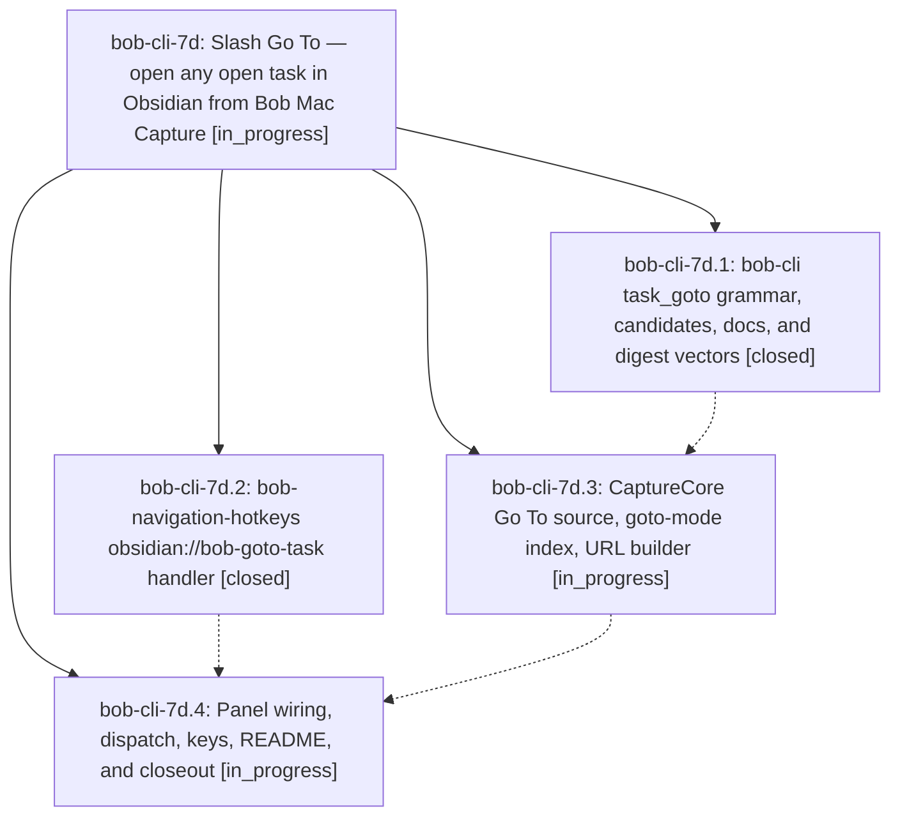

# Bead: bob-cli-7d — Slash Go To — open any open task in Obsidian from Bob Mac Capture

[Bead Pages](../README.md) / bob-cli-7d

**Status:** ◐ in_progress · **Type:** ▸ plan · **Tier:** epic
**Owner:** `bryanbugyi34@gmail.com` · **Created by:** [bbugyi200.athena.research.4b.linker.w0](https://github.com/bobs-org/bob-cli--agents/blob/main/sessions/bbugyi200.athena.research.4b.linker.w0.md) · **Assignee:** `bob-cli-7d.land`
**Created:** 2026-10-13 09:50:28 EDT
**Plan:** [202610/slash\_task\_goto.md](https://github.com/bobs-org/bob-cli--plans/blob/main/202610/slash_task_goto.md)

<!-- sase:links:start -->

## Links

| Relation | Artifact | Why |
| --- | --- | --- |
| implemented-by | [plan:202610/slash_task_goto.md][1] | derived from the plan's `bead_id:` frontmatter field |

[1]: https://github.com/bobs-org/bob-cli--plans/blob/main/202610/slash_task_goto.md

<!-- sase:links:end -->

## Description

Typing `/` as the whole capture draft opens a Go To picker over exactly the `:` task catalog; picking a row hides the panel, clears the draft, and lands Obsidian's caret on that task in its home area/project/inbox note (centred, with a `<C-o>` jump) without writing anything to the vault.

## Phases

| Bead | Title | Status | Size | Created | Agents | Commits |
|---|---|---|---|---|---:|---:|
| [bob-cli-7d.1](bob-cli-7d.1.md) | bob-cli task\_goto grammar, candidates, docs, and digest vectors | ✓ closed | medium | 2026-10-13 | 1 | 0 |
| [bob-cli-7d.2](bob-cli-7d.2.md) | bob-navigation-hotkeys obsidian://bob-goto-task handler | ✓ closed | medium | 2026-10-13 | 1 | 1 |
| [bob-cli-7d.3](bob-cli-7d.3.md) | CaptureCore Go To source, goto-mode index, URL builder | ◐ in_progress | medium | 2026-10-13 | 1 | 0 |
| [bob-cli-7d.4](bob-cli-7d.4.md) | Panel wiring, dispatch, keys, README, and closeout | ◐ in_progress | medium | 2026-10-13 | 1 | 0 |

## Lineage

## Agents

| Agent | Bead | Commits |
|---|---|---:|
| [bbugyi200.athena.bob-cli-7d.1](https://github.com/bobs-org/bob-cli--agents/blob/main/agents/bbugyi200.athena.bob-cli-7d.1/README.md) | [bob-cli-7d.1](bob-cli-7d.1.md) | 0 |
| [bbugyi200.athena.bob-cli-7d.2](https://github.com/bobs-org/bob-cli--agents/blob/main/agents/bbugyi200.athena.bob-cli-7d.2/README.md) | [bob-cli-7d.2](bob-cli-7d.2.md) | 1 |
| [bbugyi200.athena.bob-cli-7d.3](https://github.com/bobs-org/bob-cli--agents/blob/main/agents/bbugyi200.athena.bob-cli-7d.3/README.md) | [bob-cli-7d.3](bob-cli-7d.3.md) | 0 |
| [bbugyi200.athena.bob-cli-7d.4](https://github.com/bobs-org/bob-cli--agents/blob/main/agents/bbugyi200.athena.bob-cli-7d.4/README.md) | [bob-cli-7d.4](bob-cli-7d.4.md) | 0 |
| [bbugyi200.athena.bob-cli-7d.land](https://github.com/bobs-org/bob-cli--agents/blob/main/agents/bbugyi200.athena.bob-cli-7d.land/README.md) | [bob-cli-7d](README.md) | 0 |

## Commits

| Repo | Commit | Subject | Bead | Committed |
|---|---|---|---|---|
| bob-plugins | [`bob-plugins@76924cc`](https://github.com/bobs-org/bob-plugins/commit/76924ccbf011c8bd1c542e7b66b6fd027a359c24) | feat(nav): register read-only obsidian://bob-goto-task handler | [bob-cli-7d.2](bob-cli-7d.2.md) | 2026-10-13 10:12:43 EDT |
