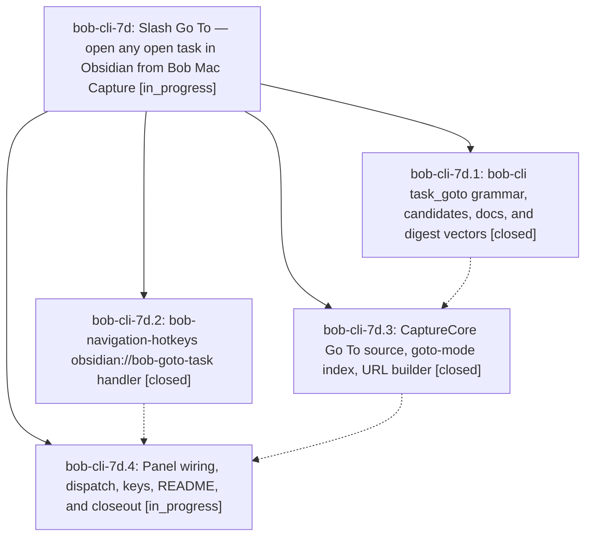

# Bead: bob-cli-7d — Slash Go To — open any open task in Obsidian from Bob Mac Capture

[Bead Pages](../README.md) / bob-cli-7d

**Status:** ◐ in_progress · **Type:** ▸ plan · **Tier:** epic
**Owner:** `bryanbugyi34@gmail.com` · **Created by:** [bbugyi200.athena.research.4b.linker.w0](https://github.com/bobs-org/bob-cli--agents/blob/main/sessions/bbugyi200.athena.research.4b.linker.w0.md) · **Assignee:** `bob-cli-7d.land`
**Created:** 2026-10-13 09:50:28 EDT
**Plan:** [202610/slash\_task\_goto.md](https://github.com/bobs-org/bob-cli--plans/blob/main/202610/slash_task_goto.md)

<!-- sase:links:start -->

## Links

| Relation | Artifact | Why |
| --- | --- | --- |
| implemented-by | [plan:202610/slash_task_goto.md][1] | derived from the plan's `bead_id:` frontmatter field |

_Plus 1 automatic references — see [Referenced By](#referenced-by)._

[1]: https://github.com/bobs-org/bob-cli--plans/blob/main/202610/slash_task_goto.md

<!-- sase:links:end -->

## Description

Typing `/` as the whole capture draft opens a Go To picker over exactly the `:` task catalog; picking a row hides the panel, clears the draft, and lands Obsidian's caret on that task in its home area/project/inbox note (centred, with a `<C-o>` jump) without writing anything to the vault.

## Phases

| Bead | Title | Status | Size | Created | Agents | Commits |
|---|---|---|---|---|---:|---:|
| [bob-cli-7d.1](bob-cli-7d.1.md) | bob-cli task\_goto grammar, candidates, docs, and digest vectors | ✓ closed | medium | 2026-10-13 | 1 | 1 |
| [bob-cli-7d.2](bob-cli-7d.2.md) | bob-navigation-hotkeys obsidian://bob-goto-task handler | ✓ closed | medium | 2026-10-13 | 1 | 0 |
| [bob-cli-7d.3](bob-cli-7d.3.md) | CaptureCore Go To source, goto-mode index, URL builder | ✓ closed | medium | 2026-10-13 | 1 | 1 |
| [bob-cli-7d.4](bob-cli-7d.4.md) | Panel wiring, dispatch, keys, README, and closeout | ◐ in_progress | medium | 2026-10-13 | 1 | 1 |

## Lineage

## Agents

| Agent | Bead | Commits |
|---|---|---:|
| [bbugyi200.athena.bob-cli-7d.1](https://github.com/bobs-org/bob-cli--agents/blob/main/agents/bbugyi200.athena.bob-cli-7d.1/README.md) | [bob-cli-7d.1](bob-cli-7d.1.md) | 1 |
| [bbugyi200.athena.bob-cli-7d.2](https://github.com/bobs-org/bob-cli--agents/blob/main/agents/bbugyi200.athena.bob-cli-7d.2/README.md) | [bob-cli-7d.2](bob-cli-7d.2.md) | 0 |
| [bbugyi200.athena.bob-cli-7d.3](https://github.com/bobs-org/bob-cli--agents/blob/main/agents/bbugyi200.athena.bob-cli-7d.3/README.md) | [bob-cli-7d.3](bob-cli-7d.3.md) | 1 |
| [bbugyi200.athena.bob-cli-7d.4](https://github.com/bobs-org/bob-cli--agents/blob/main/agents/bbugyi200.athena.bob-cli-7d.4/README.md) | [bob-cli-7d.4](bob-cli-7d.4.md) | 1 |
| [bbugyi200.athena.bob-cli-7d.land](https://github.com/bobs-org/bob-cli--agents/blob/main/agents/bbugyi200.athena.bob-cli-7d.land/README.md) | [bob-cli-7d](README.md) | 0 |

## Commits

| Repo | Commit | Subject | Bead | Committed |
|---|---|---|---|---|
| bob-cli | [`f2f2fd0`](https://github.com/bobs-org/bob-cli/commit/f2f2fd037f3cec857374af1c34fe37e137ef3052) | feat(capture): whole-draft /query Go To grammar, candidates, docs, and digest vectors | [bob-cli-7d.1](bob-cli-7d.1.md) | 2026-10-13 10:13:42 EDT |
| bob-mac-capture | [`bob-mac-capture@a86eddb`](https://github.com/bobs-org/bob-mac-capture/commit/a86eddb7fd523607d9330842d791efb3a4021719) | feat(capture): add Go To picker core | [bob-cli-7d.3](bob-cli-7d.3.md) | 2026-10-13 10:31:53 EDT |
| bob-mac-capture | [`bob-mac-capture@6345673`](https://github.com/bobs-org/bob-mac-capture/commit/6345673d2dbe8a0daacd37b664fe366370bc3b25) | feat(capture): open Obsidian from the Go To picker | [bob-cli-7d.4](bob-cli-7d.4.md) | 2026-10-13 10:53:51 EDT |

<!-- sase:referenced-by:start -->

## Referenced By

| Relation | Artifact | Why | Uses |
| --- | --- | --- | ---: |
| read-by | [agent:bob-cli-7d.1][1] | need epic scope | 1 |

[1]: https://github.com/bobs-org/bob-cli--agents/blob/main/agents/bbugyi200.athena.bob-cli-7d.1/README.md

<!-- sase:referenced-by:end -->
