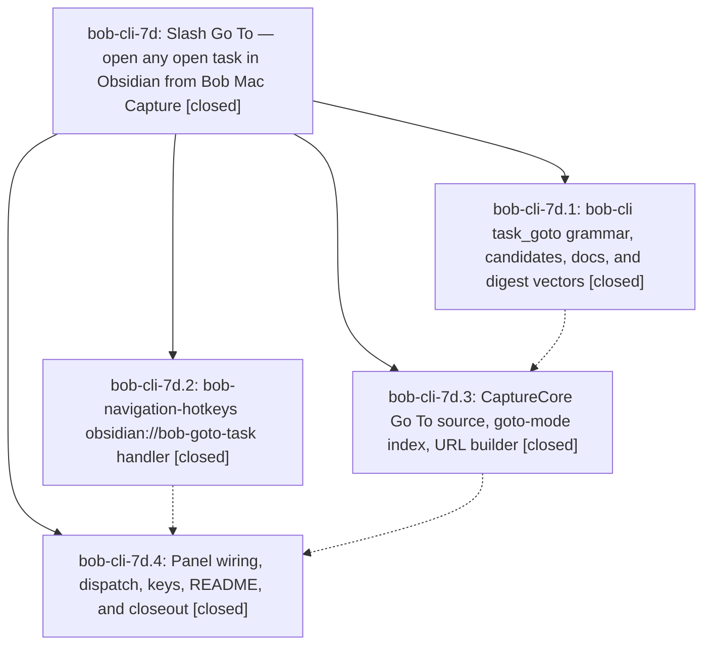

# Bead: bob-cli-7d — Slash Go To — open any open task in Obsidian from Bob Mac Capture

[Bead Pages](../README.md) / bob-cli-7d

**Status:** ✓ closed · **Resolution:** done · **Type:** ▸ plan · **Tier:** epic
**Owner:** `bryanbugyi34@gmail.com` · **Created by:** [bbugyi200.athena.research.4b.linker.w0](https://github.com/bobs-org/bob-cli--agents/blob/main/sessions/bbugyi200.athena.research.4b.linker.w0.md) · **Assignee:** `bob-cli-7d.land`
**Created:** 2026-10-13 09:50:28 EDT · **Closed:** 2026-10-13 11:19:21 EDT
**Plan:** [202610/slash\_task\_goto.md](https://github.com/bobs-org/bob-cli--plans/blob/main/202610/slash_task_goto.md)

<!-- sase:links:start -->

## Links

| Relation | Artifact | Why |
| --- | --- | --- |
| implemented-by | [plan:202610/slash_task_goto.md][1] | derived from the plan's `bead_id:` frontmatter field |

_Plus 1 automatic references — see [Referenced By](#referenced-by)._

[1]: https://github.com/bobs-org/bob-cli--plans/blob/main/202610/slash_task_goto.md

<!-- sase:links:end -->

## Description

Typing `/` as the whole capture draft opens a Go To picker over exactly the `:` task catalog; picking a row hides the panel, clears the draft, and lands Obsidian's caret on that task in its home area/project/inbox note (centred, with a `<C-o>` jump) without writing anything to the vault.

## Notes

[2026-10-13T15:19:21Z · bob-cli-7d.land] Verified bob-cli-7d. Phases 7d.1–7d.4 are closed done. memory_goto_record=no was honored: no decisions:task-goto-never-writes strand and no other memory edit.

cli-goto (f2f2fd0): task_goto_query_token claims a whole-draft single-/ token; item.rs refuses it with the T3 error before the & scan; completion, capture-complete, and the shell arm exist; TaskGotoCandidate uses discover+rank with note_path, target, empty replacement, and no requires_block_id, block_id_suggestions, or pulls_forward; line_digest vectors are asserted from tests/fixtures/line_digest/vectors.json; docs/capture.md has the Go To section.

plugin-goto-uri (76924cc, bob-navigation-hotkeys 2.32.0, still the plugin tip, parent 4f0cc94): onload registers obsidian://bob-goto-task behind the function guard; the handler validates, maps the vault path with one realpath retry, re-finds planned then block then unique digest then clamped, notices only when a ref clamps, and lands through focusTaskAnchor, which re-resolves the anchor on the live editor. The digest strip is the Rust trim_end set, not trimEnd.

mac-goto-core/panel (a86eddb, 6345673): taskGotoURL keeps slashes and encodes + as %2B; goto-mode rows open directly with no Add block ID; acceptTaskGotoRow locks, opens through taskGotoOpener, discards and dismisses on success, and keeps the picker on failure; Ctrl-C discards a / draft instead of stashing it. README Go To Picker requires hotkeys ≥ 2.32.0. 7d.4 note #2 is Bryan's post-epic Mac acceptance checklist, copied as the plan required.

Integration since f2f2fd0 needs no Go To edit. bob-cli bdfc8c3, 2d1adfa, and c80cbde do not touch task_goto sources; the / row and Go To section in docs/capture.md remain. Go To never reaches the link guard. bob-plugins has no later commit. bob-mac-capture 7b87f79 (bob-cli-7b) sits on 6345673 and only renames guard / rewrites toggle fixtures. handleTaskLinkCompletion is parameterized by source and does not write on task_goto.

Follow-ups:
- 7d.1 listen-worker pair: declined, already ready bob-cli-6m. No +1; this turn did not re-run those tests.
- 7d.2 unblocked-glyph and Keep notice: declined, already ready bob-cli-6v and bob-cli-6w. No +1; this turn did not re-run npm test.
- 7d.3 note #1 and 7d.4 note #3 Mac lint: not caused by Go To (same file failed on 8f89423, before a86eddb). bob-cli-7b closed after 7b87f79, but run 38419021175 is still red only at CaptureTogglePresentationTests.swift:512,576,588 because #"..."# contains newlines. Filed ready task bob-cli-7f (ci, small), related to bob-cli-7b and bob-cli-73. No in-progress epic owns it.
- The plan's out-of-scope list was not proposed by any phase and stays out of scope.
- epic-symbols: none. No parent bead.

## Phases

| Bead | Title | Status | Size | Created | Agents | Commits |
|---|---|---|---|---|---:|---:|
| [bob-cli-7d.1](bob-cli-7d.1.md) | bob-cli task\_goto grammar, candidates, docs, and digest vectors | ✓ closed | medium | 2026-10-13 | 1 | 1 |
| [bob-cli-7d.2](bob-cli-7d.2.md) | bob-navigation-hotkeys obsidian://bob-goto-task handler | ✓ closed | medium | 2026-10-13 | 1 | 1 |
| [bob-cli-7d.3](bob-cli-7d.3.md) | CaptureCore Go To source, goto-mode index, URL builder | ✓ closed | medium | 2026-10-13 | 1 | 1 |
| [bob-cli-7d.4](bob-cli-7d.4.md) | Panel wiring, dispatch, keys, README, and closeout | ✓ closed | medium | 2026-10-13 | 1 | 1 |

## Lineage

## Agents

| Agent | Bead | Commits |
|---|---|---:|
| [bbugyi200.athena.bob-cli-7d.1](https://github.com/bobs-org/bob-cli--agents/blob/main/agents/bbugyi200.athena.bob-cli-7d.1/README.md) | [bob-cli-7d.1](bob-cli-7d.1.md) | 1 |
| [bbugyi200.athena.bob-cli-7d.2](https://github.com/bobs-org/bob-cli--agents/blob/main/agents/bbugyi200.athena.bob-cli-7d.2/README.md) | [bob-cli-7d.2](bob-cli-7d.2.md) | 1 |
| [bbugyi200.athena.bob-cli-7d.3](https://github.com/bobs-org/bob-cli--agents/blob/main/agents/bbugyi200.athena.bob-cli-7d.3/README.md) | [bob-cli-7d.3](bob-cli-7d.3.md) | 1 |
| [bbugyi200.athena.bob-cli-7d.4](https://github.com/bobs-org/bob-cli--agents/blob/main/agents/bbugyi200.athena.bob-cli-7d.4/README.md) | [bob-cli-7d.4](bob-cli-7d.4.md) | 1 |
| [bbugyi200.athena.bob-cli-7d.land](https://github.com/bobs-org/bob-cli--agents/blob/main/agents/bbugyi200.athena.bob-cli-7d.land/README.md) | [bob-cli-7d](README.md) | 1 |

## Commits

| Repo | Commit | Subject | Bead | Committed |
|---|---|---|---|---|
| bob-plugins | [`bob-plugins@76924cc`](https://github.com/bobs-org/bob-plugins/commit/76924ccbf011c8bd1c542e7b66b6fd027a359c24) | feat(nav): register read-only obsidian://bob-goto-task handler | [bob-cli-7d.2](bob-cli-7d.2.md) | 2026-10-13 10:12:43 EDT |
| bob-cli | [`f2f2fd0`](https://github.com/bobs-org/bob-cli/commit/f2f2fd037f3cec857374af1c34fe37e137ef3052) | feat(capture): whole-draft /query Go To grammar, candidates, docs, and digest vectors | [bob-cli-7d.1](bob-cli-7d.1.md) | 2026-10-13 10:13:42 EDT |
| bob-mac-capture | [`bob-mac-capture@a86eddb`](https://github.com/bobs-org/bob-mac-capture/commit/a86eddb7fd523607d9330842d791efb3a4021719) | feat(capture): add Go To picker core | [bob-cli-7d.3](bob-cli-7d.3.md) | 2026-10-13 10:31:53 EDT |
| bob-mac-capture | [`bob-mac-capture@6345673`](https://github.com/bobs-org/bob-mac-capture/commit/6345673d2dbe8a0daacd37b664fe366370bc3b25) | feat(capture): open Obsidian from the Go To picker | [bob-cli-7d.4](bob-cli-7d.4.md) | 2026-10-13 10:53:51 EDT |
| bob-cli--plans | [`bob-cli--plans@f3e0b42`](https://github.com/bobs-org/bob-cli--plans/commit/f3e0b4247788feccec2cddea62fbbb43b02b28c7) | docs(plan): mark slash Go To plan done | [bob-cli-7d](README.md) | 2026-10-13 11:21:07 EDT |

<!-- sase:referenced-by:start -->

## Referenced By

| Relation | Artifact | Why | Uses |
| --- | --- | --- | ---: |
| read-by | [agent:bob-cli-7d.1][1] | need epic scope | 1 |

[1]: https://github.com/bobs-org/bob-cli--agents/blob/main/agents/bbugyi200.athena.bob-cli-7d.1/README.md

<!-- sase:referenced-by:end -->
