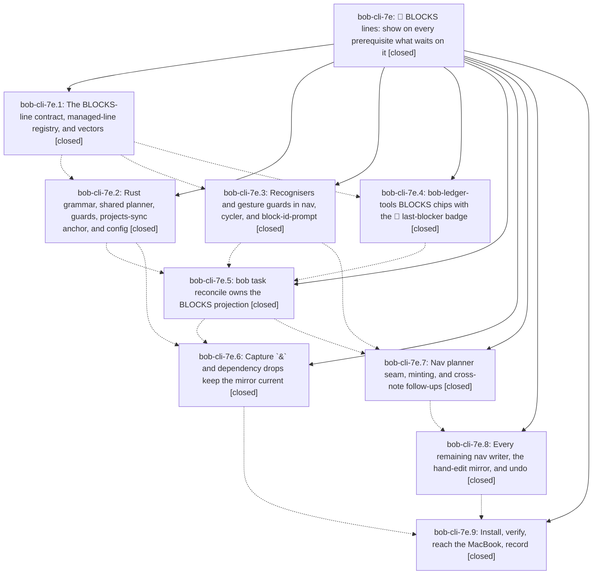

# Bead: bob-cli-7e — 🧱 BLOCKS lines: show on every prerequisite what waits on it

[Bead Pages](../README.md) / bob-cli-7e

**Status:** ✓ closed · **Resolution:** done · **Type:** ▸ plan · **Tier:** epic
**Owner:** `bryanbugyi34@gmail.com` · **Created by:** [bbugyi200.athena.research.4d.linker.w0](https://github.com/bobs-org/bob-cli--agents/blob/main/sessions/bbugyi200.athena.research.4d.linker.w0.md) · **Assignee:** `bob-cli-7e.land`
**Created:** 2026-10-13 11:09:49 EDT · **Closed:** 2026-10-13 15:35:39 EDT
**Plan:** [202610/prerequisite\_blocks\_lines.md](https://github.com/bobs-org/bob-cli--plans/blob/main/202610/prerequisite_blocks_lines.md)

<!-- sase:links:start -->

## Links

| Relation | Artifact | Why |
| --- | --- | --- |
| implemented-by | [plan:202610/prerequisite_blocks_lines.md][1] | derived from the plan's `bead_id:` frontmatter field |

_Plus 2 automatic references — see [Referenced By](#referenced-by)._

[1]: https://github.com/bobs-org/bob-cli--plans/blob/main/202610/prerequisite_blocks_lines.md

<!-- sase:links:end -->

## Description

Every open task that other open tasks depend on carries one machine-owned `🧱 **BLOCKS:**` child line that mirrors its dependents' Depends-On links. The line is kept exact by `bob task reconcile`, updated immediately by every dependency writer (Ctrl+Shift+P, chip ×, hand edits and undo, capture `&`, capture dependency drops), rendered in Obsidian as chips that show what finishing the task would free, and never read back as dependency input.

## Notes

[2026-10-13T19:35:39Z · bob-cli-7e.land] Land verification (bob-cli bfdff70, bob-plugins 8406ebb). STEP 1: read all 9 closed phases and every note. Commits: 4f72e5c (7e.1 docs §14/§2.4 registry/§11.8 MC, projects/capture/getting-started), 8e575c7 (7e.2 blocks.rs parser/planner, config/dependencies.rs, projects-sync anchor, managed-line guards in scan_pomodoros/plan_budget/completable/tree close/pomodoro_close ledger/start), cce650e (7e.5 task_status_hooks/blocks.rs pass, explicit-edge export, JSON/human output, BR1-BR29 CLI tests), bfdff70 (7e.6 capture/blocks_mirror.rs called from both & planners and dependency_drop), f287417 (7e.4 glossary sentence); plugins 6aef3b6 (7e.3 recognisers/guards nav 081, cycler, bip), 4fad819 (7e.4 ledger 141/152/272/281 chips + plan-budget guard), 108bedf (7e.7 nav 082 mint/083 seam/591 follow-ups/config), 8406ebb (7e.8 counted/marked/Ctrl+D/hand-edit+undo/conversion/Ctrl+Shift+M). DECISIONS honoured: 🧱 constants in Rust and nav; glossary:task-dependency-link carries the BLOCKS sentence (written by 7e.4 rather than rollout, within the authorized edit); no decisions:blocks-lines-mirror-depends-on record. Rollout (7e.9) verified host+MacBook installs, plugin versions (nav 2.37.0, ledger 1.50.0, cycler 1.40.0, bip 1.32.0), zero-change live dry-run (vault already holds 15 rows/8 notes), BR26/BR27/BR24 and capture &/drop pilot on a copy. Re-run here: just check green (2555 lib + 1519 CLI, percent-listen tests passing), build:check clean, 135/135 BLOCKS-focused plugin tests pass. STEP 2: post-start non-epic commits are bob-cli-7c Successor Offers (bob-cli 3f29da1, f5c82d6, e7a0c7b; plugins 310739d, 0d69a20, e5ef68c), all landed before the epic's code phases rebased on them. Checked: Rust plan_successors/project_pull_in read task.depends_on fields and the guarded scan_pomodoros only; cycler 085b/089b read memo dependsOn; 085-successor-plan guards isManagedDependencyLine; no Depends-On writer added outside the mirrored paths. No integration change needed. STEP 3 follow-ups: percent-listen (7e.1, 7e.2) -> +1 bob-cli-6m (noted passing in this run, intermittent); unblocked-glyph x4 (7e.3/7e.4/7e.7) -> +1 bob-cli-6v, reproduced on 8406ebb; decision-card Keep (same) -> +1 bob-cli-6w, reproduced; cycler successor-wiring continuation test (7e.3/7e.4/7e.7, no tracking bead) -> DISCOVERED ISSUE on active epic bob-cli-7c (introduced by 7c.4, reproduced deterministically: entry_created false); 7e.9 coordination for bob-cli-3p/3q/3o -> notes appended to those existing beads, no new tasks. Declined: the plan's memory_decision_record=no branch asked rollout to propose the decision record as a follow-up (rollout omitted it); not filed because the reviewer explicitly declined that record, and a task would re-ask a settled decision. epic-symbols: none.

## Phases

| Bead | Title | Status | Size | Created | Agents | Commits |
|---|---|---|---|---|---:|---:|
| [bob-cli-7e.1](bob-cli-7e.1.md) | The BLOCKS-line contract, managed-line registry, and vectors | ✓ closed | medium | 2026-10-13 | 1 | 1 |
| [bob-cli-7e.2](bob-cli-7e.2.md) | Rust grammar, shared planner, guards, projects-sync anchor, and config | ✓ closed | medium | 2026-10-13 | 1 | 1 |
| [bob-cli-7e.3](bob-cli-7e.3.md) | Recognisers and gesture guards in nav, cycler, and block-id-prompt | ✓ closed | medium | 2026-10-13 | 1 | 1 |
| [bob-cli-7e.4](bob-cli-7e.4.md) | bob-ledger-tools BLOCKS chips with the 🔑 last-blocker badge | ✓ closed | medium | 2026-10-13 | 1 | 2 |
| [bob-cli-7e.5](bob-cli-7e.5.md) | bob task reconcile owns the BLOCKS projection | ✓ closed | medium | 2026-10-13 | 1 | 1 |
| [bob-cli-7e.6](bob-cli-7e.6.md) | Capture \`&\` and dependency drops keep the mirror current | ✓ closed | medium | 2026-10-13 | 1 | 1 |
| [bob-cli-7e.7](bob-cli-7e.7.md) | Nav planner seam, minting, and cross-note follow-ups | ✓ closed | medium | 2026-10-13 | 1 | 1 |
| [bob-cli-7e.8](bob-cli-7e.8.md) | Every remaining nav writer, the hand-edit mirror, and undo | ✓ closed | medium | 2026-10-13 | 1 | 1 |
| [bob-cli-7e.9](bob-cli-7e.9.md) | Install, verify, reach the MacBook, record | ✓ closed | small | 2026-10-13 | 1 | 0 |

## Lineage

## Agents

| Agent | Bead | Commits |
|---|---|---:|
| [bbugyi200.athena.bob-cli-7e.1](https://github.com/bobs-org/bob-cli--agents/blob/main/sessions/bbugyi200.athena.bob-cli-7e.1.md) | [bob-cli-7e.1](bob-cli-7e.1.md) | 1 |
| [bbugyi200.athena.bob-cli-7e.2](https://github.com/bobs-org/bob-cli--agents/blob/main/sessions/bbugyi200.athena.bob-cli-7e.2.md) | [bob-cli-7e.2](bob-cli-7e.2.md) | 1 |
| [bbugyi200.athena.bob-cli-7e.3](https://github.com/bobs-org/bob-cli--agents/blob/main/agents/bbugyi200.athena.bob-cli-7e.3/README.md) | [bob-cli-7e.3](bob-cli-7e.3.md) | 1 |
| [bbugyi200.athena.bob-cli-7e.4](https://github.com/bobs-org/bob-cli--agents/blob/main/sessions/bbugyi200.athena.bob-cli-7e.4.md) | [bob-cli-7e.4](bob-cli-7e.4.md) | 2 |
| [bbugyi200.athena.bob-cli-7e.5](https://github.com/bobs-org/bob-cli--agents/blob/main/agents/bbugyi200.athena.bob-cli-7e.5/README.md) | [bob-cli-7e.5](bob-cli-7e.5.md) | 1 |
| [bbugyi200.athena.bob-cli-7e.6](https://github.com/bobs-org/bob-cli--agents/blob/main/agents/bbugyi200.athena.bob-cli-7e.6/README.md) | [bob-cli-7e.6](bob-cli-7e.6.md) | 1 |
| [bbugyi200.athena.bob-cli-7e.7](https://github.com/bobs-org/bob-cli--agents/blob/main/agents/bbugyi200.athena.bob-cli-7e.7/README.md) | [bob-cli-7e.7](bob-cli-7e.7.md) | 1 |
| [bbugyi200.athena.bob-cli-7e.8](https://github.com/bobs-org/bob-cli--agents/blob/main/agents/bbugyi200.athena.bob-cli-7e.8/README.md) | [bob-cli-7e.8](bob-cli-7e.8.md) | 1 |
| [bbugyi200.athena.bob-cli-7e.9](https://github.com/bobs-org/bob-cli--agents/blob/main/agents/bbugyi200.athena.bob-cli-7e.9/README.md) | [bob-cli-7e.9](bob-cli-7e.9.md) | 0 |
| [bbugyi200.athena.bob-cli-7e.land](https://github.com/bobs-org/bob-cli--agents/blob/main/agents/bbugyi200.athena.bob-cli-7e.land/README.md) | [bob-cli-7e](README.md) | 1 |

## Commits

| Repo | Commit | Subject | Bead | Committed |
|---|---|---|---|---|
| bob-cli | [`4f72e5c`](https://github.com/bobs-org/bob-cli/commit/4f72e5c513317708f098b35e2dfd4beab82b5748) | docs(tasks): contract BLOCKS lines, managed-child registry, and vectors | [bob-cli-7e.1](bob-cli-7e.1.md) | 2026-10-13 11:39:06 EDT |
| bob-plugins | [`bob-plugins@6aef3b6`](https://github.com/bobs-org/bob-plugins/commit/6aef3b6942ae3be0d12fa4513bee213544e8b845) | feat(blocks): add BLOCKS recognisers and gesture guards to nav, cycler, bip | [bob-cli-7e.3](bob-cli-7e.3.md) | 2026-10-13 12:07:51 EDT |
| bob-cli | [`f287417`](https://github.com/bobs-org/bob-cli/commit/f287417934042f349541dc70fcb8e87e9deb4da7) | docs(memory): document task dependency BLOCKS mirrors | [bob-cli-7e.4](bob-cli-7e.4.md) | 2026-10-13 12:19:15 EDT |
| bob-cli | [`8e575c7`](https://github.com/bobs-org/bob-cli/commit/8e575c73570b68f991806f6b890a9a9440cc1f9b) | feat(task-dependencies): add BLOCKS parsing and managed-line guards | [bob-cli-7e.2](bob-cli-7e.2.md) | 2026-10-13 12:22:45 EDT |
| bob-plugins | [`bob-plugins@4fad819`](https://github.com/bobs-org/bob-plugins/commit/4fad8196862783513ce66aaff1dc44c150f75d5d) | feat(ledger-tools): render BLOCKS dependency chips | [bob-cli-7e.4](bob-cli-7e.4.md) | 2026-10-13 12:26:12 EDT |
| bob-cli | [`cce650e`](https://github.com/bobs-org/bob-cli/commit/cce650e8e15d3e5de172dea101b38be6b03b3f50) | feat(task-status-hooks): reconcile BLOCKS lines from explicit edges | [bob-cli-7e.5](bob-cli-7e.5.md) | 2026-10-13 13:53:22 EDT |
| bob-plugins | [`bob-plugins@108bedf`](https://github.com/bobs-org/bob-plugins/commit/108bedfc1350e8c2ac441623a064cd536584e8ec) | feat(navigation): mirror dependency edges in BLOCKS lines | [bob-cli-7e.7](bob-cli-7e.7.md) | 2026-10-13 14:21:09 EDT |
| bob-cli | [`bfdff70`](https://github.com/bobs-org/bob-cli/commit/bfdff70467affebfe212b83d949d790a5a443b1b) | feat(capture): stage BLOCKS mirror on & adds and dependency drops | [bob-cli-7e.6](bob-cli-7e.6.md) | 2026-10-13 14:36:23 EDT |
| bob-plugins | [`bob-plugins@8406ebb`](https://github.com/bobs-org/bob-plugins/commit/8406ebb2864502aa67277e1d7a3130470d37c11f) | feat(bob-navigation-hotkeys): mirror remaining Depends-On writers onto BLOCKS | [bob-cli-7e.8](bob-cli-7e.8.md) | 2026-10-13 15:00:02 EDT |
| bob-cli--plans | [`bob-cli--plans@8b980cd`](https://github.com/bobs-org/bob-cli--plans/commit/8b980cda97193498e23c2074772ac3a308bb7a2e) | chore(plans): mark prerequisite\_blocks\_lines plan done after bob-cli-7e landed | [bob-cli-7e](README.md) | 2026-10-13 15:36:20 EDT |

<!-- sase:referenced-by:start -->

## Referenced By

| Relation | Artifact | Why | Uses |
| --- | --- | --- | ---: |
| read-by | [agent:bob-cli-7e.5][1] | Need epic DECISIONS and remaining phases | 1 |
| read-by | [agent:bob-cli-7e.6][2] | Need epic scope and DECISIONS | 1 |

[1]: https://github.com/bobs-org/bob-cli--agents/blob/main/agents/bbugyi200.athena.bob-cli-7e.5/README.md
[2]: https://github.com/bobs-org/bob-cli--agents/blob/main/agents/bbugyi200.athena.bob-cli-7e.6/README.md

<!-- sase:referenced-by:end -->
