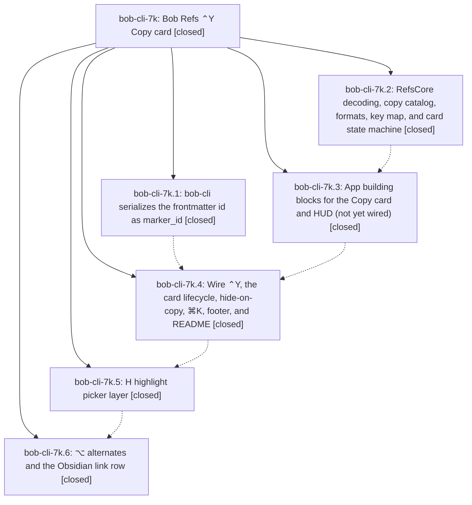

# Bead: bob-cli-7k — Bob Refs ⌃Y Copy card

[Bead Pages](../README.md) / bob-cli-7k

**Status:** ✓ closed · **Resolution:** done · **Type:** ▸ plan · **Tier:** epic
**Owner:** `bryanbugyi34@gmail.com` · **Created by:** [bbugyi200.apollo.research.19.linker.w0](https://github.com/bobs-org/bob-cli--agents/blob/main/sessions/bbugyi200.apollo.research.19.linker.w0.md) · **Assignee:** `bob-cli-7k.land`
**Created:** 2026-10-14 09:32:30 EDT · **Closed:** 2026-10-14 13:40:05 EDT
**Plan:** [202610/refs\_ctrl\_y\_copy\_card.md](https://github.com/bobs-org/bob-cli--plans/blob/main/202610/refs_ctrl_y_copy_card.md)

<!-- sase:links:start -->

## Links

| Relation | Artifact | Why |
| --- | --- | --- |
| implemented-by | [plan:202610/refs_ctrl_y_copy_card.md][1] | derived from the plan's `bead_id:` frontmatter field |

_Plus 2 automatic references — see [Referenced By](#referenced-by)._

[1]: https://github.com/bobs-org/bob-cli--plans/blob/main/202610/refs_ctrl_y_copy_card.md

<!-- sase:links:end -->

## Description

In Bob Mac Capture's Refs panel, ⌃Y turns the inspector column into a Copy card where one keypress copies a precise handle for the selected reference (marker ID, title, wiki link, sources, paths, the PDF file, the reading task, research ref, or one or all of your notes). The copy is checked, Refs hides so the next ⌘V lands where you came from, and a glass HUD confirms what was copied. A highlight picker and ⌥ alternates follow.

## Notes

[2026-10-14T17:09:39Z · bob-cli-7k.land] FOLLOW-UP TRIAGE (land agent): (1) typecheck-tests SDK defect, proposed by bob-cli-7k.3 #1 and corroborated by 7k.4 #1 and 7k.6 #3: no duplicate existed, so filed as bob-cli-7o (task(bug), small). The script predates the epic (44051a0), so the epic did not cause it. (2) bob-cli-7k.5 #1 'Mac typecheck-tests unverified (SSH timeout)': DECLINED, already resolved. bob-cli-7k.6 type-checked all four macOS test targets with an explicit SDK and fixed the three latent test compile errors, and CI run 38601917702 at 2b7b330 built and ran all 2128 tests. (3) Discovered while landing: CI Test fails with 4 RefsInspectorScrollTests failures on every epic commit and on the pre-epic baseline 44051a0. This duplicates bob-cli-7h, so I corroborated it with +1 rather than filing a new task. The epic did not cause it. All new Copy card tests pass in CI.

[2026-10-14T17:12:08Z · bob-cli-7k.land] LANDING REVIEW (land agent): The six phases match the contract, with these confirmed deviations, which tale plan sase_plan_refs_copy_card_landing_fixes fixes: (1) digit rows number and format over yourNotes instead of commentedHighlights, so a standalone note on a digit copies as 'Comment:'; (2) the card's note capacity ignores the A and H rows and is not recomputed when notes load, so rows overflow; (3) the card transition never animates because the animation modifier sits inside the inserted branch; (4) the 5 s pending timeout restarts on every key; (5) key map edges: private-use function-key characters show 'Nothing on', and a plain [ is swallowed; (6) ⌃Y leaks with Caps Lock on; (7) the notes header shows the visible count instead of the total; (8) 'Copied 1 Notes'; (9) noteBlock blank-quote and blank-comment cases; (10) the model's Esc ladder has no card step; (11) flagsChanged re-publishes while the card is closed; (12) README Esc wording; (13) the docs/ref.md additive-field sentence is missing marker_id. CI 38601917702 at 2b7b330: 2128 tests, and the only failures are the 4 pre-existing RefsInspectorScrollTests (bob-cli-7h). Integration: bob-cli commits after e7e98d2 are unrelated capture work, and bob-mac-capture has none after 2b7b330.

[2026-10-14T17:40:05Z · bob-cli-7k.land--1] LAND REVIEW: All six phases were verified against the plan. CI 38601917702 at 2b7b330 ran 2,128 tests; Copy card tests passed, with only the four known pre-epic RefsInspectorScrollTests failures tracked by bob-cli-7h and reproduced on the pre-epic baseline. bob-cli commits after e7e98d2 are unrelated capture work; bob-mac-capture had no commits after 2b7b330. FOLLOW-UP TRIAGE: bob-cli-7o was filed for the pre-existing typecheck-tests missing-SDK defect proposed by 7k.3/.4/.6; bob-cli-7h was corroborated; 7k.5 Mac-unverified was declined after 7k.6 type-checked all four targets with an explicit SDK and CI ran them. THIS TALE: fixed digit rows to use commented highlights, All Notes count/titles, blank note formatting, key-map edges, and pending feedback/timeout; capacity now budgets A/H and refreshes after note changes; fixed the card transition, Caps Lock Ctrl-Y, Escape ladder, and closed-card modifier updates; corrected README and docs/ref.md. CHECKS: Athena just portable-check passed (the retained log does not expose its test count); Mac bundle passed; stock just typecheck-tests hit the known missing-SDK error, then the explicit-SDK fallback passed BobMacCaptureTests, BobMacCaptureInstallHelperTests, CaptureCoreTests, and RefsCoreTests; bob-cli just check passed (2,564 tests in the main Rust suite); diff checks passed; final athena/mac/bob-cli statuses were 0. Mac and Athena scratch copies are removed. PRESERVED CONTRACT: Notes unavailable is red while No notes on this reference is informational; F without a PDF path says No PDF path for this reference; standalone-note payload has no blank line before provenance; No Obsidian link, No highlight N, and Nothing to copy remain; RefRow retains its separate marker_id. No symvision recipe exists, so it was not run.

## Phases

| Bead | Title | Status | Size | Created | Agents | Commits |
|---|---|---|---|---|---:|---:|
| [bob-cli-7k.1](bob-cli-7k.1.md) | bob-cli serializes the frontmatter id as marker\_id | ✓ closed | small | 2026-10-14 | 1 | 1 |
| [bob-cli-7k.2](bob-cli-7k.2.md) | RefsCore decoding, copy catalog, formats, key map, and card state machine | ✓ closed | medium | 2026-10-14 | 1 | 1 |
| [bob-cli-7k.3](bob-cli-7k.3.md) | App building blocks for the Copy card and HUD (not yet wired) | ✓ closed | medium | 2026-10-14 | 1 | 1 |
| [bob-cli-7k.4](bob-cli-7k.4.md) | Wire ⌃Y, the card lifecycle, hide-on-copy, ⌘K, footer, and README | ✓ closed | medium | 2026-10-14 | 1 | 1 |
| [bob-cli-7k.5](bob-cli-7k.5.md) | H highlight picker layer | ✓ closed | medium | 2026-10-14 | 1 | 1 |
| [bob-cli-7k.6](bob-cli-7k.6.md) | ⌥ alternates and the Obsidian link row | ✓ closed | medium | 2026-10-14 | 1 | 1 |

## Lineage

## Agents

| Agent | Bead | Commits |
|---|---|---:|
| [bbugyi200.apollo.bob-cli-7k.1](https://github.com/bobs-org/bob-cli--agents/blob/main/agents/bbugyi200.apollo.bob-cli-7k.1/README.md) | [bob-cli-7k.1](bob-cli-7k.1.md) | 1 |
| [bbugyi200.apollo.bob-cli-7k.2](https://github.com/bobs-org/bob-cli--agents/blob/main/agents/bbugyi200.apollo.bob-cli-7k.2/README.md) | [bob-cli-7k.2](bob-cli-7k.2.md) | 1 |
| [bbugyi200.apollo.bob-cli-7k.3](https://github.com/bobs-org/bob-cli--agents/blob/main/agents/bbugyi200.apollo.bob-cli-7k.3/README.md) | [bob-cli-7k.3](bob-cli-7k.3.md) | 1 |
| [bbugyi200.apollo.bob-cli-7k.4](https://github.com/bobs-org/bob-cli--agents/blob/main/sessions/bbugyi200.apollo.bob-cli-7k.4.md) | [bob-cli-7k.4](bob-cli-7k.4.md) | 1 |
| [bbugyi200.apollo.bob-cli-7k.5](https://github.com/bobs-org/bob-cli--agents/blob/main/agents/bbugyi200.apollo.bob-cli-7k.5/README.md) | [bob-cli-7k.5](bob-cli-7k.5.md) | 1 |
| [bbugyi200.apollo.bob-cli-7k.6](https://github.com/bobs-org/bob-cli--agents/blob/main/sessions/bbugyi200.apollo.bob-cli-7k.6.md) | [bob-cli-7k.6](bob-cli-7k.6.md) | 1 |
| [bbugyi200.apollo.bob-cli-7k.land](https://github.com/bobs-org/bob-cli--agents/blob/main/sessions/bbugyi200.apollo.bob-cli-7k.land.md) | [bob-cli-7k](README.md) | 3 |

## Commits

| Repo | Commit | Subject | Bead | Committed |
|---|---|---|---|---|
| bob-cli | [`e7e98d2`](https://github.com/bobs-org/bob-cli/commit/e7e98d2e49e6c9b034e864dbbc263ffa0dbabf48) | feat(ref): expose marker ids in JSON | [bob-cli-7k.1](bob-cli-7k.1.md) | 2026-10-14 09:39:35 EDT |
| bob-mac-capture | [`bob-mac-capture@060d77b`](https://github.com/bobs-org/bob-mac-capture/commit/060d77b41a79df7b529c9085f184b76928c0cbbb) | feat(refs-core): implement copy catalog and card state machine | [bob-cli-7k.2](bob-cli-7k.2.md) | 2026-10-14 09:50:04 EDT |
| bob-mac-capture | [`bob-mac-capture@7e7d8d6`](https://github.com/bobs-org/bob-mac-capture/commit/7e7d8d628446cda13fa2a903ef2570c5010aa5d1) | feat(refs): add Copy card view, glass HUD, and checked pasteboard | [bob-cli-7k.3](bob-cli-7k.3.md) | 2026-10-14 10:20:24 EDT |
| bob-mac-capture | [`bob-mac-capture@c4b1a25`](https://github.com/bobs-org/bob-mac-capture/commit/c4b1a257db3bdde636697d7f22aee6aab7285417) | feat(refs): wire copy card interactions and footer | [bob-cli-7k.4](bob-cli-7k.4.md) | 2026-10-14 11:02:14 EDT |
| bob-mac-capture | [`bob-mac-capture@9b70c62`](https://github.com/bobs-org/bob-mac-capture/commit/9b70c629cea5a8d138f768bbbf3e5a92ef5cd574) | feat(refs): add H highlight picker layer | [bob-cli-7k.5](bob-cli-7k.5.md) | 2026-10-14 11:24:01 EDT |
| bob-mac-capture | [`bob-mac-capture@2b7b330`](https://github.com/bobs-org/bob-mac-capture/commit/2b7b330e31ddd612a55365e563869891c282a71e) | feat(refs): add Option copy alternates and Obsidian links | [bob-cli-7k.6](bob-cli-7k.6.md) | 2026-10-14 12:53:23 EDT |
| bob-cli | [`0ee788d`](https://github.com/bobs-org/bob-cli/commit/0ee788d09ac5ee1670a31e8942035e3b08265052) | docs(refs): clarify copied card marker IDs | [bob-cli-7k](README.md) | 2026-10-14 13:43:58 EDT |
| bob-mac-capture | [`bob-mac-capture@24e4bc5`](https://github.com/bobs-org/bob-mac-capture/commit/24e4bc5f62c0b1b9453b53bed9afa716e6ec4d6b) | fix(refs): repair copy card landing behavior | [bob-cli-7k](README.md) | 2026-10-14 13:44:52 EDT |
| bob-cli--plans | [`bob-cli--plans@4264de6`](https://github.com/bobs-org/bob-cli--plans/commit/4264de663dbc71f1bc157a5b8d162eacb572a486) | docs(plans): mark refs copy card fixes complete | [bob-cli-7k](README.md) | 2026-10-14 13:45:18 EDT |

<!-- sase:referenced-by:start -->

## Referenced By

| Relation | Artifact | Why | Uses |
| --- | --- | --- | ---: |
| read-by | [agent:bob-cli-7k.5][1] | Need the epic design and remaining phase context | 1 |
| read-by | [agent:bob-cli-7k.land--1][2] | Confirm the completed closeout and recorded verification before final reporting | 2 |

[1]: https://github.com/bobs-org/bob-cli--agents/blob/main/agents/bbugyi200.apollo.bob-cli-7k.5/README.md
[2]: https://github.com/bobs-org/bob-cli--agents/blob/main/sessions/bbugyi200.apollo.bob-cli-7k.land.md

<!-- sase:referenced-by:end -->
