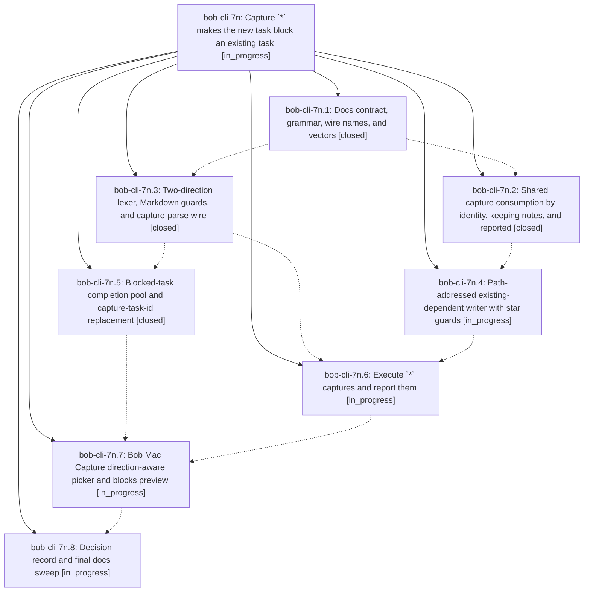

# Bead: bob-cli-7n — Capture \`\*\` makes the new task block an existing task

[Bead Pages](../README.md) / bob-cli-7n

**Status:** ◐ in_progress · **Type:** ▸ plan · **Tier:** epic
**Owner:** `bryanbugyi34@gmail.com` · **Created by:** [bbugyi200.athena.research.4g.linker.w1](https://github.com/bobs-org/bob-cli--agents/blob/main/sessions/bbugyi200.athena.research.4g.linker.w1.md) · **Assignee:** `bob-cli-7n.land`
**Created:** 2026-10-14 11:27:20 EDT
**Plan:** [202610/capture\_star\_blocks.md](https://github.com/bobs-org/bob-cli--plans/blob/main/202610/capture_star_blocks.md)

<!-- sase:links:start -->

## Links

| Relation | Artifact | Why |
| --- | --- | --- |
| implemented-by | [plan:202610/capture_star_blocks.md][1] | derived from the plan's `bead_id:` frontmatter field |

_Plus 1 automatic references — see [Referenced By](#referenced-by)._

[1]: https://github.com/bobs-org/bob-cli--plans/blob/main/202610/capture_star_blocks.md

<!-- sase:links:end -->

## Description

`bob capture` and Bob Mac Capture accept `*note:block-id`, which makes the captured (or explicitly selected) task a prerequisite of an existing open task. The edge is written to the blocked task's Depends-On line. That task's live Task Links under today's open Pomodoros are consumed by identity, with any notes under them kept. A Pomodoro entry is deleted only when this capture emptied it, and every removal is visible in the preview before submit.

## Phases

| Bead | Title | Status | Size | Created | Agents | Commits |
|---|---|---|---|---|---:|---:|
| [bob-cli-7n.1](bob-cli-7n.1.md) | Docs contract, grammar, wire names, and vectors | ✓ closed | medium | 2026-10-14 | 1 | 1 |
| [bob-cli-7n.2](bob-cli-7n.2.md) | Shared capture consumption by identity, keeping notes, and reported | ✓ closed | medium | 2026-10-14 | 1 | 1 |
| [bob-cli-7n.3](bob-cli-7n.3.md) | Two-direction lexer, Markdown guards, and capture-parse wire | ✓ closed | medium | 2026-10-14 | 1 | 1 |
| [bob-cli-7n.4](bob-cli-7n.4.md) | Path-addressed existing-dependent writer with star guards | ◐ in_progress | medium | 2026-10-14 | 1 | 0 |
| [bob-cli-7n.5](bob-cli-7n.5.md) | Blocked-task completion pool and capture-task-id replacement | ✓ closed | medium | 2026-10-14 | 1 | 1 |
| [bob-cli-7n.6](bob-cli-7n.6.md) | Execute \`\*\` captures and report them | ◐ in_progress | medium | 2026-10-14 | 1 | 0 |
| [bob-cli-7n.7](bob-cli-7n.7.md) | Bob Mac Capture direction-aware picker and blocks preview | ◐ in_progress | medium | 2026-10-14 | 1 | 0 |
| [bob-cli-7n.8](bob-cli-7n.8.md) | Decision record and final docs sweep | ◐ in_progress | small | 2026-10-14 | 1 | 0 |

## Lineage

## Agents

| Agent | Bead | Commits |
|---|---|---:|
| [bbugyi200.athena.bob-cli-7n.1](https://github.com/bobs-org/bob-cli--agents/blob/main/agents/bbugyi200.athena.bob-cli-7n.1/README.md) | [bob-cli-7n.1](bob-cli-7n.1.md) | 1 |
| [bbugyi200.athena.bob-cli-7n.2](https://github.com/bobs-org/bob-cli--agents/blob/main/sessions/bbugyi200.athena.bob-cli-7n.2.md) | [bob-cli-7n.2](bob-cli-7n.2.md) | 1 |
| [bbugyi200.athena.bob-cli-7n.3](https://github.com/bobs-org/bob-cli--agents/blob/main/sessions/bbugyi200.athena.bob-cli-7n.3.md) | [bob-cli-7n.3](bob-cli-7n.3.md) | 1 |
| [bbugyi200.athena.bob-cli-7n.4](https://github.com/bobs-org/bob-cli--agents/blob/main/agents/bbugyi200.athena.bob-cli-7n.4/README.md) | [bob-cli-7n.4](bob-cli-7n.4.md) | 0 |
| [bbugyi200.athena.bob-cli-7n.5](https://github.com/bobs-org/bob-cli--agents/blob/main/sessions/bbugyi200.athena.bob-cli-7n.5.md) | [bob-cli-7n.5](bob-cli-7n.5.md) | 1 |
| [bbugyi200.athena.bob-cli-7n.6](https://github.com/bobs-org/bob-cli--agents/blob/main/agents/bbugyi200.athena.bob-cli-7n.6/README.md) | [bob-cli-7n.6](bob-cli-7n.6.md) | 0 |
| [bbugyi200.athena.bob-cli-7n.7](https://github.com/bobs-org/bob-cli--agents/blob/main/agents/bbugyi200.athena.bob-cli-7n.7/README.md) | [bob-cli-7n.7](bob-cli-7n.7.md) | 0 |
| [bbugyi200.athena.bob-cli-7n.8](https://github.com/bobs-org/bob-cli--agents/blob/main/agents/bbugyi200.athena.bob-cli-7n.8/README.md) | [bob-cli-7n.8](bob-cli-7n.8.md) | 0 |
| [bbugyi200.athena.bob-cli-7n.land](https://github.com/bobs-org/bob-cli--agents/blob/main/agents/bbugyi200.athena.bob-cli-7n.land/README.md) | [bob-cli-7n](README.md) | 0 |

## Commits

| Repo | Commit | Subject | Bead | Committed |
|---|---|---|---|---|
| bob-cli | [`04a6e84`](https://github.com/bobs-org/bob-cli/commit/04a6e84a38fcdd0811eda86258e78cef7781ff99) | docs(capture): contract star-blocks existing-task grammar | [bob-cli-7n.1](bob-cli-7n.1.md) | 2026-10-14 11:50:51 EDT |
| bob-cli | [`8774e89`](https://github.com/bobs-org/bob-cli/commit/8774e89f0e4fd0d77793699711b57c7f0c38befe) | feat(capture): parse blocked task capture links | [bob-cli-7n.3](bob-cli-7n.3.md) | 2026-10-14 12:23:01 EDT |
| bob-cli | [`1a074c6`](https://github.com/bobs-org/bob-cli/commit/1a074c6f6aa742b9cead32d8088af477c559bfd8) | fix(capture): consume blocked task links by identity | [bob-cli-7n.2](bob-cli-7n.2.md) | 2026-10-14 12:29:03 EDT |
| bob-cli | [`78f1a69`](https://github.com/bobs-org/bob-cli/commit/78f1a6932c4dcd563ea785738a74077b67cb83bc) | feat(capture): add blocked-task completion candidates | [bob-cli-7n.5](bob-cli-7n.5.md) | 2026-10-14 12:53:19 EDT |

<!-- sase:referenced-by:start -->

## Referenced By

| Relation | Artifact | Why | Uses |
| --- | --- | --- | ---: |
| read-by | [agent:bob-cli-7n.1][1] | Need epic scope, remaining notes, and full DECISIONS | 1 |

[1]: https://github.com/bobs-org/bob-cli--agents/blob/main/agents/bbugyi200.athena.bob-cli-7n.1/README.md

<!-- sase:referenced-by:end -->
