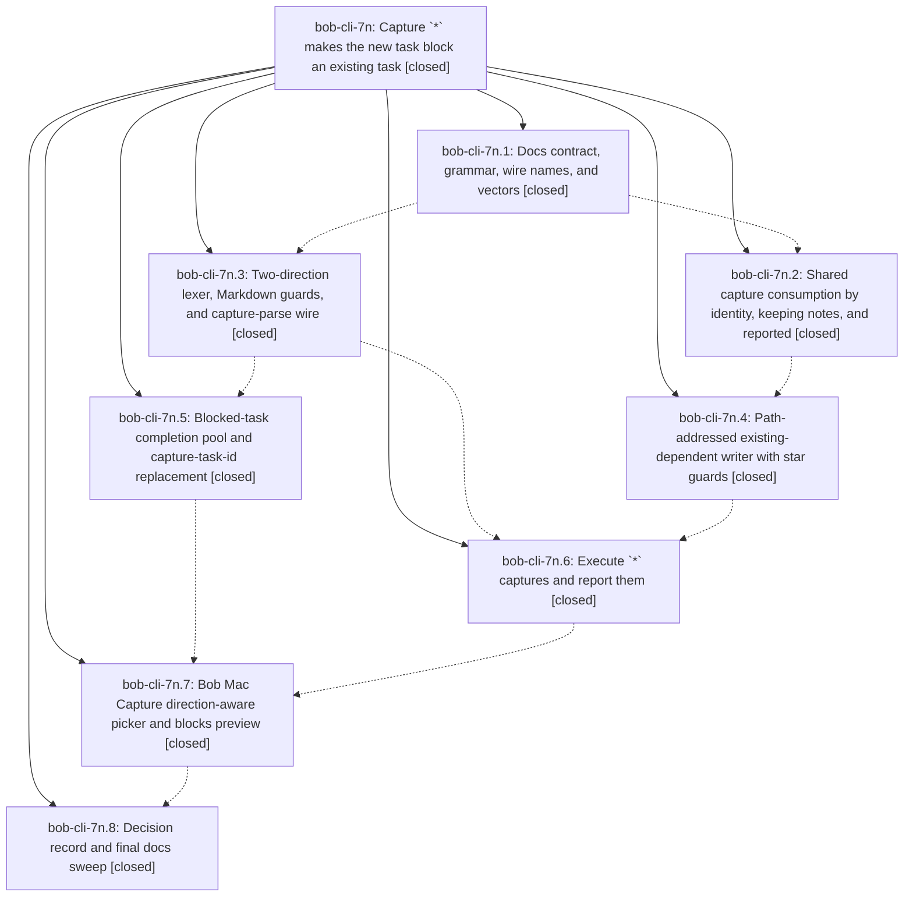

# Bead: bob-cli-7n — Capture \`\*\` makes the new task block an existing task

[Bead Pages](../README.md) / bob-cli-7n

**Status:** ✓ closed · **Resolution:** done · **Type:** ▸ plan · **Tier:** epic
**Owner:** `bryanbugyi34@gmail.com` · **Created by:** [bbugyi200.athena.research.4g.linker.w1](https://github.com/bobs-org/bob-cli--agents/blob/main/sessions/bbugyi200.athena.research.4g.linker.w1.md) · **Assignee:** `bob-cli-7n.land`
**Created:** 2026-10-14 11:27:20 EDT · **Closed:** 2026-10-14 15:54:27 EDT
**Plan:** [202610/capture\_star\_blocks.md](https://github.com/bobs-org/bob-cli--plans/blob/main/202610/capture_star_blocks.md)

<!-- sase:links:start -->

## Links

| Relation | Artifact | Why |
| --- | --- | --- |
| implemented-by | [plan:202610/capture_star_blocks.md][1] | derived from the plan's `bead_id:` frontmatter field |

_Plus 2 automatic references — see [Referenced By](#referenced-by)._

[1]: https://github.com/bobs-org/bob-cli--plans/blob/main/202610/capture_star_blocks.md

<!-- sase:links:end -->

## Description

`bob capture` and Bob Mac Capture accept `*note:block-id`, which makes the captured (or explicitly selected) task a prerequisite of an existing open task. The edge is written to the blocked task's Depends-On line. That task's live Task Links under today's open Pomodoros are consumed by identity, with any notes under them kept. A Pomodoro entry is deleted only when this capture emptied it, and every removal is visible in the preview before submit.

## Notes

[2026-10-14T19:20:56Z · bob-cli-7n.land] LANDING TRIAGE (bob-cli-7n.land). Follow-ups not caused by the epic:
(1) bob-cli-7n.7 PROPOSED FOLLOW-UP (typecheck-tests.sh needs an explicit macOS SDK path) duplicates bob-cli-7o; +1 recorded with the 7n.7 evidence.
(2) The flaky lib test native::highlights_ref::fetch::tests::curl_passes_q_as_first_argument (ETXTBSY under the full just check; 3/3 isolated reruns pass) duplicates bob-cli-5l; +1 recorded.
(3) bob-mac-capture CI is red at f2a5cb5 only in Refs tests. RefsInspectorScrollTests duplicates bob-cli-7h (+1 recorded). The RefsPanelModelTests.testQueuedDigitCopiesWhenTheShowLoaderReturns failure, followed by an xctest 'Index out of range' crash that started at bob-cli-7k's 24e4bc5, is new: filed as bob-cli-7p (ci, large).
(4) Plan §8 deferred reconcile/task_complete-retirement/bob-plugins consumption parity: filed as bob-cli-7q (feature, large), linked to bob-cli-7l.
Declined: the §8 items auto-linking N into T's slot (design choice; decisions:unblocked-tasks-are-offered), a picker key that flips &↔* (an unrequested wish with no evidence of need), and keeping the soft-block drop on later link gestures (intended per decisions:capture-link-drops-blocking-deps). The Obsidian reverse Blocks… stage is already bob-cli-3p. The prerequisite status_symbol in dependency_update showing the pre-transfer lane is existing & behaviour, not caused by this epic, and the human line shows N's final lane.
Absorbed beads: bob-cli-7l and bob-cli-7m were never closed by their phases; the land agent verified both fixes (1a074c6, 8774e89) and closed them.

[2026-10-14T19:54:27Z · bob-cli-7n.land] Landing repairs closed epic bob-cli-7n.

Phases verified against plan:202610/capture_star_blocks.md and their commits: contract 04a6e84, parse 8774e89, consume 1a074c6, complete 78f1a69, writer 158d6de, execute 1b9d35f, publish 908b3ef, mac bob-mac-capture f2a5cb5.

Absorbed bugs bob-cli-7l and bob-cli-7m were verified and closed by the land agent.

This tale shipped landing repairs 1–9: refuse body-bearing close+*; relocate task_blocks by block ID; emit dependency_updates[] whenever the singular field is set; strip tags/fields/ids from PDL8 kept-notes (flatten only block links); dedupe * targets by identity and print already-blocks with no status arrow; refuse fenced targets only when no unfenced task exists; human-output variants (would-block residents, existing-owner/sub-bullet forms, *-only owner header); forced --task-ref rejections name the typed sigil; * picker treats a missing day file as an empty ledger. Docs (capture.md, completion.md, task-dependencies.md §13.5) and ST/STP tests updated. Decision evidence SHA 158f6de → 158d6de. just check is green (fmt, clippy, full cargo test; no ETXTBSY flake this run).

Integration: since the epic started, the only non-epic bob-cli commit is 0ee788d (docs/ref.md, unrelated); bob-plugins has no commits; bob-mac-capture Refs commits are unrelated.

Mac: just portable-check and the scratch typecheck from bob-cli-7n.7 passed. Mac CI is red only on Refs tests owned by bob-cli-7h and bob-cli-7p.

Follow-up triage is already recorded on this epic (bob-cli-7o/5l/7h +1; bob-cli-7p and bob-cli-7q filed; plan §8 items declined). Epic-symbol list was empty. bob-cli justfile has no symvision recipe; skipped.

## Phases

| Bead | Title | Status | Size | Created | Agents | Commits |
|---|---|---|---|---|---:|---:|
| [bob-cli-7n.1](bob-cli-7n.1.md) | Docs contract, grammar, wire names, and vectors | ✓ closed | medium | 2026-10-14 | 1 | 1 |
| [bob-cli-7n.2](bob-cli-7n.2.md) | Shared capture consumption by identity, keeping notes, and reported | ✓ closed | medium | 2026-10-14 | 1 | 1 |
| [bob-cli-7n.3](bob-cli-7n.3.md) | Two-direction lexer, Markdown guards, and capture-parse wire | ✓ closed | medium | 2026-10-14 | 1 | 1 |
| [bob-cli-7n.4](bob-cli-7n.4.md) | Path-addressed existing-dependent writer with star guards | ✓ closed | medium | 2026-10-14 | 1 | 1 |
| [bob-cli-7n.5](bob-cli-7n.5.md) | Blocked-task completion pool and capture-task-id replacement | ✓ closed | medium | 2026-10-14 | 1 | 1 |
| [bob-cli-7n.6](bob-cli-7n.6.md) | Execute \`\*\` captures and report them | ✓ closed | medium | 2026-10-14 | 1 | 1 |
| [bob-cli-7n.7](bob-cli-7n.7.md) | Bob Mac Capture direction-aware picker and blocks preview | ✓ closed | medium | 2026-10-14 | 1 | 1 |
| [bob-cli-7n.8](bob-cli-7n.8.md) | Decision record and final docs sweep | ✓ closed | small | 2026-10-14 | 1 | 1 |

## Lineage

## Agents

| Agent | Bead | Commits |
|---|---|---:|
| [bbugyi200.athena.bob-cli-7n.1](https://github.com/bobs-org/bob-cli--agents/blob/main/agents/bbugyi200.athena.bob-cli-7n.1/README.md) | [bob-cli-7n.1](bob-cli-7n.1.md) | 1 |
| [bbugyi200.athena.bob-cli-7n.2](https://github.com/bobs-org/bob-cli--agents/blob/main/sessions/bbugyi200.athena.bob-cli-7n.2.md) | [bob-cli-7n.2](bob-cli-7n.2.md) | 1 |
| [bbugyi200.athena.bob-cli-7n.3](https://github.com/bobs-org/bob-cli--agents/blob/main/sessions/bbugyi200.athena.bob-cli-7n.3.md) | [bob-cli-7n.3](bob-cli-7n.3.md) | 1 |
| [bbugyi200.athena.bob-cli-7n.4](https://github.com/bobs-org/bob-cli--agents/blob/main/sessions/bbugyi200.athena.bob-cli-7n.4.md) | [bob-cli-7n.4](bob-cli-7n.4.md) | 1 |
| [bbugyi200.athena.bob-cli-7n.5](https://github.com/bobs-org/bob-cli--agents/blob/main/sessions/bbugyi200.athena.bob-cli-7n.5.md) | [bob-cli-7n.5](bob-cli-7n.5.md) | 1 |
| [bbugyi200.athena.bob-cli-7n.6](https://github.com/bobs-org/bob-cli--agents/blob/main/agents/bbugyi200.athena.bob-cli-7n.6/README.md) | [bob-cli-7n.6](bob-cli-7n.6.md) | 1 |
| [bbugyi200.athena.bob-cli-7n.7](https://github.com/bobs-org/bob-cli--agents/blob/main/agents/bbugyi200.athena.bob-cli-7n.7/README.md) | [bob-cli-7n.7](bob-cli-7n.7.md) | 1 |
| [bbugyi200.athena.bob-cli-7n.8](https://github.com/bobs-org/bob-cli--agents/blob/main/agents/bbugyi200.athena.bob-cli-7n.8/README.md) | [bob-cli-7n.8](bob-cli-7n.8.md) | 1 |
| [bbugyi200.athena.bob-cli-7n.land](https://github.com/bobs-org/bob-cli--agents/blob/main/sessions/bbugyi200.athena.bob-cli-7n.land.md) | [bob-cli-7n](README.md) | 2 |

## Commits

| Repo | Commit | Subject | Bead | Committed |
|---|---|---|---|---|
| bob-cli | [`04a6e84`](https://github.com/bobs-org/bob-cli/commit/04a6e84a38fcdd0811eda86258e78cef7781ff99) | docs(capture): contract star-blocks existing-task grammar | [bob-cli-7n.1](bob-cli-7n.1.md) | 2026-10-14 11:50:51 EDT |
| bob-cli | [`8774e89`](https://github.com/bobs-org/bob-cli/commit/8774e89f0e4fd0d77793699711b57c7f0c38befe) | feat(capture): parse blocked task capture links | [bob-cli-7n.3](bob-cli-7n.3.md) | 2026-10-14 12:23:01 EDT |
| bob-cli | [`1a074c6`](https://github.com/bobs-org/bob-cli/commit/1a074c6f6aa742b9cead32d8088af477c559bfd8) | fix(capture): consume blocked task links by identity | [bob-cli-7n.2](bob-cli-7n.2.md) | 2026-10-14 12:29:03 EDT |
| bob-cli | [`78f1a69`](https://github.com/bobs-org/bob-cli/commit/78f1a6932c4dcd563ea785738a74077b67cb83bc) | feat(capture): add blocked-task completion candidates | [bob-cli-7n.5](bob-cli-7n.5.md) | 2026-10-14 12:53:19 EDT |
| bob-cli | [`158d6de`](https://github.com/bobs-org/bob-cli/commit/158d6dec448d7b6c5f63b00986a315012fd0742e) | feat(capture): add path-addressed star dependent writer | [bob-cli-7n.4](bob-cli-7n.4.md) | 2026-10-14 13:24:15 EDT |
| bob-cli | [`1b9d35f`](https://github.com/bobs-org/bob-cli/commit/1b9d35f206f84c03ca4499d9f78dc69a8b170d78) | feat(capture): execute \* blocked-task captures and report them | [bob-cli-7n.6](bob-cli-7n.6.md) | 2026-10-14 14:06:34 EDT |
| bob-mac-capture | [`bob-mac-capture@f2a5cb5`](https://github.com/bobs-org/bob-mac-capture/commit/f2a5cb59782f13e5ac3c6deed6bf3bba4e19058d) | feat(capture): add direction-aware Blocks picker to Mac Capture | [bob-cli-7n.7](bob-cli-7n.7.md) | 2026-10-14 14:43:40 EDT |
| bob-cli | [`908b3ef`](https://github.com/bobs-org/bob-cli/commit/908b3ef544b48f4f9575f9c3b5735c555142cee8) | docs(capture): publish star-blocks decision and examples | [bob-cli-7n.8](bob-cli-7n.8.md) | 2026-10-14 14:55:25 EDT |
| bob-cli | [`498e5ab`](https://github.com/bobs-org/bob-cli/commit/498e5ab27f07e5dab7675a2cfae095a36e44dbae) | fix(capture): land star-blocks repairs and close the epic | [bob-cli-7n](README.md) | 2026-10-14 15:55:44 EDT |
| bob-cli--plans | [`bob-cli--plans@0519826`](https://github.com/bobs-org/bob-cli--plans/commit/05198262f1c0aee261b530491bfff8f01df679e0) | docs(plans): mark capture-star epic and landing tale done | [bob-cli-7n](README.md) | 2026-10-14 15:56:30 EDT |

<!-- sase:referenced-by:start -->

## Referenced By

| Relation | Artifact | Why | Uses |
| --- | --- | --- | ---: |
| read-by | [agent:bob-cli-7n.1][1] | Need epic scope, remaining notes, and full DECISIONS | 1 |
| read-by | [agent:bob-cli-7n.6][2] | Need parent epic scope and decisions | 1 |

[1]: https://github.com/bobs-org/bob-cli--agents/blob/main/agents/bbugyi200.athena.bob-cli-7n.1/README.md
[2]: https://github.com/bobs-org/bob-cli--agents/blob/main/agents/bbugyi200.athena.bob-cli-7n.6/README.md

<!-- sase:referenced-by:end -->
