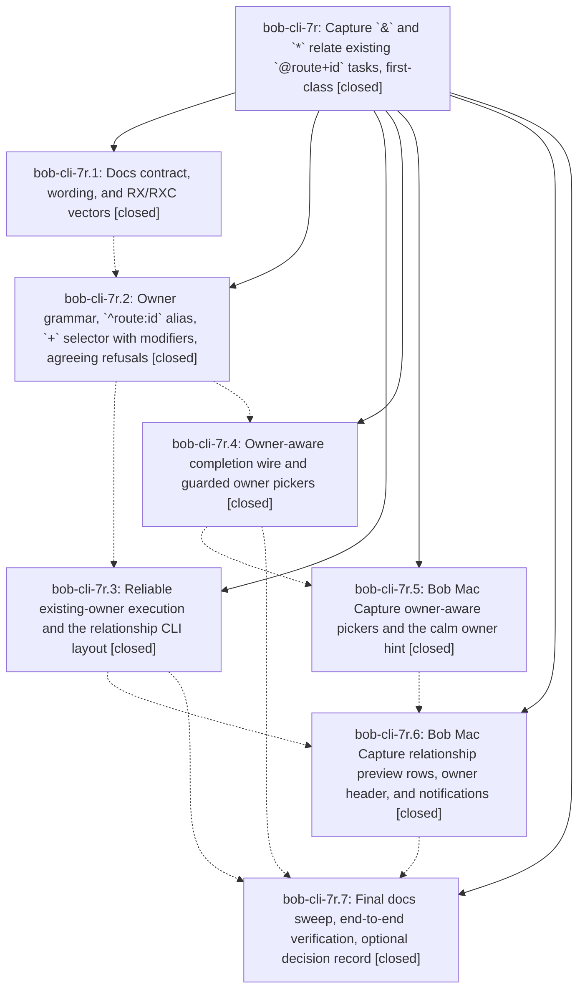

# Bead: bob-cli-7r — Capture \`&\` and \`\*\` relate existing \`@route+id\` tasks, first-class

[Bead Pages](../README.md) / bob-cli-7r

**Status:** ✓ closed · **Resolution:** done · **Type:** ▸ plan · **Tier:** epic
**Owner:** `bryanbugyi34@gmail.com` · **Created by:** [bbugyi200.athena.research.4g.linker.w1.w0](https://github.com/bobs-org/bob-cli--agents/blob/main/sessions/bbugyi200.athena.research.4g.linker.w1.w0.md) · **Assignee:** `bob-cli-7r.land`
**Created:** 2026-10-14 16:21:11 EDT · **Closed:** 2026-10-14 21:22:10 EDT
**Plan:** [202610/capture\_relate\_existing\_tasks.md](https://github.com/bobs-org/bob-cli--plans/blob/main/202610/capture_relate_existing_tasks.md)

<!-- sase:links:start -->

## Links

| Relation | Artifact | Why |
| --- | --- | --- |
| implemented-by | [plan:202610/capture_relate_existing_tasks.md][1] | derived from the plan's `bead_id:` frontmatter field |
| related | [bead:bob-cli-7s][2] | Epic bob-cli-7r's land tale fixes the identical over-disabling in the new +/@route+ parent-picker guard (project_resident_relation); reuse that helper |
| related | [bead:bob-cli-7t][3] | Source epic whose phases proposed this decisions strand (decision_record=no auto-decision) |

_Plus 1 automatic references — see [Referenced By](#referenced-by)._

[1]: https://github.com/bobs-org/bob-cli--plans/blob/main/202610/capture_relate_existing_tasks.md
[2]: https://github.com/bobs-org/bob-cli--beads/blob/main/pages/bob-cli-7s/README.md
[3]: https://github.com/bobs-org/bob-cli--beads/blob/main/pages/bob-cli-7t/README.md

<!-- sase:links:end -->

## Description

In `bob capture` and Bob Mac Capture, an existing task named with `@route+block-id` (or another existing-task spelling) can own `&` and `*`. A draft can be built from either end. Each one either writes exactly the stated relationship or refuses with a single accurate message, and the parse and execute steps agree on it. Both the terminal and the Mac preview say "<task> now depends on / now blocks <task>", with the status changes and no raw wire words or duplicated lines.

## Notes

[2026-10-15T00:45:07Z · bob-cli-7r.land] LAND TRIAGE (bob-cli-7r.land): PROPOSED FOLLOW-UP outcomes. (1) Decisions strand for the existing-owner relationship rules — proposed identically by .1, .2, .3, .5, .6 and .7 note #2; consolidated into ONE memory task bob-cli-7t (ready, needs Bryan's approval; the epic's unreviewed auto-decision decision_record=no forbade editing memory here). (2) .7 note #3 'Mac relationship preview fixtures freeze status_name Todo' — caused by this epic (fixtures recorded without Tasks-plugin status settings); folded into the remaining-work tale, which re-records the fixtures, so no task. Land-agent discoveries not caused by this epic: (3) the pre-existing * picker guard in blocked_task_candidates (78f1a69, bob-cli-7n) disables non-^prj project residents the writer accepts -> new bug task bob-cli-7s (small, ready; related to this epic). (4) macOS CI run 38656909109 crash at 00:00 UTC (NSCalendarDayChanged handled off main thread in CapturePanelModel.subscribeToAgendaStore, introduced by 06b2bda of active epic bob-cli-66) -> recorded as a DISCOVERED ISSUE note on bob-cli-66, no task. Declined reviewer nits: '✓ updated' header on a no-op repeat (spec silent); possibly unreachable second relationship_only_existing_owner check in plan.rs (harmless defensive check); completion cycle guard not chaining & with * modifiers (the whole draft is cyclic for every row, and the writer stays authoritative per §2.6); extra vault scans per keystroke (perf only, already tracked in spirit by bob-cli-5v); 'Note ^body:excercise &foo:bar' creating a plain task (docs define ^route:id as a bare-only alias, and text-bearing ^route:id was already plain text before the epic); ⛓ rows have no residents chip (§2.4 puts the chip on 🧱 rows only).

[2026-10-15T01:22:10Z · bob-cli-7r.land] Verified landing of epic bob-cli-7r (A1–A7 and B1–B5).

A1: editor_parse picks the earliest relationship extra span by start; RX9 parse and execute agree on p:2, s:3, %, and the multi-token draft.
A2: PrerequisiteJson.already_present is per-row (omitted when false); human ⛓ rows use already/now per prerequisite (RX15).
A3: ⛓ rows and prerequisites[].status_* are post-write; previous_status/previous_status_name only when the write changed status (RX14 Buy shoes [ ] → [/] In Progress; new-task no arrow).
A4: parent_under_marker derives the arrow from whichever relationship changed the parent, including * (RX12 dry-run then live).
A5: project_cannot_wait_on_resident requires the dependent to be recognized ^prj; &resident:resident + enables Other, *project:other + enables Project root, ^prj still disabled, *project:prj + still disables project.md/resident.md.
A6: RX7 forced --route old --task old -- 'Note *job:cleanup' refused with vault byte-identical; RXC2 ^body:excercise * disables Exercise as the owner task itself.
A7: docs/capture.md owner JSON examples include text; Relating existing tasks combined example is [ ] → [/] In Progress; JSON wire documents already_present/previous_status; bob capture --help unchanged.

B1: installBlocksPicker replacement is CaptureRange(start: 21, end: 22); other e41dee2/e5b2ef3 test ranges already matched their drafts.
B2: CaptureTaskBlockPresentation.covers treats every owner-block line as covering for task_dependency; fixture task-dependency-preview-existing-owner-unchanged.json (owner line unchanged) asserts covered.
B3: DependencyPrerequisite decodes already_present/previous_status additively; ⛓ wording is per-prereq already_present (fallback added==0); Ready → In Progress when previous_status is present; README preview paragraph updated.
B4: Re-recorded task-dependency-preview-*.json from Part A bob in a Tasks-settings scratch vault (status_name Ready, not Todo).
B5: just portable-check passed on athena (1191 tests, 0 failures). ssh mac timed out (kellys-macbook-pro.tail297af1.ts.net:22); macOS targets unverified. Did not wait for macOS CI.

just check on bob-cli: green (fmt, clippy, full cargo test). No --epic-symbol entries for bob-cli-7r. No just symvision recipe. Closed bob-cli-7s with the shared picker helper. Parent plan plan:202610/capture_relate_existing_tasks.md set status: done. No memory files edited.

## Phases

| Bead | Title | Status | Size | Created | Agents | Commits |
|---|---|---|---|---|---:|---:|
| [bob-cli-7r.1](bob-cli-7r.1.md) | Docs contract, wording, and RX/RXC vectors | ✓ closed | medium | 2026-10-14 | 1 | 1 |
| [bob-cli-7r.2](bob-cli-7r.2.md) | Owner grammar, \`^route:id\` alias, \`+\` selector with modifiers, agreeing refusals | ✓ closed | medium | 2026-10-14 | 1 | 1 |
| [bob-cli-7r.3](bob-cli-7r.3.md) | Reliable existing-owner execution and the relationship CLI layout | ✓ closed | medium | 2026-10-14 | 1 | 1 |
| [bob-cli-7r.4](bob-cli-7r.4.md) | Owner-aware completion wire and guarded owner pickers | ✓ closed | medium | 2026-10-14 | 1 | 1 |
| [bob-cli-7r.5](bob-cli-7r.5.md) | Bob Mac Capture owner-aware pickers and the calm owner hint | ✓ closed | medium | 2026-10-14 | 1 | 1 |
| [bob-cli-7r.6](bob-cli-7r.6.md) | Bob Mac Capture relationship preview rows, owner header, and notifications | ✓ closed | medium | 2026-10-14 | 1 | 1 |
| [bob-cli-7r.7](bob-cli-7r.7.md) | Final docs sweep, end-to-end verification, optional decision record | ✓ closed | small | 2026-10-14 | 1 | 1 |

## Lineage

## Agents

| Agent | Bead | Commits |
|---|---|---:|
| [bbugyi200.athena.bob-cli-7r.1](https://github.com/bobs-org/bob-cli--agents/blob/main/agents/bbugyi200.athena.bob-cli-7r.1/README.md) | [bob-cli-7r.1](bob-cli-7r.1.md) | 1 |
| [bbugyi200.athena.bob-cli-7r.2](https://github.com/bobs-org/bob-cli--agents/blob/main/agents/bbugyi200.athena.bob-cli-7r.2/README.md) | [bob-cli-7r.2](bob-cli-7r.2.md) | 1 |
| [bbugyi200.athena.bob-cli-7r.3](https://github.com/bobs-org/bob-cli--agents/blob/main/agents/bbugyi200.athena.bob-cli-7r.3/README.md) | [bob-cli-7r.3](bob-cli-7r.3.md) | 1 |
| [bbugyi200.athena.bob-cli-7r.4](https://github.com/bobs-org/bob-cli--agents/blob/main/sessions/bbugyi200.athena.bob-cli-7r.4.md) | [bob-cli-7r.4](bob-cli-7r.4.md) | 1 |
| [bbugyi200.athena.bob-cli-7r.5](https://github.com/bobs-org/bob-cli--agents/blob/main/agents/bbugyi200.athena.bob-cli-7r.5/README.md) | [bob-cli-7r.5](bob-cli-7r.5.md) | 1 |
| [bbugyi200.athena.bob-cli-7r.6](https://github.com/bobs-org/bob-cli--agents/blob/main/sessions/bbugyi200.athena.bob-cli-7r.6.md) | [bob-cli-7r.6](bob-cli-7r.6.md) | 1 |
| [bbugyi200.athena.bob-cli-7r.7](https://github.com/bobs-org/bob-cli--agents/blob/main/sessions/bbugyi200.athena.bob-cli-7r.7.md) | [bob-cli-7r.7](bob-cli-7r.7.md) | 1 |
| [bbugyi200.athena.bob-cli-7r.land](https://github.com/bobs-org/bob-cli--agents/blob/main/sessions/bbugyi200.athena.bob-cli-7r.land.md) | [bob-cli-7r](README.md) | 3 |

## Commits

| Repo | Commit | Subject | Bead | Committed |
|---|---|---|---|---|
| bob-cli | [`2f67276`](https://github.com/bobs-org/bob-cli/commit/2f67276206ad70015380e7cadcb86cc020a76fd7) | docs(capture): document existing task relationships | [bob-cli-7r.1](bob-cli-7r.1.md) | 2026-10-14 16:31:49 EDT |
| bob-cli | [`785d4ea`](https://github.com/bobs-org/bob-cli/commit/785d4ea17d7ded1218ca26602bc333f2fce24d5e) | feat(capture): accept ^route:id owners and + selectors beside &/\* | [bob-cli-7r.2](bob-cli-7r.2.md) | 2026-10-14 17:12:54 EDT |
| bob-cli | [`2b884f5`](https://github.com/bobs-org/bob-cli/commit/2b884f5d82807fd2cc80a4994e8f54145943433e) | feat(capture): execute existing-owner relationships and CLI layout | [bob-cli-7r.3](bob-cli-7r.3.md) | 2026-10-14 17:46:16 EDT |
| bob-cli | [`5a31133`](https://github.com/bobs-org/bob-cli/commit/5a3113354bd86b4e9e1b73512547d2d1db4bb7ed) | feat(capture): add owner-aware completion and guarded pickers | [bob-cli-7r.4](bob-cli-7r.4.md) | 2026-10-14 17:51:25 EDT |
| bob-mac-capture | [`bob-mac-capture@e41dee2`](https://github.com/bobs-org/bob-mac-capture/commit/e41dee2dc25b6048449edacaaf92250d15aca98e) | feat(capture): add owner-aware pickers and a calm dependency hint | [bob-cli-7r.5](bob-cli-7r.5.md) | 2026-10-14 18:23:46 EDT |
| bob-mac-capture | [`bob-mac-capture@e5b2ef3`](https://github.com/bobs-org/bob-mac-capture/commit/e5b2ef309916d09ab9967853a94982fc8b2853d5) | feat(mac-capture): add relationship-aware task previews | [bob-cli-7r.6](bob-cli-7r.6.md) | 2026-10-14 19:54:30 EDT |
| bob-cli | [`75a1809`](https://github.com/bobs-org/bob-cli/commit/75a180967746f23fcf22f40b5da0b8c43d2b1aad) | docs(capture): align RXC1 owner JSON and cover RX8 execute | [bob-cli-7r.7](bob-cli-7r.7.md) | 2026-10-14 20:18:31 EDT |
| bob-cli | [`14505e5`](https://github.com/bobs-org/bob-cli/commit/14505e5751dc4fea1c15e8ed87add9c89ceb574b) | fix(capture): land remaining existing-owner relationship defects (A1-A7) | [bob-cli-7r](README.md) | 2026-10-14 21:24:13 EDT |
| bob-mac-capture | [`bob-mac-capture@ac0172e`](https://github.com/bobs-org/bob-mac-capture/commit/ac0172e89a5ba5e7be98f7584be1002054be906c) | fix(capture): align relationship preview with per-prereq already/status (B1-B4) | [bob-cli-7r](README.md) | 2026-10-14 21:25:10 EDT |
| bob-cli--plans | [`bob-cli--plans@d4f4795`](https://github.com/bobs-org/bob-cli--plans/commit/d4f4795dc4b6ab6bfe9a58665889b688d72be624) | chore(plans): mark capture\_relate\_existing\_tasks done | [bob-cli-7r](README.md) | 2026-10-14 21:25:46 EDT |

<!-- sase:referenced-by:start -->

## Referenced By

| Relation | Artifact | Why | Uses |
| --- | --- | --- | ---: |
| read-by | [agent:bob-cli-7r.5][1] | Need parent epic DECISIONS and full plan context | 1 |

[1]: https://github.com/bobs-org/bob-cli--agents/blob/main/agents/bbugyi200.athena.bob-cli-7r.5/README.md

<!-- sase:referenced-by:end -->
