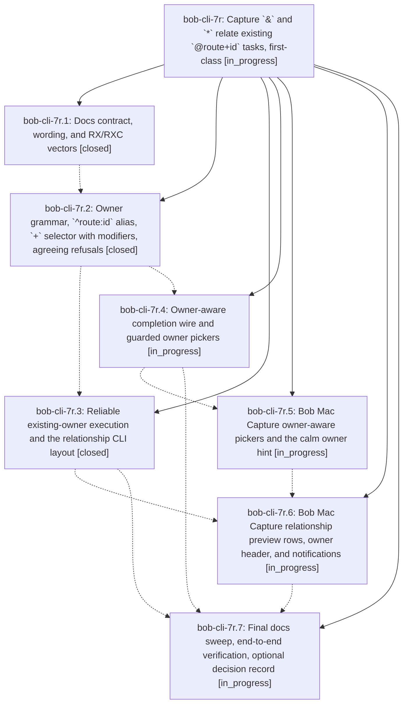

# Bead: bob-cli-7r — Capture \`&\` and \`\*\` relate existing \`@route+id\` tasks, first-class

[Bead Pages](../README.md) / bob-cli-7r

**Status:** ◐ in_progress · **Type:** ▸ plan · **Tier:** epic
**Owner:** `bryanbugyi34@gmail.com` · **Created by:** [bbugyi200.athena.research.4g.linker.w1.w0](https://github.com/bobs-org/bob-cli--agents/blob/main/sessions/bbugyi200.athena.research.4g.linker.w1.w0.md) · **Assignee:** `bob-cli-7r.land`
**Created:** 2026-10-14 16:21:11 EDT
**Plan:** [202610/capture\_relate\_existing\_tasks.md](https://github.com/bobs-org/bob-cli--plans/blob/main/202610/capture_relate_existing_tasks.md)

<!-- sase:links:start -->

## Links

| Relation | Artifact | Why |
| --- | --- | --- |
| implemented-by | [plan:202610/capture_relate_existing_tasks.md][1] | derived from the plan's `bead_id:` frontmatter field |

[1]: https://github.com/bobs-org/bob-cli--plans/blob/main/202610/capture_relate_existing_tasks.md

<!-- sase:links:end -->

## Description

In `bob capture` and Bob Mac Capture, an existing task named with `@route+block-id` (or another existing-task spelling) can own `&` and `*`. A draft can be built from either end. Each one either writes exactly the stated relationship or refuses with a single accurate message, and the parse and execute steps agree on it. Both the terminal and the Mac preview say "<task> now depends on / now blocks <task>", with the status changes and no raw wire words or duplicated lines.

## Phases

| Bead | Title | Status | Size | Created | Agents | Commits |
|---|---|---|---|---|---:|---:|
| [bob-cli-7r.1](bob-cli-7r.1.md) | Docs contract, wording, and RX/RXC vectors | ✓ closed | medium | 2026-10-14 | 1 | 1 |
| [bob-cli-7r.2](bob-cli-7r.2.md) | Owner grammar, \`^route:id\` alias, \`+\` selector with modifiers, agreeing refusals | ✓ closed | medium | 2026-10-14 | 1 | 1 |
| [bob-cli-7r.3](bob-cli-7r.3.md) | Reliable existing-owner execution and the relationship CLI layout | ✓ closed | medium | 2026-10-14 | 1 | 1 |
| [bob-cli-7r.4](bob-cli-7r.4.md) | Owner-aware completion wire and guarded owner pickers | ◐ in_progress | medium | 2026-10-14 | 1 | 0 |
| [bob-cli-7r.5](bob-cli-7r.5.md) | Bob Mac Capture owner-aware pickers and the calm owner hint | ◐ in_progress | medium | 2026-10-14 | 1 | 0 |
| [bob-cli-7r.6](bob-cli-7r.6.md) | Bob Mac Capture relationship preview rows, owner header, and notifications | ◐ in_progress | medium | 2026-10-14 | 1 | 0 |
| [bob-cli-7r.7](bob-cli-7r.7.md) | Final docs sweep, end-to-end verification, optional decision record | ◐ in_progress | small | 2026-10-14 | 1 | 0 |

## Lineage

## Agents

| Agent | Bead | Commits |
|---|---|---:|
| [bbugyi200.athena.bob-cli-7r.1](https://github.com/bobs-org/bob-cli--agents/blob/main/agents/bbugyi200.athena.bob-cli-7r.1/README.md) | [bob-cli-7r.1](bob-cli-7r.1.md) | 1 |
| [bbugyi200.athena.bob-cli-7r.2](https://github.com/bobs-org/bob-cli--agents/blob/main/agents/bbugyi200.athena.bob-cli-7r.2/README.md) | [bob-cli-7r.2](bob-cli-7r.2.md) | 1 |
| [bbugyi200.athena.bob-cli-7r.3](https://github.com/bobs-org/bob-cli--agents/blob/main/agents/bbugyi200.athena.bob-cli-7r.3/README.md) | [bob-cli-7r.3](bob-cli-7r.3.md) | 1 |
| [bbugyi200.athena.bob-cli-7r.4](https://github.com/bobs-org/bob-cli--agents/blob/main/sessions/bbugyi200.athena.bob-cli-7r.4.md) | [bob-cli-7r.4](bob-cli-7r.4.md) | 0 |
| [bbugyi200.athena.bob-cli-7r.5](https://github.com/bobs-org/bob-cli--agents/blob/main/agents/bbugyi200.athena.bob-cli-7r.5/README.md) | [bob-cli-7r.5](bob-cli-7r.5.md) | 0 |
| [bbugyi200.athena.bob-cli-7r.6](https://github.com/bobs-org/bob-cli--agents/blob/main/agents/bbugyi200.athena.bob-cli-7r.6/README.md) | [bob-cli-7r.6](bob-cli-7r.6.md) | 0 |
| [bbugyi200.athena.bob-cli-7r.7](https://github.com/bobs-org/bob-cli--agents/blob/main/agents/bbugyi200.athena.bob-cli-7r.7/README.md) | [bob-cli-7r.7](bob-cli-7r.7.md) | 0 |
| [bbugyi200.athena.bob-cli-7r.land](https://github.com/bobs-org/bob-cli--agents/blob/main/agents/bbugyi200.athena.bob-cli-7r.land/README.md) | [bob-cli-7r](README.md) | 0 |

## Commits

| Repo | Commit | Subject | Bead | Committed |
|---|---|---|---|---|
| bob-cli | [`2f67276`](https://github.com/bobs-org/bob-cli/commit/2f67276206ad70015380e7cadcb86cc020a76fd7) | docs(capture): document existing task relationships | [bob-cli-7r.1](bob-cli-7r.1.md) | 2026-10-14 16:31:49 EDT |
| bob-cli | [`785d4ea`](https://github.com/bobs-org/bob-cli/commit/785d4ea17d7ded1218ca26602bc333f2fce24d5e) | feat(capture): accept ^route:id owners and + selectors beside &/\* | [bob-cli-7r.2](bob-cli-7r.2.md) | 2026-10-14 17:12:54 EDT |
| bob-cli | [`2b884f5`](https://github.com/bobs-org/bob-cli/commit/2b884f5d82807fd2cc80a4994e8f54145943433e) | feat(capture): execute existing-owner relationships and CLI layout | [bob-cli-7r.3](bob-cli-7r.3.md) | 2026-10-14 17:46:16 EDT |
