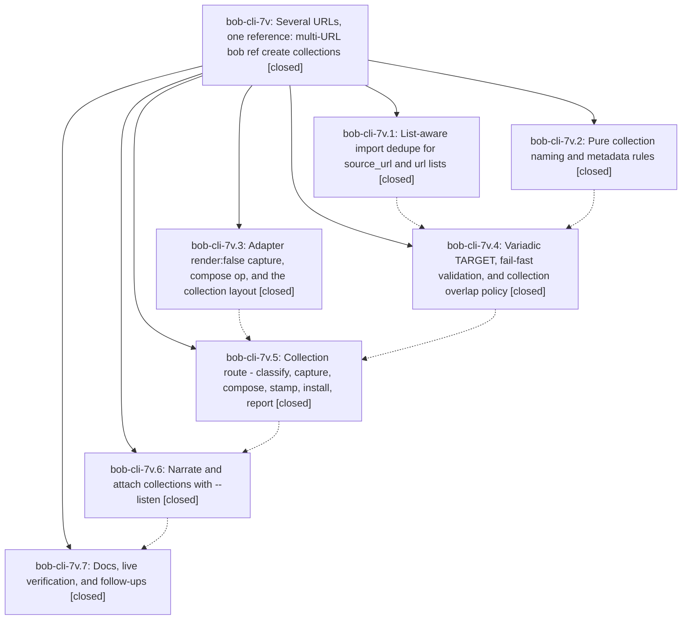

# Bead: bob-cli-7v — Several URLs, one reference: multi-URL bob ref create collections

[Bead Pages](../README.md) / bob-cli-7v

**Status:** ✓ closed · **Resolution:** done · **Type:** ▸ plan · **Tier:** epic
**Owner:** `bryanbugyi34@gmail.com` · **Created by:** [bbugyi200.athena.10k](https://github.com/bobs-org/bob-cli--agents/blob/main/sessions/bbugyi200.athena.10k.md) · **Assignee:** `bob-cli-7v.land`
**Created:** 2026-10-15 12:30:28 EDT · **Closed:** 2026-10-15 16:32:01 EDT
**Plan:** [202610/ref\_create\_multi\_url\_collections.md](https://github.com/bobs-org/bob-cli--plans/blob/main/202610/ref_create_multi_url_collections.md)

<!-- sase:links:start -->

## Links

| Relation | Artifact | Why |
| --- | --- | --- |
| implemented-by | [plan:202610/ref_create_multi_url_collections.md][1] | derived from the plan's `bead_id:` frontmatter field |

[1]: https://github.com/bobs-org/bob-cli--plans/blob/main/202610/ref_create_multi_url_collections.md

<!-- sase:links:end -->

## Description

`bob ref create URL URL…` merges 2 to 20 web articles, in argument order, into one Highlights-ready PDF and one reference. The PDF has a contents page, one bookmark per article, and continuous page numbers. The name comes from `-N` or from the words every URL's slug shares. The command is all-or-nothing and fails fast, before any network call, whenever no trustworthy name exists.

## Notes

[2026-10-15T19:28:57Z · bob-cli-7v.land] LAND TRIAGE (bob-cli-7v.land): (1) bob-cli-7v.7 PROPOSED FOLLOW-UP 'retry the live two-part collection end-to-end' — absorbed into the landing tale as epic work (the plan's docs phase required a live check); the tale retries with a different static-site series and files a task via /sase_new_task only if browser navigation still fails for environmental reasons. Plan out-of-scope items the docs phase was told to record but did not: '-H with several URLs' -> filed bob-cli-7y (feature, large; links bob-cli-7v.7's live timeout); 'contents page numbers (two-pass render)' -> filed bob-cli-7z (feature, large); '--absorb for existing refs' -> filed bob-cli-80 (feature, large; related bob-cli-39). Declined: PDF/arXiv/local-file parts (no recorded demand; v1 is web-articles-only by design, reopen when Bryan asks for a mixed packet); Bob Mac Capture 'Sources' submenu (the plan judged its urls.first Open/Copy acceptable); capture-side / ref-jobs bundling gestures (speculative; Bulk Capture deliberately splits bare-URL lines into one item each); %40 dedupe bug (already tracked as bob-cli-7u, no new evidence).

[2026-10-15T20:32:01Z · bob-cli-7v.land--4] LAND CLOSE (bob-cli-7v.land): landing review confirmed all 7 phases against plan:202610/ref_create_multi_url_collections.md and commits 47e85f6, 63ec1ca, e104962, 5feaaac, 9bdb0bd, f596bf3, dad02a2.

Decisions honored: no -O option added (output_dir = defer), no decisions memory strand created or edited (decision_record = no), no other memory note edited.

Integration found nothing to change: 5db83f3 (glossary memory notes) and 946c9b7 (capture template language) don't touch highlights_ref; no bob-plugins code reads source_url; every other bob-cli source_url reader already handles list values.

Follow-up triage per the epic bead's LAND TRIAGE note: filed bob-cli-7y (-H with several URLs), bob-cli-7z (contents page numbers, two-pass render), bob-cli-80 (--absorb for existing refs). Declined: PDF/arXiv/local-file parts (v1 is web-articles-only by design), Bob Mac Capture Sources submenu (urls.first Open/Copy judged acceptable), capture-side/ref-jobs bundling gestures (speculative). The %40 dedupe case stays tracked as bob-cli-7u.

Landing-tale defects fixed (plan sections 1-5), all covered by committed tests:
1. Adapter: tag-aware attribute rewriting in web_clip_render.py (text nodes byte-identical; fixture with id/href/url(#) inside <pre><code> and 
); qpdf outlines list shape + broad exception catch; mutool outline depth by leading-tab count; blank-page check strips N/M footers first; article_json only for render:false; compose error kinds invalid_request/browser instead of internal.
2. Naming: trailing-slash-trimmed same_path; alphabetic-letter count for the 4-letter one-word rule (gpt4 -> too_thin, raft still names); slug_words split before the 80-char cap; removed leftover allow(dead_code).
3. Dedupe: block-list source_url/url parsed via ref_library ParsedFrontmatter/get_all with unit test; added the four skipped CLI dedupe tests (single-URL refuse inline+block, legacy no-source_pdf warn-and-proceed, capture dry-run in_library routing, ref find -i over list markers).
4. Collection route: styled no-name and partial-overlap errors (red label, dim index, plain hint; byte-identical plain text); bind hints list every URL; dry-run plans explicit --audio and the listen flow with audio:/would-run lines; removed gate stub, unused _urls param, renamed _listen_flow; -N help matches the plan wording.
5. Docs: fixed the out_pdf sentence in highlights-clip.md and the two ordered-list sentences in highlights-create.md; article_json documented as render:false-only.

Verification: TMPDIR=/tmp just check-web-clip-adapter passes; just check passes (no check-full; no 6m/5t-class baseline failures attributable to this work). Single-target behavior, output, and adapter request JSON unchanged; single-target suites green. qpdf is absent on this host so the qpdf self-test path records a note rather than running; no dependency added.

Live check (scratch vault /tmp/live-coll/scratch on athena, current CARGO_TARGET_DIR/debug/bob): sqlite.org lang_select.html + lang_update.html with -N sqlite_lang. Dry-run, create, and ref scan all succeeded. PDF: 30 pages, contents page, one top-level bookmark per part (pp. 2 and 24), 248 link annotations with contents entries resolving to named part-1/part-2 destinations, each part starting on a fresh page, continuous N/M footers on all 30 pages, SQL code samples intact (proves the attribute-rewrite fix). Source pages carry no content images (0/0), so image presence could not be confirmed. Note ref/blogs/sqlite_lang.md carries a list source_url; parent scratch.md holds one ^ref-sqlite-lang task. The missing-name error (unrelated pair shares only "lang") and a part-failure message (dead lang_create_table.html, 404 upstream) both read well. No paid -L narration run.

## Phases

| Bead | Title | Status | Size | Created | Agents | Commits |
|---|---|---|---|---|---:|---:|
| [bob-cli-7v.1](bob-cli-7v.1.md) | List-aware import dedupe for source\_url and url lists | ✓ closed | small | 2026-10-15 | 1 | 1 |
| [bob-cli-7v.2](bob-cli-7v.2.md) | Pure collection naming and metadata rules | ✓ closed | medium | 2026-10-15 | 1 | 1 |
| [bob-cli-7v.3](bob-cli-7v.3.md) | Adapter render:false capture, compose op, and the collection layout | ✓ closed | medium | 2026-10-15 | 1 | 1 |
| [bob-cli-7v.4](bob-cli-7v.4.md) | Variadic TARGET, fail-fast validation, and collection overlap policy | ✓ closed | medium | 2026-10-15 | 1 | 1 |
| [bob-cli-7v.5](bob-cli-7v.5.md) | Collection route - classify, capture, compose, stamp, install, report | ✓ closed | medium | 2026-10-15 | 1 | 1 |
| [bob-cli-7v.6](bob-cli-7v.6.md) | Narrate and attach collections with --listen | ✓ closed | small | 2026-10-15 | 1 | 1 |
| [bob-cli-7v.7](bob-cli-7v.7.md) | Docs, live verification, and follow-ups | ✓ closed | small | 2026-10-15 | 1 | 1 |

## Lineage

## Agents

| Agent | Bead | Commits |
|---|---|---:|
| [bbugyi200.athena.bob-cli-7v.1](https://github.com/bobs-org/bob-cli--agents/blob/main/agents/bbugyi200.athena.bob-cli-7v.1/README.md) | [bob-cli-7v.1](bob-cli-7v.1.md) | 1 |
| [bbugyi200.athena.bob-cli-7v.2](https://github.com/bobs-org/bob-cli--agents/blob/main/sessions/bbugyi200.athena.bob-cli-7v.2.md) | [bob-cli-7v.2](bob-cli-7v.2.md) | 1 |
| [bbugyi200.athena.bob-cli-7v.3](https://github.com/bobs-org/bob-cli--agents/blob/main/agents/bbugyi200.athena.bob-cli-7v.3/README.md) | [bob-cli-7v.3](bob-cli-7v.3.md) | 1 |
| [bbugyi200.athena.bob-cli-7v.4](https://github.com/bobs-org/bob-cli--agents/blob/main/agents/bbugyi200.athena.bob-cli-7v.4/README.md) | [bob-cli-7v.4](bob-cli-7v.4.md) | 1 |
| [bbugyi200.athena.bob-cli-7v.5](https://github.com/bobs-org/bob-cli--agents/blob/main/sessions/bbugyi200.athena.bob-cli-7v.5.md) | [bob-cli-7v.5](bob-cli-7v.5.md) | 1 |
| [bbugyi200.athena.bob-cli-7v.6](https://github.com/bobs-org/bob-cli--agents/blob/main/sessions/bbugyi200.athena.bob-cli-7v.6.md) | [bob-cli-7v.6](bob-cli-7v.6.md) | 1 |
| [bbugyi200.athena.bob-cli-7v.7](https://github.com/bobs-org/bob-cli--agents/blob/main/sessions/bbugyi200.athena.bob-cli-7v.7.md) | [bob-cli-7v.7](bob-cli-7v.7.md) | 1 |
| [bbugyi200.athena.bob-cli-7v.land](https://github.com/bobs-org/bob-cli--agents/blob/main/sessions/bbugyi200.athena.bob-cli-7v.land.md) | [bob-cli-7v](README.md) | 2 |

## Commits

| Repo | Commit | Subject | Bead | Committed |
|---|---|---|---|---|
| bob-cli | [`47e85f6`](https://github.com/bobs-org/bob-cli/commit/47e85f65e00dc953c25416b475b21fe0ee4bea92) | feat(ref): dedupe list-valued source URLs | [bob-cli-7v.1](bob-cli-7v.1.md) | 2026-10-15 12:39:19 EDT |
| bob-cli | [`63ec1ca`](https://github.com/bobs-org/bob-cli/commit/63ec1ca5f138da48c3e244a4745006ad272ecf6f) | feat(ref): add collection naming and metadata rules | [bob-cli-7v.2](bob-cli-7v.2.md) | 2026-10-15 12:57:34 EDT |
| bob-cli | [`e104962`](https://github.com/bobs-org/bob-cli/commit/e10496251059137f53dece8f98543e24d5fae283) | feat(web-clip): add render:false capture and collection compose | [bob-cli-7v.3](bob-cli-7v.3.md) | 2026-10-15 12:58:59 EDT |
| bob-cli | [`5feaaac`](https://github.com/bobs-org/bob-cli/commit/5feaaac1a322b5756d3469464d866ca85a89bcae) | feat(highlights-ref): add multi-url collection gate | [bob-cli-7v.4](bob-cli-7v.4.md) | 2026-10-15 13:22:20 EDT |
| bob-cli | [`9bdb0bd`](https://github.com/bobs-org/bob-cli/commit/9bdb0bd9eadbb0382f06f5815ebc51019e94ae9a) | feat(highlights-ref): wire the multi-url collection capture pipeline | [bob-cli-7v.5](bob-cli-7v.5.md) | 2026-10-15 13:57:29 EDT |
| bob-cli | [`f596bf3`](https://github.com/bobs-org/bob-cli/commit/f596bf33154e1c0440820aab46c91b92357799a7) | feat(ref): add collection listen and attach support | [bob-cli-7v.6](bob-cli-7v.6.md) | 2026-10-15 14:41:57 EDT |
| bob-cli | [`dad02a2`](https://github.com/bobs-org/bob-cli/commit/dad02a2f6e308ca8492759a967e17658d140f6b4) | docs(ref): document multi-url collections | [bob-cli-7v.7](bob-cli-7v.7.md) | 2026-10-15 15:07:15 EDT |
| bob-cli | [`ade85d3`](https://github.com/bobs-org/bob-cli/commit/ade85d3c7f8f9fc5e7a35731ec7afba54cd79e65) | feat(ref): land multi-URL collections for bob-cli-7v | [bob-cli-7v](README.md) | 2026-10-15 16:39:03 EDT |
| bob-cli--plans | [`bob-cli--plans@5a3b4e7`](https://github.com/bobs-org/bob-cli--plans/commit/5a3b4e70672995243c2c54b04a04009b67cbd8f1) | docs(plans): add multi-URL collections creation plan | [bob-cli-7v](README.md) | 2026-10-15 16:40:46 EDT |
