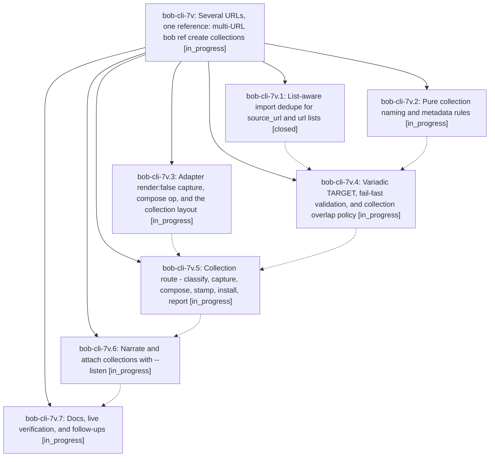

# Bead: bob-cli-7v — Several URLs, one reference: multi-URL bob ref create collections

[Bead Pages](../README.md) / bob-cli-7v

**Status:** ◐ in_progress · **Type:** ▸ plan · **Tier:** epic
**Owner:** `bryanbugyi34@gmail.com` · **Created by:** [bbugyi200.athena.10k](https://github.com/bobs-org/bob-cli--agents/blob/main/sessions/bbugyi200.athena.10k.md) · **Assignee:** `bob-cli-7v.land`
**Created:** 2026-10-15 12:30:28 EDT
**Plan:** [202610/ref\_create\_multi\_url\_collections.md](https://github.com/bobs-org/bob-cli--plans/blob/main/202610/ref_create_multi_url_collections.md)

## Description

`bob ref create URL URL…` merges 2 to 20 web articles, in argument order, into one Highlights-ready PDF and one reference. The PDF has a contents page, one bookmark per article, and continuous page numbers. The name comes from `-N` or from the words every URL's slug shares. The command is all-or-nothing and fails fast, before any network call, whenever no trustworthy name exists.

## Phases

| Bead | Title | Status | Size | Created | Agents | Commits |
|---|---|---|---|---|---:|---:|
| [bob-cli-7v.1](bob-cli-7v.1.md) | List-aware import dedupe for source\_url and url lists | ✓ closed | small | 2026-10-15 | 1 | 1 |
| [bob-cli-7v.2](bob-cli-7v.2.md) | Pure collection naming and metadata rules | ◐ in_progress | medium | 2026-10-15 | 1 | 0 |
| [bob-cli-7v.3](bob-cli-7v.3.md) | Adapter render:false capture, compose op, and the collection layout | ◐ in_progress | medium | 2026-10-15 | 1 | 0 |
| [bob-cli-7v.4](bob-cli-7v.4.md) | Variadic TARGET, fail-fast validation, and collection overlap policy | ◐ in_progress | medium | 2026-10-15 | 1 | 0 |
| [bob-cli-7v.5](bob-cli-7v.5.md) | Collection route - classify, capture, compose, stamp, install, report | ◐ in_progress | medium | 2026-10-15 | 1 | 0 |
| [bob-cli-7v.6](bob-cli-7v.6.md) | Narrate and attach collections with --listen | ◐ in_progress | small | 2026-10-15 | 1 | 0 |
| [bob-cli-7v.7](bob-cli-7v.7.md) | Docs, live verification, and follow-ups | ◐ in_progress | small | 2026-10-15 | 1 | 0 |

## Lineage

## Agents

| Agent | Bead | Commits |
|---|---|---:|
| [bbugyi200.athena.bob-cli-7v.1](https://github.com/bobs-org/bob-cli--agents/blob/main/agents/bbugyi200.athena.bob-cli-7v.1/README.md) | [bob-cli-7v.1](bob-cli-7v.1.md) | 1 |
| [bbugyi200.athena.bob-cli-7v.2](https://github.com/bobs-org/bob-cli--agents/blob/main/agents/bbugyi200.athena.bob-cli-7v.2/README.md) | [bob-cli-7v.2](bob-cli-7v.2.md) | 0 |
| [bbugyi200.athena.bob-cli-7v.3](https://github.com/bobs-org/bob-cli--agents/blob/main/agents/bbugyi200.athena.bob-cli-7v.3/README.md) | [bob-cli-7v.3](bob-cli-7v.3.md) | 0 |
| [bbugyi200.athena.bob-cli-7v.4](https://github.com/bobs-org/bob-cli--agents/blob/main/agents/bbugyi200.athena.bob-cli-7v.4/README.md) | [bob-cli-7v.4](bob-cli-7v.4.md) | 0 |
| [bbugyi200.athena.bob-cli-7v.5](https://github.com/bobs-org/bob-cli--agents/blob/main/agents/bbugyi200.athena.bob-cli-7v.5/README.md) | [bob-cli-7v.5](bob-cli-7v.5.md) | 0 |
| [bbugyi200.athena.bob-cli-7v.6](https://github.com/bobs-org/bob-cli--agents/blob/main/agents/bbugyi200.athena.bob-cli-7v.6/README.md) | [bob-cli-7v.6](bob-cli-7v.6.md) | 0 |
| [bbugyi200.athena.bob-cli-7v.7](https://github.com/bobs-org/bob-cli--agents/blob/main/agents/bbugyi200.athena.bob-cli-7v.7/README.md) | [bob-cli-7v.7](bob-cli-7v.7.md) | 0 |
| [bbugyi200.athena.bob-cli-7v.land](https://github.com/bobs-org/bob-cli--agents/blob/main/agents/bbugyi200.athena.bob-cli-7v.land/README.md) | [bob-cli-7v](README.md) | 0 |

## Commits

| Repo | Commit | Subject | Bead | Committed |
|---|---|---|---|---|
| bob-cli | [`47e85f6`](https://github.com/bobs-org/bob-cli/commit/47e85f65e00dc953c25416b475b21fe0ee4bea92) | feat(ref): dedupe list-valued source URLs | [bob-cli-7v.1](bob-cli-7v.1.md) | 2026-10-15 12:39:19 EDT |
