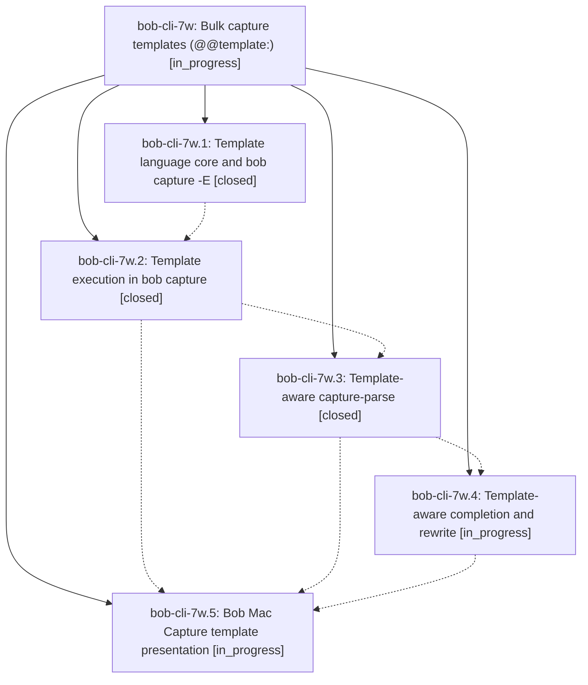

# Bead: bob-cli-7w — Bulk capture templates (@@template:)

[Bead Pages](../README.md) / bob-cli-7w

**Status:** ◐ in_progress · **Type:** ▸ plan · **Tier:** epic
**Owner:** `bryanbugyi34@gmail.com` · **Created by:** [bbugyi200.apollo.research.1j.linker.w0](https://github.com/bobs-org/bob-cli--agents/blob/main/sessions/bbugyi200.apollo.research.1j.linker.w0.md) · **Assignee:** `bob-cli-7w.land`
**Created:** 2026-10-15 14:04:18 EDT
**Plan:** [202610/bulk\_capture\_templates.md](https://github.com/bobs-org/bob-cli--plans/blob/main/202610/bulk_capture_templates.md)

<!-- sase:links:start -->

## Links

| Relation | Artifact | Why |
| --- | --- | --- |
| implemented-by | [plan:202610/bulk_capture_templates.md][1] | derived from the plan's `bead_id:` frontmatter field |

[1]: https://github.com/bobs-org/bob-cli--plans/blob/main/202610/bulk_capture_templates.md

<!-- sase:links:end -->

## Description

A draft that starts with `@@template:` captures one item per row from a `{0}`-style template, exactly as if the expanded items had been typed, all or nothing; `bob capture`, the `capture-*` editor protocol, and Bob Mac Capture make templates easy to write, easy to check, and pleasant to read.

## Notes

[2026-10-15T18:23:57Z · bryanbugyi34@gmail.com] The epic lander agent should make sure that the <ctrl+j> keymap never auto-inserts a dash when the template syntax is being used (it should just insert a newline).

## Phases

| Bead | Title | Status | Size | Created | Agents | Commits |
|---|---|---|---|---|---:|---:|
| [bob-cli-7w.1](bob-cli-7w.1.md) | Template language core and bob capture -E | ✓ closed | medium | 2026-10-15 | 1 | 1 |
| [bob-cli-7w.2](bob-cli-7w.2.md) | Template execution in bob capture | ✓ closed | medium | 2026-10-15 | 1 | 1 |
| [bob-cli-7w.3](bob-cli-7w.3.md) | Template-aware capture-parse | ✓ closed | medium | 2026-10-15 | 1 | 1 |
| [bob-cli-7w.4](bob-cli-7w.4.md) | Template-aware completion and rewrite | ◐ in_progress | small | 2026-10-15 | 1 | 0 |
| [bob-cli-7w.5](bob-cli-7w.5.md) | Bob Mac Capture template presentation | ◐ in_progress | medium | 2026-10-15 | 1 | 0 |

## Lineage

## Agents

| Agent | Bead | Commits |
|---|---|---:|
| [bbugyi200.apollo.bob-cli-7w.1](https://github.com/bobs-org/bob-cli--agents/blob/main/sessions/bbugyi200.apollo.bob-cli-7w.1.md) | [bob-cli-7w.1](bob-cli-7w.1.md) | 1 |
| [bbugyi200.apollo.bob-cli-7w.2](https://github.com/bobs-org/bob-cli--agents/blob/main/sessions/bbugyi200.apollo.bob-cli-7w.2.md) | [bob-cli-7w.2](bob-cli-7w.2.md) | 1 |
| [bbugyi200.apollo.bob-cli-7w.3](https://github.com/bobs-org/bob-cli--agents/blob/main/agents/bbugyi200.apollo.bob-cli-7w.3/README.md) | [bob-cli-7w.3](bob-cli-7w.3.md) | 1 |
| [bbugyi200.apollo.bob-cli-7w.4](https://github.com/bobs-org/bob-cli--agents/blob/main/agents/bbugyi200.apollo.bob-cli-7w.4/README.md) | [bob-cli-7w.4](bob-cli-7w.4.md) | 0 |
| [bbugyi200.apollo.bob-cli-7w.5](https://github.com/bobs-org/bob-cli--agents/blob/main/agents/bbugyi200.apollo.bob-cli-7w.5/README.md) | [bob-cli-7w.5](bob-cli-7w.5.md) | 0 |
| [bbugyi200.apollo.bob-cli-7w.land](https://github.com/bobs-org/bob-cli--agents/blob/main/agents/bbugyi200.apollo.bob-cli-7w.land/README.md) | [bob-cli-7w](README.md) | 0 |

## Commits

| Repo | Commit | Subject | Bead | Committed |
|---|---|---|---|---|
| bob-cli | [`946c9b7`](https://github.com/bobs-org/bob-cli/commit/946c9b7d166a16a24868b9929a8e552563d5ed78) | feat(capture): add template language and expansion CLI | [bob-cli-7w.1](bob-cli-7w.1.md) | 2026-10-15 14:45:00 EDT |
| bob-cli | [`8f0baa7`](https://github.com/bobs-org/bob-cli/commit/8f0baa7653714d71ed34f0399efd8a654e0cfc96) | feat(capture): execute bulk templates through planner | [bob-cli-7w.2](bob-cli-7w.2.md) | 2026-10-15 15:26:50 EDT |
| bob-cli | [`8408562`](https://github.com/bobs-org/bob-cli/commit/840856213a7eca8b6e64443eabf8159cc22d0899) | feat(capture-parse): support template drafts | [bob-cli-7w.3](bob-cli-7w.3.md) | 2026-10-15 15:57:59 EDT |
