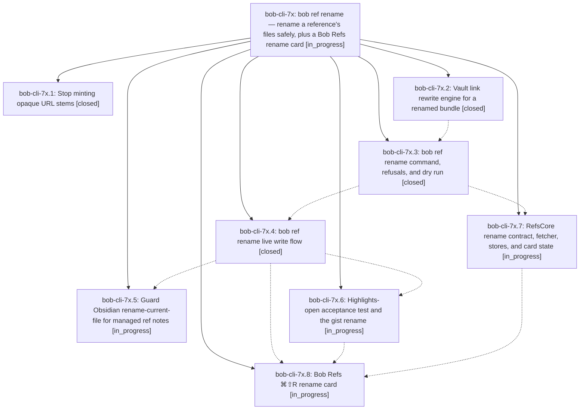

# Bead: bob-cli-7x — bob ref rename — rename a reference's files safely, plus a Bob Refs rename card

[Bead Pages](../README.md) / bob-cli-7x

**Status:** ◐ in_progress · **Type:** ▸ plan · **Tier:** epic
**Owner:** `bryanbugyi34@gmail.com` · **Created by:** [bbugyi200.apollo.research.1k.linker.w0](https://github.com/bobs-org/bob-cli--agents/blob/main/sessions/bbugyi200.apollo.research.1k.linker.w0.md) · **Assignee:** `bob-cli-7x.land`
**Created:** 2026-10-15 15:25:59 EDT
**Plan:** [202610/bob\_ref\_rename.md](https://github.com/bobs-org/bob-cli--plans/blob/main/202610/bob_ref_rename.md)

<!-- sase:links:start -->

## Links

| Relation | Artifact | Why |
| --- | --- | --- |
| implemented-by | [plan:202610/bob_ref_rename.md][1] | derived from the plan's `bead_id:` frontmatter field |

[1]: https://github.com/bobs-org/bob-cli--plans/blob/main/202610/bob_ref_rename.md

<!-- sase:links:end -->

## Description

`bob ref rename <REF> <NAME>` renames the file stem of a modern, PDF-backed, unannotated reference (note, PDF, sidecar, audio) and rewrites every inbound link in one verified, scoped commit, while keeping its id, ^ref block ID, title, and PDF bytes. Bob Refs gets a ⌘⇧R / ⌘K → Rename… card that calls it. The URL namer stops minting opaque hex stems, and Obsidian's rename-current-file command refuses managed ref notes. The misnamed 442a6bf555914893e9891c11519de94f gist ends up as karpathy_llm_wiki.

## Phases

| Bead | Title | Status | Size | Created | Agents | Commits |
|---|---|---|---|---|---:|---:|
| [bob-cli-7x.1](bob-cli-7x.1.md) | Stop minting opaque URL stems | ✓ closed | small | 2026-10-15 | 1 | 1 |
| [bob-cli-7x.2](bob-cli-7x.2.md) | Vault link rewrite engine for a renamed bundle | ✓ closed | medium | 2026-10-15 | 1 | 1 |
| [bob-cli-7x.3](bob-cli-7x.3.md) | bob ref rename command, refusals, and dry run | ✓ closed | medium | 2026-10-15 | 1 | 1 |
| [bob-cli-7x.4](bob-cli-7x.4.md) | bob ref rename live write flow | ✓ closed | medium | 2026-10-15 | 1 | 1 |
| [bob-cli-7x.5](bob-cli-7x.5.md) | Guard Obsidian rename-current-file for managed ref notes | ◐ in_progress | small | 2026-10-15 | 1 | 0 |
| [bob-cli-7x.6](bob-cli-7x.6.md) | Highlights-open acceptance test and the gist rename | ◐ in_progress | small | 2026-10-15 | 1 | 0 |
| [bob-cli-7x.7](bob-cli-7x.7.md) | RefsCore rename contract, fetcher, stores, and card state | ◐ in_progress | medium | 2026-10-15 | 1 | 0 |
| [bob-cli-7x.8](bob-cli-7x.8.md) | Bob Refs ⌘⇧R rename card | ◐ in_progress | medium | 2026-10-15 | 1 | 0 |

## Lineage

## Agents

| Agent | Bead | Commits |
|---|---|---:|
| [bbugyi200.apollo.bob-cli-7x.1](https://github.com/bobs-org/bob-cli--agents/blob/main/agents/bbugyi200.apollo.bob-cli-7x.1/README.md) | [bob-cli-7x.1](bob-cli-7x.1.md) | 1 |
| [bbugyi200.apollo.bob-cli-7x.2](https://github.com/bobs-org/bob-cli--agents/blob/main/sessions/bbugyi200.apollo.bob-cli-7x.2.md) | [bob-cli-7x.2](bob-cli-7x.2.md) | 1 |
| [bbugyi200.apollo.bob-cli-7x.3](https://github.com/bobs-org/bob-cli--agents/blob/main/sessions/bbugyi200.apollo.bob-cli-7x.3.md) | [bob-cli-7x.3](bob-cli-7x.3.md) | 1 |
| [bbugyi200.apollo.bob-cli-7x.4](https://github.com/bobs-org/bob-cli--agents/blob/main/sessions/bbugyi200.apollo.bob-cli-7x.4.md) | [bob-cli-7x.4](bob-cli-7x.4.md) | 1 |
| [bbugyi200.apollo.bob-cli-7x.5](https://github.com/bobs-org/bob-cli--agents/blob/main/agents/bbugyi200.apollo.bob-cli-7x.5/README.md) | [bob-cli-7x.5](bob-cli-7x.5.md) | 0 |
| [bbugyi200.apollo.bob-cli-7x.6](https://github.com/bobs-org/bob-cli--agents/blob/main/agents/bbugyi200.apollo.bob-cli-7x.6/README.md) | [bob-cli-7x.6](bob-cli-7x.6.md) | 0 |
| [bbugyi200.apollo.bob-cli-7x.7](https://github.com/bobs-org/bob-cli--agents/blob/main/sessions/bbugyi200.apollo.bob-cli-7x.7.md) | [bob-cli-7x.7](bob-cli-7x.7.md) | 0 |
| [bbugyi200.apollo.bob-cli-7x.8](https://github.com/bobs-org/bob-cli--agents/blob/main/agents/bbugyi200.apollo.bob-cli-7x.8/README.md) | [bob-cli-7x.8](bob-cli-7x.8.md) | 0 |
| [bbugyi200.apollo.bob-cli-7x.land](https://github.com/bobs-org/bob-cli--agents/blob/main/agents/bbugyi200.apollo.bob-cli-7x.land/README.md) | [bob-cli-7x](README.md) | 0 |

## Commits

| Repo | Commit | Subject | Bead | Committed |
|---|---|---|---|---|
| bob-cli | [`04905b3`](https://github.com/bobs-org/bob-cli/commit/04905b3999eaf0fb347cf3126fae645bbb356908) | fix(refs): avoid opaque URL stems | [bob-cli-7x.1](bob-cli-7x.1.md) | 2026-10-15 15:32:03 EDT |
| bob-cli | [`66c0dcd`](https://github.com/bobs-org/bob-cli/commit/66c0dcdc9e85ba01f808da6edb7b1508f2e9ffd6) | feat(ref-rename): plan inbound vault link rewrites | [bob-cli-7x.2](bob-cli-7x.2.md) | 2026-10-15 15:56:09 EDT |
| bob-cli | [`f732097`](https://github.com/bobs-org/bob-cli/commit/f732097c99668cc009294a76d1fa89cd6ea92ae9) | feat(ref): add reference rename planning | [bob-cli-7x.3](bob-cli-7x.3.md) | 2026-10-15 16:48:53 EDT |
| bob-cli | [`3cd6354`](https://github.com/bobs-org/bob-cli/commit/3cd63543d07ec8d46510552c25fdaec6297e98da) | feat(ref): implement verified bundle rename writes | [bob-cli-7x.4](bob-cli-7x.4.md) | 2026-10-15 17:23:43 EDT |
