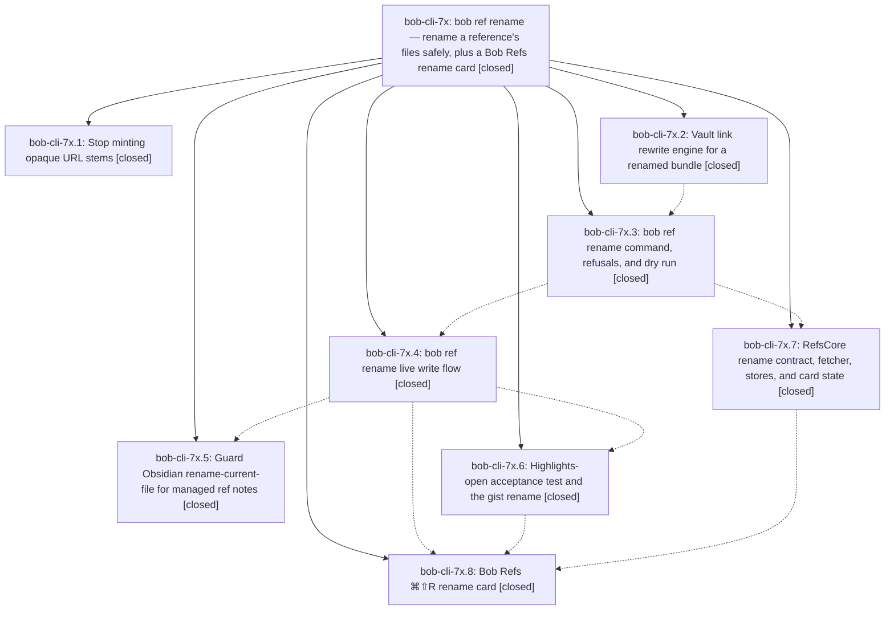

# Bead: bob-cli-7x — bob ref rename — rename a reference's files safely, plus a Bob Refs rename card

[Bead Pages](../README.md) / bob-cli-7x

**Status:** ✓ closed · **Resolution:** done · **Type:** ▸ plan · **Tier:** epic
**Owner:** `bryanbugyi34@gmail.com` · **Created by:** [bbugyi200.apollo.research.1k.linker.w0](https://github.com/bobs-org/bob-cli--agents/blob/main/sessions/bbugyi200.apollo.research.1k.linker.w0.md) · **Assignee:** `bob-cli-7x.land`
**Created:** 2026-10-15 15:25:59 EDT · **Closed:** 2026-10-15 19:39:14 EDT
**Plan:** [202610/bob\_ref\_rename.md](https://github.com/bobs-org/bob-cli--plans/blob/main/202610/bob_ref_rename.md)

<!-- sase:links:start -->

## Links

| Relation | Artifact | Why |
| --- | --- | --- |
| implemented-by | [plan:202610/bob_ref_rename.md][1] | derived from the plan's `bead_id:` frontmatter field |
| related | [bead:bob-cli-86][2] | Epic that proposed this follow-up; its namer phase stopped minting the opaque stem and its acceptance phase renamed the live gist |

_Plus 1 automatic references — see [Referenced By](#referenced-by)._

[1]: https://github.com/bobs-org/bob-cli--plans/blob/main/202610/bob_ref_rename.md
[2]: https://github.com/bobs-org/bob-cli--beads/blob/main/pages/bob-cli-86/README.md

<!-- sase:links:end -->

## Description

`bob ref rename <REF> <NAME>` renames the file stem of a modern, PDF-backed, unannotated reference (note, PDF, sidecar, audio) and rewrites every inbound link in one verified, scoped commit, while keeping its id, ^ref block ID, title, and PDF bytes. Bob Refs gets a ⌘⇧R / ⌘K → Rename… card that calls it. The URL namer stops minting opaque hex stems, and Obsidian's rename-current-file command refuses managed ref notes. The misnamed 442a6bf555914893e9891c11519de94f gist ends up as karpathy_llm_wiki.

## Notes

[2026-10-15T23:16:12Z · bob-cli-7x.land] LAND TRIAGE (bob-cli-7x.land): No child bead recorded a PROPOSED FOLLOW-UP note. Outcomes: (1) Gist host metadata (numeric author 262588213843476, <owner>/<file>.md title), which the plan's namer phase was told to propose but never did, became new task bob-cli-86 (bug, large, ready; related-linked to this epic). (2) The pre-existing bob-plugins npm test failures that 7x.5 reported were confirmed at 13dbb3d and at 13dbb3d^, so they are not caused by the epic. They were corroborated with +1s on existing tasks bob-cli-6v (unblocked-glyph x4), bob-cli-6w (decision-card Keep notice), bob-cli-7i (forward-promotion BLOCKS link), and bob-cli-3w (stage-ranker 16 ms flake). (3) Declined: the plan's remaining out-of-scope ideas (annotated renames via an identity-origin field, folder refiling, retitling, bulk renames, xlib renames, a bob-provided stem suggestion for the card, guarding delete-current-file and the file-explorer rename, a durable crash journal, and repairing a sase.md rewrite lost to a vault-sync conflict). Nothing shows a current need, and decisions:reference-renames-keep-identity already names the reopen trigger. Filing them would create a wish list. (4) Declined: reverting the 4-to-2-space reindent of six bob-mac-capture files from da2d0ef. It is swift-format default output, lint is non-strict, and a mechanical revert would churn about 2.5k lines again and could change multi-line string literals. (5) Kept: 7x.7 superseded decisions:ref-rename-keeps-identity with decisions:reference-renames-keep-identity. The old record is marked status: superseded with superseded_by, as the descriptor's immutability rule requires. The remaining epic-caused defects go to a lander tale.

[2026-10-15T23:39:14Z · bob-cli-7x.land] LAND VERIFIED (tale 202610/bob_ref_rename_landing.md): all 8 phases landed per plan; bob-cli just check green; live gist rename committed and bob ref show karpathy_llm_wiki keeps id and reading task; post-epic commits compatible (ade85d3c multi-URL collections kept namer changes; bob-cli-7w bulk-template commits untouched). Triage already noted on epic: gist host metadata to task bob-cli-86; 7 pre-existing bob-plugins failures +1 on bob-cli-6v/6w/7i/3w. Tale fixes: bob-cli title_stem helper + short_title_stem sharing it with unit tests, clip/ingest fallbacks use it, rename --help default-once, ref --help aligned rename example + fixture, docs/ref.md wording, 2 clippy fixes, highlights-create.md extension note (just check green; help outputs eyeballed). bob-plugins nav-hotkeys README table-cell fix, 2.39.0 to 2.40.0 manifest+README, build/build:check green, rename tests 3/3, npm test 2802/2809 with only the 7 known failures, plugins sync copied manifest. bob-mac-capture 10 rename-card fixes (sticky footer precedence+clearing, String-describing transport + busy message, hidden-failure notify + failed-card re-present, unchanged/already_renamed statuses, one-shot inspector invalidation, IME pass-through nil, focus-sequence refocus, dead revealedPageID remap removed, write-mode/unknown_reference fixtures + decode tests, README Rename card moved); portable-check on athena green (1225 tests, 0 failures). macOS targets UNVERIFIED: Mac offline (ssh timeout), no bundle.sh/typecheck-tests run.

## Phases

| Bead | Title | Status | Size | Created | Agents | Commits |
|---|---|---|---|---|---:|---:|
| [bob-cli-7x.1](bob-cli-7x.1.md) | Stop minting opaque URL stems | ✓ closed | small | 2026-10-15 | 1 | 1 |
| [bob-cli-7x.2](bob-cli-7x.2.md) | Vault link rewrite engine for a renamed bundle | ✓ closed | medium | 2026-10-15 | 1 | 1 |
| [bob-cli-7x.3](bob-cli-7x.3.md) | bob ref rename command, refusals, and dry run | ✓ closed | medium | 2026-10-15 | 1 | 1 |
| [bob-cli-7x.4](bob-cli-7x.4.md) | bob ref rename live write flow | ✓ closed | medium | 2026-10-15 | 1 | 1 |
| [bob-cli-7x.5](bob-cli-7x.5.md) | Guard Obsidian rename-current-file for managed ref notes | ✓ closed | small | 2026-10-15 | 1 | 1 |
| [bob-cli-7x.6](bob-cli-7x.6.md) | Highlights-open acceptance test and the gist rename | ✓ closed | small | 2026-10-15 | 1 | 1 |
| [bob-cli-7x.7](bob-cli-7x.7.md) | RefsCore rename contract, fetcher, stores, and card state | ✓ closed | medium | 2026-10-15 | 1 | 2 |
| [bob-cli-7x.8](bob-cli-7x.8.md) | Bob Refs ⌘⇧R rename card | ✓ closed | medium | 2026-10-15 | 1 | 1 |

## Lineage

## Agents

| Agent | Bead | Commits |
|---|---|---:|
| [bbugyi200.apollo.bob-cli-7x.1](https://github.com/bobs-org/bob-cli--agents/blob/main/agents/bbugyi200.apollo.bob-cli-7x.1/README.md) | [bob-cli-7x.1](bob-cli-7x.1.md) | 1 |
| [bbugyi200.apollo.bob-cli-7x.2](https://github.com/bobs-org/bob-cli--agents/blob/main/sessions/bbugyi200.apollo.bob-cli-7x.2.md) | [bob-cli-7x.2](bob-cli-7x.2.md) | 1 |
| [bbugyi200.apollo.bob-cli-7x.3](https://github.com/bobs-org/bob-cli--agents/blob/main/sessions/bbugyi200.apollo.bob-cli-7x.3.md) | [bob-cli-7x.3](bob-cli-7x.3.md) | 1 |
| [bbugyi200.apollo.bob-cli-7x.4](https://github.com/bobs-org/bob-cli--agents/blob/main/sessions/bbugyi200.apollo.bob-cli-7x.4.md) | [bob-cli-7x.4](bob-cli-7x.4.md) | 1 |
| [bbugyi200.apollo.bob-cli-7x.5](https://github.com/bobs-org/bob-cli--agents/blob/main/agents/bbugyi200.apollo.bob-cli-7x.5/README.md) | [bob-cli-7x.5](bob-cli-7x.5.md) | 1 |
| [bbugyi200.apollo.bob-cli-7x.6](https://github.com/bobs-org/bob-cli--agents/blob/main/sessions/bbugyi200.apollo.bob-cli-7x.6.md) | [bob-cli-7x.6](bob-cli-7x.6.md) | 1 |
| [bbugyi200.apollo.bob-cli-7x.7](https://github.com/bobs-org/bob-cli--agents/blob/main/sessions/bbugyi200.apollo.bob-cli-7x.7.md) | [bob-cli-7x.7](bob-cli-7x.7.md) | 2 |
| [bbugyi200.apollo.bob-cli-7x.8](https://github.com/bobs-org/bob-cli--agents/blob/main/sessions/bbugyi200.apollo.bob-cli-7x.8.md) | [bob-cli-7x.8](bob-cli-7x.8.md) | 1 |
| [bbugyi200.apollo.bob-cli-7x.land](https://github.com/bobs-org/bob-cli--agents/blob/main/sessions/bbugyi200.apollo.bob-cli-7x.land.md) | [bob-cli-7x](README.md) | 4 |

## Commits

| Repo | Commit | Subject | Bead | Committed |
|---|---|---|---|---|
| bob-cli | [`04905b3`](https://github.com/bobs-org/bob-cli/commit/04905b3999eaf0fb347cf3126fae645bbb356908) | fix(refs): avoid opaque URL stems | [bob-cli-7x.1](bob-cli-7x.1.md) | 2026-10-15 15:32:03 EDT |
| bob-cli | [`66c0dcd`](https://github.com/bobs-org/bob-cli/commit/66c0dcdc9e85ba01f808da6edb7b1508f2e9ffd6) | feat(ref-rename): plan inbound vault link rewrites | [bob-cli-7x.2](bob-cli-7x.2.md) | 2026-10-15 15:56:09 EDT |
| bob-cli | [`f732097`](https://github.com/bobs-org/bob-cli/commit/f732097c99668cc009294a76d1fa89cd6ea92ae9) | feat(ref): add reference rename planning | [bob-cli-7x.3](bob-cli-7x.3.md) | 2026-10-15 16:48:53 EDT |
| bob-cli | [`3cd6354`](https://github.com/bobs-org/bob-cli/commit/3cd63543d07ec8d46510552c25fdaec6297e98da) | feat(ref): implement verified bundle rename writes | [bob-cli-7x.4](bob-cli-7x.4.md) | 2026-10-15 17:23:43 EDT |
| bob-plugins | [`bob-plugins@13dbb3d`](https://github.com/bobs-org/bob-plugins/commit/13dbb3d7c5f5e014d9e8286ab12cce767ff79b2b) | feat(bob-navigation-hotkeys): guard managed reference renames | [bob-cli-7x.5](bob-cli-7x.5.md) | 2026-10-15 17:29:43 EDT |
| bob-cli | [`eb0dca8`](https://github.com/bobs-org/bob-cli/commit/eb0dca8e2b911c2a7b030b7a68342916772e8215) | docs(ref): record Highlights-open acceptance PASS for bob ref rename | [bob-cli-7x.6](bob-cli-7x.6.md) | 2026-10-15 17:37:17 EDT |
| bob-cli | [`8a3c561`](https://github.com/bobs-org/bob-cli/commit/8a3c5613393c5ec253c3f6ae3d5f0bec51ab3948) | docs(refs): record rename identity decision | [bob-cli-7x.7](bob-cli-7x.7.md) | 2026-10-15 17:45:59 EDT |
| bob-mac-capture | [`bob-mac-capture@da2d0ef`](https://github.com/bobs-org/bob-mac-capture/commit/da2d0efdaa4b6c2c357b8ca8a6030163ca406b9a) | feat(refs): add Bob Refs rename support | [bob-cli-7x.7](bob-cli-7x.7.md) | 2026-10-15 17:55:55 EDT |
| bob-mac-capture | [`bob-mac-capture@9ac536c`](https://github.com/bobs-org/bob-mac-capture/commit/9ac536c8a968bb0d5aa8a56687929c3ff8b52bf0) | feat(refs): add the Bob Refs rename card | [bob-cli-7x.8](bob-cli-7x.8.md) | 2026-10-15 18:49:18 EDT |
| bob-cli | [`a041abd`](https://github.com/bobs-org/bob-cli/commit/a041abdb1bb2f19f7f69d304922c12c7005e1765) | fix(ref-rename): land bob-cli-7x follow-ups, title stems, help, clippy | [bob-cli-7x](README.md) | 2026-10-15 19:41:26 EDT |
| bob-mac-capture | [`bob-mac-capture@e095347`](https://github.com/bobs-org/bob-mac-capture/commit/e095347eb0c336511813bd2a3f369dd16fbccd45) | fix(refs): rename-card landing fixes, one-shot invalidation, fixtures | [bob-cli-7x](README.md) | 2026-10-15 19:42:03 EDT |
| bob-plugins | [`bob-plugins@3a58b2a`](https://github.com/bobs-org/bob-plugins/commit/3a58b2a1eccfb6a42a5fd62cb5bf06f17257a5f6) | fix(nav-hotkeys): rename-guard README cell, version 2.40.0 | [bob-cli-7x](README.md) | 2026-10-15 19:42:34 EDT |
| bob-cli--plans | [`bob-cli--plans@1fbea74`](https://github.com/bobs-org/bob-cli--plans/commit/1fbea741c6ccbd768bc7798941a8b7ae8f717b00) | chore(plans): mark bob\_ref\_rename done | [bob-cli-7x](README.md) | 2026-10-15 19:43:04 EDT |

<!-- sase:referenced-by:start -->

## Referenced By

| Relation | Artifact | Why | Uses |
| --- | --- | --- | ---: |
| read-by | [agent:bob-cli-7x.4--3][1] | Confirm the parent epic remains open; the phase worker must not close ancestors | 1 |

[1]: https://github.com/bobs-org/bob-cli--agents/blob/main/sessions/bbugyi200.apollo.bob-cli-7x.4.md

<!-- sase:referenced-by:end -->
