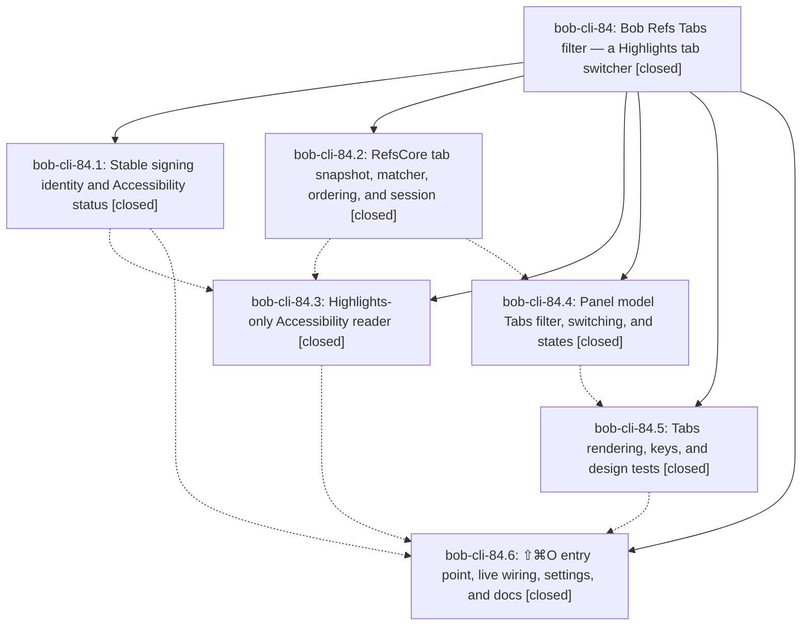

# Bead: bob-cli-84 — Bob Refs Tabs filter — a Highlights tab switcher

[Bead Pages](../README.md) / bob-cli-84

**Status:** ✓ closed · **Resolution:** done · **Type:** ▸ plan · **Tier:** epic
**Owner:** `bryanbugyi34@gmail.com` · **Created by:** [bbugyi200.apollo.7w](https://github.com/bobs-org/bob-cli--agents/blob/main/sessions/bbugyi200.apollo.7w.md) · **Assignee:** `bob-cli-84.land`
**Created:** 2026-10-15 17:50:48 EDT · **Closed:** 2026-10-16 09:36:09 EDT
**Plan:** [202610/highlights\_tabs\_switcher.md](https://github.com/bobs-org/bob-cli--plans/blob/main/202610/highlights_tabs_switcher.md)

<!-- sase:links:start -->

## Links

| Relation | Artifact | Why |
| --- | --- | --- |
| implemented-by | [plan:202610/highlights_tabs_switcher.md][1] | derived from the plan's `bead_id:` frontmatter field |
| related | [bead:bob-cli-8c][2] | Epic whose phases proposed this decision record; decision_record=no deferred it |

_Plus 2 automatic references — see [Referenced By](#referenced-by)._

[1]: https://github.com/bobs-org/bob-cli--plans/blob/main/202610/highlights_tabs_switcher.md
[2]: https://github.com/bobs-org/bob-cli--beads/blob/main/pages/bob-cli-8c/README.md

<!-- sase:links:end -->

## Description

In Bob Mac Capture's Bob Refs panel, ⇧⌘O pressed while Highlights is frontmost (or ⌘T inside the panel) shows a "Tabs" filter. It lists every document open in Highlights, matched to its reference note where one exists, with the current tab first and the previous tab pre-selected. ↵ switches to that existing tab without touching the vault or the open log. Bob Mac Capture installs with a stable signing identity, so the Accessibility grant the feature needs survives every `just install`.

## Notes

[2026-10-16T12:43:20Z · bob-cli-84.land] LAND TRIAGE (bob-cli-84.land): PROPOSED FOLLOW-UP outcomes.
(1) Decisions record for the Accessibility-only Highlights tab reader. Proposed by all six phases (.1#1, .2#2, .3#1, .4#1, .5#1, .6#1). The epic's decision_record=no skipped it, so it was filed via /sase_new_task as memory task bob-cli-8c (small, ready), linked related to bob-cli-84; Bryan approves or cancels it.
(2) just typecheck-tests fails on the CLT-only Mac for lack of -sdk. Proposed by .1#2, .3#2, .4#2, and .5#2. It duplicates bob-cli-7o, so I recorded +1 evidence there (+2 reports now). Not caused by this epic.
(3) 'XCTest stub lags real XCTest (async XCTAssertEqual in RefsInspectorTests)'. Proposed by .3#2, .4#2, and .5#2. Declined as a separate follow-up because the premise is wrong: RefsInspectorTests.swift:483-485 is a real compile error. CI fails identically (runs 38825142280, 38890871374, 38893493160, 38895720736). It was introduced by the bob-cli-7x landing commit e095347 after this epic started, so the stub is correct. Since it has kept BobMacCaptureTests from compiling in CI for this whole epic, this landing fixes it as integration work.
Landing verification found epic-caused defects that remain epic work:
- The Mac app build breaks at AXHighlightsTabsReader.swift:174, where tabButtons infers as [Any]. CI run 38899044286 fails at Build.
- Two tests fail as soon as the target compiles: RefsPanelDesignTests:1201 uses the wrong row id, and RefsFooterTests:16 has a stale assertion.
- The panel model carries tab rows over between shows, keeps a held Return across a hide, and drops the renamed row after a rename in Tabs mode.
- Smaller issues in the reader, the views, and the scripts.
These are planned as a landing tale.

[2026-10-16T13:36:09Z · bob-cli-84.land--1] Phase review: land agent reviewed all six phases and their notes against the plan contracts and commits 1cd958e, 94a4e58, a4009a4, 1b7ead4, 1e2a9bd.

What was broken: master 1e2a9bd failed to build on the Mac at AXHighlightsTabsReader.swift:174 (tabButtons inferred [Any]; CI 38899044286 Build failure). BobMacCaptureTests had not compiled in CI since e095347 (RefsInspectorTests:483 await in autoclosure), so the epic Mac tests never ran.

Fixes (landing commit fdc7c90, 18 files): (1) build/test-compile blockers - explicit AXTabs branch, await hoists; (2) fail-on-compile tests - tab-row id fix + full Tabs render trace, footer hintsText ⌘T Tabs update, .notRunning-before-.notTrusted order; (3) AX reader - running-before-trust order, drop window-title fallback, single-document select via activate+raise+verify, verify pressed window tabs, name-free ReadFailure mapping, refs-tabs-select-unverified signpost; (4) RefsCore - matcher dedupe one-per-filename, pageCaption only on selected tab, pre-select index1 gated on currentIDs, renamingItem helper + goldens; (5) panel model - clear matchedTabs/frontmost/listing + bump generation on show, clear heldTabsOpen on hide, vanished matched row openTab nil, rename remap via helper; (6) views - scope token setScope(.all), VoiceOver labels gated on openTab, permission card monospaced selectable command; (7) scripts/settings - install.sh missing-identity exit 64, security-output-first identity lookup, Settings codesign-on-appear only. Tests added/adjusted per plan section 8; README Tabs updated where behavior changed.

Verification: Athena just portable-check PASSED (1240 tests, prior land turn). Mac scratch copy (rsync excl .build/.git): Scripts/bundle.sh exit 0 with zero error: lines; Scripts/typecheck-tests.sh (scratch-only -sdk patch, PATH /opt/homebrew/bin) all four targets PASS (BobMacCaptureTests, BobMacCaptureInstallHelperTests, CaptureCoreTests, RefsCoreTests). git diff --check clean. Scratch copy deleted; leftover /tmp/bmc-land84.dBHw5N and /tmp/bmc-land84-*.log removed (none remained). sase bead epic-symbols empty.

Triage outcomes (in bob-cli-84 note): decisions record filed as memory task bob-cli-8c; typecheck -sdk proposals +1 on bob-cli-7o; XCTest-stub-lags declined as real compile error, fixed here.

Declined review items: show during running rename ignores source (rename card owns panel by design); findTabGroup depth-first ordering (84.3 live probe: native tab group at depth 1); model optional tabs: init param (identical behavior).

CI caveat: landing commit CI is the first in which BobMacCaptureTests compile since e095347. Known pre-existing CI failures tracked in bob-cli-7h, bob-cli-7p, bob-cli-61, bob-cli-67. just symvision unavailable in bob-cli workspace (no such recipe).

## Phases

| Bead | Title | Status | Size | Created | Agents | Commits |
|---|---|---|---|---|---:|---:|
| [bob-cli-84.1](bob-cli-84.1.md) | Stable signing identity and Accessibility status | ✓ closed | small | 2026-10-15 | 1 | 1 |
| [bob-cli-84.2](bob-cli-84.2.md) | RefsCore tab snapshot, matcher, ordering, and session | ✓ closed | medium | 2026-10-15 | 1 | 1 |
| [bob-cli-84.3](bob-cli-84.3.md) | Highlights-only Accessibility reader | ✓ closed | medium | 2026-10-15 | 1 | 0 |
| [bob-cli-84.4](bob-cli-84.4.md) | Panel model Tabs filter, switching, and states | ✓ closed | medium | 2026-10-15 | 1 | 1 |
| [bob-cli-84.5](bob-cli-84.5.md) | Tabs rendering, keys, and design tests | ✓ closed | medium | 2026-10-15 | 1 | 1 |
| [bob-cli-84.6](bob-cli-84.6.md) | ⇧⌘O entry point, live wiring, settings, and docs | ✓ closed | medium | 2026-10-15 | 1 | 1 |

## Lineage

## Agents

| Agent | Bead | Commits |
|---|---|---:|
| [bbugyi200.apollo.bob-cli-84.1](https://github.com/bobs-org/bob-cli--agents/blob/main/agents/bbugyi200.apollo.bob-cli-84.1/README.md) | [bob-cli-84.1](bob-cli-84.1.md) | 1 |
| [bbugyi200.apollo.bob-cli-84.2](https://github.com/bobs-org/bob-cli--agents/blob/main/sessions/bbugyi200.apollo.bob-cli-84.2.md) | [bob-cli-84.2](bob-cli-84.2.md) | 1 |
| [bbugyi200.apollo.bob-cli-84.3](https://github.com/bobs-org/bob-cli--agents/blob/main/agents/bbugyi200.apollo.bob-cli-84.3/README.md) | [bob-cli-84.3](bob-cli-84.3.md) | 0 |
| [bbugyi200.apollo.bob-cli-84.4](https://github.com/bobs-org/bob-cli--agents/blob/main/agents/bbugyi200.apollo.bob-cli-84.4/README.md) | [bob-cli-84.4](bob-cli-84.4.md) | 1 |
| [bbugyi200.apollo.bob-cli-84.5](https://github.com/bobs-org/bob-cli--agents/blob/main/agents/bbugyi200.apollo.bob-cli-84.5/README.md) | [bob-cli-84.5](bob-cli-84.5.md) | 1 |
| [bbugyi200.apollo.bob-cli-84.6](https://github.com/bobs-org/bob-cli--agents/blob/main/sessions/bbugyi200.apollo.bob-cli-84.6.md) | [bob-cli-84.6](bob-cli-84.6.md) | 1 |
| [bbugyi200.apollo.bob-cli-84.land](https://github.com/bobs-org/bob-cli--agents/blob/main/sessions/bbugyi200.apollo.bob-cli-84.land.md) | [bob-cli-84](README.md) | 1 |

## Commits

| Repo | Commit | Subject | Bead | Committed |
|---|---|---|---|---|
| bob-mac-capture | [`bob-mac-capture@1cd958e`](https://github.com/bobs-org/bob-mac-capture/commit/1cd958e4c96a1f75f6b14f29f72b3c4833a6c22e) | feat(signing): sign with stable self-signed identity with ad-hoc fallback | [bob-cli-84.1](bob-cli-84.1.md) | 2026-10-15 18:06:11 EDT |
| bob-mac-capture | [`bob-mac-capture@94a4e58`](https://github.com/bobs-org/bob-mac-capture/commit/94a4e589b12d45fec7d10347d0bc6931623bf568) | feat(refs): add Highlights tabs snapshot, matcher, ranking, and session | [bob-cli-84.2](bob-cli-84.2.md) | 2026-10-16 06:59:53 EDT |
| bob-mac-capture | [`bob-mac-capture@a4009a4`](https://github.com/bobs-org/bob-mac-capture/commit/a4009a44760cfe0085e9beb4c174388a73d45261) | feat(refs): add Highlights tabs model and actions | [bob-cli-84.4](bob-cli-84.4.md) | 2026-10-16 07:23:45 EDT |
| bob-mac-capture | [`bob-mac-capture@1b7ead4`](https://github.com/bobs-org/bob-mac-capture/commit/1b7ead440634f9dc67ed7a1be0bfb5469d8b9243) | feat(refs): add Highlights Tabs rendering, keys, and design tests | [bob-cli-84.5](bob-cli-84.5.md) | 2026-10-16 07:43:55 EDT |
| bob-mac-capture | [`bob-mac-capture@1e2a9bd`](https://github.com/bobs-org/bob-mac-capture/commit/1e2a9bd1c3766368b651bc8bf9032e7c8ece13f9) | feat(refs): wire Highlights Tabs entry point and settings | [bob-cli-84.6](bob-cli-84.6.md) | 2026-10-16 08:13:33 EDT |
| bob-cli--plans | [`bob-cli--plans@dce449c`](https://github.com/bobs-org/bob-cli--plans/commit/dce449c427f3f2a98103215953345b49f82dbf83) | docs(plans): mark bob-cli-84 highlights tabs switcher done | [bob-cli-84](README.md) | 2026-10-16 09:37:51 EDT |

<!-- sase:referenced-by:start -->

## Referenced By

| Relation | Artifact | Why | Uses |
| --- | --- | --- | ---: |
| read-by | [agent:bob-cli-84.2--2][1] | Need epic DECISIONS and plan for phase 84.2 | 1 |
| read-by | [agent:bob-cli-84.5][2] | Need epic DECISIONS and phase context | 1 |

[1]: https://github.com/bobs-org/bob-cli--agents/blob/main/sessions/bbugyi200.apollo.bob-cli-84.2.md
[2]: https://github.com/bobs-org/bob-cli--agents/blob/main/agents/bbugyi200.apollo.bob-cli-84.5/README.md

<!-- sase:referenced-by:end -->
