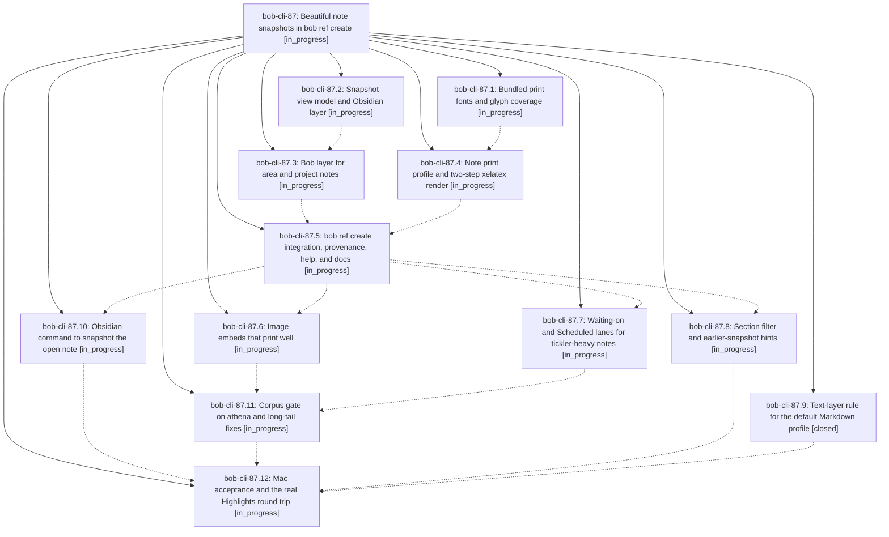

# Bead: bob-cli-87 — Beautiful note snapshots in bob ref create

[Bead Pages](../README.md) / bob-cli-87

**Status:** ◐ in_progress · **Type:** ▸ plan · **Tier:** epic
**Owner:** `bryanbugyi34@gmail.com` · **Created by:** [bbugyi200.athena.10l](https://github.com/bobs-org/bob-cli--agents/blob/main/sessions/bbugyi200.athena.10l.md) · **Assignee:** `bob-cli-87.land`
**Created:** 2026-10-16 07:13:18 EDT
**Plan:** [202610/note\_snapshots.md](https://github.com/bobs-org/bob-cli--plans/blob/main/202610/note_snapshots.md)

## Description

`bob ref create sase_blog` turns any Bob vault note, and area/project notes especially, into a calm, beautiful, Highlights-safe PDF: a dated reading snapshot of the note's open work and prose, with resolved links, embeds, and images. It renders the same on athena and the Mac, and every Highlights quote taken from it stays byte-clean.

## Phases

| Bead | Title | Status | Size | Created | Agents | Commits |
|---|---|---|---|---|---:|---:|
| [bob-cli-87.1](bob-cli-87.1.md) | Bundled print fonts and glyph coverage | ◐ in_progress | medium | 2026-10-16 | 1 | 0 |
| [bob-cli-87.10](bob-cli-87.10.md) | Obsidian command to snapshot the open note | ◐ in_progress | medium | 2026-10-16 | 1 | 0 |
| [bob-cli-87.11](bob-cli-87.11.md) | Corpus gate on athena and long-tail fixes | ◐ in_progress | medium | 2026-10-16 | 1 | 0 |
| [bob-cli-87.12](bob-cli-87.12.md) | Mac acceptance and the real Highlights round trip | ◐ in_progress | medium | 2026-10-16 | 1 | 0 |
| [bob-cli-87.2](bob-cli-87.2.md) | Snapshot view model and Obsidian layer | ◐ in_progress | large | 2026-10-16 | 1 | 0 |
| [bob-cli-87.3](bob-cli-87.3.md) | Bob layer for area and project notes | ◐ in_progress | large | 2026-10-16 | 1 | 0 |
| [bob-cli-87.4](bob-cli-87.4.md) | Note print profile and two-step xelatex render | ◐ in_progress | large | 2026-10-16 | 1 | 0 |
| [bob-cli-87.5](bob-cli-87.5.md) | bob ref create integration, provenance, help, and docs | ◐ in_progress | large | 2026-10-16 | 1 | 0 |
| [bob-cli-87.6](bob-cli-87.6.md) | Image embeds that print well | ◐ in_progress | small | 2026-10-16 | 1 | 0 |
| [bob-cli-87.7](bob-cli-87.7.md) | Waiting-on and Scheduled lanes for tickler-heavy notes | ◐ in_progress | medium | 2026-10-16 | 1 | 0 |
| [bob-cli-87.8](bob-cli-87.8.md) | Section filter and earlier-snapshot hints | ◐ in_progress | small | 2026-10-16 | 1 | 0 |
| [bob-cli-87.9](bob-cli-87.9.md) | Text-layer rule for the default Markdown profile | ✓ closed | small | 2026-10-16 | 1 | 1 |

## Lineage

## Agents

| Agent | Bead | Commits |
|---|---|---:|
| [bbugyi200.athena.bob-cli-87.1](https://github.com/bobs-org/bob-cli--agents/blob/main/agents/bbugyi200.athena.bob-cli-87.1/README.md) | [bob-cli-87.1](bob-cli-87.1.md) | 0 |
| [bbugyi200.athena.bob-cli-87.10](https://github.com/bobs-org/bob-cli--agents/blob/main/agents/bbugyi200.athena.bob-cli-87.10/README.md) | [bob-cli-87.10](bob-cli-87.10.md) | 0 |
| [bbugyi200.athena.bob-cli-87.11](https://github.com/bobs-org/bob-cli--agents/blob/main/agents/bbugyi200.athena.bob-cli-87.11/README.md) | [bob-cli-87.11](bob-cli-87.11.md) | 0 |
| [bbugyi200.athena.bob-cli-87.12](https://github.com/bobs-org/bob-cli--agents/blob/main/agents/bbugyi200.athena.bob-cli-87.12/README.md) | [bob-cli-87.12](bob-cli-87.12.md) | 0 |
| [bbugyi200.athena.bob-cli-87.2](https://github.com/bobs-org/bob-cli--agents/blob/main/agents/bbugyi200.athena.bob-cli-87.2/README.md) | [bob-cli-87.2](bob-cli-87.2.md) | 0 |
| [bbugyi200.athena.bob-cli-87.3](https://github.com/bobs-org/bob-cli--agents/blob/main/agents/bbugyi200.athena.bob-cli-87.3/README.md) | [bob-cli-87.3](bob-cli-87.3.md) | 0 |
| [bbugyi200.athena.bob-cli-87.4](https://github.com/bobs-org/bob-cli--agents/blob/main/agents/bbugyi200.athena.bob-cli-87.4/README.md) | [bob-cli-87.4](bob-cli-87.4.md) | 0 |
| [bbugyi200.athena.bob-cli-87.5](https://github.com/bobs-org/bob-cli--agents/blob/main/agents/bbugyi200.athena.bob-cli-87.5/README.md) | [bob-cli-87.5](bob-cli-87.5.md) | 0 |
| [bbugyi200.athena.bob-cli-87.6](https://github.com/bobs-org/bob-cli--agents/blob/main/agents/bbugyi200.athena.bob-cli-87.6/README.md) | [bob-cli-87.6](bob-cli-87.6.md) | 0 |
| [bbugyi200.athena.bob-cli-87.7](https://github.com/bobs-org/bob-cli--agents/blob/main/agents/bbugyi200.athena.bob-cli-87.7/README.md) | [bob-cli-87.7](bob-cli-87.7.md) | 0 |
| [bbugyi200.athena.bob-cli-87.8](https://github.com/bobs-org/bob-cli--agents/blob/main/agents/bbugyi200.athena.bob-cli-87.8/README.md) | [bob-cli-87.8](bob-cli-87.8.md) | 0 |
| [bbugyi200.athena.bob-cli-87.9](https://github.com/bobs-org/bob-cli--agents/blob/main/agents/bbugyi200.athena.bob-cli-87.9/README.md) | [bob-cli-87.9](bob-cli-87.9.md) | 1 |
| [bbugyi200.athena.bob-cli-87.land](https://github.com/bobs-org/bob-cli--agents/blob/main/agents/bbugyi200.athena.bob-cli-87.land/README.md) | [bob-cli-87](README.md) | 0 |

## Commits

| Repo | Commit | Subject | Bead | Committed |
|---|---|---|---|---|
| bob-cli | [`9ce50ee`](https://github.com/bobs-org/bob-cli/commit/9ce50eeb1b37f9a725850c2f4865f74afee946d7) | fix(highlights): preserve clean text layer in Markdown PDFs | [bob-cli-87.9](bob-cli-87.9.md) | 2026-10-16 07:21:05 EDT |
