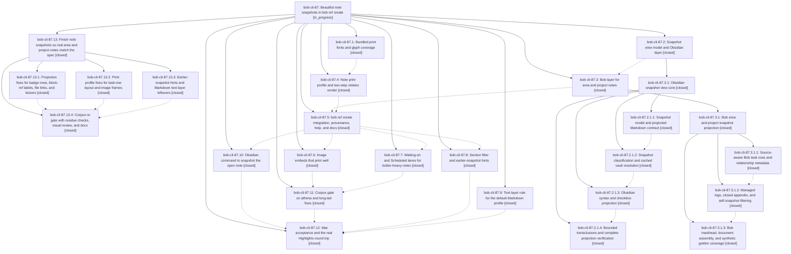

# Bead: bob-cli-87 — Beautiful note snapshots in bob ref create

[Bead Pages](../README.md) / bob-cli-87

**Status:** ◐ in_progress · **Type:** ▸ plan · **Tier:** epic
**Owner:** `bryanbugyi34@gmail.com` · **Created by:** [bbugyi200.athena.10l](https://github.com/bobs-org/bob-cli--agents/blob/main/sessions/bbugyi200.athena.10l.md) · **Assignee:** `bob-cli-87.land`
**Created:** 2026-10-16 07:13:18 EDT
**Plan:** [202610/note\_snapshots.md](https://github.com/bobs-org/bob-cli--plans/blob/main/202610/note_snapshots.md)

<!-- sase:links:start -->

## Links

| Relation | Artifact | Why |
| --- | --- | --- |
| implemented-by | [plan:202610/note_snapshots.md][1] | derived from the plan's `bead_id:` frontmatter field |

_Plus 4 automatic references — see [Referenced By](#referenced-by)._

[1]: https://github.com/bobs-org/bob-cli--plans/blob/main/202610/note_snapshots.md

<!-- sase:links:end -->

## Description

`bob ref create sase_blog` turns any Bob vault note, and area/project notes especially, into a calm, beautiful, Highlights-safe PDF: a dated reading snapshot of the note's open work and prose, with resolved links, embeds, and images. It renders the same on athena and the Mac, and every Highlights quote taken from it stays byte-clean.

## Notes

[2026-10-16T15:54:54Z · bob-cli-8b.land] DISCOVERED ISSUE: From bob-cli-8b.land while running just check on clean master 71be24ae (apollo). (1) cargo fmt --check fails only in note_snapshot files written by bob-cli-87.2.1 children (a086cd9b, 71be24ae): obsidian.rs:1217,3481,3495,3534,3542; resolve.rs:1533; serialize.rs:558,649; tests.rs:95,138,145,163,174,184,929,963; transclusion.rs:103,927,954,1066,1097,1502,1627,1642,1653,1823,1830,1867,1879,1987 — so just check stops at its first recipe line for every agent. (2) cargo test --lib: native::highlights_ref::note_snapshot::profile::tests::pandoc_maps_every_contract_construct_to_tex panics at profile.rs:864 'lifted link' (the \\hyperref[t-next]{visible link\\BobTag{ᵇ}} expectation is not in the emitted TeX). (3) profile::tests::renders_contract_with_clean_text_layer_and_metadata panics at profile.rs:943: xelatex pass 1 'File titlesec.sty not found' on apollo — the test needs a TeX package the host lacks; either gate it on package availability like other render tests or document the dependency. Fix: run cargo fmt on note_snapshot, repair the lifted-link projection or its expectation, and make the real-render test skip cleanly without titlesec. Not caused by bob-cli-8b; no new task filed because these are causally owned by this active epic.

[2026-10-16T17:26:45Z · bob-cli-8f.land] DISCOVERED ISSUE: Triaged bob-cli-8f.1 PROPOSED FOLLOW-UP note #4 during bob-cli-8f landing. Its real-render test failure (native::highlights_ref::note_snapshot::profile::tests::renders_contract_with_clean_text_layer_and_metadata: titlesec.sty missing) is owned by this active epic, specifically bob-cli-87.4. On the reviewed bob-cli tree 280321a3, profile.rs still gates only pandoc and xelatex executable availability before rendering, while note.tex requires titlesec; kpsewhich titlesec.sty returns no path on apollo. This corroborates this epic note #1 and the phase report; the lander did not rerun the render test. No duplicate task created after the sase_new_task search and recent-task sweep.

[2026-10-16T18:31:31Z · bob-cli-8f.land--2] DISCOVERED ISSUE: On the current checkout fast-forwarded to 6c53e138,  (ToolRun 5be9000c6502d8c8762e4b76c1652fc1) reproduced both failures already recorded in this epic's note #1: pandoc_maps_every_contract_construct_to_tex panics at profile.rs:864 because the emitted TeX lacks the expected lifted link, and renders_contract_with_clean_text_layer_and_metadata fails because titlesec.sty is unavailable. The same-type task search and one-week bug sweep found no task duplicate; the active note-snapshot epic already owns both failures, so no new task was created.

[2026-10-16T20:33:17Z · bob-cli-8g.land] DISCOVERED ISSUE: bob-cli-8g.land just check at bob-cli HEAD a4c9ecf5 (after 07fef5f0/a4c9ecf5) still fails only these two lib tests: note_snapshot::profile::tests::pandoc_maps_every_contract_construct_to_tex (profile.rs:864 'lifted link') and renders_contract_with_clean_text_layer_and_metadata (profile.rs:943, xelatex: titlesec.sty not found on apollo). 2848 lib + 1715 CLI tests pass otherwise. Proposed by bob-cli-8g.1/.3/.4/.5/.6; corroborates notes already on this epic, so no new task was filed.

[2026-10-17T14:05:52Z · bob-cli-87.land] LAND FOLLOW-UP TRIAGE (bob-cli-87.land): Reviewed every child and grandchild note. Outcomes: (1) bob-cli-87.1 #1 web-clip static fonts: corroborates existing bob-cli-85 (same remediation), so I added a supplementary note there naming assets/print_fonts; no new task. (2) bob-cli-87.4 #1 image hairline frame: caused by this epic (visual spec), so it stays epic work in the remaining-work plan; no task. (3) bob-cli-87.7 #1 flakes: curl_passes_q ETXTBSY was already +1'd on bob-cli-5l by bob-cli-87.7--1, so declined a duplicate; bash_readline_inserts_what_bob_returned PTY flake had no prior report, filed as bob-cli-8q (task(flake), large, related to bob-cli-5l). (4) bob-cli-87.10 #1 bob-plugins npm failures: +1 recorded on bob-cli-6v, bob-cli-6w, bob-cli-7i with that phase's clean-base repro; no new task. (5) bob-cli-87.12 #19 decisions-web strand annotated-pdfs-render-on-xelatex: the reviewer chose decision_record = no for this epic, so I filed it for Bryan's separate decision as bob-cli-8p (task(memory), small, ready), following the bob-cli-75/7t/82 precedent. (6) bob-cli-87.2.1.4 #1 and bob-cli-87.3.1.1 #1 capture-templates metadata failures: declined, already resolved by f2ced0c; just check at 5af6521 passes. (7) Epic notes #1-#4 (fmt, lifted-link expectation, titlesec): fmt and the lifted-link test pass at 5af6521; making the real-render tests skip cleanly without titlesec is still open and goes into the remaining-work plan.

[2026-10-17T14:09:55Z · bob-cli-87.land] LAND AUDIT at 5af6521 (bob-cli-87.land): I read the epic, all 12 phases, both nested child epics (87.2.1, 87.3.1) and their phases, every note, the plan and DECISIONS, the epic commits (9ce50ee through d114c56; 87.12 has no commit), and the source. just check passes: fmt, clippy, 2878 lib, 1733 CLI. The bob-plugins snapshot commands (3631c17) match the deployed vault copy. DECISIONS honored: default_text_layer and obsidian_command branches landed, no memory edited. Integration review of non-epic commits: 5af6521 ref rename re-key keeps source_note through marker sync; f8a1260 annotation intake from ready refs benefits snapshots; df4e120 leaves vault output unchanged; a3c2721, articles (8g), templates (8b), and refs fixes need no snapshot changes. Live athena checks (-d and -o to /tmp; vault git status unchanged) found epic-caused defects that break acceptance item 1 and that the 87.11 corpus gate missed: (1) the generated status-chip row survives with stale counts in every snapshot (90 notes), because transclusion.rs badge_row ignores Url('#Tasks') links, and it causes 3-4 dead local-link warnings per note; (2) every task row puts its glyph on its own line (note.lua emits \BobTask as a separate RawBlock); (3) same-note BLOCKS/WAITS ON rows print raw ^ids; (4) excerpts drop intraword underscores; (5) 15 of 30 unresolved-link warnings name existing lib/, _templates/, img/, and .base files; (6) the cash kicker reads 'AREA · area'; (7) images have no hairline frame (87.4 follow-up); (8) earlier-snapshot hints are dry-run-only and lack status and highlight counts; (9) the Markdown text layer lacks the sans/mono options, the pdftotext test, and docs; (10) real-render tests fail without titlesec; (11) docs are missing the legend, text-layer, Chromium, and same-day items and the Mac verification record. The Mac acceptance evidence is real: gate PASS (101/5062), PDFKit 0 unexplained, and a round-trip highlight byte-clean with source_note [[sase_blog]]; the #task comment path was not exercised live. Proposing child epic sase_plan_note_snapshot_landing_repairs.md (parent_bead bob-cli-87; phases projection-fixes, profile-fixes, create-polish, regate-docs). epic-symbols for bob-cli-87 to be retired at closeout.

[2026-10-17T14:10:04Z · bob-cli-87.land] Correction to the preceding LAND AUDIT note: sase bead epic-symbols bob-cli-87 reports no --epic-symbol entries, so there is nothing to retire at closeout; the justfile has no symvision recipe.

[2026-10-17T23:47:10Z · bob-cli-87.13.land] PARENT READINESS AMBIGUITY found during bob-cli-87.13 landing review at 860f0be: parent plan acceptance #4 explicitly requires the live Highlights #task follow-up to land, and mac-acceptance step 5 asks for task/prose/image highlights plus a #task comment. Current docs/highlights-create.md lines 739-743 and parent LAND AUDIT #6 say the live #task-comment and image paths were not exercised; bob-cli-87.12 notes #20-#24 still describe empty attempts and contain no later completion/waiver note. The successful byte-clean task/child quote and source_note evidence is recorded, but does not prove a live follow-up task landed. Child mac_rerun=no forbids a fresh Mac contact and does not explicitly waive parent acceptance #4. After .13 closes, recheck all descendants, linked plans, and any newer evidence; leave bob-cli-87 open unless completion or an explicit waiver resolves this ambiguity. No unrelated task filed: this is the parent epic acceptance, not scope for the gate repair.

[2026-10-18T01:43:07Z · bob-cli-87.13.land--1] BLOCKER after bob-cli-87.13 close: leave this epic open. Rechecked every descendant — all 12 original phases and child epic bob-cli-87.13 (and its four phases) are closed. Linked plan 202610/note_snapshot_landing_repairs.md is status: done; parent plan 202610/note_snapshots.md stays wip. DECISIONS still apply (default_text_layer=yes, obsidian_command=yes, decision_record=no). epic-symbols: none.

Athena corpus gate 2026-10-17 (monitor 8zx7tjb24tz7, BOB_BIN=target/release/bob from CARGO_TARGET_DIR) passed: 103 renders, 5,081 dry-runs, 0 render/dry-run/glyph/overfull/Type3/false-file/raw-block-ID residue, vault git unchanged. Mac verification remains df4e120 pre-fix (mac_rerun=no).

Acceptance #4 is still unmet. Parent plan requires Bryan's Highlights round trip: byte-clean quotes, the follow-up task lands, and source_note links back. mac-acceptance step 5 asks for a task line, a prose quote, an image highlight, and one #task comment. docs/highlights-create.md still records that a live #task-comment follow-up and image highlight were not exercised (CLI annotation-task tests cover that path). bob-cli-87.12 notes #20–#24 still describe empty round-trip attempts (highlights_count 0, no annotation follow-up on sase_blog.md) with no later completion or waiver. The recorded byte-clean task/child quote and source_note [[sase_blog]] do not prove a live follow-up task landed. Child mac_rerun=no forbids a fresh Mac contact and does not waive this parent requirement.

No new task filed: this is unfinished parent acceptance, not a separate defect. Do not close bob-cli-87 until a live #task follow-up and image highlight are exercised or an explicit waiver is recorded.

## Phases

| Bead | Title | Status | Size | Created | Agents | Commits |
|---|---|---|---|---|---:|---:|
| [bob-cli-87.1](bob-cli-87.1.md) | Bundled print fonts and glyph coverage | ✓ closed | medium | 2026-10-16 | 1 | 1 |
| [bob-cli-87.10](bob-cli-87.10.md) | Obsidian command to snapshot the open note | ✓ closed | medium | 2026-10-16 | 1 | 0 |
| [bob-cli-87.11](bob-cli-87.11.md) | Corpus gate on athena and long-tail fixes | ✓ closed | medium | 2026-10-16 | 1 | 1 |
| [bob-cli-87.12](bob-cli-87.12.md) | Mac acceptance and the real Highlights round trip | ✓ closed | medium | 2026-10-16 | 1 | 0 |
| [bob-cli-87.2](bob-cli-87.2.md) | Snapshot view model and Obsidian layer | ✓ closed | large | 2026-10-16 | 1 | 0 |
| [bob-cli-87.3](bob-cli-87.3.md) | Bob layer for area and project notes | ✓ closed | large | 2026-10-16 | 1 | 0 |
| [bob-cli-87.4](bob-cli-87.4.md) | Note print profile and two-step xelatex render | ✓ closed | large | 2026-10-16 | 1 | 1 |
| [bob-cli-87.5](bob-cli-87.5.md) | bob ref create integration, provenance, help, and docs | ✓ closed | large | 2026-10-16 | 1 | 1 |
| [bob-cli-87.6](bob-cli-87.6.md) | Image embeds that print well | ✓ closed | small | 2026-10-16 | 1 | 1 |
| [bob-cli-87.7](bob-cli-87.7.md) | Waiting-on and Scheduled lanes for tickler-heavy notes | ✓ closed | medium | 2026-10-16 | 1 | 1 |
| [bob-cli-87.8](bob-cli-87.8.md) | Section filter and earlier-snapshot hints | ✓ closed | small | 2026-10-16 | 1 | 1 |
| [bob-cli-87.9](bob-cli-87.9.md) | Text-layer rule for the default Markdown profile | ✓ closed | small | 2026-10-16 | 1 | 1 |

## Lineage

## Agents

| Agent | Bead | Commits |
|---|---|---:|
| [bbugyi200.athena.bob-cli-87.1](https://github.com/bobs-org/bob-cli--agents/blob/main/agents/bbugyi200.athena.bob-cli-87.1/README.md) | [bob-cli-87.1](bob-cli-87.1.md) | 1 |
| [bbugyi200.athena.bob-cli-87.10](https://github.com/bobs-org/bob-cli--agents/blob/main/agents/bbugyi200.athena.bob-cli-87.10/README.md) | [bob-cli-87.10](bob-cli-87.10.md) | 0 |
| [bbugyi200.athena.bob-cli-87.11](https://github.com/bobs-org/bob-cli--agents/blob/main/sessions/bbugyi200.athena.bob-cli-87.11.md) | [bob-cli-87.11](bob-cli-87.11.md) | 1 |
| [bbugyi200.athena.bob-cli-87.12](https://github.com/bobs-org/bob-cli--agents/blob/main/sessions/bbugyi200.athena.bob-cli-87.12.md) | [bob-cli-87.12](bob-cli-87.12.md) | 0 |
| [bbugyi200.athena.bob-cli-87.13.1](https://github.com/bobs-org/bob-cli--agents/blob/main/sessions/bbugyi200.athena.bob-cli-87.13.1.md) | [bob-cli-87.13.1](bob-cli-87.13.1.md) | 1 |
| [bbugyi200.athena.bob-cli-87.13.2](https://github.com/bobs-org/bob-cli--agents/blob/main/sessions/bbugyi200.athena.bob-cli-87.13.2.md) | [bob-cli-87.13.2](bob-cli-87.13.2.md) | 1 |
| [bbugyi200.athena.bob-cli-87.13.3](https://github.com/bobs-org/bob-cli--agents/blob/main/sessions/bbugyi200.athena.bob-cli-87.13.3.md) | [bob-cli-87.13.3](bob-cli-87.13.3.md) | 1 |
| [bbugyi200.athena.bob-cli-87.13.4](https://github.com/bobs-org/bob-cli--agents/blob/main/sessions/bbugyi200.athena.bob-cli-87.13.4.md) | [bob-cli-87.13.4](bob-cli-87.13.4.md) | 1 |
| [bbugyi200.athena.bob-cli-87.13.land](https://github.com/bobs-org/bob-cli--agents/blob/main/sessions/bbugyi200.athena.bob-cli-87.13.land.md) | [bob-cli-87.13](bob-cli-87.13.md) | 2 |
| [bbugyi200.athena.bob-cli-87.2](https://github.com/bobs-org/bob-cli--agents/blob/main/sessions/bbugyi200.athena.bob-cli-87.2.md) | [bob-cli-87.2](bob-cli-87.2.md) | 0 |
| [bbugyi200.athena.bob-cli-87.2.1.1](https://github.com/bobs-org/bob-cli--agents/blob/main/sessions/bbugyi200.athena.bob-cli-87.2.1.1.md) | [bob-cli-87.2.1.1](bob-cli-87.2.1.1.md) | 1 |
| [bbugyi200.athena.bob-cli-87.2.1.2](https://github.com/bobs-org/bob-cli--agents/blob/main/agents/bbugyi200.athena.bob-cli-87.2.1.2/README.md) | [bob-cli-87.2.1.2](bob-cli-87.2.1.2.md) | 1 |
| [bbugyi200.athena.bob-cli-87.2.1.3](https://github.com/bobs-org/bob-cli--agents/blob/main/agents/bbugyi200.athena.bob-cli-87.2.1.3/README.md) | [bob-cli-87.2.1.3](bob-cli-87.2.1.3.md) | 1 |
| [bbugyi200.athena.bob-cli-87.2.1.4](https://github.com/bobs-org/bob-cli--agents/blob/main/sessions/bbugyi200.athena.bob-cli-87.2.1.4.md) | [bob-cli-87.2.1.4](bob-cli-87.2.1.4.md) | 1 |
| [bbugyi200.athena.bob-cli-87.2.1.land](https://github.com/bobs-org/bob-cli--agents/blob/main/sessions/bbugyi200.athena.bob-cli-87.2.1.land.md) | [bob-cli-87.2.1](bob-cli-87.2.1.md) | 2 |
| [bbugyi200.athena.bob-cli-87.3](https://github.com/bobs-org/bob-cli--agents/blob/main/sessions/bbugyi200.athena.bob-cli-87.3.md) | [bob-cli-87.3](bob-cli-87.3.md) | 0 |
| [bbugyi200.athena.bob-cli-87.3.1.1](https://github.com/bobs-org/bob-cli--agents/blob/main/agents/bbugyi200.athena.bob-cli-87.3.1.1/README.md) | [bob-cli-87.3.1.1](bob-cli-87.3.1.1.md) | 1 |
| [bbugyi200.athena.bob-cli-87.3.1.2](https://github.com/bobs-org/bob-cli--agents/blob/main/agents/bbugyi200.athena.bob-cli-87.3.1.2/README.md) | [bob-cli-87.3.1.2](bob-cli-87.3.1.2.md) | 1 |
| [bbugyi200.athena.bob-cli-87.3.1.3](https://github.com/bobs-org/bob-cli--agents/blob/main/sessions/bbugyi200.athena.bob-cli-87.3.1.3.md) | [bob-cli-87.3.1.3](bob-cli-87.3.1.3.md) | 1 |
| [bbugyi200.athena.bob-cli-87.3.1.land](https://github.com/bobs-org/bob-cli--agents/blob/main/sessions/bbugyi200.athena.bob-cli-87.3.1.land.md) | [bob-cli-87.3.1](bob-cli-87.3.1.md) | 2 |
| [bbugyi200.athena.bob-cli-87.4](https://github.com/bobs-org/bob-cli--agents/blob/main/sessions/bbugyi200.athena.bob-cli-87.4.md) | [bob-cli-87.4](bob-cli-87.4.md) | 1 |
| [bbugyi200.athena.bob-cli-87.5](https://github.com/bobs-org/bob-cli--agents/blob/main/sessions/bbugyi200.athena.bob-cli-87.5.md) | [bob-cli-87.5](bob-cli-87.5.md) | 1 |
| [bbugyi200.athena.bob-cli-87.6](https://github.com/bobs-org/bob-cli--agents/blob/main/agents/bbugyi200.athena.bob-cli-87.6/README.md) | [bob-cli-87.6](bob-cli-87.6.md) | 1 |
| [bbugyi200.athena.bob-cli-87.7](https://github.com/bobs-org/bob-cli--agents/blob/main/sessions/bbugyi200.athena.bob-cli-87.7.md) | [bob-cli-87.7](bob-cli-87.7.md) | 1 |
| [bbugyi200.athena.bob-cli-87.8](https://github.com/bobs-org/bob-cli--agents/blob/main/sessions/bbugyi200.athena.bob-cli-87.8.md) | [bob-cli-87.8](bob-cli-87.8.md) | 1 |
| [bbugyi200.athena.bob-cli-87.9](https://github.com/bobs-org/bob-cli--agents/blob/main/agents/bbugyi200.athena.bob-cli-87.9/README.md) | [bob-cli-87.9](bob-cli-87.9.md) | 1 |
| [bbugyi200.athena.bob-cli-87.land](https://github.com/bobs-org/bob-cli--agents/blob/main/sessions/bbugyi200.athena.bob-cli-87.land.md) | [bob-cli-87](README.md) | 0 |

## Commits

| Repo | Commit | Subject | Bead | Committed |
|---|---|---|---|---|
| bob-cli | [`9ce50ee`](https://github.com/bobs-org/bob-cli/commit/9ce50eeb1b37f9a725850c2f4865f74afee946d7) | fix(highlights): preserve clean text layer in Markdown PDFs | [bob-cli-87.9](bob-cli-87.9.md) | 2026-10-16 07:21:05 EDT |
| bob-cli | [`ca88db3`](https://github.com/bobs-org/bob-cli/commit/ca88db3857268fcc4a557ce9f95151d5b0e37ebf) | feat(highlights): bundle snapshot fonts and glyph coverage | [bob-cli-87.1](bob-cli-87.1.md) | 2026-10-16 07:37:00 EDT |
| bob-cli | [`426b07c`](https://github.com/bobs-org/bob-cli/commit/426b07ca0286312d794d260475deba4a42422864) | feat(highlights): add snapshot model and markdown contract | [bob-cli-87.2.1.1](bob-cli-87.2.1.1.md) | 2026-10-16 08:28:56 EDT |
| bob-cli | [`1a57e47`](https://github.com/bobs-org/bob-cli/commit/1a57e47f67023a96de3e220642fd41c64ddf58fb) | feat(highlights): note snapshot print profile and two-step xelatex render | [bob-cli-87.4](bob-cli-87.4.md) | 2026-10-16 08:45:42 EDT |
| bob-cli | [`29f5f4e`](https://github.com/bobs-org/bob-cli/commit/29f5f4efa0bf32f7a86fbbbce778845fed7864fa) | feat(snapshot): add classification and cached vault resolution | [bob-cli-87.2.1.2](bob-cli-87.2.1.2.md) | 2026-10-16 08:54:31 EDT |
| bob-cli | [`8da6615`](https://github.com/bobs-org/bob-cli/commit/8da66156b8395c93a2d50ab3b415959db6bb1dee) | feat(note-snapshot): implement protected-code-aware obsidian syntax projection | [bob-cli-87.2.1.3](bob-cli-87.2.1.3.md) | 2026-10-16 09:33:56 EDT |
| bob-cli | [`a086cd9`](https://github.com/bobs-org/bob-cli/commit/a086cd9b405cb7ede559163c8625f09aa2605ecd) | feat(note-snapshot): complete bounded transclusions | [bob-cli-87.2.1.4](bob-cli-87.2.1.4.md) | 2026-10-16 10:32:21 EDT |
| bob-cli | [`71be24a`](https://github.com/bobs-org/bob-cli/commit/71be24aec573ff43d07235fdd4180b781af31d4e) | fix(snapshot): complete view landing repairs | [bob-cli-87.2.1](bob-cli-87.2.1.md) | 2026-10-16 11:29:38 EDT |
| bob-cli--plans | [`bob-cli--plans@f55b439`](https://github.com/bobs-org/bob-cli--plans/commit/f55b439bfc4dc0dac70d23b46ec5eed1d32e8af7) | docs(snapshot): mark view core plan done | [bob-cli-87.2.1](bob-cli-87.2.1.md) | 2026-10-16 11:31:52 EDT |
| bob-cli | [`57c3df2`](https://github.com/bobs-org/bob-cli/commit/57c3df2a87a5b8da8b29bc146e0fb2699a5241f2) | feat(snapshot): add source-aware Bob task rows and relationship metadata | [bob-cli-87.3.1.1](bob-cli-87.3.1.1.md) | 2026-10-16 12:17:45 EDT |
| bob-cli | [`87bc784`](https://github.com/bobs-org/bob-cli/commit/87bc78442fe71c511797751289c84f03ed67b8de) | feat(note-snapshot): condense logs, omit closed tasks, filter self-snapshots | [bob-cli-87.3.1.2](bob-cli-87.3.1.2.md) | 2026-10-16 12:48:25 EDT |
| bob-cli | [`6c53e13`](https://github.com/bobs-org/bob-cli/commit/6c53e13866b9d4d1336d5a9f147a44c54659f89b) | feat(note-snapshot): compose Bob mastheads and deterministic goldens | [bob-cli-87.3.1.3](bob-cli-87.3.1.3.md) | 2026-10-16 13:41:27 EDT |
| bob-cli | [`16c4640`](https://github.com/bobs-org/bob-cli/commit/16c4640a6135e193de504b83532b12ad1a933d00) | fix(snapshot): finish Bob projection landing repairs | [bob-cli-87.3.1](bob-cli-87.3.1.md) | 2026-10-16 14:29:15 EDT |
| bob-cli--plans | [`bob-cli--plans@145ecf8`](https://github.com/bobs-org/bob-cli--plans/commit/145ecf832b575d7f9640e5a62a0001c5bbc70f18) | docs(plans): mark snapshot\_bob\_layer done after landing repairs | [bob-cli-87.3.1](bob-cli-87.3.1.md) | 2026-10-16 14:30:14 EDT |
| bob-cli | [`07fef5f`](https://github.com/bobs-org/bob-cli/commit/07fef5f02c9a572b02ea1a9d7bb1a4f265a2b6eb) | feat(ref): wire note snapshot creation | [bob-cli-87.5](bob-cli-87.5.md) | 2026-10-16 15:40:04 EDT |
| bob-cli | [`a4c9ecf`](https://github.com/bobs-org/bob-cli/commit/a4c9ecf511a4e5ef5cfa29ac1868c00f2579a839) | feat(highlights): prepare note snapshot images for print | [bob-cli-87.6](bob-cli-87.6.md) | 2026-10-16 15:56:34 EDT |
| bob-cli | [`c7367ee`](https://github.com/bobs-org/bob-cli/commit/c7367ee183e5d9b9bbb3a92b9a1657a8592de10f) | feat(snapshot): split blocked tasks into Waiting on and Scheduled lanes | [bob-cli-87.7](bob-cli-87.7.md) | 2026-10-16 16:30:42 EDT |
| bob-cli | [`130a5fd`](https://github.com/bobs-org/bob-cli/commit/130a5fd8311a19fe59accb5ff6545a9ad1db2348) | feat(highlights): add section filters and snapshot hints | [bob-cli-87.8](bob-cli-87.8.md) | 2026-10-16 16:38:36 EDT |
| bob-cli | [`d114c56`](https://github.com/bobs-org/bob-cli/commit/d114c56288be765a2010de755ea9f4d966192847) | fix(note-snapshot): harden corpus rendering edge cases | [bob-cli-87.11](bob-cli-87.11.md) | 2026-10-16 18:51:18 EDT |
| bob-cli | [`726fd48`](https://github.com/bobs-org/bob-cli/commit/726fd484c357e35c07a9d9db235ad8f7db935c22) | feat(highlights): polish earlier-snapshot hints and Markdown text layer | [bob-cli-87.13.3](bob-cli-87.13.3.md) | 2026-10-17 10:40:15 EDT |
| bob-cli | [`9ef336c`](https://github.com/bobs-org/bob-cli/commit/9ef336cccbb9e11a0809ef9669406818df18acfc) | fix(note-snapshot): drop badge rows and resolve vault file links | [bob-cli-87.13.1](bob-cli-87.13.1.md) | 2026-10-17 10:52:16 EDT |
| bob-cli | [`2ae1251`](https://github.com/bobs-org/bob-cli/commit/2ae1251512e06db6fb0a2c9a1360ac48ec80aa5e) | fix(note-snapshot): hang-indent task rows and hairline image frames | [bob-cli-87.13.2](bob-cli-87.13.2.md) | 2026-10-17 11:29:49 EDT |
| bob-cli | [`860f0be`](https://github.com/bobs-org/bob-cli/commit/860f0be726a73b264e9d7b3d307f4679a8d73f79) | fix(note-snapshot): residue-gate corpus, resolve file links, and record verification | [bob-cli-87.13.4](bob-cli-87.13.4.md) | 2026-10-17 19:32:50 EDT |
| bob-cli | [`724333f`](https://github.com/bobs-org/bob-cli/commit/724333f86981290f705c19a29ac723ed96e064d4) | fix(note-snapshot): resolve snapshot files and repair the corpus gate | [bob-cli-87.13](bob-cli-87.13.md) | 2026-10-17 21:46:18 EDT |
| bob-cli--plans | [`bob-cli--plans@6ca727a`](https://github.com/bobs-org/bob-cli--plans/commit/6ca727a5f5953c14e5620925f99b30fc17efb34c) | docs(plans): mark note-snapshot landing repairs done | [bob-cli-87.13](bob-cli-87.13.md) | 2026-10-17 21:47:28 EDT |

<!-- sase:referenced-by:start -->

## Referenced By

| Relation | Artifact | Why | Uses |
| --- | --- | --- | ---: |
| read-by | [agent:bob-cli-87.2.1.1--4][1] | Need governing epic decisions for this implementation phase | 1 |
| read-by | [agent:bob-cli-87.2.1.land--1][2] | Review the parent epic requirements and record its progress | 2 |
| read-by | [agent:bob-cli-87.3.1.1][3] | Need top epic decisions | 1 |
| read-by | [agent:bob-cli-8f.land--2][4] | Inspect the note-snapshot epic after the attempted corroboration write and confirm its stored note | 3 |

[1]: https://github.com/bobs-org/bob-cli--agents/blob/main/sessions/bbugyi200.athena.bob-cli-87.2.1.1.md
[2]: https://github.com/bobs-org/bob-cli--agents/blob/main/sessions/bbugyi200.athena.bob-cli-87.2.1.land.md
[3]: https://github.com/bobs-org/bob-cli--agents/blob/main/agents/bbugyi200.athena.bob-cli-87.3.1.1/README.md
[4]: https://github.com/bobs-org/bob-cli--agents/blob/main/sessions/bbugyi200.athena.bob-cli-8f.land.md

<!-- sase:referenced-by:end -->
