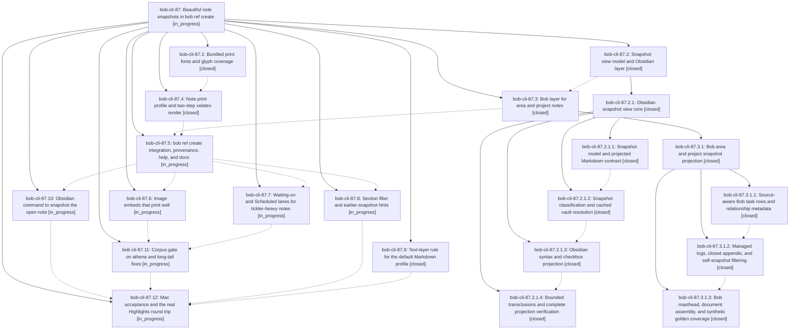

# Bead: bob-cli-87 — Beautiful note snapshots in bob ref create

[Bead Pages](../README.md) / bob-cli-87

**Status:** ◐ in_progress · **Type:** ▸ plan · **Tier:** epic
**Owner:** `bryanbugyi34@gmail.com` · **Created by:** [bbugyi200.athena.10l](https://github.com/bobs-org/bob-cli--agents/blob/main/sessions/bbugyi200.athena.10l.md) · **Assignee:** `bob-cli-87.land`
**Created:** 2026-10-16 07:13:18 EDT
**Plan:** [202610/note\_snapshots.md](https://github.com/bobs-org/bob-cli--plans/blob/main/202610/note_snapshots.md)

<!-- sase:links:start -->

## Links

| Relation | Artifact | Why |
| --- | --- | --- |
| implemented-by | [plan:202610/note_snapshots.md][1] | derived from the plan's `bead_id:` frontmatter field |

_Plus 3 automatic references — see [Referenced By](#referenced-by)._

[1]: https://github.com/bobs-org/bob-cli--plans/blob/main/202610/note_snapshots.md

<!-- sase:links:end -->

## Description

`bob ref create sase_blog` turns any Bob vault note, and area/project notes especially, into a calm, beautiful, Highlights-safe PDF: a dated reading snapshot of the note's open work and prose, with resolved links, embeds, and images. It renders the same on athena and the Mac, and every Highlights quote taken from it stays byte-clean.

## Notes

[2026-10-16T15:54:54Z · bob-cli-8b.land] DISCOVERED ISSUE: From bob-cli-8b.land while running just check on clean master 71be24ae (apollo). (1) cargo fmt --check fails only in note_snapshot files written by bob-cli-87.2.1 children (a086cd9b, 71be24ae): obsidian.rs:1217,3481,3495,3534,3542; resolve.rs:1533; serialize.rs:558,649; tests.rs:95,138,145,163,174,184,929,963; transclusion.rs:103,927,954,1066,1097,1502,1627,1642,1653,1823,1830,1867,1879,1987 — so just check stops at its first recipe line for every agent. (2) cargo test --lib: native::highlights_ref::note_snapshot::profile::tests::pandoc_maps_every_contract_construct_to_tex panics at profile.rs:864 'lifted link' (the \\hyperref[t-next]{visible link\\BobTag{ᵇ}} expectation is not in the emitted TeX). (3) profile::tests::renders_contract_with_clean_text_layer_and_metadata panics at profile.rs:943: xelatex pass 1 'File titlesec.sty not found' on apollo — the test needs a TeX package the host lacks; either gate it on package availability like other render tests or document the dependency. Fix: run cargo fmt on note_snapshot, repair the lifted-link projection or its expectation, and make the real-render test skip cleanly without titlesec. Not caused by bob-cli-8b; no new task filed because these are causally owned by this active epic.

[2026-10-16T17:26:45Z · bob-cli-8f.land] DISCOVERED ISSUE: Triaged bob-cli-8f.1 PROPOSED FOLLOW-UP note #4 during bob-cli-8f landing. Its real-render test failure (native::highlights_ref::note_snapshot::profile::tests::renders_contract_with_clean_text_layer_and_metadata: titlesec.sty missing) is owned by this active epic, specifically bob-cli-87.4. On the reviewed bob-cli tree 280321a3, profile.rs still gates only pandoc and xelatex executable availability before rendering, while note.tex requires titlesec; kpsewhich titlesec.sty returns no path on apollo. This corroborates this epic note #1 and the phase report; the lander did not rerun the render test. No duplicate task created after the sase_new_task search and recent-task sweep.

## Phases

| Bead | Title | Status | Size | Created | Agents | Commits |
|---|---|---|---|---|---:|---:|
| [bob-cli-87.1](bob-cli-87.1.md) | Bundled print fonts and glyph coverage | ✓ closed | medium | 2026-10-16 | 1 | 1 |
| [bob-cli-87.10](bob-cli-87.10.md) | Obsidian command to snapshot the open note | ◐ in_progress | medium | 2026-10-16 | 1 | 0 |
| [bob-cli-87.11](bob-cli-87.11.md) | Corpus gate on athena and long-tail fixes | ◐ in_progress | medium | 2026-10-16 | 1 | 0 |
| [bob-cli-87.12](bob-cli-87.12.md) | Mac acceptance and the real Highlights round trip | ◐ in_progress | medium | 2026-10-16 | 1 | 0 |
| [bob-cli-87.2](bob-cli-87.2.md) | Snapshot view model and Obsidian layer | ✓ closed | large | 2026-10-16 | 1 | 0 |
| [bob-cli-87.3](bob-cli-87.3.md) | Bob layer for area and project notes | ✓ closed | large | 2026-10-16 | 1 | 0 |
| [bob-cli-87.4](bob-cli-87.4.md) | Note print profile and two-step xelatex render | ✓ closed | large | 2026-10-16 | 1 | 1 |
| [bob-cli-87.5](bob-cli-87.5.md) | bob ref create integration, provenance, help, and docs | ◐ in_progress | large | 2026-10-16 | 1 | 0 |
| [bob-cli-87.6](bob-cli-87.6.md) | Image embeds that print well | ◐ in_progress | small | 2026-10-16 | 1 | 0 |
| [bob-cli-87.7](bob-cli-87.7.md) | Waiting-on and Scheduled lanes for tickler-heavy notes | ◐ in_progress | medium | 2026-10-16 | 1 | 0 |
| [bob-cli-87.8](bob-cli-87.8.md) | Section filter and earlier-snapshot hints | ◐ in_progress | small | 2026-10-16 | 1 | 0 |
| [bob-cli-87.9](bob-cli-87.9.md) | Text-layer rule for the default Markdown profile | ✓ closed | small | 2026-10-16 | 1 | 1 |

## Lineage

## Agents

| Agent | Bead | Commits |
|---|---|---:|
| [bbugyi200.athena.bob-cli-87.1](https://github.com/bobs-org/bob-cli--agents/blob/main/agents/bbugyi200.athena.bob-cli-87.1/README.md) | [bob-cli-87.1](bob-cli-87.1.md) | 1 |
| [bbugyi200.athena.bob-cli-87.10](https://github.com/bobs-org/bob-cli--agents/blob/main/agents/bbugyi200.athena.bob-cli-87.10/README.md) | [bob-cli-87.10](bob-cli-87.10.md) | 0 |
| [bbugyi200.athena.bob-cli-87.11](https://github.com/bobs-org/bob-cli--agents/blob/main/agents/bbugyi200.athena.bob-cli-87.11/README.md) | [bob-cli-87.11](bob-cli-87.11.md) | 0 |
| [bbugyi200.athena.bob-cli-87.12](https://github.com/bobs-org/bob-cli--agents/blob/main/agents/bbugyi200.athena.bob-cli-87.12/README.md) | [bob-cli-87.12](bob-cli-87.12.md) | 0 |
| [bbugyi200.athena.bob-cli-87.2](https://github.com/bobs-org/bob-cli--agents/blob/main/sessions/bbugyi200.athena.bob-cli-87.2.md) | [bob-cli-87.2](bob-cli-87.2.md) | 0 |
| [bbugyi200.athena.bob-cli-87.2.1.1](https://github.com/bobs-org/bob-cli--agents/blob/main/sessions/bbugyi200.athena.bob-cli-87.2.1.1.md) | [bob-cli-87.2.1.1](bob-cli-87.2.1.1.md) | 1 |
| [bbugyi200.athena.bob-cli-87.2.1.2](https://github.com/bobs-org/bob-cli--agents/blob/main/agents/bbugyi200.athena.bob-cli-87.2.1.2/README.md) | [bob-cli-87.2.1.2](bob-cli-87.2.1.2.md) | 1 |
| [bbugyi200.athena.bob-cli-87.2.1.3](https://github.com/bobs-org/bob-cli--agents/blob/main/agents/bbugyi200.athena.bob-cli-87.2.1.3/README.md) | [bob-cli-87.2.1.3](bob-cli-87.2.1.3.md) | 1 |
| [bbugyi200.athena.bob-cli-87.2.1.4](https://github.com/bobs-org/bob-cli--agents/blob/main/sessions/bbugyi200.athena.bob-cli-87.2.1.4.md) | [bob-cli-87.2.1.4](bob-cli-87.2.1.4.md) | 1 |
| [bbugyi200.athena.bob-cli-87.2.1.land](https://github.com/bobs-org/bob-cli--agents/blob/main/sessions/bbugyi200.athena.bob-cli-87.2.1.land.md) | [bob-cli-87.2.1](bob-cli-87.2.1.md) | 2 |
| [bbugyi200.athena.bob-cli-87.3](https://github.com/bobs-org/bob-cli--agents/blob/main/sessions/bbugyi200.athena.bob-cli-87.3.md) | [bob-cli-87.3](bob-cli-87.3.md) | 0 |
| [bbugyi200.athena.bob-cli-87.3.1.1](https://github.com/bobs-org/bob-cli--agents/blob/main/agents/bbugyi200.athena.bob-cli-87.3.1.1/README.md) | [bob-cli-87.3.1.1](bob-cli-87.3.1.1.md) | 1 |
| [bbugyi200.athena.bob-cli-87.3.1.2](https://github.com/bobs-org/bob-cli--agents/blob/main/agents/bbugyi200.athena.bob-cli-87.3.1.2/README.md) | [bob-cli-87.3.1.2](bob-cli-87.3.1.2.md) | 1 |
| [bbugyi200.athena.bob-cli-87.3.1.3](https://github.com/bobs-org/bob-cli--agents/blob/main/sessions/bbugyi200.athena.bob-cli-87.3.1.3.md) | [bob-cli-87.3.1.3](bob-cli-87.3.1.3.md) | 1 |
| [bbugyi200.athena.bob-cli-87.3.1.land](https://github.com/bobs-org/bob-cli--agents/blob/main/sessions/bbugyi200.athena.bob-cli-87.3.1.land.md) | [bob-cli-87.3.1](bob-cli-87.3.1.md) | 1 |
| [bbugyi200.athena.bob-cli-87.4](https://github.com/bobs-org/bob-cli--agents/blob/main/sessions/bbugyi200.athena.bob-cli-87.4.md) | [bob-cli-87.4](bob-cli-87.4.md) | 1 |
| [bbugyi200.athena.bob-cli-87.5](https://github.com/bobs-org/bob-cli--agents/blob/main/agents/bbugyi200.athena.bob-cli-87.5/README.md) | [bob-cli-87.5](bob-cli-87.5.md) | 0 |
| [bbugyi200.athena.bob-cli-87.6](https://github.com/bobs-org/bob-cli--agents/blob/main/agents/bbugyi200.athena.bob-cli-87.6/README.md) | [bob-cli-87.6](bob-cli-87.6.md) | 0 |
| [bbugyi200.athena.bob-cli-87.7](https://github.com/bobs-org/bob-cli--agents/blob/main/agents/bbugyi200.athena.bob-cli-87.7/README.md) | [bob-cli-87.7](bob-cli-87.7.md) | 0 |
| [bbugyi200.athena.bob-cli-87.8](https://github.com/bobs-org/bob-cli--agents/blob/main/agents/bbugyi200.athena.bob-cli-87.8/README.md) | [bob-cli-87.8](bob-cli-87.8.md) | 0 |
| [bbugyi200.athena.bob-cli-87.9](https://github.com/bobs-org/bob-cli--agents/blob/main/agents/bbugyi200.athena.bob-cli-87.9/README.md) | [bob-cli-87.9](bob-cli-87.9.md) | 1 |
| [bbugyi200.athena.bob-cli-87.land](https://github.com/bobs-org/bob-cli--agents/blob/main/agents/bbugyi200.athena.bob-cli-87.land/README.md) | [bob-cli-87](README.md) | 0 |

## Commits

| Repo | Commit | Subject | Bead | Committed |
|---|---|---|---|---|
| bob-cli | [`9ce50ee`](https://github.com/bobs-org/bob-cli/commit/9ce50eeb1b37f9a725850c2f4865f74afee946d7) | fix(highlights): preserve clean text layer in Markdown PDFs | [bob-cli-87.9](bob-cli-87.9.md) | 2026-10-16 07:21:05 EDT |
| bob-cli | [`ca88db3`](https://github.com/bobs-org/bob-cli/commit/ca88db3857268fcc4a557ce9f95151d5b0e37ebf) | feat(highlights): bundle snapshot fonts and glyph coverage | [bob-cli-87.1](bob-cli-87.1.md) | 2026-10-16 07:37:00 EDT |
| bob-cli | [`426b07c`](https://github.com/bobs-org/bob-cli/commit/426b07ca0286312d794d260475deba4a42422864) | feat(highlights): add snapshot model and markdown contract | [bob-cli-87.2.1.1](bob-cli-87.2.1.1.md) | 2026-10-16 08:28:56 EDT |
| bob-cli | [`1a57e47`](https://github.com/bobs-org/bob-cli/commit/1a57e47f67023a96de3e220642fd41c64ddf58fb) | feat(highlights): note snapshot print profile and two-step xelatex render | [bob-cli-87.4](bob-cli-87.4.md) | 2026-10-16 08:45:42 EDT |
| bob-cli | [`29f5f4e`](https://github.com/bobs-org/bob-cli/commit/29f5f4efa0bf32f7a86fbbbce778845fed7864fa) | feat(snapshot): add classification and cached vault resolution | [bob-cli-87.2.1.2](bob-cli-87.2.1.2.md) | 2026-10-16 08:54:31 EDT |
| bob-cli | [`8da6615`](https://github.com/bobs-org/bob-cli/commit/8da66156b8395c93a2d50ab3b415959db6bb1dee) | feat(note-snapshot): implement protected-code-aware obsidian syntax projection | [bob-cli-87.2.1.3](bob-cli-87.2.1.3.md) | 2026-10-16 09:33:56 EDT |
| bob-cli | [`a086cd9`](https://github.com/bobs-org/bob-cli/commit/a086cd9b405cb7ede559163c8625f09aa2605ecd) | feat(note-snapshot): complete bounded transclusions | [bob-cli-87.2.1.4](bob-cli-87.2.1.4.md) | 2026-10-16 10:32:21 EDT |
| bob-cli | [`71be24a`](https://github.com/bobs-org/bob-cli/commit/71be24aec573ff43d07235fdd4180b781af31d4e) | fix(snapshot): complete view landing repairs | [bob-cli-87.2.1](bob-cli-87.2.1.md) | 2026-10-16 11:29:38 EDT |
| bob-cli--plans | [`bob-cli--plans@f55b439`](https://github.com/bobs-org/bob-cli--plans/commit/f55b439bfc4dc0dac70d23b46ec5eed1d32e8af7) | docs(snapshot): mark view core plan done | [bob-cli-87.2.1](bob-cli-87.2.1.md) | 2026-10-16 11:31:52 EDT |
| bob-cli | [`57c3df2`](https://github.com/bobs-org/bob-cli/commit/57c3df2a87a5b8da8b29bc146e0fb2699a5241f2) | feat(snapshot): add source-aware Bob task rows and relationship metadata | [bob-cli-87.3.1.1](bob-cli-87.3.1.1.md) | 2026-10-16 12:17:45 EDT |
| bob-cli | [`87bc784`](https://github.com/bobs-org/bob-cli/commit/87bc78442fe71c511797751289c84f03ed67b8de) | feat(note-snapshot): condense logs, omit closed tasks, filter self-snapshots | [bob-cli-87.3.1.2](bob-cli-87.3.1.2.md) | 2026-10-16 12:48:25 EDT |
| bob-cli | [`6c53e13`](https://github.com/bobs-org/bob-cli/commit/6c53e13866b9d4d1336d5a9f147a44c54659f89b) | feat(note-snapshot): compose Bob mastheads and deterministic goldens | [bob-cli-87.3.1.3](bob-cli-87.3.1.3.md) | 2026-10-16 13:41:27 EDT |
| bob-cli | [`16c4640`](https://github.com/bobs-org/bob-cli/commit/16c4640a6135e193de504b83532b12ad1a933d00) | fix(snapshot): finish Bob projection landing repairs | [bob-cli-87.3.1](bob-cli-87.3.1.md) | 2026-10-16 14:29:15 EDT |

<!-- sase:referenced-by:start -->

## Referenced By

| Relation | Artifact | Why | Uses |
| --- | --- | --- | ---: |
| read-by | [agent:bob-cli-87.2.1.1--4][1] | Need governing epic decisions for this implementation phase | 1 |
| read-by | [agent:bob-cli-87.2.1.land--1][2] | Review the parent epic requirements and record its progress | 2 |
| read-by | [agent:bob-cli-87.3.1.1][3] | Need top epic decisions | 1 |

[1]: https://github.com/bobs-org/bob-cli--agents/blob/main/sessions/bbugyi200.athena.bob-cli-87.2.1.1.md
[2]: https://github.com/bobs-org/bob-cli--agents/blob/main/sessions/bbugyi200.athena.bob-cli-87.2.1.land.md
[3]: https://github.com/bobs-org/bob-cli--agents/blob/main/agents/bbugyi200.athena.bob-cli-87.3.1.1/README.md

<!-- sase:referenced-by:end -->
