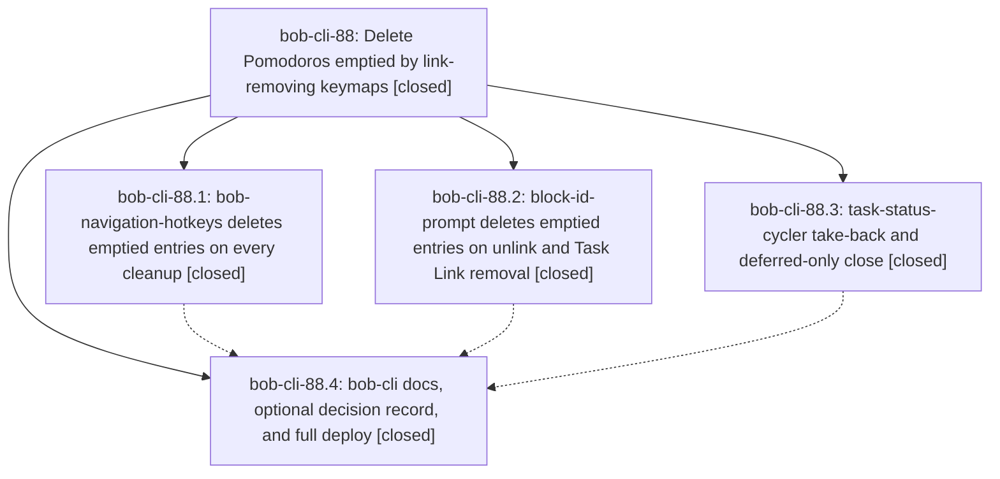

# Bead: bob-cli-88 — Delete Pomodoros emptied by link-removing keymaps

[Bead Pages](../README.md) / bob-cli-88

**Status:** ✓ closed · **Resolution:** done · **Type:** ▸ plan · **Tier:** epic
**Owner:** `bryanbugyi34@gmail.com` · **Created by:** [bbugyi200.athena.10m](https://github.com/bobs-org/bob-cli--agents/blob/main/sessions/bbugyi200.athena.10m.md) · **Assignee:** `bob-cli-88.land`
**Created:** 2026-10-16 07:28:58 EDT · **Closed:** 2026-10-16 09:36:06 EDT
**Plan:** [202610/emptied\_pomodoro\_cleanup.md](https://github.com/bobs-org/bob-cli--plans/blob/main/202610/emptied_pomodoro_cleanup.md)

<!-- sase:links:start -->

## Links

| Relation | Artifact | Why |
| --- | --- | --- |
| implemented-by | [plan:202610/emptied_pomodoro_cleanup.md][1] | derived from the plan's `bead_id:` frontmatter field |
| related | [bead:bob-cli-8d][2] | Deferred decision record proposed by all four cleanup phases |
| related | file:explicit:d2f93586f3a04ed5c17275e1 | attached via sase artifact create --bead |

_Plus 2 automatic references — see [Referenced By](#referenced-by)._

[1]: https://github.com/bobs-org/bob-cli--plans/blob/main/202610/emptied_pomodoro_cleanup.md
[2]: https://github.com/bobs-org/bob-cli--beads/blob/main/pages/bob-cli-8d/README.md

<!-- sase:links:end -->

## Description

Every Obsidian keymap that removes a Task Link from a Pomodoro entry also deletes that entry, in the same write, when the removal leaves it empty.

## Notes

[2026-10-16T13:12:20Z · bob-cli-88.land] LAND TRIAGE: Reviewed every note on bob-cli-88.1-.4 and used /sase_new_task. All PROPOSED FOLLOW-UP outcomes: (1) .1 notes 1/5, .2 note 2, and .4 note 2 propose the same six npm failures (also reported by .3 note 2). Independently reproduced on clean bob-plugins 86cebc9: 2846 pass, 6 fail, npm run validate passes. Added +1 evidence to existing bob-cli-6v (four unblocked-glyph tests), bob-cli-6w (Keep notice), and bob-cli-7i (reverse-conversion BLOCKS identity). Evidence file:explicit:d2f93586f3a04ed5c17275e1. Declined three new duplicate task reports because these exact root causes are already tracked; no active epic has a new causal link to those failures. (2) .1 note 4, .2 note 1, .3 note 1, and .4 note 1 propose one standing cleanup decision record. Filed small ready memory task bob-cli-8d through /sase_new_task, linked to bob-cli-88 and adjacent feature bob-cli-7q. The latter changes consumption parity and is not a duplicate of this policy record. No substantive proposal was discarded, and no memory file was changed. The final close note must retain these outcomes.

[2026-10-16T13:12:23Z · bob-cli-88.land] LAND VERIFICATION / REMAINING WORK: Read all four phase scopes and every note, the approved plan, actual plugin source, f49f9c8/5205c3a/86cebc9, and bob-cli docs commit 298ebdf. The reopened nav uncertainty (.1 note 3) is resolved by its final committed source and passing relevant tests. Unconditional nav cleanup and decorated links, BIP grouped selected-link/insertion cleanup, cycler take-back/deferred-close wiring, docs, version bumps, and silent notices are present. However the epic is not ready to close: (A) cycler successorTakeBackEmptiedEntryLine uses a contiguous-list-only range. Runtime vault.process reproduction removes an entry headline although a prose child survives after a blank line; with continuation or fenced-example leftovers it removes only the headline and leaves those lines orphaned. Deferred-only completion similarly deletes the closed owner and moves separated prose under its fresh placeholder. Use a full fence-aware block predicate and block deletion in both editor and vault paths. (B) BIP EOF cleanup of heading + blank + final entry returns heading plus two newlines regardless of original final-newline state; normalize EOF/seams while preserving insertion composition. (C) BIP selected-link runtime restores numeric line 2 after deleting entry at line 1, landing on the surviving entry child instead of line 1; map through edits, including same-note unlink/Work edits. (D) .4 note 3 proves its bare bob plugins sync deployed the stale default repo, downgrading BIP 1.33 to 1.32, nav 2.41 to 2.40.1, cycler 1.42 to 1.41. Explicit current-checkout dry run still needs six copies. Re-deploy with --repo set to the opened linked checkout after repairs, then verify list and dry run. These are epic work and are included in a medium tale whose final step closes this epic; no bug task was created.

[2026-10-16T13:12:27Z · bob-cli-88.land] LAND INTEGRATION: Reviewed changes from epic creation (2026-10-16 11:28:58Z), including the interval before its first implementation commit. Linked repo counted-task-move f5517b8 remains integrated: dispatch routes through existing move planners and unconditional cleanup; retained tests pass in the full suite. No other non-epic linked commits followed. Main-repo snapshot commits ca88db3/426b07c/1a57e47/29f5f4e are read-only rendering; c1b1cef adds template persistence after capture and no new plugin Task Link writer. No integration code adjustment was identified for those changes. Fetched origin/master equals main HEAD 298ebdf. Recheck subsequent drift before close. The approved decisions remain childless/delete/silent/no memory edits. epic-symbols bob-cli-88 is empty; symvision is absent from both reviewed repos. Audited JSON confirms parent_id null, no ancestors, and four closed phases. Do not mark the original plan done or close until the repair tale verifies and completes deployment.

[2026-10-16T13:36:06Z · bob-cli-88.land] Landing repairs verified. Cycler: take-back now uses fence-aware full-block scan; KEEP with blank+prose survives both editor and vault paths, continuation/fence-only deletes whole block including remainder, LF/CRLF with/without final newline, adjacent entries; deferred-only close with timed headline and move-only spelling [[Tasks#^a|A]]# keeps closed original when prose survives across blank and deletes whole block with fenced/continuation remainder while carrying stripped link to placeholder at former start with cursor fixup; successor relocation uses inserted placeholder. BIP: whole-entry deletion at EOF now gives '## Pomodoros' without final and '## Pomodoros\n' with final, CRLF '## Pomodoros'/'## Pomodoros\r\n', seam collapse, insertion composition preserves boundary text; selected-link cursor inside REMOVE now lands at KEEP line 1 with clamped column; same-note unlink maps task below deletions through Work-summary inserts in one write. Integration: no new base commits since 86cebc9/298ebdf; retained counted task-move f5517b8 and snapshot/template ca88db3/426b07c/1a57e47/29f5f4e/c1b1cef; no new plugin writer. Validation: npm run validate passes; focused 122 pass; full npm test 2854 pass 6 fail matching baseline bob-cli-6v (4 glyph), bob-cli-6w (Keep), bob-cli-7i (BLOCKS); just check passes; runtime harness exercised, no real Obsidian smoke available. Deployment corrects .4 note3 stale-checkout downgrade: deployed with bob plugins sync --repo <linked checkout>, 6 copied, list shows BIP 1.33.1 cycler 1.42.1 nav 2.41.0 all synced, dry run 0 copy 0 skip 16 unchanged. Follow-ups retained: test proposals .1 notes 1/5 .2 note2 .4 note2 corroborated on 6v/6w/7i (.3 note2 also); standing-decision proposals .1 note4 .2 note1 .3 note1 .4 note1 became memory task bob-cli-8d; declined duplicates as already tracked; bob-cli-7q is related consumption policy not duplicate; no substantive proposal discarded; no memory edited. epic-symbols clean, symvision absent in both repos.

## Phases

| Bead | Title | Status | Size | Created | Agents | Commits |
|---|---|---|---|---|---:|---:|
| [bob-cli-88.1](bob-cli-88.1.md) | bob-navigation-hotkeys deletes emptied entries on every cleanup | ✓ closed | medium | 2026-10-16 | 1 | 1 |
| [bob-cli-88.2](bob-cli-88.2.md) | block-id-prompt deletes emptied entries on unlink and Task Link removal | ✓ closed | medium | 2026-10-16 | 1 | 1 |
| [bob-cli-88.3](bob-cli-88.3.md) | task-status-cycler take-back and deferred-only close | ✓ closed | small | 2026-10-16 | 1 | 1 |
| [bob-cli-88.4](bob-cli-88.4.md) | bob-cli docs, optional decision record, and full deploy | ✓ closed | small | 2026-10-16 | 1 | 1 |

## Lineage

## Agents

| Agent | Bead | Commits |
|---|---|---:|
| [bbugyi200.athena.bob-cli-88.1](https://github.com/bobs-org/bob-cli--agents/blob/main/agents/bbugyi200.athena.bob-cli-88.1/README.md) | [bob-cli-88.1](bob-cli-88.1.md) | 1 |
| [bbugyi200.athena.bob-cli-88.2](https://github.com/bobs-org/bob-cli--agents/blob/main/agents/bbugyi200.athena.bob-cli-88.2/README.md) | [bob-cli-88.2](bob-cli-88.2.md) | 1 |
| [bbugyi200.athena.bob-cli-88.3](https://github.com/bobs-org/bob-cli--agents/blob/main/agents/bbugyi200.athena.bob-cli-88.3/README.md) | [bob-cli-88.3](bob-cli-88.3.md) | 1 |
| [bbugyi200.athena.bob-cli-88.4](https://github.com/bobs-org/bob-cli--agents/blob/main/sessions/bbugyi200.athena.bob-cli-88.4.md) | [bob-cli-88.4](bob-cli-88.4.md) | 1 |
| [bbugyi200.athena.bob-cli-88.land](https://github.com/bobs-org/bob-cli--agents/blob/main/sessions/bbugyi200.athena.bob-cli-88.land.md) | [bob-cli-88](README.md) | 2 |

## Commits

| Repo | Commit | Subject | Bead | Committed |
|---|---|---|---|---|
| bob-plugins | [`bob-plugins@f49f9c8`](https://github.com/bobs-org/bob-plugins/commit/f49f9c88869d53ce89ed772dea40a94fe6dc3ad1) | feat(task-status-cycler): delete Pomodoros emptied by take-back and deferred-only close | [bob-cli-88.3](bob-cli-88.3.md) | 2026-10-16 07:50:48 EDT |
| bob-plugins | [`bob-plugins@5205c3a`](https://github.com/bobs-org/bob-plugins/commit/5205c3a5f4f4a6a16a35a284d91d8702d023d9e8) | feat(block-id-prompt): delete Pomodoro entries emptied by link removal | [bob-cli-88.2](bob-cli-88.2.md) | 2026-10-16 07:51:35 EDT |
| bob-plugins | [`bob-plugins@86cebc9`](https://github.com/bobs-org/bob-plugins/commit/86cebc9c4dcf83a238b387127b5eedf8c68f9725) | feat(bob-navigation-hotkeys): delete Pomodoros emptied by every cleanup | [bob-cli-88.1](bob-cli-88.1.md) | 2026-10-16 08:14:53 EDT |
| bob-cli | [`298ebdf`](https://github.com/bobs-org/bob-cli/commit/298ebdf41b05000189bba7d5af8e64a1a717685e) | docs(task-cleanup): document emptied entry cleanup | [bob-cli-88.4](bob-cli-88.4.md) | 2026-10-16 08:56:10 EDT |
| bob-plugins | [`bob-plugins@e90c260`](https://github.com/bobs-org/bob-plugins/commit/e90c2603382af8bea8563ef380c6b3db08a24670) | fix(block-id-prompt,task-status-cycler): delete whole emptied Pomodoro blocks with EOF and cursor mapping | [bob-cli-88](README.md) | 2026-10-16 09:38:08 EDT |
| bob-cli--plans | [`bob-cli--plans@d5d122c`](https://github.com/bobs-org/bob-cli--plans/commit/d5d122c0388ef444423625e2a434c8caf5d5e6c5) | docs(plans): mark emptied\_pomodoro\_cleanup done | [bob-cli-88](README.md) | 2026-10-16 09:39:02 EDT |

<!-- sase:referenced-by:start -->

## Referenced By

| Relation | Artifact | Why | Uses |
| --- | --- | --- | ---: |
| read-by | [agent:bob-cli-88.2][1] | epic context | 1 |
| read-by | [agent:bob-cli-88.4--3][2] | Confirm parent epic remains open and phase scope before closing only bob-cli-88.4 | 1 |

[1]: https://github.com/bobs-org/bob-cli--agents/blob/main/agents/bbugyi200.athena.bob-cli-88.2/README.md
[2]: https://github.com/bobs-org/bob-cli--agents/blob/main/sessions/bbugyi200.athena.bob-cli-88.4.md

<!-- sase:referenced-by:end -->
