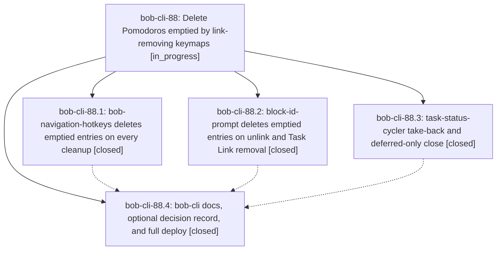

# Bead: bob-cli-88 — Delete Pomodoros emptied by link-removing keymaps

[Bead Pages](../README.md) / bob-cli-88

**Status:** ◐ in_progress · **Type:** ▸ plan · **Tier:** epic
**Owner:** `bryanbugyi34@gmail.com` · **Created by:** [bbugyi200.athena.10m](https://github.com/bobs-org/bob-cli--agents/blob/main/sessions/bbugyi200.athena.10m.md) · **Assignee:** `bob-cli-88.land`
**Created:** 2026-10-16 07:28:58 EDT
**Plan:** [202610/emptied\_pomodoro\_cleanup.md](https://github.com/bobs-org/bob-cli--plans/blob/main/202610/emptied_pomodoro_cleanup.md)

<!-- sase:links:start -->

## Links

| Relation | Artifact | Why |
| --- | --- | --- |
| implemented-by | [plan:202610/emptied_pomodoro_cleanup.md][1] | derived from the plan's `bead_id:` frontmatter field |

_Plus 1 automatic references — see [Referenced By](#referenced-by)._

[1]: https://github.com/bobs-org/bob-cli--plans/blob/main/202610/emptied_pomodoro_cleanup.md

<!-- sase:links:end -->

## Description

Every Obsidian keymap that removes a Task Link from a Pomodoro entry also deletes that entry, in the same write, when the removal leaves it empty.

## Phases

| Bead | Title | Status | Size | Created | Agents | Commits |
|---|---|---|---|---|---:|---:|
| [bob-cli-88.1](bob-cli-88.1.md) | bob-navigation-hotkeys deletes emptied entries on every cleanup | ✓ closed | medium | 2026-10-16 | 1 | 1 |
| [bob-cli-88.2](bob-cli-88.2.md) | block-id-prompt deletes emptied entries on unlink and Task Link removal | ✓ closed | medium | 2026-10-16 | 1 | 1 |
| [bob-cli-88.3](bob-cli-88.3.md) | task-status-cycler take-back and deferred-only close | ✓ closed | small | 2026-10-16 | 1 | 1 |
| [bob-cli-88.4](bob-cli-88.4.md) | bob-cli docs, optional decision record, and full deploy | ✓ closed | small | 2026-10-16 | 1 | 1 |

## Lineage

## Agents

| Agent | Bead | Commits |
|---|---|---:|
| [bbugyi200.athena.bob-cli-88.1](https://github.com/bobs-org/bob-cli--agents/blob/main/agents/bbugyi200.athena.bob-cli-88.1/README.md) | [bob-cli-88.1](bob-cli-88.1.md) | 1 |
| [bbugyi200.athena.bob-cli-88.2](https://github.com/bobs-org/bob-cli--agents/blob/main/agents/bbugyi200.athena.bob-cli-88.2/README.md) | [bob-cli-88.2](bob-cli-88.2.md) | 1 |
| [bbugyi200.athena.bob-cli-88.3](https://github.com/bobs-org/bob-cli--agents/blob/main/agents/bbugyi200.athena.bob-cli-88.3/README.md) | [bob-cli-88.3](bob-cli-88.3.md) | 1 |
| [bbugyi200.athena.bob-cli-88.4](https://github.com/bobs-org/bob-cli--agents/blob/main/sessions/bbugyi200.athena.bob-cli-88.4.md) | [bob-cli-88.4](bob-cli-88.4.md) | 1 |
| [bbugyi200.athena.bob-cli-88.land](https://github.com/bobs-org/bob-cli--agents/blob/main/agents/bbugyi200.athena.bob-cli-88.land/README.md) | [bob-cli-88](README.md) | 0 |

## Commits

| Repo | Commit | Subject | Bead | Committed |
|---|---|---|---|---|
| bob-plugins | [`bob-plugins@f49f9c8`](https://github.com/bobs-org/bob-plugins/commit/f49f9c88869d53ce89ed772dea40a94fe6dc3ad1) | feat(task-status-cycler): delete Pomodoros emptied by take-back and deferred-only close | [bob-cli-88.3](bob-cli-88.3.md) | 2026-10-16 07:50:48 EDT |
| bob-plugins | [`bob-plugins@5205c3a`](https://github.com/bobs-org/bob-plugins/commit/5205c3a5f4f4a6a16a35a284d91d8702d023d9e8) | feat(block-id-prompt): delete Pomodoro entries emptied by link removal | [bob-cli-88.2](bob-cli-88.2.md) | 2026-10-16 07:51:35 EDT |
| bob-plugins | [`bob-plugins@86cebc9`](https://github.com/bobs-org/bob-plugins/commit/86cebc9c4dcf83a238b387127b5eedf8c68f9725) | feat(bob-navigation-hotkeys): delete Pomodoros emptied by every cleanup | [bob-cli-88.1](bob-cli-88.1.md) | 2026-10-16 08:14:53 EDT |
| bob-cli | [`298ebdf`](https://github.com/bobs-org/bob-cli/commit/298ebdf41b05000189bba7d5af8e64a1a717685e) | docs(task-cleanup): document emptied entry cleanup | [bob-cli-88.4](bob-cli-88.4.md) | 2026-10-16 08:56:10 EDT |

<!-- sase:referenced-by:start -->

## Referenced By

| Relation | Artifact | Why | Uses |
| --- | --- | --- | ---: |
| read-by | [agent:bob-cli-88.2][1] | epic context | 1 |

[1]: https://github.com/bobs-org/bob-cli--agents/blob/main/agents/bbugyi200.athena.bob-cli-88.2/README.md

<!-- sase:referenced-by:end -->
