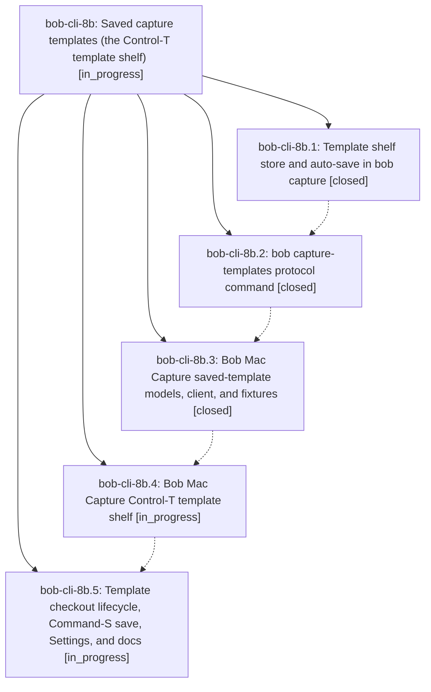

# Bead: bob-cli-8b — Saved capture templates (the Control-T template shelf)

[Bead Pages](../README.md) / bob-cli-8b

**Status:** ◐ in_progress · **Type:** ▸ plan · **Tier:** epic
**Owner:** `bryanbugyi34@gmail.com` · **Created by:** [bbugyi200.apollo.research.1n.linker.w0](https://github.com/bobs-org/bob-cli--agents/blob/main/sessions/bbugyi200.apollo.research.1n.linker.w0.md) · **Assignee:** `bob-cli-8b.land`
**Created:** 2026-10-16 08:18:36 EDT
**Plan:** [202610/saved\_capture\_templates.md](https://github.com/bobs-org/bob-cli--plans/blob/main/202610/saved_capture_templates.md)

<!-- sase:links:start -->

## Links

| Relation | Artifact | Why |
| --- | --- | --- |
| implemented-by | [plan:202610/saved_capture_templates.md][1] | derived from the plan's `bead_id:` frontmatter field |

_Plus 1 automatic references — see [Referenced By](#referenced-by)._

[1]: https://github.com/bobs-org/bob-cli--plans/blob/main/202610/saved_capture_templates.md

<!-- sase:links:end -->

## Description

Every successful `@@template:` capture saves its template block to a bob-owned shelf on disk, and Bob Mac Capture's Control-T opens a stash-style shelf of those templates: picking one checks it out into the draft, capturing puts it back on top (with your edits), abandoning leaves it untouched, and nothing is ever silently lost.

## Phases

| Bead | Title | Status | Size | Created | Agents | Commits |
|---|---|---|---|---|---:|---:|
| [bob-cli-8b.1](bob-cli-8b.1.md) | Template shelf store and auto-save in bob capture | ✓ closed | medium | 2026-10-16 | 1 | 1 |
| [bob-cli-8b.2](bob-cli-8b.2.md) | bob capture-templates protocol command | ✓ closed | medium | 2026-10-16 | 1 | 1 |
| [bob-cli-8b.3](bob-cli-8b.3.md) | Bob Mac Capture saved-template models, client, and fixtures | ✓ closed | medium | 2026-10-16 | 1 | 1 |
| [bob-cli-8b.4](bob-cli-8b.4.md) | Bob Mac Capture Control-T template shelf | ◐ in_progress | medium | 2026-10-16 | 1 | 0 |
| [bob-cli-8b.5](bob-cli-8b.5.md) | Template checkout lifecycle, Command-S save, Settings, and docs | ◐ in_progress | medium | 2026-10-16 | 1 | 0 |

## Lineage

## Agents

| Agent | Bead | Commits |
|---|---|---:|
| [bbugyi200.apollo.bob-cli-8b.1](https://github.com/bobs-org/bob-cli--agents/blob/main/agents/bbugyi200.apollo.bob-cli-8b.1/README.md) | [bob-cli-8b.1](bob-cli-8b.1.md) | 1 |
| [bbugyi200.apollo.bob-cli-8b.2](https://github.com/bobs-org/bob-cli--agents/blob/main/agents/bbugyi200.apollo.bob-cli-8b.2/README.md) | [bob-cli-8b.2](bob-cli-8b.2.md) | 1 |
| [bbugyi200.apollo.bob-cli-8b.3](https://github.com/bobs-org/bob-cli--agents/blob/main/sessions/bbugyi200.apollo.bob-cli-8b.3.md) | [bob-cli-8b.3](bob-cli-8b.3.md) | 1 |
| [bbugyi200.apollo.bob-cli-8b.4](https://github.com/bobs-org/bob-cli--agents/blob/main/agents/bbugyi200.apollo.bob-cli-8b.4/README.md) | [bob-cli-8b.4](bob-cli-8b.4.md) | 0 |
| [bbugyi200.apollo.bob-cli-8b.5](https://github.com/bobs-org/bob-cli--agents/blob/main/agents/bbugyi200.apollo.bob-cli-8b.5/README.md) | [bob-cli-8b.5](bob-cli-8b.5.md) | 0 |
| [bbugyi200.apollo.bob-cli-8b.land](https://github.com/bobs-org/bob-cli--agents/blob/main/agents/bbugyi200.apollo.bob-cli-8b.land/README.md) | [bob-cli-8b](README.md) | 0 |

## Commits

| Repo | Commit | Subject | Bead | Committed |
|---|---|---|---|---|
| bob-cli | [`c1b1cef`](https://github.com/bobs-org/bob-cli/commit/c1b1cef9f2749c8a94b0290c4d728fc1797e7e4e) | feat(capture): add bob-owned template shelf with auto-save | [bob-cli-8b.1](bob-cli-8b.1.md) | 2026-10-16 08:48:55 EDT |
| bob-cli | [`31528a1`](https://github.com/bobs-org/bob-cli/commit/31528a11bc3162e80f4e40011af4de4cad64c995) | feat(capture-templates): add saved template protocol | [bob-cli-8b.2](bob-cli-8b.2.md) | 2026-10-16 09:16:36 EDT |
| bob-mac-capture | [`bob-mac-capture@cb4c01e`](https://github.com/bobs-org/bob-mac-capture/commit/cb4c01e0dd40165959a8bb39111d68248a44cfac) | feat(mac-capture): add saved-template protocol client and models | [bob-cli-8b.3](bob-cli-8b.3.md) | 2026-10-16 10:21:28 EDT |

<!-- sase:referenced-by:start -->

## Referenced By

| Relation | Artifact | Why | Uses |
| --- | --- | --- | ---: |
| read-by | [agent:bob-cli-8b.1][1] | Need epic DECISIONS and scope for phase work | 1 |

[1]: https://github.com/bobs-org/bob-cli--agents/blob/main/agents/bbugyi200.apollo.bob-cli-8b.1/README.md

<!-- sase:referenced-by:end -->
