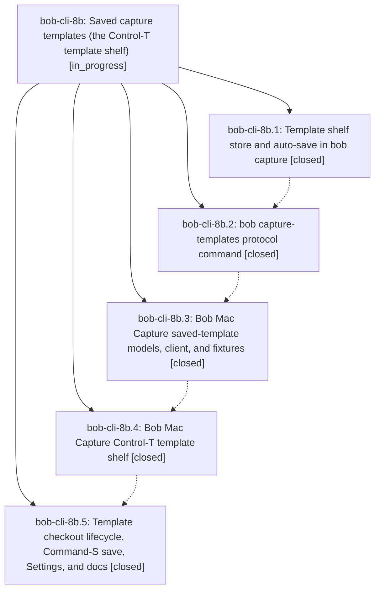

# Bead: bob-cli-8b — Saved capture templates (the Control-T template shelf)

[Bead Pages](../README.md) / bob-cli-8b

**Status:** ◐ in_progress · **Type:** ▸ plan · **Tier:** epic
**Owner:** `bryanbugyi34@gmail.com` · **Created by:** [bbugyi200.apollo.research.1n.linker.w0](https://github.com/bobs-org/bob-cli--agents/blob/main/sessions/bbugyi200.apollo.research.1n.linker.w0.md) · **Assignee:** `bob-cli-8b.land`
**Created:** 2026-10-16 08:18:36 EDT
**Plan:** [202610/saved\_capture\_templates.md](https://github.com/bobs-org/bob-cli--plans/blob/main/202610/saved_capture_templates.md)

<!-- sase:links:start -->

## Links

| Relation | Artifact | Why |
| --- | --- | --- |
| implemented-by | [plan:202610/saved_capture_templates.md][1] | derived from the plan's `bead_id:` frontmatter field |

_Plus 2 automatic references — see [Referenced By](#referenced-by)._

[1]: https://github.com/bobs-org/bob-cli--plans/blob/main/202610/saved_capture_templates.md

<!-- sase:links:end -->

## Description

Every successful `@@template:` capture saves its template block to a bob-owned shelf on disk, and Bob Mac Capture's Control-T opens a stash-style shelf of those templates: picking one checks it out into the draft, capturing puts it back on top (with your edits), abandoning leaves it untouched, and nothing is ever silently lost.

## Notes

[2026-10-16T14:48:15Z · bob-cli-87.2.1.land] DISCOVERED ISSUE: From bob-cli-87.2.1.land, triaging bob-cli-87.2.1.4 note #1. On clean master a086cd9, cargo test --lib every_ -- --nocapture reproduces two failures introduced by saved-template protocol commit 31528a1 (bob-cli-8b.2): (1) native::completion::kinds::tests::every_value_arg_has_a_decision reports missing capture-templates delete:template, save:template-origin, show:template decisions; (2) runner::tests::every_native_command_is_on_exactly_one_canonical_path reports 36 canonical commands versus stale expected 31. 51 other selected tests pass. Evidence: file:explicit:28b089609636028ae170391f. The snapshot transclusion worker also reproduced both on clean pre-transclusion 8da6615. Add completion kinds/appropriate ValueHints and update the canonical command coverage assertion while preserving uniqueness checks. No new task: these are caused by this still-active epic.

[2026-10-16T16:01:01Z · bob-cli-8b.land] LAND TRIAGE (bob-cli-8b.land): PROPOSED FOLLOW-UPs — decision record (8b.2 #1, 8b.3 #1, 8b.5 #1) filed as memory task bob-cli-8h; glossary strand saved-template (8b.2 #2, 8b.3 #2, 8b.5 #2) filed as memory task bob-cli-8i (linked to 8h); both small and ready; the epic itself did not edit memory, per memory_saved_templates_decision=no and memory_saved_template_glossary=no. Plan step 7 note on bob-cli-83 was present (8b.5). Discovered non-epic issues: note_snapshot cargo fmt drift plus profile tests pandoc_maps_every_contract_construct_to_tex (lifted link) and renders_contract_with_clean_text_layer_and_metadata (titlesec.sty missing) recorded as a DISCOVERED ISSUE note on active epic bob-cli-87 (caused by its child bob-cli-87.2.1), no task; six untracked Refs* XCTests red on every macOS CI run since the rename-card/Highlights Tabs epics filed as ci task bob-cli-8j (linked to the existing trackers bob-cli-7p, bob-cli-7h, and bob-cli-8e, which already cover the other baseline failures, so nothing new was filed for those); missing .swift-format config, which caused cb4c01e's whole-file 4-to-2-space re-indent (~10k-line diff, 1.5k with -w), filed as small bug bob-cli-8k. Integration: bob-cli-89 (Mac preserves BOB_CONFIG not BOB_CONFIG_FILE) closed superseded, since cb4c01e fixed it; bob-cli-8a annotated with the --template-origin identity-gate precedent. Declined: duplicated helpers in store.rs/command.rs beyond the shared template_origin_arg (refactor only, no behavior change); BOB_CAPTURE_TEMPLATES_FILE chmod-ing an existing parent dir to 0700 (follows the contract's create_state_lock_file reuse); save rejecting a misplaced header inside rows (the contract says misplaced header is a definition issue); the Mac setPlainDraft fallback when no editable NSTextView exists (never hit in the app); armed delete not disarmed by Tab/Command chords (matches the stash picker, as the contract requires). Epic-caused remaining work found: see the landing tale.

[2026-10-16T16:06:39Z · 10p] DISCOVERED ISSUE: bob-cli-8b.5 commit 6a7046e added SettingsView.swift catch-as-BobClientError without import CaptureCore, so just install / xcode-swift.sh build fails with cannot find type BobClientError in scope (CI run 38923816910 Build). Linux portable-check cannot type-check BobMacCapture; phase 8b.5 closed with the Mac host offline. Tale plan:202610/fix_mac_capture_install_missing_capturecore_import.md is landing the one-line import. Process gap already tracked by bob-cli-1x (+1 recorded). No new task.

## Phases

| Bead | Title | Status | Size | Created | Agents | Commits |
|---|---|---|---|---|---:|---:|
| [bob-cli-8b.1](bob-cli-8b.1.md) | Template shelf store and auto-save in bob capture | ✓ closed | medium | 2026-10-16 | 1 | 1 |
| [bob-cli-8b.2](bob-cli-8b.2.md) | bob capture-templates protocol command | ✓ closed | medium | 2026-10-16 | 1 | 1 |
| [bob-cli-8b.3](bob-cli-8b.3.md) | Bob Mac Capture saved-template models, client, and fixtures | ✓ closed | medium | 2026-10-16 | 1 | 1 |
| [bob-cli-8b.4](bob-cli-8b.4.md) | Bob Mac Capture Control-T template shelf | ✓ closed | medium | 2026-10-16 | 1 | 1 |
| [bob-cli-8b.5](bob-cli-8b.5.md) | Template checkout lifecycle, Command-S save, Settings, and docs | ✓ closed | medium | 2026-10-16 | 1 | 1 |

## Lineage

## Agents

| Agent | Bead | Commits |
|---|---|---:|
| [bbugyi200.apollo.bob-cli-8b.1](https://github.com/bobs-org/bob-cli--agents/blob/main/agents/bbugyi200.apollo.bob-cli-8b.1/README.md) | [bob-cli-8b.1](bob-cli-8b.1.md) | 1 |
| [bbugyi200.apollo.bob-cli-8b.2](https://github.com/bobs-org/bob-cli--agents/blob/main/agents/bbugyi200.apollo.bob-cli-8b.2/README.md) | [bob-cli-8b.2](bob-cli-8b.2.md) | 1 |
| [bbugyi200.apollo.bob-cli-8b.3](https://github.com/bobs-org/bob-cli--agents/blob/main/sessions/bbugyi200.apollo.bob-cli-8b.3.md) | [bob-cli-8b.3](bob-cli-8b.3.md) | 1 |
| [bbugyi200.apollo.bob-cli-8b.4](https://github.com/bobs-org/bob-cli--agents/blob/main/agents/bbugyi200.apollo.bob-cli-8b.4/README.md) | [bob-cli-8b.4](bob-cli-8b.4.md) | 1 |
| [bbugyi200.apollo.bob-cli-8b.5](https://github.com/bobs-org/bob-cli--agents/blob/main/agents/bbugyi200.apollo.bob-cli-8b.5/README.md) | [bob-cli-8b.5](bob-cli-8b.5.md) | 1 |
| [bbugyi200.apollo.bob-cli-8b.land](https://github.com/bobs-org/bob-cli--agents/blob/main/sessions/bbugyi200.apollo.bob-cli-8b.land.md) | [bob-cli-8b](README.md) | 2 |

## Commits

| Repo | Commit | Subject | Bead | Committed |
|---|---|---|---|---|
| bob-cli | [`c1b1cef`](https://github.com/bobs-org/bob-cli/commit/c1b1cef9f2749c8a94b0290c4d728fc1797e7e4e) | feat(capture): add bob-owned template shelf with auto-save | [bob-cli-8b.1](bob-cli-8b.1.md) | 2026-10-16 08:48:55 EDT |
| bob-cli | [`31528a1`](https://github.com/bobs-org/bob-cli/commit/31528a11bc3162e80f4e40011af4de4cad64c995) | feat(capture-templates): add saved template protocol | [bob-cli-8b.2](bob-cli-8b.2.md) | 2026-10-16 09:16:36 EDT |
| bob-mac-capture | [`bob-mac-capture@cb4c01e`](https://github.com/bobs-org/bob-mac-capture/commit/cb4c01e0dd40165959a8bb39111d68248a44cfac) | feat(mac-capture): add saved-template protocol client and models | [bob-cli-8b.3](bob-cli-8b.3.md) | 2026-10-16 10:21:28 EDT |
| bob-mac-capture | [`bob-mac-capture@ee08ca7`](https://github.com/bobs-org/bob-mac-capture/commit/ee08ca7a4f8d7fc88fcd21067b2deab9f97b8b46) | feat(mac-capture): add Control-T saved-template shelf | [bob-cli-8b.4](bob-cli-8b.4.md) | 2026-10-16 11:01:15 EDT |
| bob-mac-capture | [`bob-mac-capture@6a7046e`](https://github.com/bobs-org/bob-mac-capture/commit/6a7046e226d3a995ffd06b2f6e873678e36a6cde) | feat(saved-templates): implement Mac Capture template checkout | [bob-cli-8b.5](bob-cli-8b.5.md) | 2026-10-16 11:25:25 EDT |
| bob-cli | [`f2ced0c`](https://github.com/bobs-org/bob-cli/commit/f2ced0c5ae842eb1dc010574d71bef3427e3b73a) | fix(capture-templates): land saved-templates repairs Part A | [bob-cli-8b](README.md) | 2026-10-16 12:26:12 EDT |
| bob-mac-capture | [`bob-mac-capture@4034e19`](https://github.com/bobs-org/bob-mac-capture/commit/4034e19d6fd411bed6f6ce57b395463d0168e0da) | fix(saved-templates): shelf height expectation and undo window hosting | [bob-cli-8b](README.md) | 2026-10-16 12:26:49 EDT |

<!-- sase:referenced-by:start -->

## Referenced By

| Relation | Artifact | Why | Uses |
| --- | --- | --- | ---: |
| read-by | [agent:bob-cli-8b.1][1] | Need epic DECISIONS and scope for phase work | 1 |
| read-by | [agent:bob-cli-8f.1][2] | Cite existing tracker for capture-templates kinds and NativeCommand coverage failures | 1 |

[1]: https://github.com/bobs-org/bob-cli--agents/blob/main/agents/bbugyi200.apollo.bob-cli-8b.1/README.md
[2]: https://github.com/bobs-org/bob-cli--agents/blob/main/agents/bbugyi200.apollo.bob-cli-8f.1/README.md

<!-- sase:referenced-by:end -->
