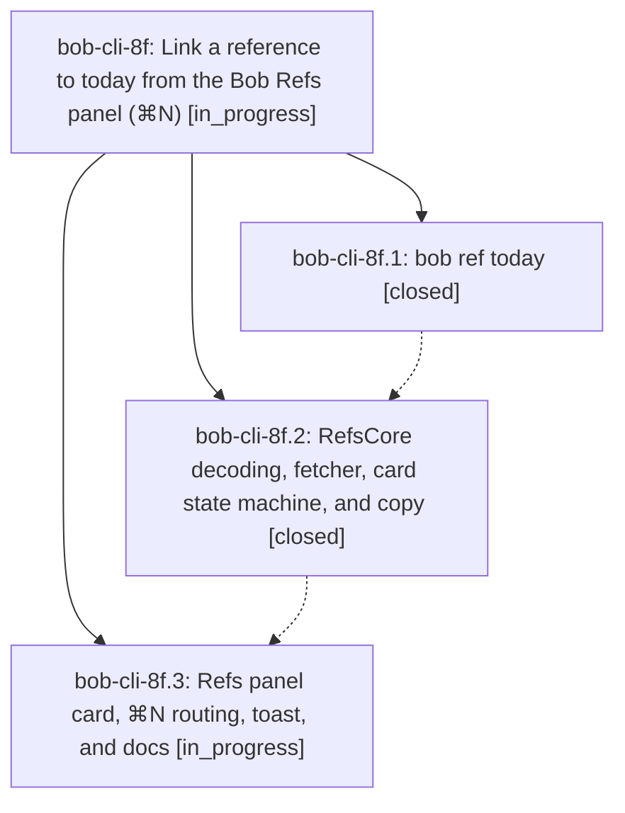

# Bead: bob-cli-8f — Link a reference to today from the Bob Refs panel (⌘N)

[Bead Pages](../README.md) / bob-cli-8f

**Status:** ◐ in_progress · **Type:** ▸ plan · **Tier:** epic
**Owner:** `bryanbugyi34@gmail.com` · **Created by:** [bbugyi200.apollo.7y](https://github.com/bobs-org/bob-cli--agents/blob/main/sessions/bbugyi200.apollo.7y.md) · **Assignee:** `bob-cli-8f.land`
**Created:** 2026-10-16 10:04:17 EDT
**Plan:** [202610/refs\_link\_to\_today.md](https://github.com/bobs-org/bob-cli--plans/blob/main/202610/refs_link_to_today.md)

<!-- sase:links:start -->

## Links

| Relation | Artifact | Why |
| --- | --- | --- |
| implemented-by | [plan:202610/refs_link_to_today.md][1] | derived from the plan's `bead_id:` frontmatter field |

_Plus 1 automatic references — see [Referenced By](#referenced-by)._

[1]: https://github.com/bobs-org/bob-cli--plans/blob/main/202610/refs_link_to_today.md

<!-- sase:links:end -->

## Description

In Bob Mac Capture's Refs panel, ⌘N opens a Link to Today card with the current or next Pomodoro preselected. Return (or a second ⌘N) sets the selected reference's reading task Next and links it under that Pomodoro in today's daily note. Arrows or a typed name pick another Pomodoro or create a new named one. A glass toast confirms exactly what changed. A new `bob ref today` command owns every vault decision through capture's existing-task link planner.

## Phases

| Bead | Title | Status | Size | Created | Agents | Commits |
|---|---|---|---|---|---:|---:|
| [bob-cli-8f.1](bob-cli-8f.1.md) | bob ref today | ✓ closed | medium | 2026-10-16 | 1 | 1 |
| [bob-cli-8f.2](bob-cli-8f.2.md) | RefsCore decoding, fetcher, card state machine, and copy | ✓ closed | medium | 2026-10-16 | 1 | 1 |
| [bob-cli-8f.3](bob-cli-8f.3.md) | Refs panel card, ⌘N routing, toast, and docs | ◐ in_progress | medium | 2026-10-16 | 1 | 0 |

## Lineage

## Agents

| Agent | Bead | Commits |
|---|---|---:|
| [bbugyi200.apollo.bob-cli-8f.1](https://github.com/bobs-org/bob-cli--agents/blob/main/agents/bbugyi200.apollo.bob-cli-8f.1/README.md) | [bob-cli-8f.1](bob-cli-8f.1.md) | 1 |
| [bbugyi200.apollo.bob-cli-8f.2](https://github.com/bobs-org/bob-cli--agents/blob/main/agents/bbugyi200.apollo.bob-cli-8f.2/README.md) | [bob-cli-8f.2](bob-cli-8f.2.md) | 1 |
| [bbugyi200.apollo.bob-cli-8f.3](https://github.com/bobs-org/bob-cli--agents/blob/main/agents/bbugyi200.apollo.bob-cli-8f.3/README.md) | [bob-cli-8f.3](bob-cli-8f.3.md) | 0 |
| [bbugyi200.apollo.bob-cli-8f.land](https://github.com/bobs-org/bob-cli--agents/blob/main/agents/bbugyi200.apollo.bob-cli-8f.land/README.md) | [bob-cli-8f](README.md) | 0 |

## Commits

| Repo | Commit | Subject | Bead | Committed |
|---|---|---|---|---|
| bob-cli | [`a3c2721`](https://github.com/bobs-org/bob-cli/commit/a3c27210555bfaea7a309cf3772ff39a1fcdfd7d) | feat(ref): add bob ref today to link a reading task under today's Pomodoro | [bob-cli-8f.1](bob-cli-8f.1.md) | 2026-10-16 11:17:13 EDT |
| bob-mac-capture | [`bob-mac-capture@ef6522b`](https://github.com/bobs-org/bob-mac-capture/commit/ef6522bb4142b2ac5b755e81f6d4671fba7b3d54) | feat(refs): add portable Link to Today card core | [bob-cli-8f.2](bob-cli-8f.2.md) | 2026-10-16 12:31:27 EDT |

<!-- sase:referenced-by:start -->

## Referenced By

| Relation | Artifact | Why | Uses |
| --- | --- | --- | ---: |
| read-by | [agent:bob-cli-8f.1][1] | Need parent epic scope and remaining phases | 1 |

[1]: https://github.com/bobs-org/bob-cli--agents/blob/main/agents/bbugyi200.apollo.bob-cli-8f.1/README.md

<!-- sase:referenced-by:end -->
