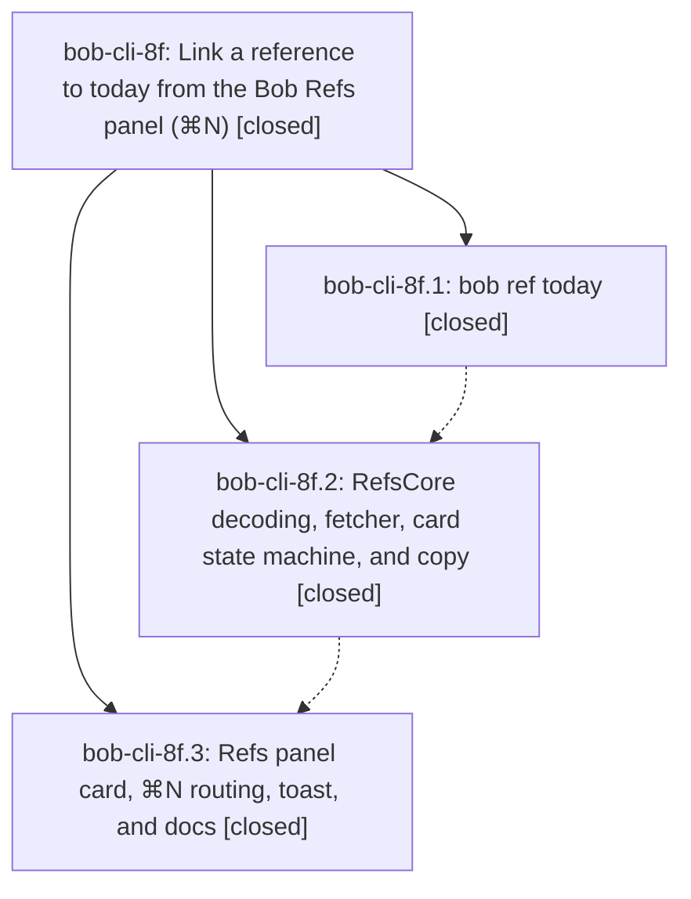

# Bead: bob-cli-8f — Link a reference to today from the Bob Refs panel (⌘N)

[Bead Pages](../README.md) / bob-cli-8f

**Status:** ✓ closed · **Resolution:** done · **Type:** ▸ plan · **Tier:** epic
**Owner:** `bryanbugyi34@gmail.com` · **Created by:** [bbugyi200.apollo.7y](https://github.com/bobs-org/bob-cli--agents/blob/main/sessions/bbugyi200.apollo.7y.md) · **Assignee:** `bob-cli-8f.land`
**Created:** 2026-10-16 10:04:17 EDT · **Closed:** 2026-10-16 14:32:40 EDT
**Plan:** [202610/refs\_link\_to\_today.md](https://github.com/bobs-org/bob-cli--plans/blob/main/202610/refs_link_to_today.md)

<!-- sase:links:start -->

## Links

| Relation | Artifact | Why |
| --- | --- | --- |
| implemented-by | [plan:202610/refs_link_to_today.md][1] | derived from the plan's `bead_id:` frontmatter field |

_Plus 1 automatic references — see [Referenced By](#referenced-by)._

[1]: https://github.com/bobs-org/bob-cli--plans/blob/main/202610/refs_link_to_today.md

<!-- sase:links:end -->

## Description

In Bob Mac Capture's Refs panel, ⌘N opens a Link to Today card with the current or next Pomodoro preselected. Return (or a second ⌘N) sets the selected reference's reading task Next and links it under that Pomodoro in today's daily note. Arrows or a typed name pick another Pomodoro or create a new named one. A glass toast confirms exactly what changed. A new `bob ref today` command owns every vault decision through capture's existing-task link planner.

## Notes

[2026-10-16T17:27:20Z · bob-cli-8f.land] LAND AUDIT / FOLLOW-UP TRIAGE: Read this epic and all notes on bob-cli-8f.1, .2, .3; reviewed approved plan plan:202610/refs_link_to_today.md, selected after_link=stay, CLI commit a3c27210 and Mac commits ef6522b/3a6db2b plus implementation and tests. Phase .1 notes #1-2 fixtures are present in Mac Tests/Fixtures (seven real envelopes); note #5 shared capture planner, selectors, typed errors, docs/help, parity tests are implemented. Phase .2 API notes are wired, including generation tokens and separate preview/write lanes. Phase .3 note #1 missing Mac verification is addressed by note #2 (release bundle and all test targets typechecked); this lander has not rerun those checks. Two PROPOSED FOLLOW-UP entries collected, both from .1: #3 completion kinds and NativeCommand coverage (two distinct assertions) are repaired in later commit f2ced0c5, which adds all three missing kinds and all five canonical command variants; decline new tasks as already fixed by bob-cli-8b. #4 titlesec.sty missing is causally owned by active bob-cli-87 / phase .4, already in its note #1; used sase_new_task, searched all task statuses and swept recent tasks, then corroborated with a DISCOVERED ISSUE note on bob-cli-87 citing proposing bead .1 #4 and current source/package lookup. No new task created. Carry these outcomes into final close note. Current epic-symbols reports no entries; plan remains wip and epic remains open pending the bounded landing repair tale.

[2026-10-16T17:27:26Z · bob-cli-8f.land] LAND INTEGRATION / REMAINING WORK: Audited CLI master through 280321a3 (base is origin/master; no separate PR divergence) and Mac master through 3a6db2b. Post-start non-epic work: snapshot/transclusion/project metadata and article heading selection changes do not introduce another ref-today writer; capture-templates f2ced0c5 preserves CaptureItemResult and fixes the reported coverage failures; Mac saved-template protocol/checkout, settings import, signing, and accessibility changes remain compatible with separate refs-today lanes and shared CaptureCommandSuccess. Remaining epic defects from source inspection: RefsPanelModel.failTodayLinkListing can call card.fail during an active fast-path write and unlock the card; no preview debounce exists; stale-write reload is not locked against edits/resubmission; finishTodayLink refreshes Today only and never discards inspector cache; failure transition does not advance field focus generation; failed-state row clicks are ignored. Key hints already render in RefsFooter (no repair needed), but invalid ready-state submission never beeps. Model tests cover only one Today happy path; design test renders only ready/linked despite planned state matrix. CLI destination_after_found_move falls back to the pre-image line when two open entries share a digest: with SOURCE at line 2, its Task Link line 3, identical unnamed placeholders lines 4 and 5, moving to the latter shifts it to line 4 but returns planned line 5. Repair within this epic, with targeted regressions, then verification and normal close in the same coder turn; do not create follow-up tasks for these defects.

[2026-10-16T17:30:18Z · bob-cli-8f.land] POST-AUDIT BASE CHECK: Fetched both repositories before proposing the repair tale. Mac remains 3a6db2b. CLI origin/master advanced to ff97c620 (bob-cli-8g.4 articles vault CLI); reviewed its command/completion registration, shared article-heading helper cleanup, and justfile changes, then fast-forwarded this checkout. It preserves the ref-today code and f2ced0c5 coverage repairs; no further feature integration is required. The justfile change adds articles install-smoke commands, not a symvision recipe. Repair tale should validate against this newer baseline.

[2026-10-16T18:32:40Z · bob-cli-8f.land--2] LANDING OUTCOMES: bob-cli-8f.1 closed: bob ref today CLI and duplicate unnamed destination line tracking are implemented; targeted ledger and CLI JSON regressions pass. Its follow-up #3 (completion kinds and NativeCommand coverage) was fixed by bob-cli-8b commit f2ced0c5, so no task was opened. Follow-up #4 (missing titlesec.sty in the note-snapshot renderer) is owned by active bob-cli-87/phase .4; it was corroborated there after duplicate search, with no new task. bob-cli-8f.2 closed: RefsCore/fetcher/card contracts and real-bob fixtures are in place; three refusal/reload fixtures were added and the README records their scratch-vault provenance. bob-cli-8f.3 closed: panel routing, UI, accessibility, and expanded model/design tests landed; approved-link behavior remains after_link=stay. Athena just portable-check passed (1,276 tests). Mac Scripts/bundle.sh and just typecheck-tests passed for all listed targets against the XCTest stub; XCTest execution is unavailable on that machine. CLI verification: named tool check is not configured, so sase tool run -- just check was used (ToolRun 5be9000c6502d8c8762e4b76c1652fc1); fmt and clippy passed, 1,699 CLI integration tests passed, but the library suite has two pre-existing tracked note_snapshot failures: pandoc_maps_every_contract_construct_to_tex (missing expected lifted-link TeX) and renders_contract_with_clean_text_layer_and_metadata (titlesec.sty unavailable). Both are recorded under bob-cli-87 and were corroborated there; no new task was needed. epic-symbols has no entries; neither Justfile has a symvision recipe. The approved plan is marked done.

## Phases

| Bead | Title | Status | Size | Created | Agents | Commits |
|---|---|---|---|---|---:|---:|
| [bob-cli-8f.1](bob-cli-8f.1.md) | bob ref today | ✓ closed | medium | 2026-10-16 | 1 | 1 |
| [bob-cli-8f.2](bob-cli-8f.2.md) | RefsCore decoding, fetcher, card state machine, and copy | ✓ closed | medium | 2026-10-16 | 1 | 1 |
| [bob-cli-8f.3](bob-cli-8f.3.md) | Refs panel card, ⌘N routing, toast, and docs | ✓ closed | medium | 2026-10-16 | 1 | 1 |

## Lineage

## Agents

| Agent | Bead | Commits |
|---|---|---:|
| [bbugyi200.apollo.bob-cli-8f.1](https://github.com/bobs-org/bob-cli--agents/blob/main/agents/bbugyi200.apollo.bob-cli-8f.1/README.md) | [bob-cli-8f.1](bob-cli-8f.1.md) | 1 |
| [bbugyi200.apollo.bob-cli-8f.2](https://github.com/bobs-org/bob-cli--agents/blob/main/agents/bbugyi200.apollo.bob-cli-8f.2/README.md) | [bob-cli-8f.2](bob-cli-8f.2.md) | 1 |
| [bbugyi200.apollo.bob-cli-8f.3](https://github.com/bobs-org/bob-cli--agents/blob/main/sessions/bbugyi200.apollo.bob-cli-8f.3.md) | [bob-cli-8f.3](bob-cli-8f.3.md) | 1 |
| [bbugyi200.apollo.bob-cli-8f.land](https://github.com/bobs-org/bob-cli--agents/blob/main/sessions/bbugyi200.apollo.bob-cli-8f.land.md) | [bob-cli-8f](README.md) | 1 |

## Commits

| Repo | Commit | Subject | Bead | Committed |
|---|---|---|---|---|
| bob-cli | [`a3c2721`](https://github.com/bobs-org/bob-cli/commit/a3c27210555bfaea7a309cf3772ff39a1fcdfd7d) | feat(ref): add bob ref today to link a reading task under today's Pomodoro | [bob-cli-8f.1](bob-cli-8f.1.md) | 2026-10-16 11:17:13 EDT |
| bob-mac-capture | [`bob-mac-capture@ef6522b`](https://github.com/bobs-org/bob-mac-capture/commit/ef6522bb4142b2ac5b755e81f6d4671fba7b3d54) | feat(refs): add portable Link to Today card core | [bob-cli-8f.2](bob-cli-8f.2.md) | 2026-10-16 12:31:27 EDT |
| bob-mac-capture | [`bob-mac-capture@3a6db2b`](https://github.com/bobs-org/bob-mac-capture/commit/3a6db2bd120d51a212e5dc0cdf04486b60a2bec1) | feat(refs): wire Link to Today card, toast, and ⌘N routing | [bob-cli-8f.3](bob-cli-8f.3.md) | 2026-10-16 13:18:16 EDT |
| bob-cli | [`eeeeab0`](https://github.com/bobs-org/bob-cli/commit/eeeeab0f91dd6b600737fc2ef71487c82ac058d4) | fix(refs): track duplicate pomodoro destinations after moves | [bob-cli-8f](README.md) | 2026-10-16 14:34:17 EDT |

<!-- sase:referenced-by:start -->

## Referenced By

| Relation | Artifact | Why | Uses |
| --- | --- | --- | ---: |
| read-by | [agent:bob-cli-8f.1][1] | Need parent epic scope and remaining phases | 1 |

[1]: https://github.com/bobs-org/bob-cli--agents/blob/main/agents/bbugyi200.apollo.bob-cli-8f.1/README.md

<!-- sase:referenced-by:end -->
