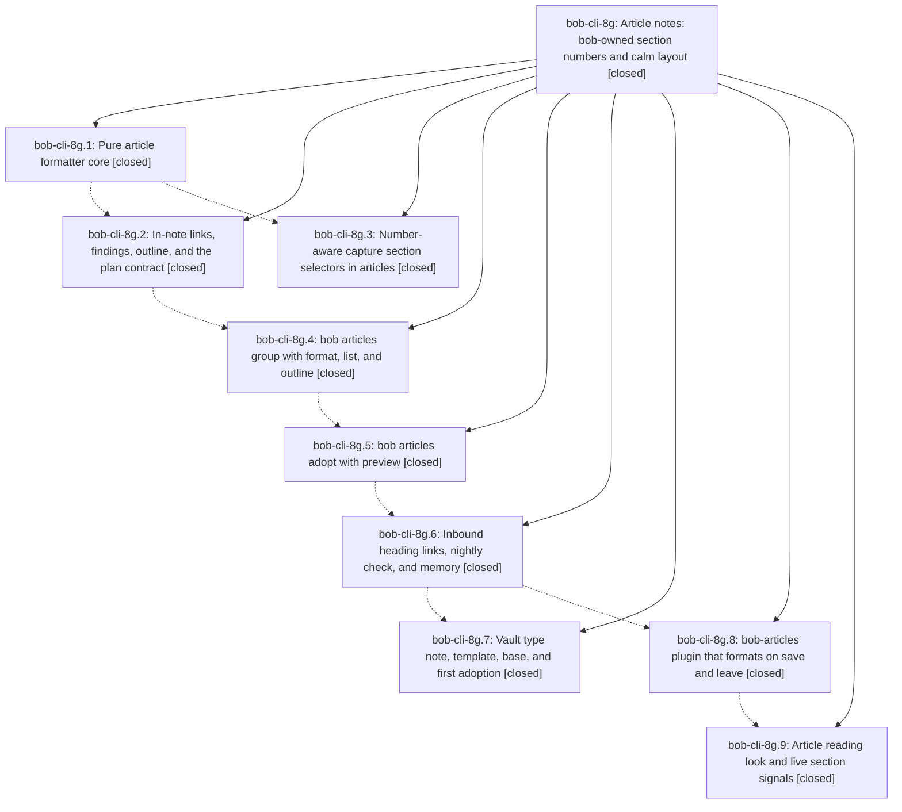

# Bead: bob-cli-8g — Article notes: bob-owned section numbers and calm layout

[Bead Pages](../README.md) / bob-cli-8g

**Status:** ✓ closed · **Resolution:** done · **Type:** ▸ plan · **Tier:** epic
**Owner:** `bryanbugyi34@gmail.com` · **Created by:** [bbugyi200.apollo.research.1o.linker.w0](https://github.com/bobs-org/bob-cli--agents/blob/main/sessions/bbugyi200.apollo.research.1o.linker.w0.md) · **Assignee:** `bob-cli-8g.land`
**Created:** 2026-10-16 10:53:03 EDT · **Closed:** 2026-10-16 17:06:41 EDT
**Plan:** [202610/article\_notes.md](https://github.com/bobs-org/bob-cli--plans/blob/main/202610/article_notes.md)

<!-- sase:links:start -->

## Links

| Relation | Artifact | Why |
| --- | --- | --- |
| implemented-by | [plan:202610/article_notes.md][1] | derived from the plan's `bead_id:` frontmatter field |

[1]: https://github.com/bobs-org/bob-cli--plans/blob/main/202610/article_notes.md

<!-- sase:links:end -->

## Description

Vault notes typed `[[article]]` get house-style section numbers (1. / 1.1 / 1.1.1) and a layout-only format from one bob engine. It runs from `bob articles`, from agents, and from Obsidian on save. Heading links follow every renumber, no word ever changes, and articles read like well-set documents. `sase_blog_contents.md` is the first adopted article.

## Notes

[2026-10-16T20:34:12Z · bob-cli-8g.land] LANDING FOLLOW-UP TRIAGE (bob-cli-8g.land): (A) note_snapshot profile failures pandoc_maps_every_contract_construct_to_tex 'lifted link' + renders_contract_with_clean_text_layer_and_metadata titlesec.sty (proposed by 8g.1/.3/.4/.5/.6): still the only just check failures at a4c9ecf5; owned by active epic bob-cli-87, DISCOVERED ISSUE note appended there, no task filed. (B) bob-plugins npm test failures (proposed by 8g.8/.9): duplicates; +1 recorded on bob-cli-6v, bob-cli-6w, bob-cli-7i (reproduced at 5bc2d9d: 6 failures) and bob-cli-3w (phase-observed flake, not hit in landing run). (C) capture-templates every_value_arg_has_a_decision + NativeCommand 36 vs 31 (8g.1#1, 8g.3#2): declined, both pass on current master. (D) rustfmt drift citing bob-cli-24 (8g.2#1): declined, cargo fmt --check passes and bob-cli-24 is closed.

[2026-10-16T20:37:16Z · bob-cli-8g.land] LANDING VERIFICATION (bob-cli-8g.land): all 9 phases reviewed against plan:202610/article_notes.md. just check at a4c9ecf5: only the 2 bob-cli-87 note_snapshot tests fail (2848 lib + 1715 CLI pass). bob articles format -a -c exits 0 on ~/bob; plugin deployed byte-identical and enabled; bob-articles tests 17/17 and validate pass. Integration review of non-epic commits since start (snapshot, capture-templates, ref today/snapshot, refs) found nothing to adopt or conflicting. Reproduced remaining epic gaps: embeds not refreshed; indented-code links rewritten and blank runs collapsed; F5 missing next to $$/%%/HTML; --all writes nothing when one note is refused and drift aborts the batch; numbered counts every heading; [b] pseudo-footnote missed; prose #task refuses; bad-option line 1; no near-miss on unresolved NOTE; capture not raw-first; lazy-continuation Setext; docs/articles.md incomplete; plugin drops save-path formats when bob deletes trailing lines, leave path ignores undo guard, Reading view misses numbers on first open, risky overflow/margin CSS. Planned as a medium tale whose last step closes this epic. No --epic-symbol entries.

[2026-10-16T21:06:41Z · bob-cli-8g.land] LANDING COMPLETE (bob-cli-8g.land): Implemented the approved article-notes landing plan across bob-cli, bob-plugins, and docs. Core fixes cover heading embeds, protected indented code and blank runs, F5 spacing, partial writes with preimage drift refusal, invalid UTF-8 skips, numbering/count semantics, pseudo-footnotes, task-tag detection, option diagnostics, resolver suggestions, raw-title capture precedence, lazy-list/Setext handling, frontmatter-only layout, findings display, scanner reuse, and the complete docs/articles.md contract. Plugin fixes cover trailing-line deletion edits, undo-guarded leave formatting and stale tooltips, Reading view outline refresh, CSS spacing/overflow, UTF-8 chunk output and stdin errors, legacy bob notice, repeated Convert refusals, plus version 0.2.1. All 9 phases were reviewed against plan:202610/article_notes.md; integration review of non-epic commits since start found nothing conflicting or to adopt. Follow-up triage: the two note_snapshot failures remain tracked by active bob-cli-87; plugin npm test failures duplicate bob-cli-6v, bob-cli-6w, bob-cli-7i (+1 each), with the ranker performance flake tracked by bob-cli-3w (+1); capture-templates and rustfmt proposals were declined because they are already passing. Verification: targeted Rust article tests 39 passed/1 ignored; real-vault corpus passed; just check had only the two known bob-cli-87 note_snapshot failures (Pandoc lifted-link assertion and missing titlesec.sty); just install succeeded; bob articles format -a -c exited 0, sase_blog_contents is formatted with 4 findings, and its repeat write was silent; bob-articles tests 23/23 and npm run validate 7/7 passed; plugin npm test 2881/2888 passed with only the six tracked failures and bob-cli-3w ranker flake. bob-articles 0.2.1 deployed and manifest.js/styles.css were byte-identical to source. Manual Obsidian visual acceptance (light/dark, narrow, 200%, PDF, and one-u undo after live :w renumber) remains for Bryan; reload Obsidian to load the deployment.

## Phases

| Bead | Title | Status | Size | Created | Agents | Commits |
|---|---|---|---|---|---:|---:|
| [bob-cli-8g.1](bob-cli-8g.1.md) | Pure article formatter core | ✓ closed | medium | 2026-10-16 | 1 | 1 |
| [bob-cli-8g.2](bob-cli-8g.2.md) | In-note links, findings, outline, and the plan contract | ✓ closed | medium | 2026-10-16 | 1 | 1 |
| [bob-cli-8g.3](bob-cli-8g.3.md) | Number-aware capture section selectors in articles | ✓ closed | small | 2026-10-16 | 1 | 1 |
| [bob-cli-8g.4](bob-cli-8g.4.md) | bob articles group with format, list, and outline | ✓ closed | medium | 2026-10-16 | 1 | 1 |
| [bob-cli-8g.5](bob-cli-8g.5.md) | bob articles adopt with preview | ✓ closed | small | 2026-10-16 | 1 | 1 |
| [bob-cli-8g.6](bob-cli-8g.6.md) | Inbound heading links, nightly check, and memory | ✓ closed | medium | 2026-10-16 | 1 | 1 |
| [bob-cli-8g.7](bob-cli-8g.7.md) | Vault type note, template, base, and first adoption | ✓ closed | small | 2026-10-16 | 1 | 0 |
| [bob-cli-8g.8](bob-cli-8g.8.md) | bob-articles plugin that formats on save and leave | ✓ closed | medium | 2026-10-16 | 1 | 1 |
| [bob-cli-8g.9](bob-cli-8g.9.md) | Article reading look and live section signals | ✓ closed | medium | 2026-10-16 | 1 | 1 |

## Lineage

## Agents

| Agent | Bead | Commits |
|---|---|---:|
| [bbugyi200.apollo.bob-cli-8g.1](https://github.com/bobs-org/bob-cli--agents/blob/main/agents/bbugyi200.apollo.bob-cli-8g.1/README.md) | [bob-cli-8g.1](bob-cli-8g.1.md) | 1 |
| [bbugyi200.apollo.bob-cli-8g.2](https://github.com/bobs-org/bob-cli--agents/blob/main/agents/bbugyi200.apollo.bob-cli-8g.2/README.md) | [bob-cli-8g.2](bob-cli-8g.2.md) | 1 |
| [bbugyi200.apollo.bob-cli-8g.3](https://github.com/bobs-org/bob-cli--agents/blob/main/sessions/bbugyi200.apollo.bob-cli-8g.3.md) | [bob-cli-8g.3](bob-cli-8g.3.md) | 1 |
| [bbugyi200.apollo.bob-cli-8g.4](https://github.com/bobs-org/bob-cli--agents/blob/main/sessions/bbugyi200.apollo.bob-cli-8g.4.md) | [bob-cli-8g.4](bob-cli-8g.4.md) | 1 |
| [bbugyi200.apollo.bob-cli-8g.5](https://github.com/bobs-org/bob-cli--agents/blob/main/sessions/bbugyi200.apollo.bob-cli-8g.5.md) | [bob-cli-8g.5](bob-cli-8g.5.md) | 1 |
| [bbugyi200.apollo.bob-cli-8g.6](https://github.com/bobs-org/bob-cli--agents/blob/main/agents/bbugyi200.apollo.bob-cli-8g.6/README.md) | [bob-cli-8g.6](bob-cli-8g.6.md) | 1 |
| [bbugyi200.apollo.bob-cli-8g.7](https://github.com/bobs-org/bob-cli--agents/blob/main/agents/bbugyi200.apollo.bob-cli-8g.7/README.md) | [bob-cli-8g.7](bob-cli-8g.7.md) | 0 |
| [bbugyi200.apollo.bob-cli-8g.8](https://github.com/bobs-org/bob-cli--agents/blob/main/sessions/bbugyi200.apollo.bob-cli-8g.8.md) | [bob-cli-8g.8](bob-cli-8g.8.md) | 1 |
| [bbugyi200.apollo.bob-cli-8g.9](https://github.com/bobs-org/bob-cli--agents/blob/main/agents/bbugyi200.apollo.bob-cli-8g.9/README.md) | [bob-cli-8g.9](bob-cli-8g.9.md) | 1 |
| [bbugyi200.apollo.bob-cli-8g.land](https://github.com/bobs-org/bob-cli--agents/blob/main/sessions/bbugyi200.apollo.bob-cli-8g.land.md) | [bob-cli-8g](README.md) | 2 |

## Commits

| Repo | Commit | Subject | Bead | Committed |
|---|---|---|---|---|
| bob-cli | [`8e96375`](https://github.com/bobs-org/bob-cli/commit/8e9637538ecee897cb0bbc5809c0e056cf311d7f) | feat(articles): add pure article formatter core | [bob-cli-8g.1](bob-cli-8g.1.md) | 2026-10-16 12:04:49 EDT |
| bob-cli | [`a3e45a3`](https://github.com/bobs-org/bob-cli/commit/a3e45a3b530163829087975f234d1f08d004dee5) | feat(capture): match article section selectors on de-numbered identity | [bob-cli-8g.3](bob-cli-8g.3.md) | 2026-10-16 12:43:32 EDT |
| bob-cli | [`280321a`](https://github.com/bobs-org/bob-cli/commit/280321a33eb0c3a4c791e0ec70b74e61eb8e2b7d) | feat(articles): add structured outline and link planning | [bob-cli-8g.2](bob-cli-8g.2.md) | 2026-10-16 12:48:29 EDT |
| bob-cli | [`ff97c62`](https://github.com/bobs-org/bob-cli/commit/ff97c620d6a15f6a64c46de5e85ae29075a74afb) | feat(articles): add articles vault CLI | [bob-cli-8g.4](bob-cli-8g.4.md) | 2026-10-16 13:28:16 EDT |
| bob-cli | [`e646cbd`](https://github.com/bobs-org/bob-cli/commit/e646cbd898f54ec99a590ce1ca9eb6ac283148f1) | feat(articles): add adopt with preview and stdin JSON | [bob-cli-8g.5](bob-cli-8g.5.md) | 2026-10-16 14:13:42 EDT |
| bob-cli | [`93a76ed`](https://github.com/bobs-org/bob-cli/commit/93a76ed3876b4a9221ad258def1cca3ed450e321) | feat(articles): repair inbound heading links and add nightly check | [bob-cli-8g.6](bob-cli-8g.6.md) | 2026-10-16 15:10:35 EDT |
| bob-plugins | [`bob-plugins@7f9d496`](https://github.com/bobs-org/bob-plugins/commit/7f9d496754991b135f374c7cf0d5e571212fc766) | feat(bob-articles): add article formatting plugin | [bob-cli-8g.8](bob-cli-8g.8.md) | 2026-10-16 15:39:07 EDT |
| bob-plugins | [`bob-plugins@5bc2d9d`](https://github.com/bobs-org/bob-plugins/commit/5bc2d9d1676237f2185a90d4e578e4838ca0578d) | feat(bob-articles): add reading look and live section signals | [bob-cli-8g.9](bob-cli-8g.9.md) | 2026-10-16 16:01:10 EDT |
| bob-cli | [`f1b37e5`](https://github.com/bobs-org/bob-cli/commit/f1b37e50f53c96d65f88fb5fd31b82b47a043939) | fix(articles): complete formatting and capture corrections | [bob-cli-8g](README.md) | 2026-10-16 17:09:53 EDT |
| bob-plugins | [`bob-plugins@553a4e3`](https://github.com/bobs-org/bob-plugins/commit/553a4e3877fc5d64b0d648a9b47e3c2edfc1b295) | fix(bob-articles): harden edit and rendering paths | [bob-cli-8g](README.md) | 2026-10-16 17:10:39 EDT |
