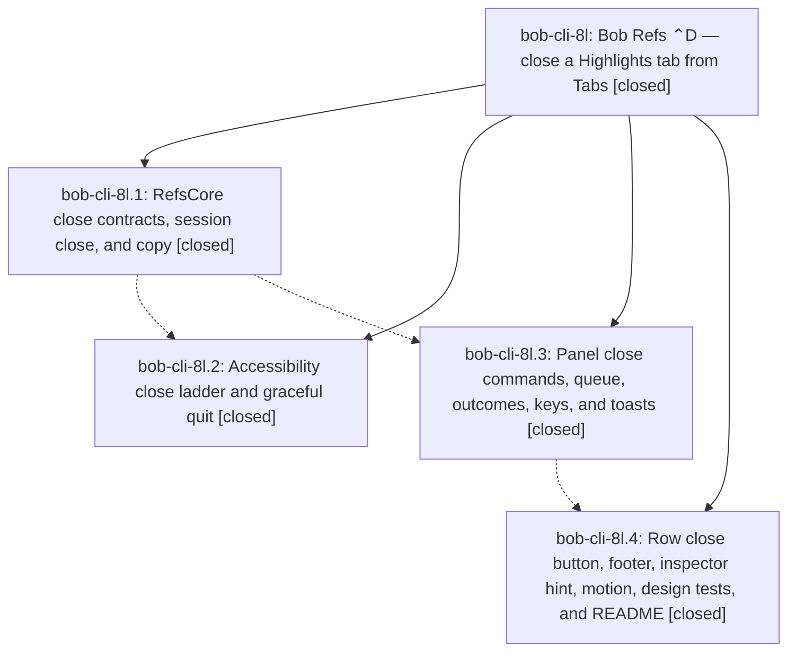

# Bead: bob-cli-8l — Bob Refs ⌃D — close a Highlights tab from Tabs

[Bead Pages](../README.md) / bob-cli-8l

**Status:** ✓ closed · **Resolution:** done · **Type:** ▸ plan · **Tier:** epic
**Owner:** `bryanbugyi34@gmail.com` · **Created by:** [bbugyi200.apollo.85](https://github.com/bobs-org/bob-cli--agents/blob/main/sessions/bbugyi200.apollo.85.md) · **Assignee:** `bob-cli-8l.land`
**Created:** 2026-10-16 14:11:30 EDT · **Closed:** 2026-10-16 16:18:00 EDT
**Plan:** [202610/highlights\_tab\_close.md](https://github.com/bobs-org/bob-cli--plans/blob/main/202610/highlights_tab_close.md)

<!-- sase:links:start -->

## Links

| Relation | Artifact | Why |
| --- | --- | --- |
| implemented-by | [plan:202610/highlights_tab_close.md][1] | derived from the plan's `bead_id:` frontmatter field |
| related | file:explicit:639045a6614971c0076beb44 | attached via sase artifact create --bead |

_Plus 1 automatic references — see [Referenced By](#referenced-by)._

[1]: https://github.com/bobs-org/bob-cli--plans/blob/main/202610/highlights_tab_close.md

<!-- sase:links:end -->

## Description

In Bob Mac Capture's Bob Refs panel, ⌃D on a Tabs row closes that Highlights tab without leaving the panel. The row folds away, the selection moves to the row that took its place, and a glass toast confirms the close, so ⌃D ⌃D ⌃D clears several tabs in a row. Closing the last open document also quits Highlights. Every close is verified against a fresh Accessibility read, and a failed close puts the row back with a banner.

## Notes

[2026-10-16T19:20:00Z · bryanbugyi34@gmail.com] This keymap should actually be <ctrl+x> instead of <ctrl+d> (which would conflict with the keymap that scrolls down). The epic lander agent should fix this before closing this bead.

[2026-10-16T19:51:18Z · bob-cli-8l.land] LAND AUDIT before remaining-work tale: Read the epic and all four child beads and every note, the linked approved plan, actual SASE_BEAD commits 7fd75c8/211c699/7954c28/7ee2499, source, and relevant tests at bob-mac-capture 7ee2499. The phase-1 note's pre-finalization SHA differs from the actual final commit; its reported implementation is present. Tabs-only close eligibility and in-memory reopen/no-open-log DECISIONS are honored. User note #1 (Ctrl-X, preserve Ctrl-D scroll) remains unresolved. DISCOVERED ISSUE: epic code restarts an empty close worker indefinitely, uses an expired deadline before AXSheet detection, lacks Rename/Link-to-Today write guards on close entry points, and expands an AX guard test with unconditional notRunning despite trust-first behavior. These stay epic work in the medium tale. Integration reviewed non-epic f996588 (independent Capture layout) and 936f232 (Today-link guards to integrate), plus bob-cli drift e646cbd8/16c4640a/eeeeab0f/93a76ed3/07fef5f0; no other integration edit identified. Source audit evidence: file:explicit:639045a6614971c0076beb44. Follow-up triage COMPLETE: exactly one PROPOSED FOLLOW-UP, bob-cli-8l.2 #1, is the pending policy record already tracked by bob-cli-8c. Sase_new_task search, last-week same-type sweep, and active-epic sweep completed; independent +1 and evidence ref recorded on bob-cli-8c to include close-button presses, bounded select-close-restore, and fresh-zero-doc terminate. No duplicate task or memory edit; no proposals declined. Current epic-symbols is empty; both justfiles currently lack symvision. No parent bead. No new compilation/tests or live Highlights actions performed during this audit. The tale must implement, verify, and close bob-cli-8l itself, mark plan:202610/highlights_tab_close.md done, and recheck parent link in the same turn without waiting for its own future commit.

[2026-10-16T20:18:00Z · bob-cli-8l.land] Verified all four phase scopes and notes against 7fd75c8, 211c699, 7954c28, and 7ee2499 and the repaired source. Preserved tabs_only and reopen decisions. Addressed Bryan's Ctrl-X correction, idle-worker restart, save-sheet deadline, trust-dependent test, and Rename/Today write-guard integration. Reviewed non-epic f996588/936f232 and subsequent drift (bob-cli still at 07fef5f0, mac at 7ee2499 plus this repair). Follow-up from bob-cli-8l.2 #1 was corroborated on existing bob-cli-8c; no duplicate or memory edit. Verification: athena portable-check lint exit 0, swift build --build-tests exit 0, swift test 1290 passed 0 failed; Mac scratch bundle/typecheck unverified (mac offline, SSH timeout per AGENTS.md); Xcode suites not executed; bob-cli just check exit 101 with 2 lib (missing titlesec.sty, lifted link) plus 7 cli pre-existing failures on a clean tree, no bob-cli code changed. No epic-symbol exemptions remain.

## Phases

| Bead | Title | Status | Size | Created | Agents | Commits |
|---|---|---|---|---|---:|---:|
| [bob-cli-8l.1](bob-cli-8l.1.md) | RefsCore close contracts, session close, and copy | ✓ closed | medium | 2026-10-16 | 1 | 1 |
| [bob-cli-8l.2](bob-cli-8l.2.md) | Accessibility close ladder and graceful quit | ✓ closed | medium | 2026-10-16 | 1 | 1 |
| [bob-cli-8l.3](bob-cli-8l.3.md) | Panel close commands, queue, outcomes, keys, and toasts | ✓ closed | medium | 2026-10-16 | 1 | 1 |
| [bob-cli-8l.4](bob-cli-8l.4.md) | Row close button, footer, inspector hint, motion, design tests, and README | ✓ closed | medium | 2026-10-16 | 1 | 1 |

## Lineage

## Agents

| Agent | Bead | Commits |
|---|---|---:|
| [bbugyi200.apollo.bob-cli-8l.1](https://github.com/bobs-org/bob-cli--agents/blob/main/agents/bbugyi200.apollo.bob-cli-8l.1/README.md) | [bob-cli-8l.1](bob-cli-8l.1.md) | 1 |
| [bbugyi200.apollo.bob-cli-8l.2](https://github.com/bobs-org/bob-cli--agents/blob/main/agents/bbugyi200.apollo.bob-cli-8l.2/README.md) | [bob-cli-8l.2](bob-cli-8l.2.md) | 1 |
| [bbugyi200.apollo.bob-cli-8l.3](https://github.com/bobs-org/bob-cli--agents/blob/main/sessions/bbugyi200.apollo.bob-cli-8l.3.md) | [bob-cli-8l.3](bob-cli-8l.3.md) | 1 |
| [bbugyi200.apollo.bob-cli-8l.4](https://github.com/bobs-org/bob-cli--agents/blob/main/agents/bbugyi200.apollo.bob-cli-8l.4/README.md) | [bob-cli-8l.4](bob-cli-8l.4.md) | 1 |
| [bbugyi200.apollo.bob-cli-8l.land](https://github.com/bobs-org/bob-cli--agents/blob/main/sessions/bbugyi200.apollo.bob-cli-8l.land.md) | [bob-cli-8l](README.md) | 2 |

## Commits

| Repo | Commit | Subject | Bead | Committed |
|---|---|---|---|---|
| bob-mac-capture | [`bob-mac-capture@7fd75c8`](https://github.com/bobs-org/bob-mac-capture/commit/7fd75c8835289f92465aaf01c505e932cb4201ab) | feat(refs): add tab-close contracts, session close, and copy | [bob-cli-8l.1](bob-cli-8l.1.md) | 2026-10-16 14:20:54 EDT |
| bob-mac-capture | [`bob-mac-capture@211c699`](https://github.com/bobs-org/bob-mac-capture/commit/211c6998de6aade5764bd5db1da364fa077cfd38) | feat(refs): add Highlights tab close ladder and graceful quit | [bob-cli-8l.2](bob-cli-8l.2.md) | 2026-10-16 14:49:45 EDT |
| bob-mac-capture | [`bob-mac-capture@7954c28`](https://github.com/bobs-org/bob-mac-capture/commit/7954c28aec7d25e5a5ba42633a1b2436a3b2f74e) | feat(refs): close Highlights tabs with ⌃D from the panel | [bob-cli-8l.3](bob-cli-8l.3.md) | 2026-10-16 15:18:42 EDT |
| bob-mac-capture | [`bob-mac-capture@7ee2499`](https://github.com/bobs-org/bob-mac-capture/commit/7ee2499aa77d358f05b5e4a00a91937c925e076c) | feat(refs): add Tabs close button, fold-out, and close copy | [bob-cli-8l.4](bob-cli-8l.4.md) | 2026-10-16 15:39:34 EDT |
| bob-mac-capture | [`bob-mac-capture@175153c`](https://github.com/bobs-org/bob-mac-capture/commit/175153c8e7f5913a53f03d710c6f3b0c01f5ce74) | feat(refs): close Highlights tabs with Ctrl-X, repair worker/sheet/guards | [bob-cli-8l](README.md) | 2026-10-16 16:19:54 EDT |
| bob-cli--plans | [`bob-cli--plans@8ca51de`](https://github.com/bobs-org/bob-cli--plans/commit/8ca51de3113cc5c36d6ed9b2b52f71085906e7b3) | docs(plans): mark highlights\_tab\_close done for bob-cli-8l landing | [bob-cli-8l](README.md) | 2026-10-16 16:20:31 EDT |

<!-- sase:referenced-by:start -->

## Referenced By

| Relation | Artifact | Why | Uses |
| --- | --- | --- | ---: |
| read-by | [agent:bob-cli-8l.1][1] | Need epic DECISIONS and parent scope | 1 |

[1]: https://github.com/bobs-org/bob-cli--agents/blob/main/agents/bbugyi200.apollo.bob-cli-8l.1/README.md

<!-- sase:referenced-by:end -->
