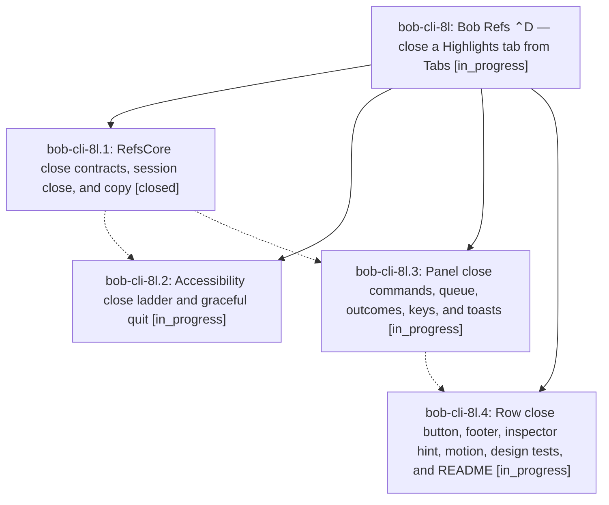

# Bead: bob-cli-8l — Bob Refs ⌃D — close a Highlights tab from Tabs

[Bead Pages](../README.md) / bob-cli-8l

**Status:** ◐ in_progress · **Type:** ▸ plan · **Tier:** epic
**Owner:** `bryanbugyi34@gmail.com` · **Created by:** [bbugyi200.apollo.85](https://github.com/bobs-org/bob-cli--agents/blob/main/sessions/bbugyi200.apollo.85.md) · **Assignee:** `bob-cli-8l.land`
**Created:** 2026-10-16 14:11:30 EDT
**Plan:** [202610/highlights\_tab\_close.md](https://github.com/bobs-org/bob-cli--plans/blob/main/202610/highlights_tab_close.md)

## Description

In Bob Mac Capture's Bob Refs panel, ⌃D on a Tabs row closes that Highlights tab without leaving the panel. The row folds away, the selection moves to the row that took its place, and a glass toast confirms the close, so ⌃D ⌃D ⌃D clears several tabs in a row. Closing the last open document also quits Highlights. Every close is verified against a fresh Accessibility read, and a failed close puts the row back with a banner.

## Phases

| Bead | Title | Status | Size | Created | Agents | Commits |
|---|---|---|---|---|---:|---:|
| [bob-cli-8l.1](bob-cli-8l.1.md) | RefsCore close contracts, session close, and copy | ✓ closed | medium | 2026-10-16 | 1 | 1 |
| [bob-cli-8l.2](bob-cli-8l.2.md) | Accessibility close ladder and graceful quit | ◐ in_progress | medium | 2026-10-16 | 1 | 0 |
| [bob-cli-8l.3](bob-cli-8l.3.md) | Panel close commands, queue, outcomes, keys, and toasts | ◐ in_progress | medium | 2026-10-16 | 1 | 0 |
| [bob-cli-8l.4](bob-cli-8l.4.md) | Row close button, footer, inspector hint, motion, design tests, and README | ◐ in_progress | medium | 2026-10-16 | 1 | 0 |

## Lineage

## Agents

| Agent | Bead | Commits |
|---|---|---:|
| [bbugyi200.apollo.bob-cli-8l.1](https://github.com/bobs-org/bob-cli--agents/blob/main/agents/bbugyi200.apollo.bob-cli-8l.1/README.md) | [bob-cli-8l.1](bob-cli-8l.1.md) | 1 |
| [bbugyi200.apollo.bob-cli-8l.2](https://github.com/bobs-org/bob-cli--agents/blob/main/agents/bbugyi200.apollo.bob-cli-8l.2/README.md) | [bob-cli-8l.2](bob-cli-8l.2.md) | 0 |
| [bbugyi200.apollo.bob-cli-8l.3](https://github.com/bobs-org/bob-cli--agents/blob/main/agents/bbugyi200.apollo.bob-cli-8l.3/README.md) | [bob-cli-8l.3](bob-cli-8l.3.md) | 0 |
| [bbugyi200.apollo.bob-cli-8l.4](https://github.com/bobs-org/bob-cli--agents/blob/main/agents/bbugyi200.apollo.bob-cli-8l.4/README.md) | [bob-cli-8l.4](bob-cli-8l.4.md) | 0 |
| [bbugyi200.apollo.bob-cli-8l.land](https://github.com/bobs-org/bob-cli--agents/blob/main/agents/bbugyi200.apollo.bob-cli-8l.land/README.md) | [bob-cli-8l](README.md) | 0 |

## Commits

| Repo | Commit | Subject | Bead | Committed |
|---|---|---|---|---|
| bob-mac-capture | [`bob-mac-capture@7fd75c8`](https://github.com/bobs-org/bob-mac-capture/commit/7fd75c8835289f92465aaf01c505e932cb4201ab) | feat(refs): add tab-close contracts, session close, and copy | [bob-cli-8l.1](bob-cli-8l.1.md) | 2026-10-16 14:20:54 EDT |
