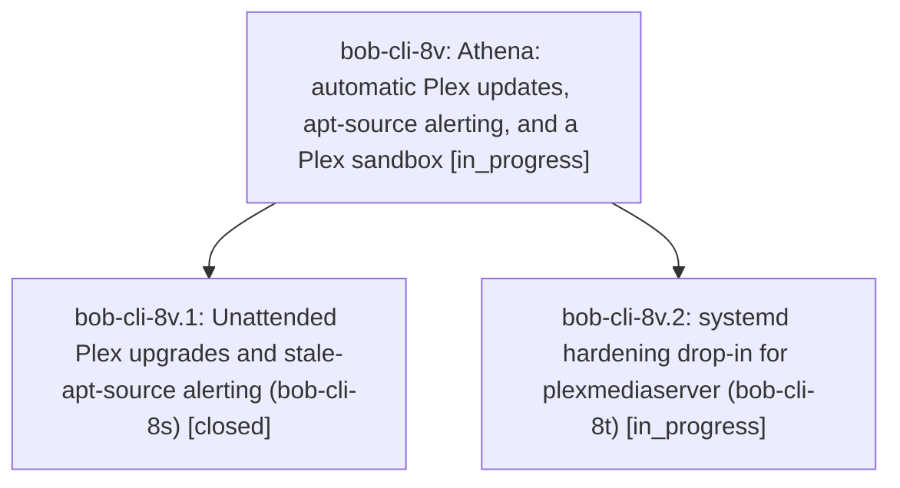

# Bead: bob-cli-8v — Athena: automatic Plex updates, apt-source alerting, and a Plex sandbox

[Bead Pages](../README.md) / bob-cli-8v

**Status:** ◐ in_progress · **Type:** ▸ plan · **Tier:** epic
**Owner:** `bryanbugyi34@gmail.com` · **Created by:** [bbugyi200.athena.110](https://github.com/bobs-org/bob-cli--agents/blob/main/sessions/bbugyi200.athena.110.md) · **Assignee:** `bob-cli-8v.land`
**Created:** 2026-10-17 12:20:28 EDT
**Plan:** [202610/athena\_plex\_autoupdate\_and\_sandbox.md](https://github.com/bobs-org/bob-cli--plans/blob/main/202610/athena_plex_autoupdate_and_sandbox.md)

<!-- sase:links:start -->

## Links

| Relation | Artifact | Why |
| --- | --- | --- |
| implemented-by | [plan:202610/athena_plex_autoupdate_and_sandbox.md][1] | derived from the plan's `bead_id:` frontmatter field |

[1]: https://github.com/bobs-org/bob-cli--plans/blob/main/202610/athena_plex_autoupdate_and_sandbox.md

<!-- sase:links:end -->

## Description

Plex on athena patches itself from repo.plex.tv, a stale or failing apt source reaches Bryan as an alert within days, and plexmediaserver runs sandboxed with every Plex feature still working; bob-cli-8s and bob-cli-8t are closed.

## Phases

| Bead | Title | Status | Size | Created | Agents | Commits |
|---|---|---|---|---|---:|---:|
| [bob-cli-8v.1](bob-cli-8v.1.md) | Unattended Plex upgrades and stale-apt-source alerting (bob-cli-8s) | ✓ closed | medium | 2026-10-17 | 1 | 0 |
| [bob-cli-8v.2](bob-cli-8v.2.md) | systemd hardening drop-in for plexmediaserver (bob-cli-8t) | ◐ in_progress | medium | 2026-10-17 | 1 | 0 |

## Lineage

## Agents

| Agent | Bead | Commits |
|---|---|---:|
| [bbugyi200.athena.bob-cli-8v.1](https://github.com/bobs-org/bob-cli--agents/blob/main/sessions/bbugyi200.athena.bob-cli-8v.1.md) | [bob-cli-8v.1](bob-cli-8v.1.md) | 0 |
| [bbugyi200.athena.bob-cli-8v.2](https://github.com/bobs-org/bob-cli--agents/blob/main/sessions/bbugyi200.athena.bob-cli-8v.2.md) | [bob-cli-8v.2](bob-cli-8v.2.md) | 0 |
| [bbugyi200.athena.bob-cli-8v.land](https://github.com/bobs-org/bob-cli--agents/blob/main/agents/bbugyi200.athena.bob-cli-8v.land/README.md) | [bob-cli-8v](README.md) | 0 |
