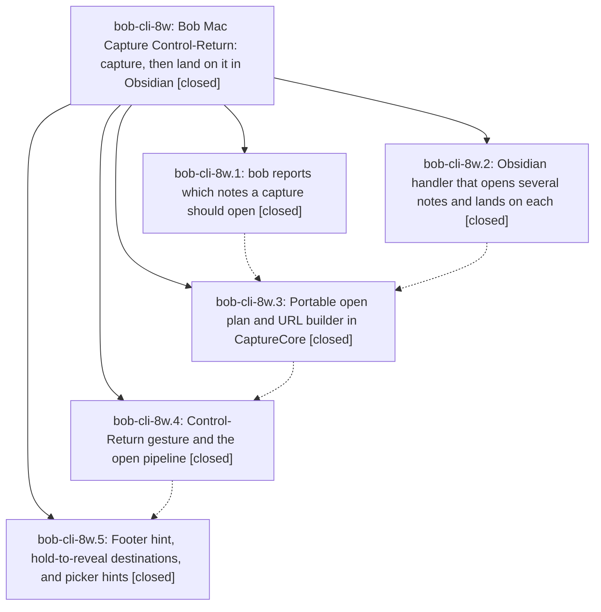

# Bead: bob-cli-8w — Bob Mac Capture Control-Return: capture, then land on it in Obsidian

[Bead Pages](../README.md) / bob-cli-8w

**Status:** ✓ closed · **Resolution:** done · **Type:** ▸ plan · **Tier:** epic
**Owner:** `bryanbugyi34@gmail.com` · **Created by:** [bbugyi200.apollo.8q](https://github.com/bobs-org/bob-cli--agents/blob/main/sessions/bbugyi200.apollo.8q.md) · **Assignee:** `bob-cli-8w.land`
**Created:** 2026-10-17 15:54:14 EDT · **Closed:** 2026-10-17 18:45:08 EDT
**Plan:** [202610/ctrl\_enter\_capture\_and\_open.md](https://github.com/bobs-org/bob-cli--plans/blob/main/202610/ctrl_enter_capture_and_open.md)

<!-- sase:links:start -->

## Links

| Relation | Artifact | Why |
| --- | --- | --- |
| implemented-by | [plan:202610/ctrl_enter_capture_and_open.md][1] | derived from the plan's `bead_id:` frontmatter field |

_Plus 1 automatic references — see [Referenced By](#referenced-by)._

[1]: https://github.com/bobs-org/bob-cli--plans/blob/main/202610/ctrl_enter_capture_and_open.md

<!-- sase:links:end -->

## Description

In Bob Mac Capture, Control-Return captures the draft, then brings Obsidian forward with every note the capture changed open in its own tab. The caret sits on the exact line that changed, which gets a short highlight. bob decides what to open, so the app stays a thin client. One Obsidian URL carries the whole list, so tabs never replace each other. The panel shows beforehand what Control-Return will open.

## Notes

[2026-10-17T21:03:15Z · 117] DISCOVERED ISSUE: bob-plugins README.md now contains its first ~280 lines three times. Commit 3e359a6 (bob-cli-8w.2, 'add open notes URI handler') added 566 README lines: '## Task Card' appears at lines 50, 326 and 588 (1087 lines total vs one copy at 3e359a6~1), and the three copies differ slightly. Impact: every later README edit (e.g. the planned Ctrl+Shift+Alt+B Blocks stage docs) must touch three copies or dedupe first. Fix: restore the single copy from 3e359a6~1 plus the intended open-notes URI handler paragraph.

[2026-10-17T22:00:27Z · bob-cli-8w.land] LAND FOLLOW-UP TRIAGE (bob-cli-8w.land): (1) bob-cli-8w.1 PROPOSED FOLLOW-UP #1/#2 (lib test pandoc_maps_every_contract_construct_to_tex 'lifted link' panic at profile.rs:946): reproduced on master 30bdfb89; bob-cli-87.land had it passing at 5af6521 and only bob-cli-87.13.1/87.13.2 commits touched note_snapshot since, so recorded a DISCOVERED ISSUE note on active epic bob-cli-87.13 instead of a new task. (2) bob-cli-8w.2 PROPOSED FOLLOW-UP #1 (clean-base bob-plugins npm failures): +1 recorded on existing bob-cli-6v (unblocked-glyph), bob-cli-6w (Keep-count notice), bob-cli-7i (forward/reverse project conversion BLOCKS) and bob-cli-3w (stage-ranker timing flake); the land review confirmed the six failures on parent ff96c07; no new task. (3) Epic note #1 (bob-plugins README triplicated by 3e359a6) is epic-caused: root cause is a JS String.replace whose replacement text contained the regex anchors `...{8}$` and `...+$`, and $` expanded to the pre-match prefix twice. Fixed in the landing working tree by restoring one copy plus the intended Open notes URI section, table sentence, and 2.44.0 bump (README 1087 -> 565 lines). (4) No --epic-symbol entries; no symvision recipe.

[2026-10-17T22:45:08Z · bob-cli-8w.land] Landing repairs verified; epic bob-cli-8w closed.

What was verified: all five phases (8w.1–8w.5) against the epic plan and DECISIONS (tab_policy = new_tab, notify_after_open = yes). Control-Return captures, then opens one obsidian://bob-open-notes URL so each changed note lands in its own tab on the captured line.

What this tale fixed:
- §0 bob-plugins README: already one `## Task Card`; 2.44.1 table row plus Open notes URI section.
- §1 bob-cli open_notes: resolve staged targets before day-file compare; match task_blocks by block_id; first_added_child_line from block.line + added-child offset; shared last_exact_line_index; docs/capture.md names StagedTextFile.updated_target != original_target.
- §2 bob-plugins: reuse only getViewType()==="empty"; placeDuplicateTabAfterSource for tab order; shared Go To regexes, resolveGoToVaultFile, findLeafShowingPath (first match); bob-navigation-hotkeys 2.44.1.
- §3 bob-mac-capture: template kind guard; pull-in open intent only on a real commit; Return branches strip [.capsLock, .numericPad, .function, .help]; README needs plugin ≥ 2.44.1; noteOpener reports localizedDescription via shared NSWorkspace helper; LossyOpenNote drops only bad entries; legacy day label "Today"; real-bob linked-task fixture.

Test results:
- bob-cli: `just check` — CLI 1758 ok; only known lib failure pandoc_maps_every_contract_construct_to_tex (bob-cli-87.13). open_notes 23/23 passed.
- bob-plugins: npm run build, validate 7/7; open-notes+goto 45/45; npm test 2925 pass / 7 fail = known clean-base 6v (4), 6w, 7i, 3w (stage-ranker passed alone 14/14). `bob plugins sync --repo <checkout> -p bob-navigation-hotkeys --no-pull` copied 2.44.1.
- bob-mac-capture: athena `just portable-check` — 1321 tests, 0 failures (CaptureOpenPlanTests including real fixture, hash URL, Today label, lossy decode). macOS targets unverified: SSH to mac timed out (kellys-macbook-pro).

Follow-up triage: epic note #2. 8w.1 lifted-link test → DISCOVERED ISSUE on bob-cli-87.13. 8w.2 npm failures +1s on bob-cli-6v, 6w, 7i, 3w. No new tasks.

Integration review of commits since the epic started:
- bob-mac-capture 5c49d9e (Control-\): no routing conflict; opener now shares the NSWorkspace helper.
- 4c91ca9, b5adef5b, b59af42b (keychain/install) and bob-cli 30bdfb89 (reverse Blocks stage docs): no overlap.

epic-symbols: none for bob-cli-8w. just symvision: recipe still missing. parent_bead: none.

## Phases

| Bead | Title | Status | Size | Created | Agents | Commits |
|---|---|---|---|---|---:|---:|
| [bob-cli-8w.1](bob-cli-8w.1.md) | bob reports which notes a capture should open | ✓ closed | medium | 2026-10-17 | 1 | 1 |
| [bob-cli-8w.2](bob-cli-8w.2.md) | Obsidian handler that opens several notes and lands on each | ✓ closed | medium | 2026-10-17 | 1 | 1 |
| [bob-cli-8w.3](bob-cli-8w.3.md) | Portable open plan and URL builder in CaptureCore | ✓ closed | small | 2026-10-17 | 1 | 1 |
| [bob-cli-8w.4](bob-cli-8w.4.md) | Control-Return gesture and the open pipeline | ✓ closed | medium | 2026-10-17 | 1 | 1 |
| [bob-cli-8w.5](bob-cli-8w.5.md) | Footer hint, hold-to-reveal destinations, and picker hints | ✓ closed | medium | 2026-10-17 | 1 | 1 |

## Lineage

## Agents

| Agent | Bead | Commits |
|---|---|---:|
| [bbugyi200.apollo.bob-cli-8w.1](https://github.com/bobs-org/bob-cli--agents/blob/main/agents/bbugyi200.apollo.bob-cli-8w.1/README.md) | [bob-cli-8w.1](bob-cli-8w.1.md) | 1 |
| [bbugyi200.apollo.bob-cli-8w.2](https://github.com/bobs-org/bob-cli--agents/blob/main/sessions/bbugyi200.apollo.bob-cli-8w.2.md) | [bob-cli-8w.2](bob-cli-8w.2.md) | 1 |
| [bbugyi200.apollo.bob-cli-8w.3](https://github.com/bobs-org/bob-cli--agents/blob/main/agents/bbugyi200.apollo.bob-cli-8w.3/README.md) | [bob-cli-8w.3](bob-cli-8w.3.md) | 1 |
| [bbugyi200.apollo.bob-cli-8w.4](https://github.com/bobs-org/bob-cli--agents/blob/main/sessions/bbugyi200.apollo.bob-cli-8w.4.md) | [bob-cli-8w.4](bob-cli-8w.4.md) | 1 |
| [bbugyi200.apollo.bob-cli-8w.5](https://github.com/bobs-org/bob-cli--agents/blob/main/agents/bbugyi200.apollo.bob-cli-8w.5/README.md) | [bob-cli-8w.5](bob-cli-8w.5.md) | 1 |
| [bbugyi200.apollo.bob-cli-8w.land](https://github.com/bobs-org/bob-cli--agents/blob/main/sessions/bbugyi200.apollo.bob-cli-8w.land.md) | [bob-cli-8w](README.md) | 3 |

## Commits

| Repo | Commit | Subject | Bead | Committed |
|---|---|---|---|---|
| bob-plugins | [`bob-plugins@3e359a6`](https://github.com/bobs-org/bob-plugins/commit/3e359a6d92d11194c507cd1e56f4efb7aad31cd2) | feat(bob-navigation-hotkeys): add open notes URI handler | [bob-cli-8w.2](bob-cli-8w.2.md) | 2026-10-17 16:16:15 EDT |
| bob-cli | [`8b6ca21`](https://github.com/bobs-org/bob-cli/commit/8b6ca217377c327843e28285bce7d7b93a360005) | feat(capture): emit batch-level open\_notes in JSON | [bob-cli-8w.1](bob-cli-8w.1.md) | 2026-10-17 16:34:30 EDT |
| bob-mac-capture | [`bob-mac-capture@a924620`](https://github.com/bobs-org/bob-mac-capture/commit/a924620ae097ab3ce4865cf2c54c16fbc505a9dc) | feat(capture): add portable open plan and URI builder | [bob-cli-8w.3](bob-cli-8w.3.md) | 2026-10-17 16:45:03 EDT |
| bob-mac-capture | [`bob-mac-capture@57406f8`](https://github.com/bobs-org/bob-mac-capture/commit/57406f81d47b52cb5e22b9675a01aae98e0cf446) | feat(capture): add Control-Return open pipeline | [bob-cli-8w.4](bob-cli-8w.4.md) | 2026-10-17 17:06:24 EDT |
| bob-mac-capture | [`bob-mac-capture@04a9d62`](https://github.com/bobs-org/bob-mac-capture/commit/04a9d627e770cb4f3e5489d8c6e985c6d5d94097) | feat(mac-capture): add Control-Return open chip and destination hints | [bob-cli-8w.5](bob-cli-8w.5.md) | 2026-10-17 17:37:51 EDT |
| bob-cli | [`4052bd7`](https://github.com/bobs-org/bob-cli/commit/4052bd7779b1867e6c48e7f70748de3b75021055) | fix(capture): land open\_notes on the written task and day file | [bob-cli-8w](README.md) | 2026-10-17 18:47:01 EDT |
| bob-mac-capture | [`bob-mac-capture@46342ab`](https://github.com/bobs-org/bob-mac-capture/commit/46342ab86c987c0021f1fdc29ad8bff4927ad4df) | fix(capture): Control-Return open intent, modifiers, and decode | [bob-cli-8w](README.md) | 2026-10-17 18:47:43 EDT |
| bob-plugins | [`bob-plugins@1b74d6c`](https://github.com/bobs-org/bob-plugins/commit/1b74d6c4b7635c348afe758d22b3b00511678bc9) | fix(bob-navigation-hotkeys): reuse empty tabs and share Go To helpers | [bob-cli-8w](README.md) | 2026-10-17 18:48:19 EDT |

<!-- sase:referenced-by:start -->

## Referenced By

| Relation | Artifact | Why | Uses |
| --- | --- | --- | ---: |
| read-by | [agent:bob-cli-8w.1][1] | Need parent epic DECISIONS and full plan context | 1 |

[1]: https://github.com/bobs-org/bob-cli--agents/blob/main/agents/bbugyi200.apollo.bob-cli-8w.1/README.md

<!-- sase:referenced-by:end -->
