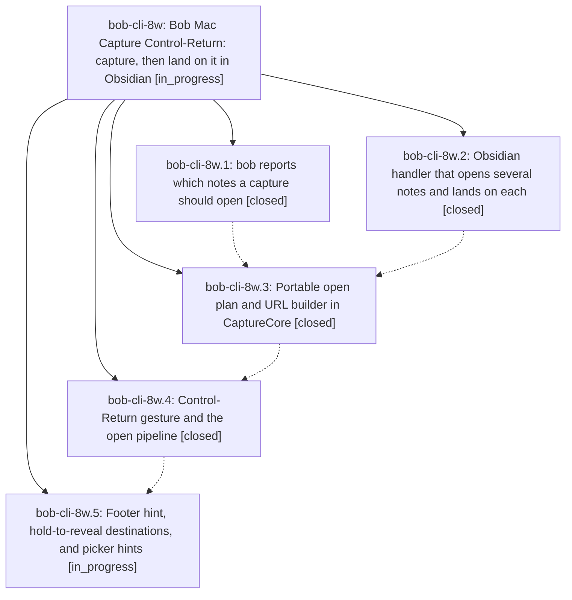

# Bead: bob-cli-8w — Bob Mac Capture Control-Return: capture, then land on it in Obsidian

[Bead Pages](../README.md) / bob-cli-8w

**Status:** ◐ in_progress · **Type:** ▸ plan · **Tier:** epic
**Owner:** `bryanbugyi34@gmail.com` · **Created by:** [bbugyi200.apollo.8q](https://github.com/bobs-org/bob-cli--agents/blob/main/sessions/bbugyi200.apollo.8q.md) · **Assignee:** `bob-cli-8w.land`
**Created:** 2026-10-17 15:54:14 EDT
**Plan:** [202610/ctrl\_enter\_capture\_and\_open.md](https://github.com/bobs-org/bob-cli--plans/blob/main/202610/ctrl_enter_capture_and_open.md)

<!-- sase:links:start -->

## Links

| Relation | Artifact | Why |
| --- | --- | --- |
| implemented-by | [plan:202610/ctrl_enter_capture_and_open.md][1] | derived from the plan's `bead_id:` frontmatter field |

_Plus 1 automatic references — see [Referenced By](#referenced-by)._

[1]: https://github.com/bobs-org/bob-cli--plans/blob/main/202610/ctrl_enter_capture_and_open.md

<!-- sase:links:end -->

## Description

In Bob Mac Capture, Control-Return captures the draft, then brings Obsidian forward with every note the capture changed open in its own tab. The caret sits on the exact line that changed, which gets a short highlight. bob decides what to open, so the app stays a thin client. One Obsidian URL carries the whole list, so tabs never replace each other. The panel shows beforehand what Control-Return will open.

## Notes

[2026-10-17T21:03:15Z · 117] DISCOVERED ISSUE: bob-plugins README.md now contains its first ~280 lines three times. Commit 3e359a6 (bob-cli-8w.2, 'add open notes URI handler') added 566 README lines: '## Task Card' appears at lines 50, 326 and 588 (1087 lines total vs one copy at 3e359a6~1), and the three copies differ slightly. Impact: every later README edit (e.g. the planned Ctrl+Shift+Alt+B Blocks stage docs) must touch three copies or dedupe first. Fix: restore the single copy from 3e359a6~1 plus the intended open-notes URI handler paragraph.

## Phases

| Bead | Title | Status | Size | Created | Agents | Commits |
|---|---|---|---|---|---:|---:|
| [bob-cli-8w.1](bob-cli-8w.1.md) | bob reports which notes a capture should open | ✓ closed | medium | 2026-10-17 | 1 | 1 |
| [bob-cli-8w.2](bob-cli-8w.2.md) | Obsidian handler that opens several notes and lands on each | ✓ closed | medium | 2026-10-17 | 1 | 0 |
| [bob-cli-8w.3](bob-cli-8w.3.md) | Portable open plan and URL builder in CaptureCore | ✓ closed | small | 2026-10-17 | 1 | 1 |
| [bob-cli-8w.4](bob-cli-8w.4.md) | Control-Return gesture and the open pipeline | ✓ closed | medium | 2026-10-17 | 1 | 1 |
| [bob-cli-8w.5](bob-cli-8w.5.md) | Footer hint, hold-to-reveal destinations, and picker hints | ◐ in_progress | medium | 2026-10-17 | 1 | 0 |

## Lineage

## Agents

| Agent | Bead | Commits |
|---|---|---:|
| [bbugyi200.apollo.bob-cli-8w.1](https://github.com/bobs-org/bob-cli--agents/blob/main/agents/bbugyi200.apollo.bob-cli-8w.1/README.md) | [bob-cli-8w.1](bob-cli-8w.1.md) | 1 |
| [bbugyi200.apollo.bob-cli-8w.2](https://github.com/bobs-org/bob-cli--agents/blob/main/sessions/bbugyi200.apollo.bob-cli-8w.2.md) | [bob-cli-8w.2](bob-cli-8w.2.md) | 0 |
| [bbugyi200.apollo.bob-cli-8w.3](https://github.com/bobs-org/bob-cli--agents/blob/main/agents/bbugyi200.apollo.bob-cli-8w.3/README.md) | [bob-cli-8w.3](bob-cli-8w.3.md) | 1 |
| [bbugyi200.apollo.bob-cli-8w.4](https://github.com/bobs-org/bob-cli--agents/blob/main/sessions/bbugyi200.apollo.bob-cli-8w.4.md) | [bob-cli-8w.4](bob-cli-8w.4.md) | 1 |
| [bbugyi200.apollo.bob-cli-8w.5](https://github.com/bobs-org/bob-cli--agents/blob/main/agents/bbugyi200.apollo.bob-cli-8w.5/README.md) | [bob-cli-8w.5](bob-cli-8w.5.md) | 0 |
| [bbugyi200.apollo.bob-cli-8w.land](https://github.com/bobs-org/bob-cli--agents/blob/main/agents/bbugyi200.apollo.bob-cli-8w.land/README.md) | [bob-cli-8w](README.md) | 0 |

## Commits

| Repo | Commit | Subject | Bead | Committed |
|---|---|---|---|---|
| bob-cli | [`8b6ca21`](https://github.com/bobs-org/bob-cli/commit/8b6ca217377c327843e28285bce7d7b93a360005) | feat(capture): emit batch-level open\_notes in JSON | [bob-cli-8w.1](bob-cli-8w.1.md) | 2026-10-17 16:34:30 EDT |
| bob-mac-capture | [`bob-mac-capture@a924620`](https://github.com/bobs-org/bob-mac-capture/commit/a924620ae097ab3ce4865cf2c54c16fbc505a9dc) | feat(capture): add portable open plan and URI builder | [bob-cli-8w.3](bob-cli-8w.3.md) | 2026-10-17 16:45:03 EDT |
| bob-mac-capture | [`bob-mac-capture@57406f8`](https://github.com/bobs-org/bob-mac-capture/commit/57406f81d47b52cb5e22b9675a01aae98e0cf446) | feat(capture): add Control-Return open pipeline | [bob-cli-8w.4](bob-cli-8w.4.md) | 2026-10-17 17:06:24 EDT |

<!-- sase:referenced-by:start -->

## Referenced By

| Relation | Artifact | Why | Uses |
| --- | --- | --- | ---: |
| read-by | [agent:bob-cli-8w.1][1] | Need parent epic DECISIONS and full plan context | 1 |

[1]: https://github.com/bobs-org/bob-cli--agents/blob/main/agents/bbugyi200.apollo.bob-cli-8w.1/README.md

<!-- sase:referenced-by:end -->
