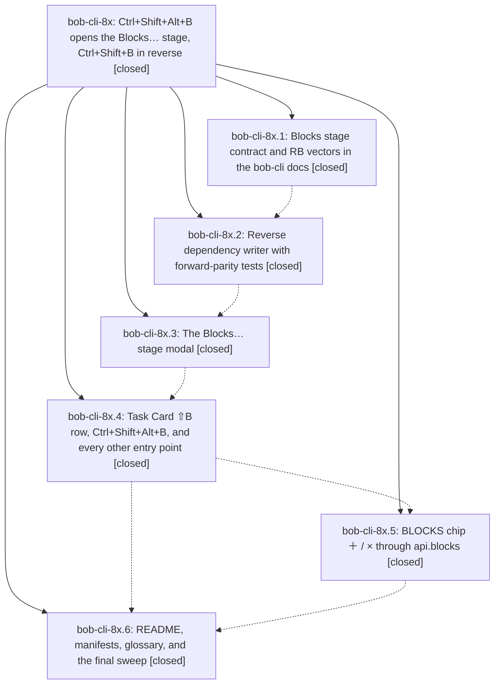

# Bead: bob-cli-8x — Ctrl+Shift+Alt+B opens the Blocks… stage, Ctrl+Shift+B in reverse

[Bead Pages](../README.md) / bob-cli-8x

**Status:** ✓ closed · **Resolution:** done · **Type:** ▸ plan · **Tier:** epic
**Owner:** `bryanbugyi34@gmail.com` · **Created by:** [bbugyi200.athena.117](https://github.com/bobs-org/bob-cli--agents/blob/main/sessions/bbugyi200.athena.117.md) · **Assignee:** `bob-cli-8x.land`
**Created:** 2026-10-17 17:11:59 EDT · **Closed:** 2026-10-17 21:16:22 EDT
**Plan:** [202610/ctrl\_shift\_alt\_b\_blocks\_stage.md](https://github.com/bobs-org/bob-cli--plans/blob/main/202610/ctrl_shift_alt_b_blocks_stage.md)

<!-- sase:links:start -->

## Links

| Relation | Artifact | Why |
| --- | --- | --- |
| implemented-by | [plan:202610/ctrl_shift_alt_b_blocks_stage.md][1] | derived from the plan's `bead_id:` frontmatter field |
| related | [bead:bob-cli-8z][2] | bob-cli-8x changed BLOCKS_GENERATED_LINE_NOTICE copy and its remaining-work plan touches the same BLOCKS-line refusals |

[1]: https://github.com/bobs-org/bob-cli--plans/blob/main/202610/ctrl_shift_alt_b_blocks_stage.md
[2]: https://github.com/bobs-org/bob-cli--beads/blob/main/pages/bob-cli-8z/README.md

<!-- sase:links:end -->

## Description

In Obsidian, Ctrl+Shift+Alt+B on task N (Task Card ⇧B) opens a Blocks… stage where Bryan picks the open tasks T that N blocks. Applying it writes N onto each T's Depends-On line. The bytes are exactly what Ctrl+Shift+B on T adding N would write: T becomes Blocked, its live links in today's Pomodoros are consumed, N takes over its lane, and N's BLOCKS mirror is updated. The stage previews every consequence before ↵, and BLOCKS chips gain ＋ / ×.

## Notes

[2026-10-18T00:41:13Z · bob-cli-8x.land] LAND TRIAGE (bob-cli-8x.land): Every child PROPOSED FOLLOW-UP (8x.2, 8x.3, 8x.4, 8x.5, 8x.6) reported the same six pre-existing bob-plugins npm test failures. I reproduced them at master 96a42c5 (2990 tests, 2984 pass, 6 fail) and corroborated the existing beads with +1 instead of filing new ones: bob-cli-6v (four unblocked-glyph cases), bob-cli-6w (Keep counts once), and bob-cli-7i (forward conversion / reverse BLOCKS). None was caused by this epic. The land audit also found one distinct pre-existing gap, filed as bob-cli-8z: nav ! on a BLOCKS line says 'No links found', but §14.8 has promised the generated-line notice since before this epic. Integration: none of the commits since the epic started overlap the Blocks feature, so nothing needs changing. Those are bob-cli b59af42, 8b6ca21, b5adef5, 4052bd7, and 860f0be, and bob-plugins 1b74d6c and bca788d (1b74d6c already deduplicated the README). The 96a42c5 CLAUDE.md rewrite and GEMINI/OPENCODE/QWEN.md deletions match the same agent-file migration bob-cli took in 5af6521, so I am not reverting them. Epic-symbols: none.

[2026-10-18T00:44:35Z · bob-cli-8x.land] LAND AUDIT (bob-cli-8x.land): The epic is NOT complete. I read the code and reproduced the defects with in-memory harness runs. All are epic-caused.
Writer:
- Same-note rows keep stale line indexes after N's BLOCKS line is inserted, so the wrong task gets blocked or stamped (084 ~519).
- The mirror and committed refs read stale lines, so N's BLOCKS can list a bystander (592 ~376/~449).
- Notices name N instead of T (084 ~562).
- Mixed same-note plus cross-note picks drop N's lane rise (084 ~616).
- The stage passes its snapshot as both expected and files, so the changed-since-open check never fires (425 ~364, 592 ~104).
- Pomodoro links are consumed even for T's whose write failed (592 ~337).
- Guards are skipped for closed-note T's (malformed line, sub-project, ^prj resident cycle).
- ^prj removal recovery uses N's path for the daily-note flag (592 ~249).
Forward regressions:
- 550 now redirects every child line of a task to its owner, which breaks Ctrl+Shift+P on plain child bullets and nested Task Links.
- 410 moved the mixed counted badge ahead of 🔒 / −.
Missing:
- Ctrl+Shift+P on a BLOCKS line still opens the Task Card. The test exercises only the palette command.
- A blockquoted N is not refused.
- block-id-prompt's TASK_BLOCKS_LINE_NOTICE still has the old copy.
- Copy and doc drift remains in the README, manifest, and TD §2.4, §13.7, §14.1, §9, and §15.
Declined, with reasons: whole-strip warning color (cosmetic); ledger × double notice (same as the forward Depends-On ×); the BLOCKS widget mousedown handler (harmless parity with Depends-On); a second counted source-note partial write (only a sub-second race remains once the live stale check lands); §6.1 table order and the '0 tasks' detail (cosmetic). Remaining work is planned as a tale whose final step closes bob-cli-8x and bob-cli-3p.

[2026-10-18T01:16:22Z · bob-cli-8x.land] Landing of the Blocks… stage (Ctrl+Shift+Alt+B, Task Card ⇧B, api.blocks, BLOCKS chip ＋/×). Phases: all six phases (8x.1–8x.6) were verified against the plan by the land audit; the defects that audit found are fixed here (plan 202610/land_blocks_stage_fixes.md). Fixes: writer re-location of rows after every per-T plan (line-edit tracking, T stamped at its post-plan line, final line/block id carried out of the planner); shared forward stamp fix (applyDependencyEdit stamps the dependent's post-plan line) with a forward regression test; identity-based mirror and committed refs (N located by block id); notices name T (add, remove, project, counted; chip × shares the writer); mixed same-note and cross-note picks keep N's lane rise, and a preparation no write can carry fails the plan (unexpected-preparation); live changed-since-open check (live reads of every touched note vs the stage's open-time snapshot plus staged rawLine, stage no longer passes vaultStage.files, stale notice returned once and shown by the caller once); Pomodoro links consumed only for T's that committed, counts from what was removed; apply-time preflight guards on the trial graph (malformed Depends-On, project descendant, resident/plain cycles) with a 🧱 refusal that writes nothing; ^prj removal recovery uses T's path for the daily-note flag; Ctrl+Shift+P redirect restricted to Depends-On/BLOCKS lines (plain child bullet and nested Task Link unchanged; BLOCKS line and Ctrl+Shift+Alt+B open the owner's Blocks stage) with hotkey-path tests; forward counted badge order restored (reverse gated on blocksStage); blockquoted N refusal; card copy without 🧱 for a finished N (entry Notice keeps it); block-id-prompt twin notice; removeDependent returns not-a-dependent for an owner with no id; strip/subtitle copy (pluralization, removals-only, no lane promise for a project N, counted subtitle, BLOCKED-row count after the add); today-links read kept across a pool refresh; dead code removed (blocksStripText, void self, pendingMirrors). Versions: nav 2.45.1, block-id-prompt 1.33.2, ledger-tools 1.51.1 (widget dead-code removal); README, nav manifest, docs/task-dependencies.md §2.4/§9/§13.7/§14.1/§15.2–15.8, freshness.md, projects.md updated. Tests: bob-plugins npm test 3013 tests, 3007 pass, 6 fail — exactly the known six (bob-cli-6v x4: unblocked-glyph cases; bob-cli-6w: Keep counts once; bob-cli-7i: forward conversion/reverse BLOCKS) vs 2990/2984/6 at 96a42c5, i.e. 23 new tests; every new test aimed at a fixed defect fails on 96a42c5 and passes now; npm run validate 7/7; bob plugins sync deployed; bob-cli just check passes. Follow-ups: 6v / 6w / 7i corroborated and bob-cli-8z (nav ! on a BLOCKS line) filed by the land audit, untouched here. Integration: no overlap from the seven post-start commits (land audit). Declined audit items, not done: warning-colored whole strip on ⚠, ledger × failure double notice (same as forward Depends-On ×), BLOCKS widget mousedown without api.blocks, second counted source note after the first was written (only a sub-second race remains once live content is compared first), §6.1 table order and the '0 tasks' card detail. No Symvision epic symbols and no just symvision recipe exist.

## Phases

| Bead | Title | Status | Size | Created | Agents | Commits |
|---|---|---|---|---|---:|---:|
| [bob-cli-8x.1](bob-cli-8x.1.md) | Blocks stage contract and RB vectors in the bob-cli docs | ✓ closed | medium | 2026-10-17 | 1 | 1 |
| [bob-cli-8x.2](bob-cli-8x.2.md) | Reverse dependency writer with forward-parity tests | ✓ closed | medium | 2026-10-17 | 1 | 1 |
| [bob-cli-8x.3](bob-cli-8x.3.md) | The Blocks… stage modal | ✓ closed | medium | 2026-10-17 | 1 | 1 |
| [bob-cli-8x.4](bob-cli-8x.4.md) | Task Card ⇧B row, Ctrl+Shift+Alt+B, and every other entry point | ✓ closed | medium | 2026-10-17 | 1 | 1 |
| [bob-cli-8x.5](bob-cli-8x.5.md) | BLOCKS chip ＋ / × through api.blocks | ✓ closed | small | 2026-10-17 | 1 | 1 |
| [bob-cli-8x.6](bob-cli-8x.6.md) | README, manifests, glossary, and the final sweep | ✓ closed | small | 2026-10-17 | 1 | 2 |

## Lineage

## Agents

| Agent | Bead | Commits |
|---|---|---:|
| [bbugyi200.athena.bob-cli-8x.1](https://github.com/bobs-org/bob-cli--agents/blob/main/agents/bbugyi200.athena.bob-cli-8x.1/README.md) | [bob-cli-8x.1](bob-cli-8x.1.md) | 1 |
| [bbugyi200.athena.bob-cli-8x.2](https://github.com/bobs-org/bob-cli--agents/blob/main/agents/bbugyi200.athena.bob-cli-8x.2/README.md) | [bob-cli-8x.2](bob-cli-8x.2.md) | 1 |
| [bbugyi200.athena.bob-cli-8x.3](https://github.com/bobs-org/bob-cli--agents/blob/main/agents/bbugyi200.athena.bob-cli-8x.3/README.md) | [bob-cli-8x.3](bob-cli-8x.3.md) | 1 |
| [bbugyi200.athena.bob-cli-8x.4](https://github.com/bobs-org/bob-cli--agents/blob/main/agents/bbugyi200.athena.bob-cli-8x.4/README.md) | [bob-cli-8x.4](bob-cli-8x.4.md) | 1 |
| [bbugyi200.athena.bob-cli-8x.5](https://github.com/bobs-org/bob-cli--agents/blob/main/agents/bbugyi200.athena.bob-cli-8x.5/README.md) | [bob-cli-8x.5](bob-cli-8x.5.md) | 1 |
| [bbugyi200.athena.bob-cli-8x.6](https://github.com/bobs-org/bob-cli--agents/blob/main/agents/bbugyi200.athena.bob-cli-8x.6/README.md) | [bob-cli-8x.6](bob-cli-8x.6.md) | 2 |
| [bbugyi200.athena.bob-cli-8x.land](https://github.com/bobs-org/bob-cli--agents/blob/main/sessions/bbugyi200.athena.bob-cli-8x.land.md) | [bob-cli-8x](README.md) | 1 |

## Commits

| Repo | Commit | Subject | Bead | Committed |
|---|---|---|---|---|
| bob-cli | [`30bdfb8`](https://github.com/bobs-org/bob-cli/commit/30bdfb8900be9cc7a24dc534e73f9e0712a2b5c7) | docs(task-dependencies): document reverse Blocks stage contract | [bob-cli-8x.1](bob-cli-8x.1.md) | 2026-10-17 17:26:11 EDT |
| bob-plugins | [`bob-plugins@8ca6a65`](https://github.com/bobs-org/bob-plugins/commit/8ca6a65eeca6b6f34403ae2e9840896e42a8cf1a) | feat(nav): add reverse Blocks writer with forward-parity tests | [bob-cli-8x.2](bob-cli-8x.2.md) | 2026-10-17 18:22:11 EDT |
| bob-plugins | [`bob-plugins@e3f3329`](https://github.com/bobs-org/bob-plugins/commit/e3f3329d9843cb6dbc2200652cf24754191720ca) | feat(nav): add reverse Blocks stage modal | [bob-cli-8x.3](bob-cli-8x.3.md) | 2026-10-17 19:04:26 EDT |
| bob-plugins | [`bob-plugins@10d12f4`](https://github.com/bobs-org/bob-plugins/commit/10d12f42aeb3944fe0ed54fa7c3c3da5c501486c) | feat(navigation): add Task Card Blocks entry points | [bob-cli-8x.4](bob-cli-8x.4.md) | 2026-10-17 19:28:45 EDT |
| bob-plugins | [`bob-plugins@254b32b`](https://github.com/bobs-org/bob-plugins/commit/254b32ba0ee7e54fc0a922de9fbf501701ae9540) | feat(ledger-tools): add BLOCKS chip ＋ / × through api.blocks | [bob-cli-8x.5](bob-cli-8x.5.md) | 2026-10-17 19:54:07 EDT |
| bob-cli | [`3ec4d0d`](https://github.com/bobs-org/bob-cli/commit/3ec4d0d232dbb178e01d0b4fe0761a66323f547f) | docs(dependencies): clarify editing from both ends | [bob-cli-8x.6](bob-cli-8x.6.md) | 2026-10-17 20:08:44 EDT |
| bob-plugins | [`bob-plugins@96a42c5`](https://github.com/bobs-org/bob-plugins/commit/96a42c56e9d338c0fd013cce4c1187bcba8b2b04) | docs(plugins): publish reverse Blocks stage gestures | [bob-cli-8x.6](bob-cli-8x.6.md) | 2026-10-17 20:09:51 EDT |
| bob-cli | [`30eafe2`](https://github.com/bobs-org/bob-cli/commit/30eafe28067dc98d3acfc1dded118471051e9201) | docs(task-dependencies): document Blocks stage apply-time guards and writer contract | [bob-cli-8x](README.md) | 2026-10-17 21:18:16 EDT |
