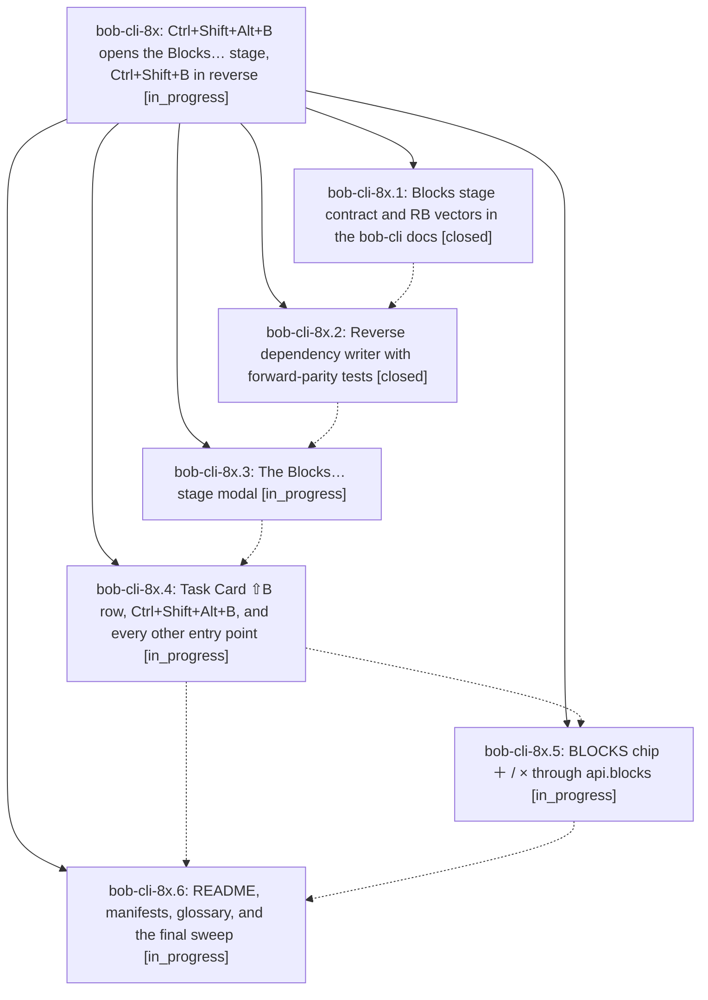

# Bead: bob-cli-8x — Ctrl+Shift+Alt+B opens the Blocks… stage, Ctrl+Shift+B in reverse

[Bead Pages](../README.md) / bob-cli-8x

**Status:** ◐ in_progress · **Type:** ▸ plan · **Tier:** epic
**Owner:** `bryanbugyi34@gmail.com` · **Created by:** [bbugyi200.athena.117](https://github.com/bobs-org/bob-cli--agents/blob/main/sessions/bbugyi200.athena.117.md) · **Assignee:** `bob-cli-8x.land`
**Created:** 2026-10-17 17:11:59 EDT
**Plan:** [202610/ctrl\_shift\_alt\_b\_blocks\_stage.md](https://github.com/bobs-org/bob-cli--plans/blob/main/202610/ctrl_shift_alt_b_blocks_stage.md)

<!-- sase:links:start -->

## Links

| Relation | Artifact | Why |
| --- | --- | --- |
| implemented-by | [plan:202610/ctrl_shift_alt_b_blocks_stage.md][1] | derived from the plan's `bead_id:` frontmatter field |

[1]: https://github.com/bobs-org/bob-cli--plans/blob/main/202610/ctrl_shift_alt_b_blocks_stage.md

<!-- sase:links:end -->

## Description

In Obsidian, Ctrl+Shift+Alt+B on task N (Task Card ⇧B) opens a Blocks… stage where Bryan picks the open tasks T that N blocks. Applying it writes N onto each T's Depends-On line. The bytes are exactly what Ctrl+Shift+B on T adding N would write: T becomes Blocked, its live links in today's Pomodoros are consumed, N takes over its lane, and N's BLOCKS mirror is updated. The stage previews every consequence before ↵, and BLOCKS chips gain ＋ / ×.

## Phases

| Bead | Title | Status | Size | Created | Agents | Commits |
|---|---|---|---|---|---:|---:|
| [bob-cli-8x.1](bob-cli-8x.1.md) | Blocks stage contract and RB vectors in the bob-cli docs | ✓ closed | medium | 2026-10-17 | 1 | 1 |
| [bob-cli-8x.2](bob-cli-8x.2.md) | Reverse dependency writer with forward-parity tests | ✓ closed | medium | 2026-10-17 | 1 | 1 |
| [bob-cli-8x.3](bob-cli-8x.3.md) | The Blocks… stage modal | ◐ in_progress | medium | 2026-10-17 | 1 | 0 |
| [bob-cli-8x.4](bob-cli-8x.4.md) | Task Card ⇧B row, Ctrl+Shift+Alt+B, and every other entry point | ◐ in_progress | medium | 2026-10-17 | 1 | 0 |
| [bob-cli-8x.5](bob-cli-8x.5.md) | BLOCKS chip ＋ / × through api.blocks | ◐ in_progress | small | 2026-10-17 | 1 | 0 |
| [bob-cli-8x.6](bob-cli-8x.6.md) | README, manifests, glossary, and the final sweep | ◐ in_progress | small | 2026-10-17 | 1 | 0 |

## Lineage

## Agents

| Agent | Bead | Commits |
|---|---|---:|
| [bbugyi200.athena.bob-cli-8x.1](https://github.com/bobs-org/bob-cli--agents/blob/main/agents/bbugyi200.athena.bob-cli-8x.1/README.md) | [bob-cli-8x.1](bob-cli-8x.1.md) | 1 |
| [bbugyi200.athena.bob-cli-8x.2](https://github.com/bobs-org/bob-cli--agents/blob/main/agents/bbugyi200.athena.bob-cli-8x.2/README.md) | [bob-cli-8x.2](bob-cli-8x.2.md) | 1 |
| [bbugyi200.athena.bob-cli-8x.3](https://github.com/bobs-org/bob-cli--agents/blob/main/agents/bbugyi200.athena.bob-cli-8x.3/README.md) | [bob-cli-8x.3](bob-cli-8x.3.md) | 0 |
| [bbugyi200.athena.bob-cli-8x.4](https://github.com/bobs-org/bob-cli--agents/blob/main/agents/bbugyi200.athena.bob-cli-8x.4/README.md) | [bob-cli-8x.4](bob-cli-8x.4.md) | 0 |
| [bbugyi200.athena.bob-cli-8x.5](https://github.com/bobs-org/bob-cli--agents/blob/main/agents/bbugyi200.athena.bob-cli-8x.5/README.md) | [bob-cli-8x.5](bob-cli-8x.5.md) | 0 |
| [bbugyi200.athena.bob-cli-8x.6](https://github.com/bobs-org/bob-cli--agents/blob/main/agents/bbugyi200.athena.bob-cli-8x.6/README.md) | [bob-cli-8x.6](bob-cli-8x.6.md) | 0 |
| [bbugyi200.athena.bob-cli-8x.land](https://github.com/bobs-org/bob-cli--agents/blob/main/agents/bbugyi200.athena.bob-cli-8x.land/README.md) | [bob-cli-8x](README.md) | 0 |

## Commits

| Repo | Commit | Subject | Bead | Committed |
|---|---|---|---|---|
| bob-cli | [`30bdfb8`](https://github.com/bobs-org/bob-cli/commit/30bdfb8900be9cc7a24dc534e73f9e0712a2b5c7) | docs(task-dependencies): document reverse Blocks stage contract | [bob-cli-8x.1](bob-cli-8x.1.md) | 2026-10-17 17:26:11 EDT |
| bob-plugins | [`bob-plugins@8ca6a65`](https://github.com/bobs-org/bob-plugins/commit/8ca6a65eeca6b6f34403ae2e9840896e42a8cf1a) | feat(nav): add reverse Blocks writer with forward-parity tests | [bob-cli-8x.2](bob-cli-8x.2.md) | 2026-10-17 18:22:11 EDT |
