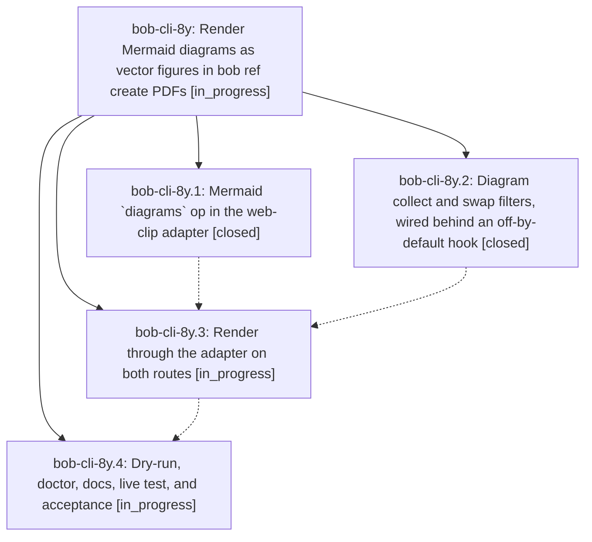

# Bead: bob-cli-8y — Render Mermaid diagrams as vector figures in bob ref create PDFs

[Bead Pages](../README.md) / bob-cli-8y

**Status:** ◐ in_progress · **Type:** ▸ plan · **Tier:** epic
**Owner:** `bryanbugyi34@gmail.com` · **Created by:** [bbugyi200.athena.research.4r.linker.w0](https://github.com/bobs-org/bob-cli--agents/blob/main/sessions/bbugyi200.athena.research.4r.linker.w0.md) · **Assignee:** `bob-cli-8y.land`
**Created:** 2026-10-17 19:29:16 EDT
**Plan:** [202610/ref\_create\_mermaid\_figures.md](https://github.com/bobs-org/bob-cli--plans/blob/main/202610/ref_create_mermaid_figures.md)

<!-- sase:links:start -->

## Links

| Relation | Artifact | Why |
| --- | --- | --- |
| implemented-by | [plan:202610/ref_create_mermaid_figures.md][1] | derived from the plan's `bead_id:` frontmatter field |

[1]: https://github.com/bobs-org/bob-cli--plans/blob/main/202610/ref_create_mermaid_figures.md

<!-- sase:links:end -->

## Description

Explicit Mermaid code blocks in Markdown and vault-note imports print as fitted, selectable, Highlights-safe vector figures instead of wrapped source. Rendering is offline and pinned, costs about one browser launch per document, and a broken diagram or missing renderer degrades visibly without ever failing the import.

## Phases

| Bead | Title | Status | Size | Created | Agents | Commits |
|---|---|---|---|---|---:|---:|
| [bob-cli-8y.1](bob-cli-8y.1.md) | Mermaid \`diagrams\` op in the web-clip adapter | ✓ closed | medium | 2026-10-17 | 1 | 1 |
| [bob-cli-8y.2](bob-cli-8y.2.md) | Diagram collect and swap filters, wired behind an off-by-default hook | ✓ closed | medium | 2026-10-17 | 1 | 0 |
| [bob-cli-8y.3](bob-cli-8y.3.md) | Render through the adapter on both routes | ◐ in_progress | medium | 2026-10-17 | 1 | 0 |
| [bob-cli-8y.4](bob-cli-8y.4.md) | Dry-run, doctor, docs, live test, and acceptance | ◐ in_progress | medium | 2026-10-17 | 1 | 0 |

## Lineage

## Agents

| Agent | Bead | Commits |
|---|---|---:|
| [bbugyi200.athena.bob-cli-8y.1](https://github.com/bobs-org/bob-cli--agents/blob/main/sessions/bbugyi200.athena.bob-cli-8y.1.md) | [bob-cli-8y.1](bob-cli-8y.1.md) | 1 |
| [bbugyi200.athena.bob-cli-8y.2](https://github.com/bobs-org/bob-cli--agents/blob/main/sessions/bbugyi200.athena.bob-cli-8y.2.md) | [bob-cli-8y.2](bob-cli-8y.2.md) | 0 |
| [bbugyi200.athena.bob-cli-8y.3](https://github.com/bobs-org/bob-cli--agents/blob/main/agents/bbugyi200.athena.bob-cli-8y.3/README.md) | [bob-cli-8y.3](bob-cli-8y.3.md) | 0 |
| [bbugyi200.athena.bob-cli-8y.4](https://github.com/bobs-org/bob-cli--agents/blob/main/agents/bbugyi200.athena.bob-cli-8y.4/README.md) | [bob-cli-8y.4](bob-cli-8y.4.md) | 0 |
| [bbugyi200.athena.bob-cli-8y.land](https://github.com/bobs-org/bob-cli--agents/blob/main/agents/bbugyi200.athena.bob-cli-8y.land/README.md) | [bob-cli-8y](README.md) | 0 |

## Commits

| Repo | Commit | Subject | Bead | Committed |
|---|---|---|---|---|
| bob-cli | [`54670b4`](https://github.com/bobs-org/bob-cli/commit/54670b4535e3328f5ec1e54c574ff4e7ac8925de) | feat(web-clip): add offline Mermaid diagram rendering | [bob-cli-8y.1](bob-cli-8y.1.md) | 2026-10-17 20:34:41 EDT |
