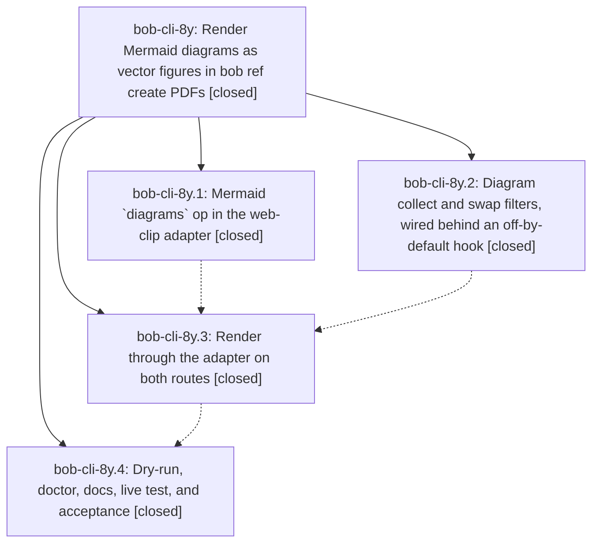

# Bead: bob-cli-8y — Render Mermaid diagrams as vector figures in bob ref create PDFs

[Bead Pages](../README.md) / bob-cli-8y

**Status:** ✓ closed · **Resolution:** done · **Type:** ▸ plan · **Tier:** epic
**Owner:** `bryanbugyi34@gmail.com` · **Created by:** [bbugyi200.athena.research.4r.linker.w0](https://github.com/bobs-org/bob-cli--agents/blob/main/sessions/bbugyi200.athena.research.4r.linker.w0.md) · **Assignee:** `bob-cli-8y.land`
**Created:** 2026-10-17 19:29:16 EDT · **Closed:** 2026-10-17 23:00:29 EDT
**Plan:** [202610/ref\_create\_mermaid\_figures.md](https://github.com/bobs-org/bob-cli--plans/blob/main/202610/ref_create_mermaid_figures.md)

<!-- sase:links:start -->

## Links

| Relation | Artifact | Why |
| --- | --- | --- |
| implemented-by | [plan:202610/ref_create_mermaid_figures.md][1] | derived from the plan's `bead_id:` frontmatter field |

[1]: https://github.com/bobs-org/bob-cli--plans/blob/main/202610/ref_create_mermaid_figures.md

<!-- sase:links:end -->

## Description

Explicit Mermaid code blocks in Markdown and vault-note imports print as fitted, selectable, Highlights-safe vector figures instead of wrapped source. Rendering is offline and pinned, costs about one browser launch per document, and a broken diagram or missing renderer degrades visibly without ever failing the import.

## Notes

[2026-10-18T02:34:43Z · bob-cli-8y.land] LAND FOLLOW-UP TRIAGE at 99b2ac4: Read every note on bob-cli-8y.1/.2/.3/.4 and collected all PROPOSED FOLLOW-UP entries. Used /sase_new_task, read type/size policy, searched all statuses, swept last-week tasks, and inspected all active epic scopes (including bob-cli-87 and its print-profile phase). Outcomes for eight distinct proposals: (1) skipped decision record, 8y.1 #1 + 8y.2 #1 + 8y.3 #1 + 8y.4 #8 -> bob-cli-90, small memory task, ready, related to bob-cli-8p. No memory edited; separate explicit approval remains required. (2) prepared completion missing_required_stage:formatting, 8y.2 #3 -> bob-cli-91, large bug, ready. Confirmed just check has cargo fmt/clippy/tests but no CHECK_STAGES and sase tool list has no named tools; prepared-completion failure evidence is the proposing phase's record, not a fresh failure induced here. (3) landscape pages, 8y.4 #3, and (6) flowchart TD/short-label authoring nudge, 8y.4 #6 -> combined bob-cli-92, large feature, ready: both address the measured 46%/49% small-label issue from 8y.4 #1; one task evaluates the smallest useful remedy. (4) SVG embeds, 8y.4 #4 -> bob-cli-93, large feature, ready, related to bob-cli-85 for font context. SVG placeholders are explicit existing policy in assets.rs and docs, not unfinished Mermaid or snapshot work. (5) listen-skip marker, 8y.4 #5 -> declined now: no narrated-diagram failure or requested interaction demonstrated; A10 excludes it. (7) browser-free mmdr/svg2pdf, 8y.4 #7 -> declined now: no new fixture fidelity/selectable-text evidence reopens the rejected backend. (8) installed-bob deployment, 8y.4 #9 -> operational reminder only, no task: the epic explicitly forbids just install; research hooks gain the feature on the next planned Bob deployment. Carry every outcome into the eventual close note; do not file duplicates.

[2026-10-18T02:34:46Z · bob-cli-8y.land] LAND AUDIT at 99b2ac4: Reviewed original epic scope/DECISIONS/plan, all four closed children and every note, actual adapter/collect/swap/orchestration/route/doctor/docs/test source, and epic commits 54670b4, ad036f9, 58c9614, 99b2ac4. Phase .2 temporary off-by-default hook is now wired; .3 ETXTBSY scratch+cp repair is present. .4 notes record real Athena 12/12 rendering, +4.70s batch delta, no Type3/raster rows and clean body checks; the Mac manual checklist honors mac_check=manual and no memory edits honor decision_record=no. Reviewed post-start non-epic drift: 860f0be and 724333f snapshot projection/file-link/profile/corpus fixes precede Mermaid collection and preserve AST images through the final profile; 3ec4d0d/30eafe2 dependency docs need no Mermaid integration. Fresh origin fetch matched 99b2ac4. No --epic-symbol entries; just --summary contains no symvision recipe; parent_id is null.

Two epic-caused defects remain and prevent closure. (A) parse_manifest discards first occurrence positions, and first_occurrence sums counts of preceding unique sources. Real scratch CLI reproduction with A,B,A and a stub that rejects B exits 0 and reports rendered 2 of 3, but warns diagram 3 of 3 instead of 2 of 3. (B) prescan misses Pandoc definition-list fence prefixes. Input Term followed by ':   ```mermaid', four-space-indented flowchart LR / A --> B / closing fence is a Mermaid CodeBlock inside DefinitionList according to pandoc -f markdown -t json. Current workspace bob dry-run reports no diagram count, and actual import silently prints source without a fallback note or warning even with a deliberately nonexistent adapter. The '~   ~~~mermaid' definition variant also parses as a Mermaid CodeBlock and is missed. Scratch imports used the workspace build and separate vaults; no installed Bob or real vault changes. Preparing a validated medium tale, sase_plan_mermaid_landing_repairs.md, covering only these fixes and their regressions plus this epic's full closeout. The tale coder must run just check and adapter/live verification, resolve epic symbols, close bob-cli-8y normally, run symvision if available, and mark plan:202610/ref_create_mermaid_figures.md done in the same coding turn; no wait for its own commit/push/CI. Full gate rerun is assigned to that implementation; no just check-full run.

[2026-10-18T03:00:29Z · bob-cli-8y.land--1] Verified just check and check-web-clip-adapter succeeded with origin/master at 0/0 drift. The live Mermaid PDF test executed, not skipped, and passed font, no-raster, malformed-fence fallback, and long-TMPDIR assertions; the full check reported 2,922 passing tests. Follow-up triage outcomes: (1) decision record skipped and task bob-cli-90 filed; (2) missing formatting stage recorded in bob-cli-91; (3) landscape pages and (6) flowchart/short-label authoring were combined in bob-cli-92; (4) SVG embeds recorded in bob-cli-93; (5) listen-skip declined; (7) browser-free backend declined; (8) installed-Bob deployment remains an operational reminder. Mac acceptance remains a manual reminder for Bryan and was not performed here.

## Phases

| Bead | Title | Status | Size | Created | Agents | Commits |
|---|---|---|---|---|---:|---:|
| [bob-cli-8y.1](bob-cli-8y.1.md) | Mermaid \`diagrams\` op in the web-clip adapter | ✓ closed | medium | 2026-10-17 | 1 | 1 |
| [bob-cli-8y.2](bob-cli-8y.2.md) | Diagram collect and swap filters, wired behind an off-by-default hook | ✓ closed | medium | 2026-10-17 | 1 | 1 |
| [bob-cli-8y.3](bob-cli-8y.3.md) | Render through the adapter on both routes | ✓ closed | medium | 2026-10-17 | 1 | 1 |
| [bob-cli-8y.4](bob-cli-8y.4.md) | Dry-run, doctor, docs, live test, and acceptance | ✓ closed | medium | 2026-10-17 | 1 | 1 |

## Lineage



## Agents

| Agent | Bead | Commits |
|---|---|---:|
| [bbugyi200.athena.bob-cli-8y.1](https://github.com/bobs-org/bob-cli--agents/blob/main/sessions/bbugyi200.athena.bob-cli-8y.1.md) | [bob-cli-8y.1](bob-cli-8y.1.md) | 1 |
| [bbugyi200.athena.bob-cli-8y.2](https://github.com/bobs-org/bob-cli--agents/blob/main/sessions/bbugyi200.athena.bob-cli-8y.2.md) | [bob-cli-8y.2](bob-cli-8y.2.md) | 1 |
| [bbugyi200.athena.bob-cli-8y.3](https://github.com/bobs-org/bob-cli--agents/blob/main/sessions/bbugyi200.athena.bob-cli-8y.3.md) | [bob-cli-8y.3](bob-cli-8y.3.md) | 1 |
| [bbugyi200.athena.bob-cli-8y.4](https://github.com/bobs-org/bob-cli--agents/blob/main/agents/bbugyi200.athena.bob-cli-8y.4/README.md) | [bob-cli-8y.4](bob-cli-8y.4.md) | 1 |
| [bbugyi200.athena.bob-cli-8y.land](https://github.com/bobs-org/bob-cli--agents/blob/main/sessions/bbugyi200.athena.bob-cli-8y.land.md) | [bob-cli-8y](README.md) | 2 |

## Commits

| Repo | Commit | Subject | Bead | Committed |
|---|---|---|---|---|
| bob-cli | [`54670b4`](https://github.com/bobs-org/bob-cli/commit/54670b4535e3328f5ec1e54c574ff4e7ac8925de) | feat(web-clip): add offline Mermaid diagram rendering | [bob-cli-8y.1](bob-cli-8y.1.md) | 2026-10-17 20:34:41 EDT |
| bob-cli | [`ad036f9`](https://github.com/bobs-org/bob-cli/commit/ad036f9b530b0d735f0d1079e59e718233b437b8) | feat(highlights-ref): add mermaid diagram collect and swap filters | [bob-cli-8y.2](bob-cli-8y.2.md) | 2026-10-17 21:01:59 EDT |
| bob-cli | [`58c9614`](https://github.com/bobs-org/bob-cli/commit/58c9614401350666609e9dbc67d5b95f8aa5b0d9) | feat(highlights-ref): render mermaid diagrams through the clip adapter | [bob-cli-8y.3](bob-cli-8y.3.md) | 2026-10-17 21:56:04 EDT |
| bob-cli | [`99b2ac4`](https://github.com/bobs-org/bob-cli/commit/99b2ac4085705d021d332bee440d52897364cd17) | feat(highlights): finish Mermaid diagram acceptance | [bob-cli-8y.4](bob-cli-8y.4.md) | 2026-10-17 22:19:05 EDT |
| bob-cli | [`fd3f400`](https://github.com/bobs-org/bob-cli/commit/fd3f400b142ab667ca4ba885ebe5a8d2ea9976c1) | fix(highlights): repair Mermaid landing edge cases | [bob-cli-8y](README.md) | 2026-10-17 23:01:19 EDT |
| bob-cli--plans | [`bob-cli--plans@cbf4447`](https://github.com/bobs-org/bob-cli--plans/commit/cbf444746d46a00cb4c426e93fc6119630054559) | docs(plan): mark Mermaid figures epic complete | [bob-cli-8y](README.md) | 2026-10-17 23:02:25 EDT |
