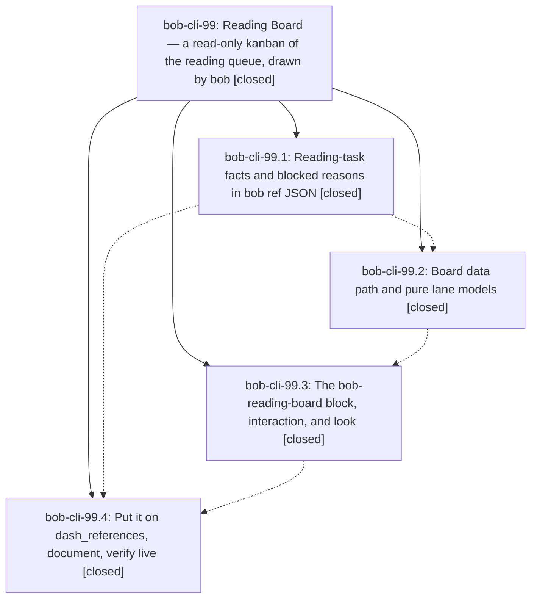

# Bead: bob-cli-99 — Reading Board — a read-only kanban of the reading queue, drawn by bob

[Bead Pages](../README.md) / bob-cli-99

**Status:** ✓ closed · **Resolution:** done · **Type:** ▸ plan · **Tier:** epic
**Owner:** `bryanbugyi34@gmail.com` · **Created by:** [bbugyi200.apollo.8z](https://github.com/bobs-org/bob-cli--agents/blob/main/sessions/bbugyi200.apollo.8z.md) · **Assignee:** `bob-cli-99.land`
**Created:** 2026-10-18 13:02:21 EDT · **Closed:** 2026-10-18 16:53:06 EDT
**Plan:** [202610/reading\_board.md](https://github.com/bobs-org/bob-cli--plans/blob/main/202610/reading_board.md)

<!-- sase:links:start -->

## Links

| Relation | Artifact | Why |
| --- | --- | --- |
| implemented-by | [plan:202610/reading_board.md][1] | derived from the plan's `bead_id:` frontmatter field |
| related | file:explicit:2ad4163e19db21052bd615c2 | attached via sase artifact create --bead |
| related | file:explicit:fcf6e006c27bd0600d8b345a | attached via sase artifact create --bead |

_Plus 1 automatic references — see [Referenced By](#referenced-by)._

[1]: https://github.com/bobs-org/bob-cli--plans/blob/main/202610/reading_board.md

<!-- sase:links:end -->

## Description

dash_references opens on a calm, read-only Reading Board (📖 Reading · ⭐ Next · 📥 Ready · 💤 Snoozed) whose lanes, wake dates, and waiting-on reasons come from `bob ref list` JSON, so the board, the terminal, and Bob Mac Capture always agree on what can be read now.

## Notes

[2026-10-18T20:09:49Z · bob-cli-99.land] LAND FOLLOW-UP TRIAGE (before remaining-work tale): Read every note on bob-cli-99.1/.2/.3/.4. Used sase_new_task, read size/type policy, searched all statuses, swept last-week tasks, inspected all active epic scopes and the relevant 87/87.13 ownership. Outcomes: (1) skipped reading-board-is-bob-rendered memory record, 99.1 #1 + 99.2 #1 + 99.3 #1 + 99.4 #4 -> bob-cli-9e, small memory, ready. Followed sase_memory_write routing; memory_board_record=no was automatic, so this is a separate review task, and no memory was edited. (2) plugin baseline failures, 99.2 #2, also in 99.3/99.4 completion notes -> +1 on bob-cli-6v (four glyph cases), bob-cli-6w (Keep notice), bob-cli-7i (reverse-conversion BLOCKS), and bob-cli-3w (ranker timing flake); no duplicates. Current clean bob-plugins 74e3d9b npm test: 3077/3084 pass, same seven failures; isolated ranker suite 23/23 passes unchanged. Artifact file:explicit:fcf6e006c27bd0600d8b345a attached to all four tasks. (3) Highlights baseline proposals, 99.1 #2 and 99.2 #3, also 99.4 completion note -> split by cause: lifted-link assertion reproduced at 47036193 and recorded as DISCOVERED ISSUE plus fresh evidence on causally responsible active epic bob-cli-87 (no new task); Mermaid text checks -> bob-cli-9i, small ci, ready. cargo test --lib diagrams_ reproduces 8 pass/2 fail; pdftotext is absent on apollo and both pdf_haystack helpers incorrectly decode compressed PDF bytes as text, explaining current lib failures and the CLI family reported by 99.2. Log file:explicit:2ad4163e19db21052bd615c2. Mermaid owner 8y is already closed; no active epic owns this helper defect. (4) Mac inspector blocked reasons, 99.4 #1 -> bob-cli-9f, medium feature, ready, related to 9d for overlapping RefsCore changes; current RefsDecoding.swift still ignores blocked_by/priority/scheduled. (5) REFERENCES tooltip split, 99.4 #2 -> bob-cli-9g, medium feature, ready; displayed Base count remains original epic scope. (6) two-week usage review, 99.4 #3 -> bob-cli-9h, small feature, snoozed until 2026-11-01T14:00:00Z, deferrable if rollout/use was delayed. (7) ask Bryan to run just install-all on MacBook/open References, 99.4 #5 -> declined as a new task: operational reminder explicitly reserved for him by the approved rollout; carry it to the final coding response. Every original proposal is accounted for; retain these outcomes in the eventual epic close note. The newly found board contract/refresh bugs remain this epic's work, not follow-up tasks.

[2026-10-18T20:10:39Z · bob-cli-99.land] LAND AUDIT at bob-cli 47036193, bob-plugins 74e3d9b, bob-mac-capture 5a0bff5: Reviewed the epic (originally no own notes), all four closed children and every note, plan:202610/reading_board.md, the original Obsidian research, epic commits b88195e7/b291f23f and plugin commits 8a0be74/74e3d9b, actual Rust row/reason/human-output code, plugin spawn/data/models/renderer/interaction/tests/CSS wiring, and Mac decoder compatibility. DECISIONS honored: PDF member/button/macOS routing implemented, human reason suffix implemented, memory_board_record=no preserved. Original implementation notes are supported except the gaps below, which were not covered by existing passing tests. No interfaces need renaming.

Integration: fetched origin twice, HEAD=origin/master. Since epic creation, reviewed Work badge changes 674c9f55/44c04e24 and plugin 1907419/6529c58; bare-x commits c166ed26/6bc432b2 preserve task status and Today semantics; intake/locking/drain/doctor commits 85eac25a/c4ac06fb/fa7745fc/5848c39d/47036193 preserve the row contract. New listen-attach intake at 5848c39d makes proper string-valued audio decoding particularly relevant. Mac 5a0bff5 Newest adds optional added_at independently and remains compatible; no board re-sort or Mac feature changes are required. Recheck further drift in the coder.

Independent verification: Rust ref_library 73/73 pass; focused board/stats/PDF JS 85/85 pass; npm validate/build check pass; full npm 3077/3084, only the seven separately triaged failures. Live read-only bob ref list returns 47 modern open rows with 2 Reading/5 Next/17 Ready/23 Snoozed, matching readingBoardModel; all 23 blocked rows carry reasons. No full Rust just check rerun in this review; that gate is required in the implementation tale. No just check-full was run.

Remaining epic work reproduced using production JS helpers/mixins: (1) audio path strings decode false; eight live audio rows become zero board audio markers. (2) readingBoardSignature omits parent/type/task locations/prerequisite identities, so an unchanged-title task move leaves the same signature and retains stale DOM/action closures. (3) background revalidation errors are discarded instead of showing the promised timestamped stale-frame lint; only manual refresh populates refreshError, and cached returns incorrectly stamp freshness. (4) an event during a same-key flight is lost: controlled-promise probe produced one spawn, dataGeneration=1/currentGeneration=1, no follow-up, though that report began at generation 0. Keep mounted-fence refresh demands and late-unload handling correct while repairing it. (5) malformed fence values type: [papers, parent: [sase, cash], parent: {note: sase} are accepted into argv with no lint, against the approved bad-values contract. (6) docs/ref.md calls the board coming and falsely says Mac Refs consumes blocked_by/task.priority/task.scheduled, while RefsDecoding.swift ignores them.

These are in-scope defects, not task follow-ups. A medium tale, sase_plan_reading_board_landing_repairs.md, has passed the required explain/edit/revalidate loop and covers only these repairs, focused regressions, integration recheck, deployment, and this epic's same-turn closeout. It must preserve the triage note outcomes, run just check (never check-full), resolve/re-key epic symbols, close bob-cli-99 normally, run symvision if available, and mark plan:202610/reading_board.md done before its host commit. Current epic-symbols is empty, current justfile has no symvision recipe, and bob-cli-99 has no parent. Leave the epic open pending that implementation.

[2026-10-18T20:53:06Z · bob-cli-99.land--2] LAND COMPLETE — Reading Board landing repairs

Delivered all six in-scope repairs in bob-ledger-tools and bob-cli. The decoder now preserves path-valued Bob audio as a presence flag; the shared fixture exercises raw JSON through decoder, model, and DOM, including null/absent audio. Render signatures now include displayed topic/type, task navigation, and prerequisite identity while generated-time-only updates stay in place. Keyed background/mount refresh results reach mounted views: failures keep the last good frame with a timestamped lint and Retry, successful recovery clears it, cached/failing results do not advance freshness, and teardown blocks late updates. Same-key invalidations/manual refreshes coalesce into a follow-up fetch tied to the generation it actually read. Fence parsing rejects malformed or wrongly typed values with lints and keeps valid options usable. docs/ref.md now describes the shipped board and accurately states that the Mac Refs inspector does not yet consume blocked_by/priority/scheduled. bob-ledger-tools was bumped to 1.55.0 with the repair description.

Integration review: fetched origin after the prior audit. bob-cli advanced from 47036193 to de78e982 and 0f47802b. de78e982 adds added_at and rename-following Git birth dates; the board ignores this additive field and remains compatible. 0f47802b is capture documentation. bob-plugins remains at 74e3d9b. The dashboard note still has the bob-reading-board fence directly above the Reading Queue Base embed. No Mac inspector or badge scope was added. Decisions honored: pdf_action=yes, human_reason=yes, memory_board_record=no; no memory file was edited.

Verification:
- npm run build completed with generated plugin output unchanged; npm run build:check and npm run validate passed (7/7 plugins).
- Reading Board data/models/block suites: 49/49 passed. Stats and navigation PDF suites: 66/66 passed.
- Full npm test: 3,085 passed, 7 failed. The same triaged baseline failures remain: four unblocked-glyph timing cases, Keep notice ordering, the 16 ms ranker timing case, and reverse BLOCKS conversion. No Reading Board test failed.
- just check exited 101. It reproduced the known Highlights baseline: the lifted-link assertion already assigned to active bob-cli-87, plus two library and five CLI Mermaid PDF-text failures because pdftotext is absent and both helpers inspect compressed PDF bytes as text. No failure was in the Reading Board changes. No check-full or install-all ran.
- Real Chromium 151 synthetic preview: 91/91 checks passed; inspected light/dark desktop, stale-error, and touch screenshots. Live JSON preview: 53/53 checks passed. Current live data has 48 refs: Reading 2, Next 5, Ready 18, Snoozed 23; all 23 blocked rows have reasons. The decoder/model turns all 8 raw audio paths into 8 audio cards. Real-title screenshots and preview files stayed in /tmp.
- bob plugins sync --help confirms --repo <DIR>. Dry run and deployment used the opened plugin checkout with --no-pull; deployment reported 0 copied, 0 skipped, 3 unchanged (already current).

All four child phase beads are closed; the epic has no parent. sase bead epic-symbols bob-cli-99 returned no entries. No just symvision recipe is available.

Follow-up triage preserved:
- The skipped reading-board decision record proposals from 99.1 #1, 99.2 #1, 99.3 #1, and 99.4 #4 map to bob-cli-9e (small memory, ready); memory_board_record=no remains honored.
- The four plugin baseline failures from 99.2 #2 and 99.3/.4 map to existing bob-cli-6v (glyph), bob-cli-6w (Keep notice), bob-cli-7i (BLOCKS conversion), and bob-cli-3w (ranker); no duplicate tasks.
- The lifted-link failure from 99.1 #2 and 99.2 #3 is recorded on causally responsible active epic bob-cli-87, not a new task. Mermaid PDF-text failure

… and 663 more characters

## Phases

| Bead | Title | Status | Size | Created | Agents | Commits |
|---|---|---|---|---|---:|---:|
| [bob-cli-99.1](bob-cli-99.1.md) | Reading-task facts and blocked reasons in bob ref JSON | ✓ closed | medium | 2026-10-18 | 1 | 1 |
| [bob-cli-99.2](bob-cli-99.2.md) | Board data path and pure lane models | ✓ closed | medium | 2026-10-18 | 1 | 1 |
| [bob-cli-99.3](bob-cli-99.3.md) | The bob-reading-board block, interaction, and look | ✓ closed | medium | 2026-10-18 | 1 | 1 |
| [bob-cli-99.4](bob-cli-99.4.md) | Put it on dash\_references, document, verify live | ✓ closed | small | 2026-10-18 | 1 | 1 |

## Lineage

## Agents

| Agent | Bead | Commits |
|---|---|---:|
| [bbugyi200.apollo.bob-cli-99.1](https://github.com/bobs-org/bob-cli--agents/blob/main/agents/bbugyi200.apollo.bob-cli-99.1/README.md) | [bob-cli-99.1](bob-cli-99.1.md) | 1 |
| [bbugyi200.apollo.bob-cli-99.2](https://github.com/bobs-org/bob-cli--agents/blob/main/sessions/bbugyi200.apollo.bob-cli-99.2.md) | [bob-cli-99.2](bob-cli-99.2.md) | 1 |
| [bbugyi200.apollo.bob-cli-99.3](https://github.com/bobs-org/bob-cli--agents/blob/main/agents/bbugyi200.apollo.bob-cli-99.3/README.md) | [bob-cli-99.3](bob-cli-99.3.md) | 1 |
| [bbugyi200.apollo.bob-cli-99.4](https://github.com/bobs-org/bob-cli--agents/blob/main/agents/bbugyi200.apollo.bob-cli-99.4/README.md) | [bob-cli-99.4](bob-cli-99.4.md) | 1 |
| [bbugyi200.apollo.bob-cli-99.land](https://github.com/bobs-org/bob-cli--agents/blob/main/sessions/bbugyi200.apollo.bob-cli-99.land.md) | [bob-cli-99](README.md) | 1 |

## Commits

| Repo | Commit | Subject | Bead | Committed |
|---|---|---|---|---|
| bob-cli | [`b88195e`](https://github.com/bobs-org/bob-cli/commit/b88195e7d5b1f40ecca031260dd32922edfc0721) | feat(ref): add blocked\_by reasons and task priority/scheduled | [bob-cli-99.1](bob-cli-99.1.md) | 2026-10-18 14:06:48 EDT |
| bob-plugins | [`bob-plugins@8a0be74`](https://github.com/bobs-org/bob-plugins/commit/8a0be74b5d590a5b3fcbb953b5b4e6fcd4086adb) | feat(reading-board): add board data and lane models | [bob-cli-99.2](bob-cli-99.2.md) | 2026-10-18 14:45:32 EDT |
| bob-plugins | [`bob-plugins@74e3d9b`](https://github.com/bobs-org/bob-plugins/commit/74e3d9bcfc913e3964c058319effc3e976e2239a) | feat(reading-board): add the bob-reading-board block, keyboard and mouse routing, and Highlights hand-off | [bob-cli-99.3](bob-cli-99.3.md) | 2026-10-18 15:23:22 EDT |
| bob-cli | [`b291f23`](https://github.com/bobs-org/bob-cli/commit/b291f23fe6e91252f8ff0a00ae0a4af2ca07bea0) | docs(ref): document the Obsidian Reading Board on dash\_references | [bob-cli-99.4](bob-cli-99.4.md) | 2026-10-18 15:52:16 EDT |
| bob-cli | [`0511bee`](https://github.com/bobs-org/bob-cli/commit/0511beed45faf25ada30186d573a4cce800f9e45) | docs(ref): clarify Reading Board consumers | [bob-cli-99](README.md) | 2026-10-18 16:55:16 EDT |

<!-- sase:referenced-by:start -->

## Referenced By

| Relation | Artifact | Why | Uses |
| --- | --- | --- | ---: |
| read-by | [agent:bob-cli-99.3][1] | Check epic notes | 1 |

[1]: https://github.com/bobs-org/bob-cli--agents/blob/main/agents/bbugyi200.apollo.bob-cli-99.3/README.md

<!-- sase:referenced-by:end -->
