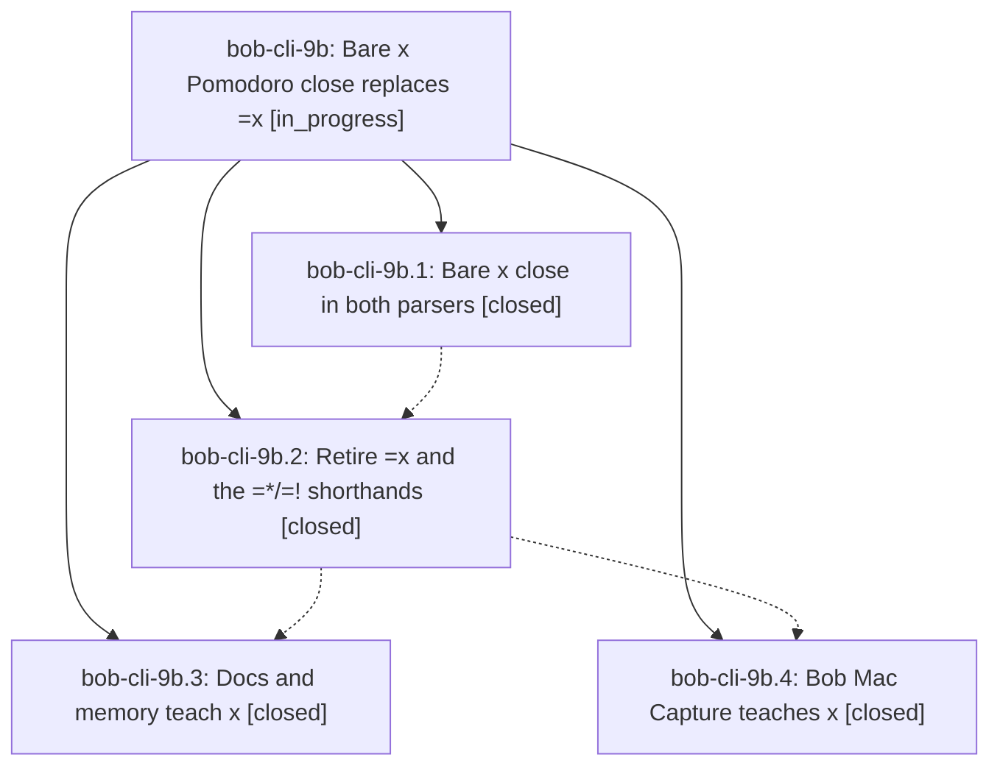

# Bead: bob-cli-9b — Bare x Pomodoro close replaces =x

[Bead Pages](../README.md) / bob-cli-9b

**Status:** ◐ in_progress · **Type:** ▸ plan · **Tier:** epic
**Owner:** `bryanbugyi34@gmail.com` · **Created by:** [bbugyi200.athena.11i](https://github.com/bobs-org/bob-cli--agents/blob/main/sessions/bbugyi200.athena.11i.md) · **Assignee:** `bob-cli-9b.land`
**Created:** 2026-10-18 14:36:55 EDT
**Plan:** [202610/bare\_x\_close.md](https://github.com/bobs-org/bob-cli--plans/blob/main/202610/bare_x_close.md)

<!-- sase:links:start -->

## Links

| Relation | Artifact | Why |
| --- | --- | --- |
| implemented-by | [plan:202610/bare_x_close.md][1] | derived from the plan's `bead_id:` frontmatter field |

_Plus 1 automatic references — see [Referenced By](#referenced-by)._

[1]: https://github.com/bobs-org/bob-cli--plans/blob/main/202610/bare_x_close.md

<!-- sase:links:end -->

## Description

Closing today's running Pomodoro takes a bare `x` token with the same selection grammar as today's `=x` (`=x2!1*3` becomes `x2!1*3`). The `=*`/`=!` shorthands are gone. bob, its docs, and Bob Mac Capture teach only the new spelling.

## Phases

| Bead | Title | Status | Size | Created | Agents | Commits |
|---|---|---|---|---|---:|---:|
| [bob-cli-9b.1](bob-cli-9b.1.md) | Bare x close in both parsers | ✓ closed | medium | 2026-10-18 | 1 | 1 |
| [bob-cli-9b.2](bob-cli-9b.2.md) | Retire =x and the =\*/=! shorthands | ✓ closed | medium | 2026-10-18 | 1 | 1 |
| [bob-cli-9b.3](bob-cli-9b.3.md) | Docs and memory teach x | ✓ closed | medium | 2026-10-18 | 1 | 1 |
| [bob-cli-9b.4](bob-cli-9b.4.md) | Bob Mac Capture teaches x | ✓ closed | medium | 2026-10-18 | 1 | 1 |

## Lineage

## Agents

| Agent | Bead | Commits |
|---|---|---:|
| [bbugyi200.athena.bob-cli-9b.1](https://github.com/bobs-org/bob-cli--agents/blob/main/sessions/bbugyi200.athena.bob-cli-9b.1.md) | [bob-cli-9b.1](bob-cli-9b.1.md) | 1 |
| [bbugyi200.athena.bob-cli-9b.2](https://github.com/bobs-org/bob-cli--agents/blob/main/agents/bbugyi200.athena.bob-cli-9b.2/README.md) | [bob-cli-9b.2](bob-cli-9b.2.md) | 1 |
| [bbugyi200.athena.bob-cli-9b.3](https://github.com/bobs-org/bob-cli--agents/blob/main/sessions/bbugyi200.athena.bob-cli-9b.3.md) | [bob-cli-9b.3](bob-cli-9b.3.md) | 1 |
| [bbugyi200.athena.bob-cli-9b.4](https://github.com/bobs-org/bob-cli--agents/blob/main/agents/bbugyi200.athena.bob-cli-9b.4/README.md) | [bob-cli-9b.4](bob-cli-9b.4.md) | 1 |
| [bbugyi200.athena.bob-cli-9b.land](https://github.com/bobs-org/bob-cli--agents/blob/main/agents/bbugyi200.athena.bob-cli-9b.land/README.md) | [bob-cli-9b](README.md) | 0 |

## Commits

| Repo | Commit | Subject | Bead | Committed |
|---|---|---|---|---|
| bob-cli | [`c166ed2`](https://github.com/bobs-org/bob-cli/commit/c166ed26326dd8b8c76428bbcf04158d920ee95f) | feat(capture): add bare x Pomodoro close | [bob-cli-9b.1](bob-cli-9b.1.md) | 2026-10-18 15:07:05 EDT |
| bob-cli | [`6bc432b`](https://github.com/bobs-org/bob-cli/commit/6bc432b297045b3f8b5dc4e866999a18848a35d9) | feat(capture)!: retire =x and the =\*/=! shorthands | [bob-cli-9b.2](bob-cli-9b.2.md) | 2026-10-18 15:51:21 EDT |
| bob-cli | [`0f47802`](https://github.com/bobs-org/bob-cli/commit/0f47802b20a6b9c1b2e4469d3ba58cd6a6e997e1) | docs(capture): teach the bare x Pomodoro close | [bob-cli-9b.3](bob-cli-9b.3.md) | 2026-10-18 16:26:27 EDT |
| bob-mac-capture | [`bob-mac-capture@2c007c7`](https://github.com/bobs-org/bob-mac-capture/commit/2c007c74c086223718fe55a61b5cdc230af890f3) | feat(capture): teach Mac Capture the bare x close | [bob-cli-9b.4](bob-cli-9b.4.md) | 2026-10-18 16:40:12 EDT |

<!-- sase:referenced-by:start -->

## Referenced By

| Relation | Artifact | Why | Uses |
| --- | --- | --- | ---: |
| read-by | [agent:bob-cli-9b.3--1][1] | Need parent epic state after docs phase closed | 1 |

[1]: https://github.com/bobs-org/bob-cli--agents/blob/main/sessions/bbugyi200.athena.bob-cli-9b.3.md

<!-- sase:referenced-by:end -->
