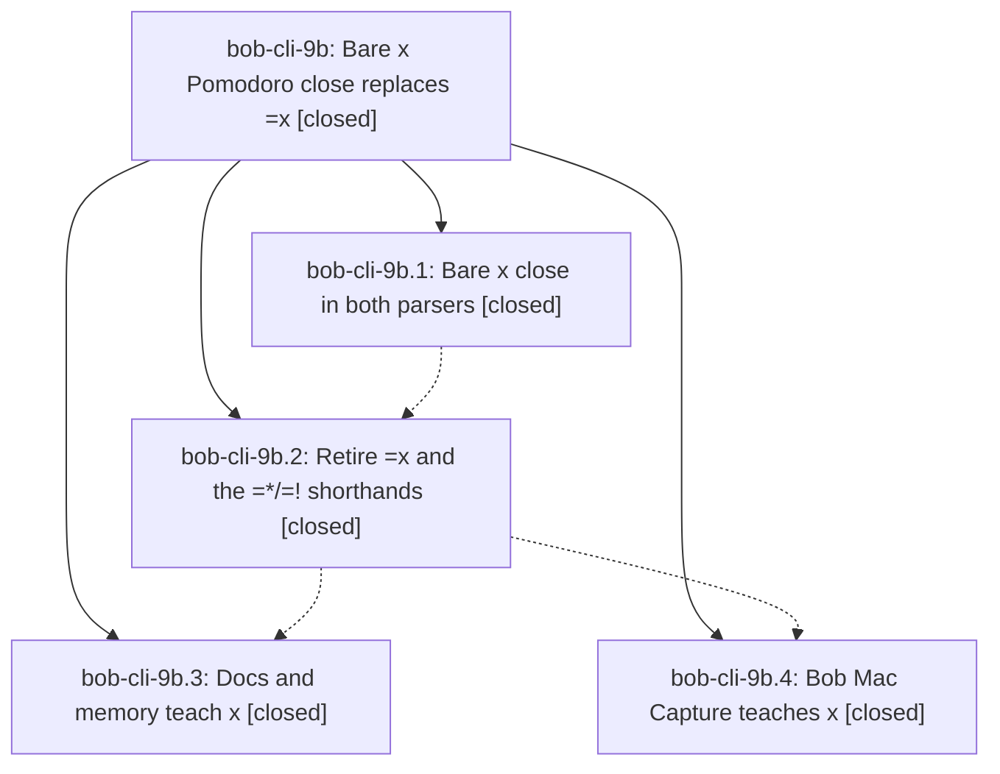

# Bead: bob-cli-9b — Bare x Pomodoro close replaces =x

[Bead Pages](../README.md) / bob-cli-9b

**Status:** ✓ closed · **Resolution:** done · **Type:** ▸ plan · **Tier:** epic
**Owner:** `bryanbugyi34@gmail.com` · **Created by:** [bbugyi200.athena.11i](https://github.com/bobs-org/bob-cli--agents/blob/main/sessions/bbugyi200.athena.11i.md) · **Assignee:** `bob-cli-9b.land`
**Created:** 2026-10-18 14:36:55 EDT · **Closed:** 2026-10-18 17:29:47 EDT
**Plan:** [202610/bare\_x\_close.md](https://github.com/bobs-org/bob-cli--plans/blob/main/202610/bare_x_close.md)

<!-- sase:links:start -->

## Links

| Relation | Artifact | Why |
| --- | --- | --- |
| implemented-by | [plan:202610/bare_x_close.md][1] | derived from the plan's `bead_id:` frontmatter field |

_Plus 1 automatic references — see [Referenced By](#referenced-by)._

[1]: https://github.com/bobs-org/bob-cli--plans/blob/main/202610/bare_x_close.md

<!-- sase:links:end -->

## Description

Closing today's running Pomodoro takes a bare `x` token with the same selection grammar as today's `=x` (`=x2!1*3` becomes `x2!1*3`). The `=*`/`=!` shorthands are gone. bob, its docs, and Bob Mac Capture teach only the new spelling.

## Notes

[2026-10-18T20:52:03Z · bob-cli-9b.land] LAND AUDIT: Read this epic and every note on all four closed children, audited plan:202610/bare_x_close.md, and reviewed bob-cli commits c166ed2 (parser), 6bc432b (retirement), 0f47802 (docs) and bob-mac-capture 2c007c7 (Mac). Source review confirms lowercase-only bare x, unchanged close selection/log/chain engine, claimed retired =x/=X/=*/=! forms, preserved =x link suffixes, unchanged JSON schema with exact raw and one-byte x spans, and Mac hint prefix selected from Bob raw. Only authorized glossary:capture and glossary:bulk-capture changed; no decision record or other memory was edited. Reviewed intervening commits 85eac25/c4ac06f/fa7745f/5848c39/4703619 (reference intake), b291f23 (Reading Board docs), de78e98 (added_at), and Mac bc6eb30/5a0bff5/7d6063a (Refs race/Newest): no feature overlap requiring bare-x integration changes found. FOLLOW-UP TRIAGE: bob-cli-9b.2 note #1 is already fulfilled by bob-cli-9b.3 and docs/capture.md retired-forms table; declined a separate task because this was in-epic handoff work already completed. Other child notes contain verification claims, no additional proposals. Separately discovered Mac CI 39164361288 on 2c007c7 passed lint/build but could not compile tests because RefsNewestTests.zone conflicts with NSObject.zone(); blame identifies 5a0bff5/bob-cli-9d.2. Used sase_new_task duplicate/sweep/active-epic workflow and recorded DISCOVERED ISSUE on active bob-cli-9d, with no duplicate task. No epic-symbol entries; justfile has no symvision recipe. Current working trees clean. Remaining landing verification: fresh just check and portable-check, then smoke current rebuilt Bob and compare Mac parse fixtures/documented errors before normal close and plan status update. target/debug/bob was stale before rebuilding; its old grammar is not evidence against current source. Named tool check is unavailable (sase tool run check reports unknown tool), so use SASE_TOOL_BYPASS with the raw gate.

[2026-10-18T21:10:07Z · bob-cli-9b.land--1] LANDING UPDATE / REMAINDER: monitor bdtdhceyyt3f completed exit 0: just check and linked Mac portable-check (1,369 tests). Rebuilt target/debug/bob explicitly; scratch dry-run x1!2, capture-parse x2, all 17 documented retired/near-miss errors in both editor/execution, 16 uppercase/prose cases, preserved link/task =x suffixes, and unchanged dry-run vault bytes all passed. Among 36 changed Mac parser fixtures, 33 exactly match live Bob; three are epic-caused stale offsets, not context variation: pomodoro-start-drop-parse-chain.json (x =~2), pomodoro-start-named-parse-chain-query.json (x =#de), pomodoro-start-named-parse-chain.json (x =#bugs). In each, close span/range is still [0,2] rather than [0,1], and subsequent ranges are one byte too far right. Related pomodoro-start-named-complete-chain-query.json and two test assertions still expect replacement [5,7] for x =#de; live capture-complete --cursor 6 returns [4,6]. All introduced or exposed by 2c007c7/9b.4. Epic remains open; authoring a small tale to fix these fixtures/expectations, verify, and finish this landing. Refreshed remote review adds 0511bee and 2a11d05 (reference docs/test data/comment changes): no bare-x integration changes needed; Mac origin/master remains 2c007c7. FOLLOW-UP TRIAGE COMPLETE: 9b.2 note #1 exact-message docs proposal is fulfilled by 9b.3 and now verified against all 17 table rows; declined separate task as completed in-epic work. No other child proposals. Previously discovered unrelated macOS CI 39164361288 RefsNewestTests.zone compile failure remains attached via sase_new_task to active bob-cli-9d (caused by 5a0bff5/9d.2), no duplicate task. The fixture remainder is epic work, not a new task.

[2026-10-18T21:29:47Z · bob-cli-9b.land--1] Completed the epic-caused fixture remainder from Mac commit 2c007c7 after integration review of bob-cli commits c166ed2, 6bc432b, 0f47802 and refreshed base commits 0511bee/2a11d05; no additional bare-x drift was present. Corrected all three chain parser fixtures from current built Bob, fixed the x =#de completion replacement to [4,6], corrected both Swift assertions, and added byte-range selection plus replacement-application coverage. All 36 parser fixtures changed by 2c007c7 now match current capture-parse JSON exactly; live capture-complete confirms [4,6]. Fresh SASE_TOOL_BYPASS just check passed: 2,950 unit tests, 1,814 CLI tests, one ignored. Mac portable-check passed 1,369 tests. A scratch Mac release bundle and just typecheck-tests both passed; the Mac typecheck used its XCTest stub, so no macOS XCTest run is claimed. Known unrelated CI failure 39164361288 (RefsNewestTests.zone, from bob-cli-9d.2) remains attached to active bob-cli-9d and was not duplicated. Follow-up bob-cli-9b.2 note #1 exact-message docs proposal was fulfilled by 9b.3 and verified against all 17 messages, so no separate task was filed; other child notes have no proposals. Fixture correction was completed in-epic work, not a follow-up. No epic symbols remain. just symvision availability will be checked after close.

## Phases

| Bead | Title | Status | Size | Created | Agents | Commits |
|---|---|---|---|---|---:|---:|
| [bob-cli-9b.1](bob-cli-9b.1.md) | Bare x close in both parsers | ✓ closed | medium | 2026-10-18 | 1 | 1 |
| [bob-cli-9b.2](bob-cli-9b.2.md) | Retire =x and the =\*/=! shorthands | ✓ closed | medium | 2026-10-18 | 1 | 1 |
| [bob-cli-9b.3](bob-cli-9b.3.md) | Docs and memory teach x | ✓ closed | medium | 2026-10-18 | 1 | 1 |
| [bob-cli-9b.4](bob-cli-9b.4.md) | Bob Mac Capture teaches x | ✓ closed | medium | 2026-10-18 | 1 | 1 |

## Lineage

## Agents

| Agent | Bead | Commits |
|---|---|---:|
| [bbugyi200.athena.bob-cli-9b.1](https://github.com/bobs-org/bob-cli--agents/blob/main/sessions/bbugyi200.athena.bob-cli-9b.1.md) | [bob-cli-9b.1](bob-cli-9b.1.md) | 1 |
| [bbugyi200.athena.bob-cli-9b.2](https://github.com/bobs-org/bob-cli--agents/blob/main/agents/bbugyi200.athena.bob-cli-9b.2/README.md) | [bob-cli-9b.2](bob-cli-9b.2.md) | 1 |
| [bbugyi200.athena.bob-cli-9b.3](https://github.com/bobs-org/bob-cli--agents/blob/main/sessions/bbugyi200.athena.bob-cli-9b.3.md) | [bob-cli-9b.3](bob-cli-9b.3.md) | 1 |
| [bbugyi200.athena.bob-cli-9b.4](https://github.com/bobs-org/bob-cli--agents/blob/main/agents/bbugyi200.athena.bob-cli-9b.4/README.md) | [bob-cli-9b.4](bob-cli-9b.4.md) | 1 |
| [bbugyi200.athena.bob-cli-9b.land](https://github.com/bobs-org/bob-cli--agents/blob/main/sessions/bbugyi200.athena.bob-cli-9b.land.md) | [bob-cli-9b](README.md) | 0 |
| [bbugyi200.athena.bob-cli-9b.land--1--code](https://github.com/bobs-org/bob-cli--agents/blob/main/agents/bbugyi200.athena.bob-cli-9b.land--1--code/README.md) | [bob-cli-9b](README.md) | 2 |

## Commits

| Repo | Commit | Subject | Bead | Committed |
|---|---|---|---|---|
| bob-cli | [`c166ed2`](https://github.com/bobs-org/bob-cli/commit/c166ed26326dd8b8c76428bbcf04158d920ee95f) | feat(capture): add bare x Pomodoro close | [bob-cli-9b.1](bob-cli-9b.1.md) | 2026-10-18 15:07:05 EDT |
| bob-cli | [`6bc432b`](https://github.com/bobs-org/bob-cli/commit/6bc432b297045b3f8b5dc4e866999a18848a35d9) | feat(capture)!: retire =x and the =\*/=! shorthands | [bob-cli-9b.2](bob-cli-9b.2.md) | 2026-10-18 15:51:21 EDT |
| bob-cli | [`0f47802`](https://github.com/bobs-org/bob-cli/commit/0f47802b20a6b9c1b2e4469d3ba58cd6a6e997e1) | docs(capture): teach the bare x Pomodoro close | [bob-cli-9b.3](bob-cli-9b.3.md) | 2026-10-18 16:26:27 EDT |
| bob-mac-capture | [`bob-mac-capture@2c007c7`](https://github.com/bobs-org/bob-mac-capture/commit/2c007c74c086223718fe55a61b5cdc230af890f3) | feat(capture): teach Mac Capture the bare x close | [bob-cli-9b.4](bob-cli-9b.4.md) | 2026-10-18 16:40:12 EDT |
| bob-mac-capture | [`bob-mac-capture@6166ec1`](https://github.com/bobs-org/bob-mac-capture/commit/6166ec100bee4b0923e5ea4912342e63643f991b) | test(capture): correct bare-x chain fixtures | [bob-cli-9b](README.md) | 2026-10-18 17:30:26 EDT |
| bob-cli--plans | [`bob-cli--plans@0f12e2b`](https://github.com/bobs-org/bob-cli--plans/commit/0f12e2bc8aeb408fc5c1b060b98847cf9f5bd6a0) | docs(plan): mark bare-x closeout complete | [bob-cli-9b](README.md) | 2026-10-18 17:31:17 EDT |

<!-- sase:referenced-by:start -->

## Referenced By

| Relation | Artifact | Why | Uses |
| --- | --- | --- | ---: |
| read-by | [agent:bob-cli-9b.3--1][1] | Need parent epic state after docs phase closed | 1 |

[1]: https://github.com/bobs-org/bob-cli--agents/blob/main/sessions/bbugyi200.athena.bob-cli-9b.3.md

<!-- sase:referenced-by:end -->
